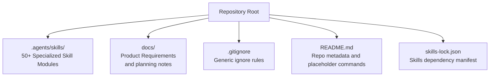
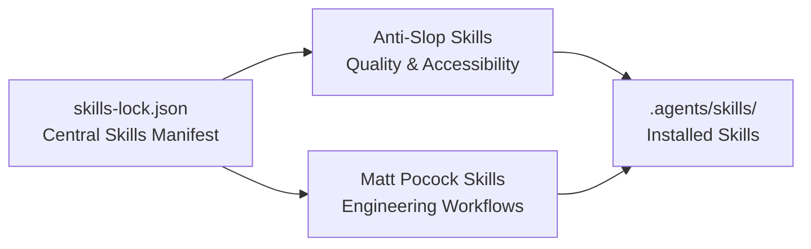
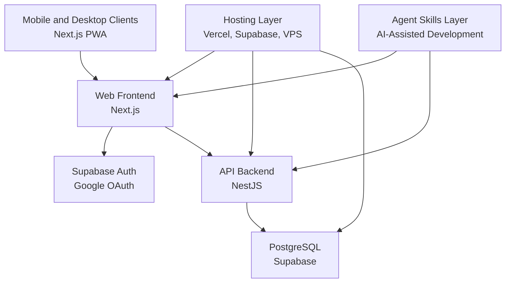
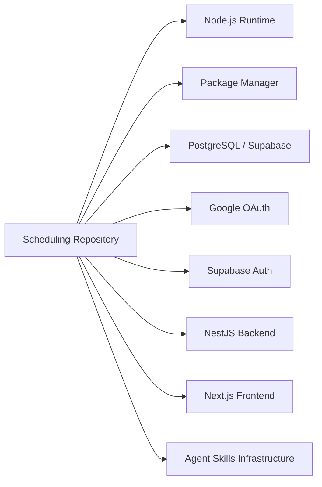

# Development Setup Guide

<cite>
**Referenced Files in This Document**
- [README.md](file://README.md)
- [skills-lock.json](file://skills-lock.json)
- [.gitignore](file://.gitignore)
- [PRD-Aplikasi-Penjadwalan-Shift-Kyne.md](file://docs/PRD-Aplikasi-Penjadwalan-Shift-Kyne.md)
- [SKILL.md](file://.agents/skills/antislop/SKILL.md)
- [SKILL.md](file://.agents/skills/antislop-human/SKILL.md)
- [SKILL.md](file://.agents/skills/setup-matt-pocock-skills/SKILL.md)
</cite>

## Update Summary
**Changes Made**
- Added comprehensive Agent Skills Infrastructure section documenting the 50+ specialized skill modules
- Updated Project Structure to include the new `.agents/skills/` directory layout
- Enhanced Environment Preparation with agent skills setup requirements
- Added new sections for Agent Skills Management and AI-Assisted Development Workflow
- Updated Troubleshooting Guide with agent skills-specific issues
- Expanded Contributing Guidelines to include agent skills contribution standards

## Table of Contents
1. [Introduction](#introduction)
2. [Project Structure](#project-structure)
3. [Agent Skills Infrastructure](#agent-skills-infrastructure)
4. [Core Components](#core-components)
5. [Architecture Overview](#architecture-overview)
6. [Detailed Component Analysis](#detailed-component-analysis)
7. [Dependency Analysis](#dependency-analysis)
8. [Performance Considerations](#performance-considerations)
9. [Troubleshooting Guide](#troubleshooting-guide)
10. [Conclusion](#conclusion)
11. [Appendices](#appendices)

## Introduction
This guide helps you prepare the development environment for the Kyne shift scheduling application. At this stage, the repository is a scaffold with no application code yet, but it now includes an extensive agent skills infrastructure with 50+ specialized skill modules designed to enhance AI-assisted development workflows.

The product is a standalone PWA that will eventually live alongside an ERP monorepo. For now, treat this repo as the future home of the web frontend, API, shared packages, database schema, and deployment configuration once the stack is finalized.

**Updated**: The repository now includes a comprehensive system of agent skills from miqdadbadjuber/anti-slop and mattpocock/skills repositories, providing antislop protection mechanisms, engineering workflows, productivity tools, and accessibility-focused capabilities with WCAG compliance references.

**Section sources**
- [README.md:1-25](file://README.md#L1-L25)
- [PRD-Aplikasi-Penjadwalan-Shift-Kyne.md:1-10](file://docs/PRD-Aplikasi-Penjadwalan-Shift-Kyne.md#L1-L10)

## Project Structure
Currently, the repository contains documentation, a generic `.gitignore`, and an extensive agent skills infrastructure. The expected future layout is described in the Product Requirements Document (PRD).

**Diagram sources**
- [README.md:1-25](file://README.md#L1-L25)
- [PRD-Aplikasi-Penjadwalan-Shift-Kyne.md:230-241](file://docs/PRD-Aplikasi-Penjadwalan-Shift-Kyne.md#L230-L241)
- [.gitignore:1-34](file://.gitignore#L1-L34)
- [skills-lock.json:1-270](file://skills-lock.json#L1-L270)

**Section sources**
- [README.md:22-25](file://README.md#L22-L25)
- [PRD-Aplikasi-Penjadwalan-Shift-Kyne.md:230-241](file://docs/PRD-Aplikasi-Penjadwalan-Shift-Kyne.md#L230-L241)

## Agent Skills Infrastructure

### Overview
The repository includes a comprehensive agent skills infrastructure consisting of 50+ specialized skill modules organized into two main categories:

1. **Anti-Slop Skills** (from miqdadbadjuber/anti-slop): Core quality assurance and design anti-pattern prevention
2. **Matt Pocock Skills** (from mattpocock/skills): Engineering workflows, productivity tools, and development best practices

### Anti-Slop Protection System
The anti-slop system provides comprehensive protection against generic AI-generated code patterns through multiple specialized modules:

#### Core Anti-Slop Modules
- **antislop**: Core filter and rules engine for preventing AI slop patterns
- **antislop-code**: Code-specific anti-slop protection with programming language awareness
- **antislop-copywriting**: Copywriting and content quality enforcement
- **antislop-human**: Human-centered accessibility and usability guidelines
- **antislop-layoutmobile**: Mobile-first responsive design patterns
- **antislop-ui**: User interface design principles and anti-patterns

#### Key Features
- **WCAG Compliance**: Built-in accessibility standards with contrast checking tools
- **Design Quality Gates**: Automated checks for design consistency and purpose-driven decisions
- **Pattern Recognition**: Detection of common AI-generated design anti-patterns
- **Human-Centered Design**: Focus on real user needs and accessibility requirements

**Section sources**
- [SKILL.md:1-701](file://.agents/skills/antislop/SKILL.md#L1-L701)
- [SKILL.md:1-205](file://.agents/skills/antislop-human/SKILL.md#L1-L205)

### Engineering Workflow Skills
The Matt Pocock skills provide structured engineering workflows and productivity enhancements:

#### Development Lifecycle Skills
- **code-review**: Structured code review processes and checklists
- **implement**: Implementation guidance and best practices
- **prototype**: Rapid prototyping methodologies
- **research**: Research-driven development approaches
- **tdd**: Test-driven development workflows

#### Project Management Skills
- **triage**: Issue triage and prioritization systems
- **domain-modeling**: Domain-driven design and modeling
- **to-spec**: Specification writing and management
- **to-tickets**: Ticket creation and management workflows

#### Productivity Enhancement Skills
- **grilling**: Critical thinking and problem-solving techniques
- **teach**: Knowledge sharing and documentation practices
- **handoff**: Smooth project handoff procedures
- **retro**: Retrospective facilitation and improvement cycles

**Section sources**
- [SKILL.md:1-121](file://.agents/skills/setup-matt-pocock-skills/SKILL.md#L1-L121)
- [skills-lock.json:40-267](file://skills-lock.json#L40-L267)

### Skills Management
The skills are managed through a centralized lock file (`skills-lock.json`) that tracks:
- Source repositories (miqdadbadjuber/anti-slop, mattpocock/skills)
- Skill paths and computed hashes for integrity verification
- Version control and update mechanisms

**Diagram sources**
- [skills-lock.json:1-270](file://skills-lock.json#L1-L270)

**Section sources**
- [skills-lock.json:1-270](file://skills-lock.json#L1-L270)

## Core Components
Until the technology stack is implemented, think of "components" as the areas you must prepare on your machine:

- Node.js runtime and package manager
- PostgreSQL database server
- Google Cloud Console account for authentication
- Supabase project for Auth and Database
- Local development tools such as Docker or PM2 for running NestJS later
- Editor settings aligned with the PRD's monorepo expectations
- **Agent skills environment** for AI-assisted development workflows

### Environment Preparation
Prepare these before any code is added:

1. Install Node.js using the version recommended by the final stack.
2. Install a modern package manager: npm, yarn, pnpm, or Bun.
3. Install PostgreSQL locally or use a managed service.
4. Create a Google Cloud project and enable Google Sign-In.
5. Create a Supabase project and configure Google OAuth.
6. Prepare environment variables for local development.
7. Verify that your browser can open links from WhatsApp without blocking login flows.
8. **Set up agent skills environment** for AI-assisted development workflows.

**Updated**: Added agent skills environment setup to support the comprehensive skill infrastructure.

**Section sources**
- [PRD-Aplikasi-Penjadwalan-Shift-Kyne.md:230-241](file://docs/PRD-Aplikasi-Penjadwalan-Shift-Kyne.md#L230-L241)
- [PRD-Aplikasi-Penjadwalan-Shift-Kyne.md:218-228](file://docs/PRD-Aplikasi-Penjadwalan-Shift-Kyne.md#L218-L228)

### Required Tools Installation
| Tool | Purpose | Notes |
|---|---|---|
| Node.js | Runtime for Next.js and NestJS | Use a stable LTS release unless the stack pins another version |
| Package manager | Dependency management | Choose one tool consistently across the monorepo |
| PostgreSQL | Application database | Store dates and times carefully; timezone handling matters |
| Supabase | Auth and managed Postgres | Used for Google login and database access via Prisma |
| Google Cloud Console | Google OAuth client configuration | Configure redirect URIs for local and production URLs |
| Docker or PM2 | Backend process management | VPS hosting plan mentions Docker or PM2 |
| Reverse proxy | HTTPS termination | Caddy or Nginx is mentioned for production |
| Browser testing tools | Validate PWA and mobile behavior | Test on Android Chrome and iPhone Safari |
| **Agent skills CLI** | Manage and run specialized skills | Supports npx-based skill installation and updates |

**Updated**: Added agent skills CLI to the required tools table.

**Section sources**
- [PRD-Aplikasi-Penjadwalan-Shift-Kyne.md:230-241](file://docs/PRD-Aplikasi-Penjadwalan-Shift-Kyne.md#L230-L241)
- [PRD-Aplikasi-Penjadwalan-Shift-Kyne.md:218-228](file://docs/PRD-Aplikasi-Penjadwalan-Shift-Kyne.md#L218-L228)

### Initial Project Configuration
When the stack is finalized, create these configuration artifacts:

- `.env.example` with all required keys
- `.env.local` for secrets that should never be committed
- Database connection string pointing to local or test PostgreSQL
- Supabase URL and anonymous/public keys if needed
- Google OAuth client ID and secret for local development
- Timezone setting for Asia/Makassar
- Frontend base URL and backend API URL
- Feature flags for probation request behavior and deadlines
- **Agent skills configuration** for customizing skill behavior and preferences

The existing `.gitignore` already excludes environment files, dependency folders, build outputs, logs, editor-specific files, and private key files. Keep this pattern when adding framework-specific ignores.

**Updated**: Added agent skills configuration to the initial project setup requirements.

**Section sources**
- [.gitignore:1-34](file://.gitignore#L1-L34)
- [PRD-Aplikasi-Penjadwalan-Shift-Kyne.md:218-228](file://docs/PRD-Aplikasi-Penjadwalan-Shift-Kyne.md#L218-L228)

## Architecture Overview
The planned architecture follows a monorepo structure similar to the ERP system. The frontend will be a Next.js PWA, the backend will be NestJS, and data will be stored in PostgreSQL through Supabase and accessed via Prisma. Authentication uses Supabase Auth with Google sign-in and PKCE redirect.

**Updated**: Added Agent Skills Layer to show how AI-assisted development integrates with the overall architecture.

**Diagram sources**
- [PRD-Aplikasi-Penjadwalan-Shift-Kyne.md:230-241](file://docs/PRD-Aplikasi-Penjadwalan-Shift-Kyne.md#L230-L241)

## Detailed Component Analysis

### Repository Metadata and Placeholder Commands
The README identifies this as a new repository with no code yet. It also reserves placeholder command blocks for dependencies, development server, and tests. Treat these as placeholders until the stack is defined.

Key points:
- Remote repository URL is documented.
- Main branch is `main`.
- Getting started section is intentionally empty until stack selection.
- Layout section warns that directory structure is not set yet.

**Section sources**
- [README.md:1-25](file://README.md#L1-L25)

### Product Requirements and Stack Intent
The PRD defines roles, business rules, weekly scheduling flow, functional modules, data model draft, non-functional requirements, and the target stack. It also documents security rules, hosting plans, and timeline expectations.

Important setup implications:
- Google login with email whitelist is mandatory.
- Timezone is Asia/Makassar.
- Mobile-first PWA behavior must work on Android and iPhone.
- Database schema should use UUIDs, timestamps, soft deletes, and audit fields.
- Backend runs on a VPS with Docker or PM2 and reverse proxy.

**Section sources**
- [PRD-Aplikasi-Penjadwalan-Shift-Kyne.md:27-66](file://docs/PRD-Aplikasi-Penjadwalan-Shift-Kyne.md#L27-L66)
- [PRD-Aplikasi-Penjadwalan-Shift-Kyne.md:73-100](file://docs/PRD-Aplikasi-Penjadwalan-Shift-Kyne.md#L73-L100)
- [PRD-Aplikasi-Penjadwalan-Shift-Kyne.md:102-195](file://docs/PRD-Aplikasi-Penjadwalan-Shift-Kyne.md#L102-L195)
- [PRD-Aplikasi-Penjadwalan-Shift-Kyne.md:197-217](file://docs/PRD-Aplikasi-Penjadwalan-Shift-Kyne.md#L197-L217)
- [PRD-Aplikasi-Penjadwalan-Shift-Kyne.md:218-248](file://docs/PRD-Aplikasi-Penjadwalan-Shift-Kyne.md#L218-L248)
- [PRD-Aplikasi-Penjadwalan-Shift-Kyne.md:250-267](file://docs/PRD-Aplikasi-Penjadwalan-Shift-Kyne.md#L250-L267)

### Branch Management Strategy
At this time:
- The main branch is `main`.
- No feature branches are defined yet.
- Once implementation starts, adopt a branching strategy consistent with the ERP monorepo.

Recommended approach after stack selection:
- Use short-lived feature branches named after features or fixes.
- Require pull requests before merging into `main`.
- Protect `main` with required reviews and status checks.
- Tag releases when MVP milestones are reached.

**Section sources**
- [README.md:7-11](file://README.md#L7-L11)

### Contributing Guidelines and Development Workflow
Because this is a scaffold, formal contributing guidelines are not present yet. Until they are added, follow these safe defaults:

- Do not commit secrets or `.env` files.
- Keep changes small and focused.
- Write clear commit messages describing what changed and why.
- Update documentation when changing setup steps.
- Test Google login flows early because opening links from WhatsApp is a known risk.
- Follow the PRD's security rules: whitelist emails at the backend, enforce role-based access, and rely on server-side validation.
- **Use agent skills responsibly**: Leverage the antislop skills for code quality and the engineering skills for structured development workflows.
- **Respect accessibility standards**: Apply WCAG guidelines from the antislop-human skill when building UI components.

**Updated**: Added guidelines for responsible use of agent skills and accessibility standards.

**Section sources**
- [PRD-Aplikasi-Penjadwalan-Shift-Kyne.md:243-248](file://docs/PRD-Aplikasi-Penjadwalan-Shift-Kyne.md#L243-L248)
- [PRD-Aplikasi-Penjadwalan-Shift-Kyne.md:250-267](file://docs/PRD-Aplikasi-Penjadwalan-Shift-Kyne.md#L250-L267)

## Dependency Analysis
At this stage, there are no application dependencies. The repository depends conceptually on external services and tools described in the PRD, plus the agent skills infrastructure.

**Updated**: Added Agent Skills Infrastructure to the dependency graph.

**Diagram sources**
- [PRD-Aplikasi-Penjadwalan-Shift-Kyne.md:230-241](file://docs/PRD-Aplikasi-Penjadwalan-Shift-Kyne.md#L230-L241)
- [skills-lock.json:1-270](file://skills-lock.json#L1-L270)

**Section sources**
- [PRD-Aplikasi-Penjadwalan-Shift-Kyne.md:230-241](file://docs/PRD-Aplikasi-Penjadwalan-Shift-Kyne.md#L230-L241)
- [skills-lock.json:1-270](file://skills-lock.json#L1-L270)

## Performance Considerations
These are general recommendations until implementation begins:

- Prefer server-side validation and authorization.
- Avoid storing redundant time data; calculate hours from shift definitions.
- Handle timezone conversions explicitly around Asia/Makassar.
- Cache read-heavy dashboard data where appropriate.
- Monitor database queries once Prisma is configured.
- Keep PWA assets optimized for mobile networks.
- **Optimize agent skills usage**: Use skills selectively to avoid performance overhead during development.
- **Apply antislop performance guidelines**: Follow R-40 performance mechanisms for optimal loading and rendering.

**Updated**: Added considerations for agent skills performance and antislop performance guidelines.

## Troubleshooting Guide

### Common Setup Issues
| Problem | Likely Cause | Resolution |
|---|---|---|
| Cannot run commands from README | Placeholder script blocks are not implemented yet | Wait for stack definition; do not expect working scripts now |
| Secrets accidentally committed | Missing `.env` exclusion | Remove secrets from history and rotate them immediately |
| Google login fails from WhatsApp link | In-app browser restrictions | Open in Chrome or Safari, or install the PWA first |
| Login works but user is rejected | Email not whitelisted in backend | Add the user's email to the employee whitelist |
| Time-related bugs | Wrong timezone handling | Ensure WITA timezone is used for deadlines and shift times |
| Database connection fails | Incorrect credentials or network access | Verify connection string, permissions, and firewall rules |
| Build output pollutes repository | Missing ignore rules | Extend `.gitignore` for framework-specific outputs |
| **Agent skills not loading** | Skills not properly installed or configured | Check skills-lock.json and reinstall skills using npx |
| **Antislop rules not applying** | Mode not properly configured | Run antislop mode selection or check global preferences |
| **Accessibility violations** | WCAG guidelines not followed | Use antislop-human skill and contrast checker tools |

**Updated**: Added troubleshooting entries for agent skills and antislop-related issues.

**Section sources**
- [README.md:12-20](file://README.md#L12-L20)
- [.gitignore:1-34](file://.gitignore#L1-L34)
- [PRD-Aplikasi-Penjadwalan-Shift-Kyne.md:218-228](file://docs/PRD-Aplikasi-Penjadwalan-Shift-Kyne.md#L218-L228)
- [PRD-Aplikasi-Penjadwalan-Shift-Kyne.md:243-248](file://docs/PRD-Aplikasi-Penjadwalan-Shift-Kyne.md#L243-L248)

### Environment Configuration Checklist
Before starting development:

- Confirm Node.js and package manager versions.
- Confirm PostgreSQL is reachable locally or remotely.
- Confirm Supabase project exists and is initialized.
- Configure Google OAuth client with correct redirect URIs.
- Populate `.env.local` with secrets.
- Verify `.env.example` lists every required variable.
- Test login from a normal browser and from WhatsApp links.
- Validate that timezone handling uses Asia/Makassar.
- **Verify agent skills installation**: Check that skills-lock.json is valid and skills are accessible.
- **Test antislop functionality**: Ensure antislop rules are active and accessibility checks are working.

**Updated**: Added agent skills and antislop verification to the environment checklist.

**Section sources**
- [PRD-Aplikasi-Penjadwalan-Shift-Kyne.md:230-241](file://docs/PRD-Aplikasi-Penjadwalan-Shift-Kyne.md#L230-L241)
- [PRD-Aplikasi-Penjadwalan-Shift-Kyne.md:218-228](file://docs/PRD-Aplikasi-Penjadwalan-Shift-Kyne.md#L218-L228)

## Conclusion
This repository is currently a scaffold. Your immediate task is to prepare the development environment, align with the intended stack, and follow safe contribution practices. When the stack is finalized, replace placeholder commands with real installation, build, test, and deployment instructions. Until then, focus on environment readiness, secure configuration, and understanding the product requirements.

**Updated**: The repository now includes a powerful agent skills infrastructure that can significantly enhance your development workflow. Leverage the antislop skills for quality assurance and the engineering skills for structured development practices while maintaining focus on accessibility and user experience.

## Appendices

### Expected Future Directory Layout
Once the stack is selected, expect something like:

- `web/` — Next.js PWA frontend
- `api/` — NestJS backend
- Shared packages for types and validation
- Database migrations and seed data
- Deployment configuration for Vercel, Supabase, and VPS

**Section sources**
- [PRD-Aplikasi-Penjadwalan-Shift-Kyne.md:230-241](file://docs/PRD-Aplikasi-Penjadwalan-Shift-Kyne.md#L230-L241)

### Agent Skills Quick Reference
For quick reference to the most important agent skills:

#### Essential Anti-Slop Skills
- **antislop**: Core quality filter - always load first
- **antislop-human**: Accessibility and human-centered design
- **antislop-ui**: UI design patterns and anti-patterns

#### Essential Engineering Skills  
- **setup-matt-pocock-skills**: Initialize engineering workflow configuration
- **code-review**: Structured code review processes
- **tdd**: Test-driven development workflows

#### Productivity Skills
- **grilling**: Critical thinking and problem-solving
- **triage**: Issue management and prioritization
- **handoff**: Project handoff procedures

**Section sources**
- [SKILL.md:1-701](file://.agents/skills/antislop/SKILL.md#L1-L701)
- [SKILL.md:1-121](file://.agents/skills/setup-matt-pocock-skills/SKILL.md#L1-L121)
- [skills-lock.json:1-270](file://skills-lock.json#L1-L270)