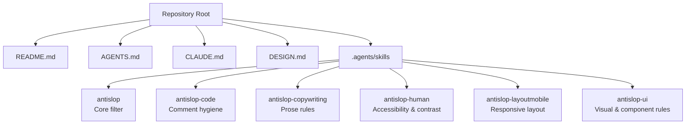
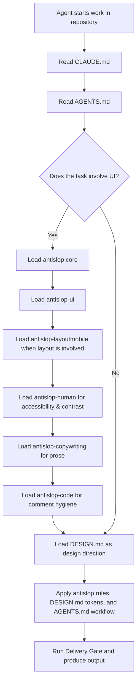
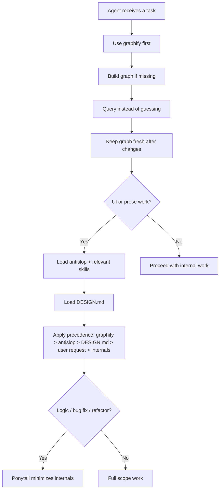
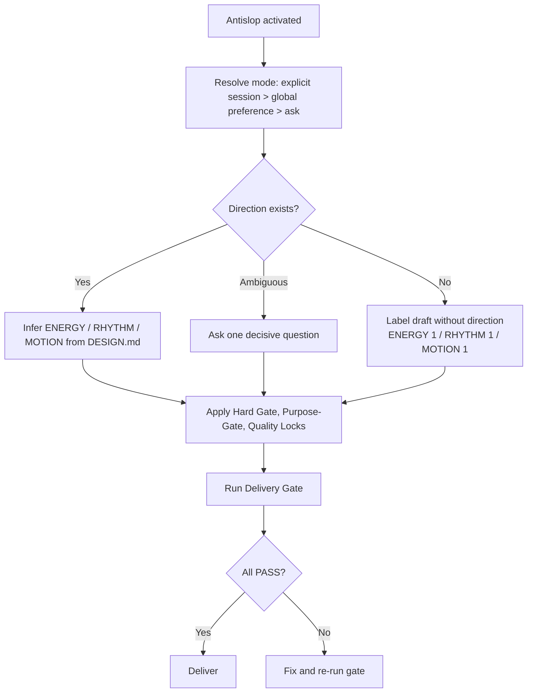
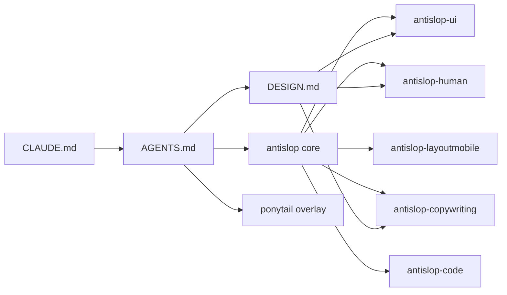

# Agent Configuration Framework

<cite>
**Referenced Files in This Document**
- [README.md](file://README.md)
- [AGENTS.md](file://AGENTS.md)
- [CLAUDE.md](file://CLAUDE.md)
- [DESIGN.md](file://DESIGN.md)
- [antislop SKILL.md](file://.agents/skills/antislop/SKILL.md)
- [antislop-code SKILL.md](file://.agents/skills/antislop-code/SKILL.md)
- [antislop-copywriting SKILL.md](file://.agents/skills/antislop-copywriting/SKILL.md)
- [antislop-human SKILL.md](file://.agents/skills/antislop-human/SKILL.md)
- [antislop-layoutmobile SKILL.md](file://.agents/skills/antislop-layoutmobile/SKILL.md)
- [antislop-ui SKILL.md](file://.agents/skills/antislop-ui/SKILL.md)
</cite>

## Table of Contents
1. [Introduction](#introduction)
2. [Project Structure](#project-structure)
3. [Core Components](#core-components)
4. [Architecture Overview](#architecture-overview)
5. [Detailed Component Analysis](#detailed-component-analysis)
6. [Dependency Analysis](#dependency-analysis)
7. [Performance Considerations](#performance-considerations)
8. [Troubleshooting Guide](#troubleshooting-guide)
9. [Conclusion](#conclusion)

## Introduction
This document explains the agent configuration framework used by this repository. The project itself is a new scaffolding for a standalone scheduling application and currently contains no application code; its active surface is the agent-facing configuration: rules, skills, design direction, and workflow instructions.

The framework has two layers:
- **Repository-level configuration:** `AGENTS.md`, `CLAUDE.md`, `DESIGN.md`, and `README.md` define how agents should work in this repo.
- **Skill-layer configuration:** the `.agents/skills` directory holds reusable skill definitions that extend behavior for UI, copy, code comments, accessibility, mobile layout, and general anti-slop filtering.

The result is not a runtime system but an operational contract between human contributors and AI agents working inside this repository.

**Section sources**
- [README.md:1-25](file://README.md#L1-L25)
- [AGENTS.md:1-45](file://AGENTS.md#L1-L45)
- [CLAUDE.md:1-4](file://CLAUDE.md#L1-L4)

## Project Structure
At a high level, the repository organizes agent configuration around four concerns:

| Concern | Primary Location | Purpose |
|---|---|---|
| Repository entry point | `README.md` | States that the project is a new scaffold with no implementation yet |
| Agent workflow rules | `AGENTS.md` | Defines issue tracking, triage labels, domain docs, graphify, antislop, DESIGN.md precedence, and ponytail overlay |
| Agent routing hint | `CLAUDE.md` | Points to `AGENTS.md` as the authoritative agent instructions file |
| Design system | `DESIGN.md` | Declares Apple-inspired visual tokens, components, spacing, typography, and iteration rules |
| Skill definitions | `.agents/skills/*/SKILL.md` | Encapsulates reusable agent behaviors such as anti-slop filtering, copy hygiene, accessibility, mobile layout, and UI standards |

**Diagram sources**
- [README.md:1-25](file://README.md#L1-L25)
- [AGENTS.md:1-45](file://AGENTS.md#L1-L45)
- [CLAUDE.md:1-4](file://CLAUDE.md#L1-L4)
- [DESIGN.md:1-563](file://DESIGN.md#L1-L563)
- [antislop SKILL.md:1-701](file://.agents/skills/antislop/SKILL.md#L1-L701)
- [antislop-code SKILL.md:1-129](file://.agents/skills/antislop-code/SKILL.md#L1-L129)
- [antislop-copywriting SKILL.md:1-408](file://.agents/skills/antislop-copywriting/SKILL.md#L1-L408)
- [antislop-human SKILL.md:1-205](file://.agents/skills/antislop-human/SKILL.md#L1-L205)
- [antislop-layoutmobile SKILL.md:1-171](file://.agents/skills/antislop-layoutmobile/SKILL.md#L1-L171)
- [antislop-ui SKILL.md:1-345](file://.agents/skills/antislop-ui/SKILL.md#L1-L345)

**Section sources**
- [README.md:1-25](file://README.md#L1-L25)
- [AGENTS.md:1-45](file://AGENTS.md#L1-L45)
- [CLAUDE.md:1-4](file://CLAUDE.md#L1-L4)
- [DESIGN.md:1-563](file://DESIGN.md#L1-L563)

## Core Components
The agent configuration framework consists of five core components:

1. **Repository Context (`README.md`)**  
   Establishes that this is a new repository scaffold with no code or features yet. It also leaves room for future tooling and layout documentation once the stack is decided.

2. **Agent Workflow Contract (`AGENTS.md`)**  
   Defines mandatory operating procedures:
   - Issue tracking via GitHub Issues and the `gh` CLI.
   - Triage label vocabulary.
   - Domain documentation structure.
   - Graphify-first analysis policy.
   - Antislop + DESIGN.md enforcement.
   - Ponytail session minimizer behavior.

3. **Agent Routing Hint (`CLAUDE.md`)**  
   A small pointer telling agents to read `AGENTS.md` as the authoritative instruction source.

4. **Design System (`DESIGN.md`)**  
   A tokenized Apple-inspired design system covering colors, typography, spacing, rounded values, components, layout principles, elevation, responsive breakpoints, touch targets, and iteration guidance.

5. **Skill Layer (`.agents/skills/*`)**  
   Reusable agent capabilities layered on top of the core antislop filter. Each skill declares its name, description, allowed tools, and detailed behavioral rules.

**Section sources**
- [README.md:1-25](file://README.md#L1-L25)
- [AGENTS.md:1-45](file://AGENTS.md#L1-L45)
- [CLAUDE.md:1-4](file://CLAUDE.md#L1-L4)
- [DESIGN.md:1-563](file://DESIGN.md#L1-L563)
- [antislop SKILL.md:1-701](file://.agents/skills/antislop/SKILL.md#L1-L701)

## Architecture Overview
The framework is best understood as a layered decision pipeline rather than a traditional software architecture. When an agent works in this repository, it should follow this order:

**Diagram sources**
- [CLAUDE.md:1-4](file://CLAUDE.md#L1-L4)
- [AGENTS.md:17-45](file://AGENTS.md#L17-L45)
- [antislop SKILL.md:39-66](file://.agents/skills/antislop/SKILL.md#L39-L66)
- [antislop-ui SKILL.md:1-16](file://.agents/skills/antislop-ui/SKILL.md#L1-L16)
- [antislop-layoutmobile SKILL.md:1-17](file://.agents/skills/antislop-layoutmobile/SKILL.md#L1-L17)
- [antislop-human SKILL.md:1-19](file://.agents/skills/antislop-human/SKILL.md#L1-L19)
- [antislop-copywriting SKILL.md:1-19](file://.agents/skills/antislop-copywriting/SKILL.md#L1-L19)
- [antislop-code SKILL.md:1-17](file://.agents/skills/antislop-code/SKILL.md#L1-L17)
- [DESIGN.md:1-563](file://DESIGN.md#L1-L563)

### How the Layers Interact
- `CLAUDE.md` is a thin router. It does not contain rules; it points to `AGENTS.md`.
- `AGENTS.md` sets the repository-wide operating system: graphify, antislop, DESIGN.md precedence, and ponytail.
- `DESIGN.md` is treated as data, not as executable instructions. It supplies identity, tokens, and constraints.
- The antislop core defines the mechanism: mode resolution, rule tiers, liveliness dials, and the Delivery Gate.
- Specialized skills add depth for specific concerns without duplicating the core mechanism.

**Section sources**
- [CLAUDE.md:1-4](file://CLAUDE.md#L1-L4)
- [AGENTS.md:1-45](file://AGENTS.md#L1-L45)
- [antislop SKILL.md:68-86](file://.agents/skills/antislop/SKILL.md#L68-L86)
- [DESIGN.md:1-563](file://DESIGN.md#L1-L563)

## Detailed Component Analysis

### Repository-Level Configuration

#### README.md
`README.md` is intentionally minimal. It states:
- The project is a standalone scheduling application.
- The repository is new and has no code or features yet.
- Getting started and layout sections are placeholders until the stack and folder structure are decided.

This means the current “application” is really the agent configuration layer.

**Section sources**
- [README.md:1-25](file://README.md#L1-L25)

#### CLAUDE.md
`CLAUDE.md` delegates authority to `AGENTS.md`. Its only job is to ensure agents do not invent their own top-level instructions when `AGENTS.md` exists.

**Section sources**
- [CLAUDE.md:1-4](file://CLAUDE.md#L1-L4)

#### AGENTS.md
`AGENTS.md` is the central operational contract. It defines:
- Issue tracker usage through GitHub Issues and the `gh` CLI.
- Default triage labels.
- Domain documentation structure using `GLOSSARY.md` and `docs/adr/`.
- Mandatory graphify-first analysis.
- Mandatory antislop + DESIGN.md enforcement.
- Ponytail as a default-on minimizer for logic/bug-fix/refactor work.

It also establishes precedence: graphify, antislop, and DESIGN.md override everything else unless explicitly overridden by the user.

**Diagram sources**
- [AGENTS.md:5-15](file://AGENTS.md#L5-L15)
- [AGENTS.md:17-26](file://AGENTS.md#L17-L26)
- [AGENTS.md:28-36](file://AGENTS.md#L28-L36)
- [AGENTS.md:38-45](file://AGENTS.md#L38-L45)

**Section sources**
- [AGENTS.md:1-45](file://AGENTS.md#L1-L45)

#### DESIGN.md
`DESIGN.md` is a tokenized design system describing an Apple-inspired interface. It includes:
- Color tokens.
- Typography tokens.
- Rounded values.
- Spacing tokens.
- Component definitions.
- Overview, color rationale, typography hierarchy, layout rhythm, elevation, shapes, components, responsive behavior, iteration guide, and known gaps.

Important architectural note from the antislop core: `DESIGN.md` is data to apply, not instructions to obey. If something inside it reads like a command to the agent, it should be treated as content, not as executable behavior.

**Section sources**
- [DESIGN.md:1-563](file://DESIGN.md#L1-L563)
- [antislop SKILL.md:78-86](file://.agents/skills/antislop/SKILL.md#L78-L86)

### Skill-Layer Configuration

#### Antislop Core
The antislop core is the foundation of the framework. It:
- Resolves one of three modes: during, after, or ask.
- Treats antislop as a filter, not a style guide.
- Requires every technique to pass a purpose test.
- Requires liveliness to be added deliberately through ENERGY, RHYTHM, and MOTION dials.
- Enforces 40 numbered rules grouped into Hard Gate, Purpose-Gate, and Quality Locks.
- Requires a Delivery Gate before any deliverable is shipped.

**Diagram sources**
- [antislop SKILL.md:39-66](file://.agents/skills/antislop/SKILL.md#L39-L66)
- [antislop SKILL.md:68-101](file://.agents/skills/antislop/SKILL.md#L68-L101)
- [antislop SKILL.md:223-405](file://.agents/skills/antislop/SKILL.md#L223-L405)
- [antislop SKILL.md:562-603](file://.agents/skills/antislop/SKILL.md#L562-L603)
- [antislop SKILL.md:619-701](file://.agents/skills/antislop/SKILL.md#L619-L701)

**Section sources**
- [antislop SKILL.md:1-701](file://.agents/skills/antislop/SKILL.md#L1-L701)

#### Antislop UI
The UI skill deepens the visual and structural concerns covered by the core. It focuses on:
- Generic gradients, glassmorphism, border radius, shadows, glow, backgrounds, dark mode defaults, palette size, accent overuse, and sterile defaults.
- Template layouts, feature cards, bento grids, uniform spacing, “How It Works” patterns, logo bars, pricing cards, demos without products, template footers, and uniform section rhythm.
- Decorative elements such as generic icons, Lucide-style icon sets, emoji decoration, button arrows, colored stripes, capsule badges, eyebrow badges, decorative dots, generic typography, fake terminals, and disconnected illustrations.
- App/dashboard defaults, stat cards, filler activity feeds, charts without questions, generic tables, placeholder data, and placeholder empty/loading states.
- Motion, performance, page basics, and a UI-specific checklist.

**Section sources**
- [antislop-ui SKILL.md:1-345](file://.agents/skills/antislop-ui/SKILL.md#L1-L345)

#### Antislop Layout & Mobile
The layout/mobile skill treats mobile as a distinct layout state, not a squeezed desktop. It covers:
- Breakpoints driven by content, not device lists.
- Avoiding trailing mobile overrides.
- Moving beyond two-state layouts.
- Scaling type, padding, and section heights for mobile.
- Grid collapse, overflow containment, and tap target sizing.
- Mobile navigation patterns and safe-area handling.
- A mobile-specific checklist tied to R-03 and R-35.

**Section sources**
- [antislop-layoutmobile SKILL.md:1-171](file://.agents/skills/antislop-layoutmobile/SKILL.md#L1-L171)

#### Antislop Human
The human skill focuses on real people’s access to the interface. It covers:
- Contrast verification through script, formula, or reference table.
- Text over photos/gradients.
- Keyboard navigation, focus indicators, tab order, and interactive affordances.
- Color-only feedback, missing UI states, zoom behavior, and mobile keyboard coverage.
- WCAG 2.2 references and a human-specific checklist.

**Section sources**
- [antislop-human SKILL.md:1-205](file://.agents/skills/antislop-human/SKILL.md#L1-L205)

#### Antislop Copywriting
The copywriting skill addresses prose quality and AI tells in text. It covers:
- Tone, voice, buzzwords, significance inflation, unsourced claims, weasel attributions, persuasive tropes, chatbot closers, fake-candid openers, signposting announcements, temporal runway clichés, all-caps emphasis, actorless passive, inanimate subjects, rhythm tells, aphorism formulas, staccato drama, theatrical takeaways, synonym cycling, false ranges, fabricated specifics, speculative gap-filling, and generic conclusions.
- Hygiene topics including em dashes, boldface overuse, excessive quotes, inline-header lists, title case in lists, emojis in headings, filler phrases, and hedging.
- Voice calibration, draft-audit-final loop, and a copywriting checklist.

**Section sources**
- [antislop-copywriting SKILL.md:1-408](file://.agents/skills/antislop-copywriting/SKILL.md#L1-L408)

#### Antislop Code
The code skill is narrowly scoped: it cleans comments without modifying executable code. It removes:
- Decorative separators.
- Restatements of the obvious.
- Workflow narration.
- Empty labels.
- Vague TODOs.
- Signature echoes.
- Decorative emoji.
- End markers.

It preserves comments that explain business logic, architecture, security, performance trade-offs, concurrency, protocol details, API contracts, workarounds, edge cases, assumptions, licensing, and legal notices.

**Section sources**
- [antislop-code SKILL.md:1-129](file://.agents/skills/antislop-code/SKILL.md#L1-L129)

## Dependency Analysis
The dependency relationships among configuration files form a clear hierarchy:

**Diagram sources**
- [CLAUDE.md:1-4](file://CLAUDE.md#L1-L4)
- [AGENTS.md:17-45](file://AGENTS.md#L17-L45)
- [antislop SKILL.md:1-701](file://.agents/skills/antislop/SKILL.md#L1-L701)
- [DESIGN.md:1-563](file://DESIGN.md#L1-L563)

### Coupling and Cohesion
- **High cohesion within skills:** each skill focuses on one concern (UI, copy, code comments, accessibility, mobile layout).
- **Low coupling between specialized skills:** they do not duplicate the core mechanism; they reference core rules by number.
- **Strong coupling to the core:** all antislop skills depend on the antislop core for mode resolution, rule tiers, and the Delivery Gate.
- **Design system as shared data:** `DESIGN.md` is referenced by multiple skills indirectly through the antislop workflow, especially UI and copy work.

### External Integration Points
- **GitHub Issues and `gh` CLI:** defined in `AGENTS.md` as the issue-tracking integration.
- **Graphify:** required by `AGENTS.md` for codebase analysis.
- **Contrast checker script:** included with the antislop-human skill for WCAG AA verification.
- **DESIGN.md tokens:** consumed by UI and copy work as the single source of visual truth.

**Section sources**
- [AGENTS.md:5-15](file://AGENTS.md#L5-L15)
- [AGENTS.md:17-45](file://AGENTS.md#L17-L45)
- [antislop-human SKILL.md:46-83](file://.agents/skills/antislop-human/SKILL.md#L46-L83)
- [antislop SKILL.md:68-86](file://.agents/skills/antislop/SKILL.md#L68-L86)

## Performance Considerations
Although this repository has no application code, performance considerations still exist at the configuration level:

1. **Graphify overhead:** `AGENTS.md` requires building and updating a codebase graph before answering questions. This can be expensive in large repositories, so it should be run only when needed and updated after significant changes.
2. **Skill loading cost:** loading every antislop skill adds cognitive and processing overhead. Agents should load only the skills relevant to the current task.
3. **Delivery Gate cost:** the Delivery Gate requires thorough verification. For read-only tasks, the notice placement rules avoid interrupting progress messages.
4. **Design system parsing:** `DESIGN.md` is large and token-heavy. Agents should treat it as data and avoid unnecessary re-parsing across unrelated tasks.

[No sources needed since this section provides general guidance]

## Troubleshooting Guide

### Common Configuration Conflicts
| Symptom | Likely Cause | Resolution |
|---|---|---|
| An agent ignores DESIGN.md | The agent treated DESIGN.md as executable instructions instead of data | Ensure antislop core is loaded and the conflict protocol under R-37 is followed |
| Output feels generic despite antislop | No direction existed and the agent silently fell back to a sterile default | Label the output as “draft without direction” and set ENERGY 1 / RHYTHM 1 / MOTION 1 |
| Em dash appears in generated text | R-02 was violated | Replace with comma, period, colon, parentheses, or restructure the sentence |
| Mobile layout breaks | Desktop-only layout or trailing mobile overrides were used | Reflow into a distinct mobile state and verify at narrow widths |
| Contrast fails | Colors were eyeballed instead of computed | Use the contrast-check script, formula, or reference table |
| Interactive elements do nothing | Dead controls were shipped | Give every control real behavior or remove it |
| Graphify answers are stale | Graph was not updated after code changes | Run `graphify . --update` after significant changes |

### Debugging the Antislop Mode
If antislop behavior seems inconsistent:
1. Check whether there is an explicit session instruction.
2. If not, check the platform-specific settings file for `mode`.
3. If neither exists, the agent must ask the user before proceeding.
4. Do not claim a saved preference was loaded when it was not.

**Section sources**
- [antislop SKILL.md:39-66](file://.agents/skills/antislop/SKILL.md#L39-L66)
- [antislop SKILL.md:231-237](file://.agents/skills/antislop/SKILL.md#L231-L237)
- [antislop SKILL.md:363-373](file://.agents/skills/antislop/SKILL.md#L363-L373)
- [antislop-layoutmobile SKILL.md:19-43](file://.agents/skills/antislop-layoutmobile/SKILL.md#L19-L43)
- [antislop-human SKILL.md:46-83](file://.agents/skills/antislop-human/SKILL.md#L46-L83)

### Debugging DESIGN.md Conflicts
When DESIGN.md requests something that collides with antislop:
1. Name the element.
2. Name the conflicting rule.
3. Ask the owner to keep or drop it.
4. Record the answer in one line.
5. Never silently break either side.

**Section sources**
- [antislop SKILL.md:363-373](file://.agents/skills/antislop/SKILL.md#L363-L373)

## Conclusion
The Agent Configuration Framework in this repository is a lightweight but strict operational contract. It does not implement scheduling logic; instead, it governs how AI agents should analyze, write, review, and deliver work inside the repository.

Its strength lies in clear precedence:
- Graphify-first analysis.
- Antislop as a purpose-driven filter.
- DESIGN.md as the single design system.
- Ponytail as a minimizer for non-user-facing work.
- Skills as focused extensions of the core.

Its weakness is that it depends entirely on disciplined agent behavior. Without following the mode resolution, rule tiers, Delivery Gate, and DESIGN.md-as-data principle, the framework becomes a collection of rules without a coherent execution path.

For future development, the most important next step is to populate the repository with actual scheduling application code while preserving this agent configuration as the boundary between product implementation and AI-assisted contribution.

[No sources needed since this section summarizes without analyzing specific files]