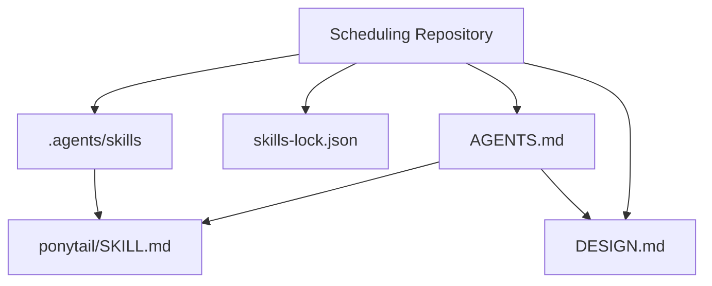
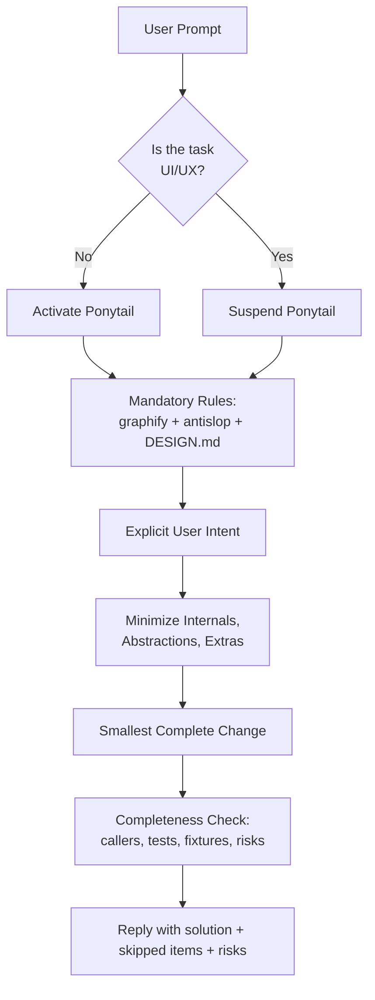
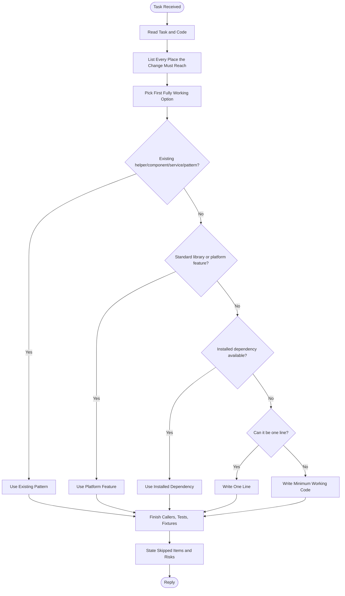
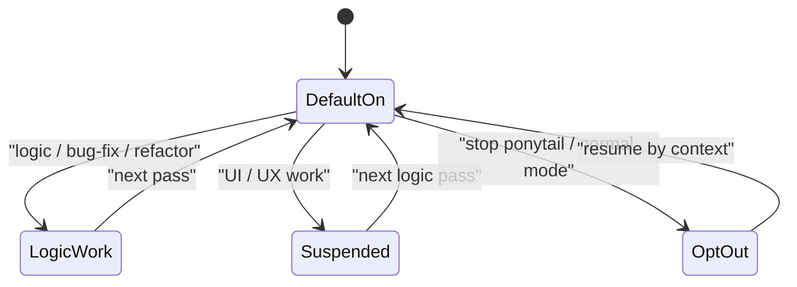
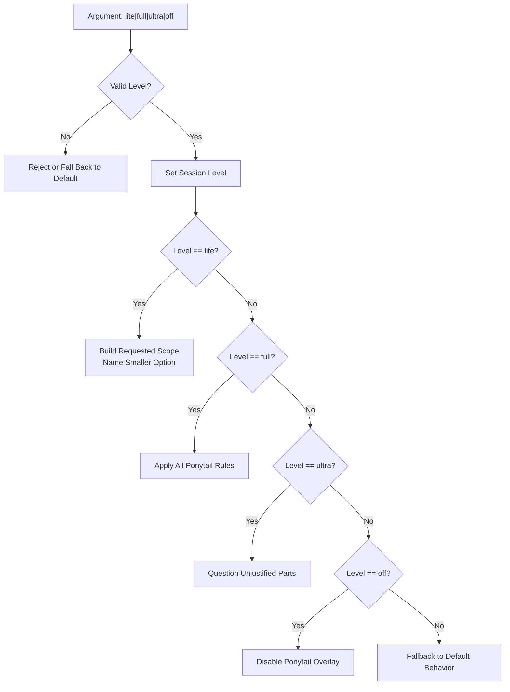
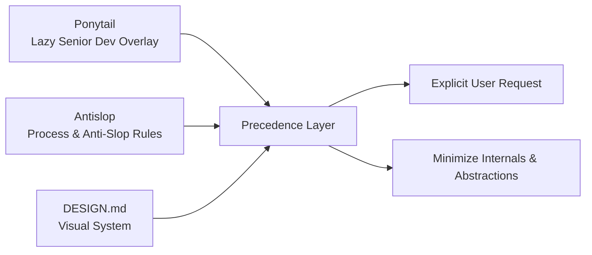
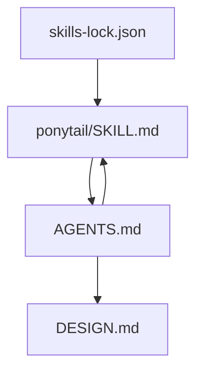

# Ponytail Skill

<cite>
**Referenced Files in This Document**
- [SKILL.md](file://.agents/skills/ponytail/SKILL.md)
- [AGENTS.md](file://AGENTS.md)
- [DESIGN.md](file://DESIGN.md)
- [skills-lock.json](file://skills-lock.json)
</cite>

## Table of Contents
1. [Introduction](#introduction)
2. [Project Structure](#project-structure)
3. [Core Components](#core-components)
4. [Architecture Overview](#architecture-overview)
5. [Detailed Component Analysis](#detailed-component-analysis)
6. [Dependency Analysis](#dependency-analysis)
7. [Performance Considerations](#performance-considerations)
8. [Troubleshooting Guide](#troubleshooting-guide)
9. [Conclusion](#conclusion)

## Introduction
Ponytail is a session-scoped “lazy senior developer” skill that pushes the agent toward the smallest complete change: minimal new code, no speculative features, and a clear risk summary at the end of every reply. In this repository it is configured as a default-on overlay for logic, bug-fix, and refactor work, while UI/UX work suspends it so design-system rules take over.

The skill defines three operating levels — lite, full (default), and ultra — and enforces a strict preference order: mandatory graphify and antislop/design rules first, then user intent, then minimization of internals and abstractions.

## Project Structure
Ponytail lives as an agent skill document under the `.agents/skills` tree and is registered through the project’s skills lock file. The scheduling repository itself is still scaffold-only; there is no application code yet, so Ponytail currently governs how agents should behave when writing or changing future code.

**Diagram sources**
- [.agents/skills/ponytail/SKILL.md:1-53](file://.agents/skills/ponytail/SKILL.md#L1-L53)
- [skills-lock.json:142-147](file://skills-lock.json#L142-L147)
- [AGENTS.md:38-44](file://AGENTS.md#L38-L44)
- [DESIGN.md:1-10](file://DESIGN.md#L1-L10)

**Section sources**
- [.agents/skills/ponytail/SKILL.md:1-53](file://.agents/skills/ponytail/SKILL.md#L1-L53)
- [skills-lock.json:142-147](file://skills-lock.json#L142-L147)
- [AGENTS.md:38-44](file://AGENTS.md#L38-L44)

## Core Components
Ponytail can be understood as a behavioral contract rather than executable code. Its core components are:

| Component | Purpose | Key Behavior |
|---|---|---|
| Identity | Declares the skill name, description, license, and argument hint | `name: ponytail`, `argument-hint: "[lite|full|ultra|off]"`, MIT license |
| Session Mode | Controls whether lazy mode is active | Active until the user says “stop ponytail” or “normal mode”; switchable with `/ponytail lite|full|ultra` |
| Scope Rule | Defines what must be considered before editing | Callers, tests, fixtures, config, exports, data exposure, and breaking changes |
| Smallest Complete Change | Defines the decision hierarchy for implementation | Prefer existing code, standard library, installed dependency, one-liner, then minimum working code |
| Completeness Guard | Prevents laziness from becoming negligence | Must finish callers/tests/fixtures; leave small tests for non-trivial logic; keep validation, error handling, security, accessibility, and calibration |
| Levels | Different intensities of minimization | Lite builds what was asked; Full applies all rules; Ultra questions the request before building |
| Repository Overlay | Integrates Ponytail into this repo’s agent workflow | Default ON for logic/refactor work; auto-OFF for UI/UX; precedence over internals but never over graphify/antislop/DESIGN.md |

**Section sources**
- [.agents/skills/ponytail/SKILL.md:1-53](file://.agents/skills/ponytail/SKILL.md#L1-L53)
- [AGENTS.md:38-44](file://AGENTS.md#L38-L44)

## Architecture Overview
Ponytail does not run as a service; it shapes agent behavior through layered rules. The effective runtime model is:

**Diagram sources**
- [AGENTS.md:38-44](file://AGENTS.md#L38-L44)
- [.agents/skills/ponytail/SKILL.md:15-44](file://.agents/skills/ponytail/SKILL.md#L15-L44)

## Detailed Component Analysis

### Ponytail Skill Definition
The skill document defines the persona, invocation, scope, implementation preferences, completeness requirements, and level behavior. It is intentionally concise because its goal is to reduce cognitive overhead and speculative code.

Key responsibilities:
- Treat the best code as code never written.
- Identify the full blast radius before editing.
- Prefer reuse, platform features, and installed dependencies.
- Keep values in the form the platform already provides.
- Leave one small test or self-check for new non-trivial logic.
- Mark shortcuts with explicit limits and upgrade conditions.
- Never cut trust-boundary validation, data-loss prevention, security, accessibility, or requested features.

**Diagram sources**
- [.agents/skills/ponytail/SKILL.md:19-44](file://.agents/skills/ponytail/SKILL.md#L19-L44)

**Section sources**
- [.agents/skills/ponytail/SKILL.md:1-53](file://.agents/skills/ponytail/SKILL.md#L1-L53)

### Repository-Level Ponytail Overlay
In this repository, Ponytail is elevated from a normal skill to a default-on overlay for logic-oriented work. The AGENTS.md file establishes precedence and automatic suspension for UI/UX tasks.

Important behaviors:
- Assume lazy mode from the first prompt for logic/bug-fix/refactor work.
- Do not require `/ponytail` to activate it.
- Say “stop ponytail” or “normal mode” to opt out.
- Auto-suspend for interface, layout, styling, components, or user-facing prose.
- Graphify, antislop, and DESIGN.md remain non-negotiable.
- Ponytail minimizes internals, not required coverage or user-facing quality.

**Diagram sources**
- [AGENTS.md:38-44](file://AGENTS.md#L38-L44)

**Section sources**
- [AGENTS.md:38-44](file://AGENTS.md#L38-L44)

### Level Model
Ponytail supports three levels plus an off state through its argument hint. The levels control how aggressively the agent minimizes scope and questions requests.

| Level | Expected Behavior | When to Use |
|---|---|---|
| `lite` | Build what was asked; name the smaller option in one line; let the user pick | Quick implementation where the user wants control over trade-offs |
| `full` | Apply all Ponytail rules | Default mode for most coding tasks |
| `ultra` | Question parts of the request that the need does not justify | When the user explicitly wants pushback on unnecessary work |
| `off` | Disable Ponytail behavior | When the user switches to “normal mode” or “stop ponytail” |

**Diagram sources**
- [.agents/skills/ponytail/SKILL.md:1-10](file://.agents/skills/ponytail/SKILL.md#L1-L10)
- [.agents/skills/ponytail/SKILL.md:46-53](file://.agents/skills/ponytail/SKILL.md#L46-L53)

**Section sources**
- [.agents/skills/ponytail/SKILL.md:1-10](file://.agents/skills/ponytail/SKILL.md#L1-L10)
- [.agents/skills/ponytail/SKILL.md:46-53](file://.agents/skills/ponytail/SKILL.md#L46-L53)

### Integration With Antislop and DESIGN.md
Ponytail is not a standalone style guide. It works alongside antislop and the repository’s DESIGN.md, which define visual tokens, typography, spacing, components, and do/don’t rules. Ponytail minimizes code; DESIGN.md constrains visual decisions.

Key integration points:
- DESIGN.md is the only design system for visual decisions.
- Visual values come from DESIGN.md tokens.
- Process and AI-slop patterns come from antislop.
- Surface conflicts between DESIGN.md and antislop must be raised, not silently broken.
- Ponytail cannot override these mandatory rules.

**Diagram sources**
- [AGENTS.md:28-36](file://AGENTS.md#L28-L36)
- [AGENTS.md:38-44](file://AGENTS.md#L38-L44)
- [DESIGN.md:1-10](file://DESIGN.md#L1-L10)

**Section sources**
- [AGENTS.md:28-36](file://AGENTS.md#L28-L36)
- [AGENTS.md:38-44](file://AGENTS.md#L38-L44)
- [DESIGN.md:1-10](file://DESIGN.md#L1-L10)

## Dependency Analysis
Ponytail has two main dependencies in this repository:

1. **Agent Workflow Rules**: AGENTS.md defines how Ponytail behaves as a default-on overlay and how it interacts with other mandatory rules.
2. **Skills Registry**: skills-lock.json registers the ponytail skill, including its source, type, path, and computed hash.

**Diagram sources**
- [.agents/skills/ponytail/SKILL.md:1-53](file://.agents/skills/ponytail/SKILL.md#L1-L53)
- [skills-lock.json:142-147](file://skills-lock.json#L142-L147)
- [AGENTS.md:38-44](file://AGENTS.md#L38-L44)

**Section sources**
- [skills-lock.json:142-147](file://skills-lock.json#L142-L147)
- [AGENTS.md:38-44](file://AGENTS.md#L38-L44)

## Performance Considerations
Because Ponytail is a behavioral skill rather than runtime code, its performance impact is measured in agent workflow efficiency:

- **Reduced speculative code**: By forcing the smallest complete change, it lowers diff size, review cost, and merge risk.
- **Faster iteration**: Preferring existing helpers, platform features, and installed dependencies avoids reinvention.
- **Lower cognitive load**: A short reply with skipped items and risks helps busy humans understand outcomes quickly.
- **Risk of under-testing**: If the agent treats “lazy” as “incomplete,” coverage may suffer. The completeness guard exists to prevent this.
- **UI/UX suspension**: Automatically suspending Ponytail for UI work prevents overly aggressive minimization from breaking design-system consistency.

[No sources needed since this section provides general guidance]

## Troubleshooting Guide

### Ponytail Is Not Activating
**Symptoms**: The agent writes verbose solutions, adds unrequested abstractions, or ignores minimization rules.  
**Likely causes**:
- The task is classified as UI/UX, so Ponytail auto-suspends.
- The user switched to “normal mode.”
- The agent did not treat the prompt as logic/bug-fix/refactor work.

**Resolution**:
- Confirm the task is not touching interface, layout, styling, components, or user-facing prose.
- Explicitly say “ponytail” if the repository rule requires it for your workflow, even though AGENTS.md makes it default-on for logic work.
- Use `/ponytail full` to reassert the default level.

**Section sources**
- [AGENTS.md:38-44](file://AGENTS.md#L38-L44)
- [.agents/skills/ponytail/SKILL.md:15-18](file://.agents/skills/ponytail/SKILL.md#L15-L18)

### Ponytail Is Too Aggressive
**Symptoms**: Required tests, fixtures, or callers are missing; shortcuts lack documented limits; validation is removed.  
**Likely causes**:
- The agent confused “lazy about the solution” with “lazy about the change.”
- The level is set to `lite` without understanding the trade-off.
- The agent treated “no abstraction” as “no necessary structure.”

**Resolution**:
- Switch to `full` or `ultra`.
- Remind the agent that Ponytail must finish every caller/test/fixture a change touches.
- Require explicit risk statements and shortcut-limit comments.

**Section sources**
- [.agents/skills/ponytail/SKILL.md:23-44](file://.agents/skills/ponytail/SKILL.md#L23-L44)

### Ponytail Conflicts With Design Rules
**Symptoms**: Visual decisions ignore DESIGN.md, or antislop process rules are overridden.  
**Likely causes**:
- Ponytail is being applied to UI/UX work where it should be suspended.
- The agent prioritized minimization over mandatory rules.

**Resolution**:
- Let DESIGN.md and antislop win on concrete visual values and process.
- Keep Ponytail focused on minimizing code, not overriding design constraints.
- Surface conflicts instead of silently breaking one rule set.

**Section sources**
- [AGENTS.md:28-36](file://AGENTS.md#L28-L36)
- [AGENTS.md:38-44](file://AGENTS.md#L38-L44)

### Skills Registration Is Out of Sync
**Symptoms**: The ponytail skill is not recognized by the agent tooling.  
**Likely causes**:
- The entry in skills-lock.json is missing or stale.
- The skill path or hash changed.

**Resolution**:
- Verify the ponytail entry exists in skills-lock.json.
- Confirm the source, skillPath, and computedHash match the current SKILL.md.
- Update the lock file after significant skill changes.

**Section sources**
- [skills-lock.json:142-147](file://skills-lock.json#L142-L147)

## Conclusion
Ponytail is a disciplined minimization layer for agent-driven development. It encourages the smallest complete change, forces awareness of blast radius, and demands a clear risk summary. In this repository, it is enabled by default for logic work, automatically suspended for UI/UX work, and strictly subordinate to graphify, antislop, and DESIGN.md. Used correctly, it reduces bloat, accelerates iteration, and keeps human-readable replies short — but it must never replace validation, security, accessibility, or required coverage.

[No sources needed since this section summarizes without analyzing specific files]