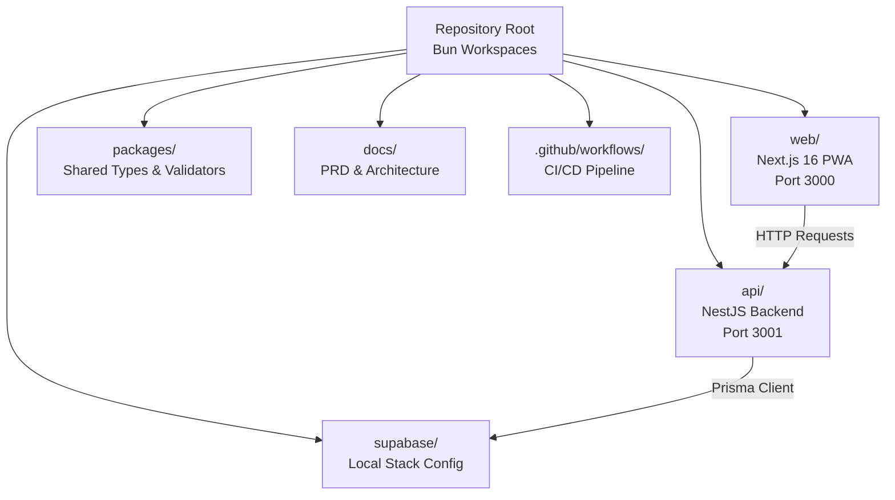

# Development Setup Guide

<cite>
**Referenced Files in This Document**
- [README.md](file://README.md)
- [package.json](file://package.json)
- [turbo.json](file://turbo.json)
- [.github/workflows/ci.yml](file://.github/workflows/ci.yml)
- [supabase/config.toml](file://supabase/config.toml)
- [api/package.json](file://api/package.json)
- [web/package.json](file://web/package.json)
- [api/vitest.config.ts](file://api/vitest.config.ts)
- [api/test/jest-api.json](file://api/test/jest-api.json)
- [api/src/env.ts](file://api/src/env.ts)
</cite>

## Update Summary
**Changes Made**
- Updated environment preparation to reflect Bun 1.4.3, Docker/OrbStack, and Supabase CLI requirements
- Added complete Supabase local stack setup with port configuration (5442x range)
- Documented Turborepo monorepo structure with web and api workspaces
- Added testing infrastructure documentation covering Vitest for unit tests and Jest for API integration tests
- Included CI/CD pipeline setup with GitHub Actions workflow
- Updated project structure to show actual implemented components (Next.js PWA, NestJS API, Prisma database)
- Added database management commands and Prisma migration workflow
- Enhanced troubleshooting guide with Supabase-specific issues and testing problems

## Table of Contents
1. [Introduction](#introduction)
2. [Prerequisites and Environment Setup](#prerequisites-and-environment-setup)
3. [Project Structure](#project-structure)
4. [Initial Setup and Configuration](#initial-setup-and-configuration)
5. [Development Workflow](#development-workflow)
6. [Testing Infrastructure](#testing-infrastructure)
7. [Database Management](#database-management)
8. [CI/CD Pipeline](#cicd-pipeline)
9. [Troubleshooting Guide](#troubleshooting-guide)
10. [Conclusion](#conclusion)

## Introduction
This guide helps you set up the development environment for the Kyne shift scheduling application. The repository is now a fully functional monorepo using Bun workspaces and Turborepo, containing a Next.js PWA frontend, NestJS backend API, and Supabase PostgreSQL database.

The application manages weekly shift scheduling for Kyne's team (6 bar & kitchen staff plus 1 manager). It follows a modern TypeScript-first architecture with comprehensive testing infrastructure and automated CI/CD pipelines.

**Updated**: The project has evolved from a scaffold to a complete development environment with working components, testing setup, and deployment automation.

**Section sources**
- [README.md:1-20](file://README.md#L1-L20)

## Prerequisites and Environment Setup

### Required Tools
Before starting development, ensure you have these tools installed:

| Tool | Version | Purpose | Installation Notes |
|---|---|---|---|
| Bun | 1.4.3 | Package manager and runtime | Use official installer or package manager |
| Docker | Latest | Running Supabase local stack | OrbStack recommended for macOS users |
| Supabase CLI | Latest | Local database and services management | Install via npm: `npm install -g supabase` |
| Git | Latest | Version control | Standard installation |

### System Requirements
- **Operating System**: macOS, Windows, or Linux
- **Memory**: Minimum 4GB RAM (8GB recommended for Docker + development)
- **Storage**: At least 2GB free space for dependencies and containers
- **Network**: Internet access for initial dependency installation

**Section sources**
- [README.md:21-35](file://README.md#L21-L35)

## Project Structure
The repository follows a monorepo structure with Bun workspaces and Turborepo orchestration:



**Diagram sources**
- [package.json:6-10](file://package.json#L6-L10)
- [turbo.json:1-40](file://turbo.json#L1-L40)

### Workspace Components

#### Web Frontend (`web/`)
- Next.js 16 with App Router
- PWA capabilities for mobile and desktop
- React 19 with TypeScript
- Port 3000 for development

#### API Backend (`api/`)
- NestJS framework with Express adapter
- Prisma ORM for database operations
- JWT authentication and RBAC
- Port 3001 for development

#### Shared Packages (`packages/`)
- `types/`: Shared TypeScript definitions including SHIFT_TYPE_CATALOG
- `validators/`: Zod validation schemas used across the application

#### Database Layer (`supabase/`)
- Local Supabase stack configuration
- PostgreSQL 17 with custom ports (5442x range)
- Authentication and storage services
- Migration management

**Section sources**
- [README.md:10-20](file://README.md#L10-L20)
- [web/package.json:1-25](file://web/package.json#L1-L25)
- [api/package.json:1-47](file://api/package.json#L1-L47)

## Initial Setup and Configuration

### Step 1: Clone and Install Dependencies
```bash
# Clone the repository
git clone <repository-url>
cd scheduling

# Install all dependencies using Bun
bun install
```

### Step 2: Start Local Database Services
```bash
# Start Supabase local stack
bun run db:start

# This starts:
# - PostgreSQL on port 54422
# - Supabase API on port 54421
# - Studio on port 54423
# - Realtime service on port 54425
```

### Step 3: Configure Environment Variables
```bash
# Copy environment template
cp .env.example .env

# Edit .env with your configuration
# For local development, the default values should work
# For Supabase cloud, update DATABASE_URL and DIRECT_URL
```

### Step 4: Initialize Database Schema
```bash
# Generate Prisma client
bun run db:generate

# Apply database migrations
bun run db:migrate

# Seed initial data (shift types)
bun run db:seed
```

### Step 5: Start Development Servers
```bash
# Start both web and API in watch mode
bun run dev

# Access applications:
# - Web: http://localhost:3000
# - API: http://localhost:3001
# - Health check: GET http://localhost:3001/health
```

**Section sources**
- [README.md:21-35](file://README.md#L21-L35)

## Development Workflow

### Available Commands
The root `package.json` provides centralized commands through Turborepo:

| Command | Description | Scope |
|---|---|---|
| `bun run dev` | Start development servers | All packages |
| `bun run build` | Build all packages | All packages |
| `bun run typecheck` | TypeScript compilation check | All packages |
| `bun run test` | Run unit tests | All packages |
| `bun run test:api` | Run API integration tests | API package only |
| `bun run format` | Format code with Prettier | All files |
| `bun run format:check` | Check code formatting | All files |

### Database Commands
| Command | Description |
|---|---|
| `bun run db:start` | Start Supabase local stack |
| `bun run db:stop` | Stop Supabase local stack |
| `bun run db:generate` | Generate Prisma client |
| `bun run db:migrate` | Apply database migrations |
| `bun run db:seed` | Seed database with initial data |

### Development Best Practices
1. **Use Turborepo commands**: Always use root commands for consistency
2. **Run type checking**: Execute `bun run typecheck` before committing
3. **Format code**: Run `bun run format` to maintain consistent code style
4. **Test changes**: Run relevant tests before submitting pull requests
5. **Database changes**: Always run migrations after schema modifications

**Section sources**
- [README.md:37-50](file://README.md#L37-L50)
- [package.json:11-24](file://package.json#L11-L24)

## Testing Infrastructure

### Test Frameworks
The project uses a dual testing strategy:

#### Unit Tests (Vitest)
- **Framework**: Vitest v4.1.10
- **Scope**: Pure logic functions and utilities
- **Location**: `src/**/*.spec.ts`
- **Configuration**: `api/vitest.config.ts`
- **Execution**: `bun run test`

#### Integration Tests (Jest)
- **Framework**: Jest v30.4.2
- **Scope**: API endpoints and database interactions
- **Location**: `test/*.api-spec.ts`
- **Configuration**: `api/test/jest-api.json`
- **Execution**: `bun run test:api`

### Test Configuration Details

#### Vitest Configuration
```typescript
// api/vitest.config.ts
export default defineConfig({
  oxc: false,
  test: {
    globals: true,
    environment: 'node',
    include: ['src/**/*.spec.ts'],
    pool: 'forks',
  },
  plugins: [swc.vite({...})],
  resolve: {
    alias: {
      '@repo/types': path.resolve(__dirname, '../packages/types/src/index.ts'),
      '@repo/validators': path.resolve(__dirname, '../packages/validators/src/index.ts'),
    },
  },
});
```

#### Jest API Test Configuration
```json
{
  "moduleFileExtensions": ["js", "json", "ts"],
  "rootDir": ".",
  "testEnvironment": "node",
  "testRegex": ".api-spec.ts$",
  "maxWorkers": 1,
  "testTimeout": 30000,
  "transform": {
    "^.+\\.(t|j)s$": ["ts-jest", {...}]
  }
}
```

### Running Tests
```bash
# Run all unit tests
bun run test

# Run API integration tests
bun run test:api

# Run tests with coverage
bun run test --coverage
```

**Section sources**
- [api/package.json:10-14](file://api/package.json#L10-L14)
- [api/vitest.config.ts:1-33](file://api/vitest.config.ts#L1-L33)
- [api/test/jest-api.json:1-34](file://api/test/jest-api.json#L1-L34)

## Database Management

### Database Architecture
The application uses Supabase PostgreSQL with Prisma ORM:

- **PostgreSQL 17**: Primary database engine
- **Supabase Auth**: User authentication and authorization
- **Prisma Client**: Type-safe database queries
- **RLS Policies**: Row-level security for data protection

### Database Ports and Services
| Service | Local Port | Description |
|---|---:|---|
| PostgreSQL | 54422 | Main database server |
| Supabase API | 54421 | REST API endpoints |
| Studio | 54423 | Database management UI |
| Realtime | 54425 | WebSocket connections |
| Analytics | 54427 | Usage analytics |

### Database Operations

#### Schema Management
```bash
# Generate Prisma client from schema
bun run db:generate

# Create new migration
npx prisma migrate dev --name description_of_change

# Apply pending migrations
bun run db:migrate

# Reset database (destructive)
npx prisma migrate reset
```

#### Data Seeding
```bash
# Seed database with initial data
bun run db:seed

# Custom seed scripts can be added to prisma/seed.ts
```

### Security Considerations
- **RLS deny-all**: Browser cannot directly access database tables
- **API-only access**: All data operations go through the NestJS API
- **Connection pooling**: Direct connections for API, pooled for development
- **Timezone handling**: All times stored as WITA (Asia/Makassar)

**Section sources**
- [supabase/config.toml:35-85](file://supabase/config.toml#L35-L85)
- [README.md:53-58](file://README.md#L53-L58)

## CI/CD Pipeline

### GitHub Actions Workflow
The project includes automated CI/CD with GitHub Actions:

```yaml
# .github/workflows/ci.yml
name: CI
on:
  push:
    branches: [main]
  pull_request:

jobs:
  test:
    runs-on: ubuntu-latest
    steps:
      - uses: actions/checkout@v4
      - uses: oven-sh/setup-bun@v2
        with:
          bun-version: 1.4.3
      - run: bun install --frozen-lockfile
      - run: bun run db:generate
      - run: bun run typecheck
      - run: bun run test
      - run: bun run test:api
      - run: bun run build
```

### CI Pipeline Stages
1. **Checkout**: Clone repository code
2. **Setup Bun**: Install Bun 1.4.3 runtime
3. **Install Dependencies**: Install all workspace dependencies
4. **Generate Prisma Client**: Create type-safe database client
5. **Type Checking**: Validate TypeScript compilation
6. **Unit Testing**: Run Vitest unit tests
7. **Integration Testing**: Run Jest API tests
8. **Build**: Compile all packages for production

### Turborepo Configuration
```json
{
  "$schema": "https://turborepo.dev/schema.json",
  "ui": "stream",
  "globalPassThroughEnv": ["DATABASE_URL", "DIRECT_URL"],
  "tasks": {
    "build": {
      "dependsOn": ["^build"],
      "outputs": [".next/**", "!.next/cache/**", "dist/**"]
    },
    "dev": {
      "dependsOn": ["db:generate"],
      "cache": false,
      "persistent": true
    }
  }
}
```

**Section sources**
- [.github/workflows/ci.yml:1-22](file://.github/workflows/ci.yml#L1-L22)
- [turbo.json:1-40](file://turbo.json#L1-L40)

## Troubleshooting Guide

### Common Setup Issues

#### Supabase Local Stack Problems
| Problem | Solution |
|---|---|
| Port conflicts (5442x) | Ensure no other services use ports 54421-54429 |
| Docker not running | Start Docker Desktop or OrbStack |
| Database connection fails | Verify `.env` contains correct `DATABASE_URL` |
| Supabase CLI not found | Install globally: `npm install -g supabase` |

#### Dependency Installation Issues
| Problem | Solution |
|---|---|
| Bun version mismatch | Install exact version: `curl -fsSL https://bun.sh/install | bash -s -- 1.4.3` |
| Permission errors | Run with appropriate permissions or use sudo |
| Network timeouts | Check proxy settings and firewall configuration |
| Corrupted lock file | Delete `bun.lock` and run `bun install` |

#### Database Migration Issues
| Problem | Solution |
|---|---|
| Migration conflicts | Drop and recreate database: `npx prisma migrate reset` |
| Prisma client outdated | Regenerate: `bun run db:generate` |
| Connection string invalid | Verify `DATABASE_URL` format and credentials |
| Timezone issues | Ensure database timezone matches Asia/Makassar |

#### Testing Problems
| Problem | Solution |
|---|---|
| Vitest not finding tests | Check test file naming pattern (*.spec.ts) |
| Jest timeout errors | Increase timeout in jest-api.json |
| Database not available during tests | Start Supabase stack before running tests |
| Coverage reports missing | Ensure coverage directories exist |

#### Development Server Issues
| Problem | Solution |
|---|---|
| Port 3000/3001 already in use | Kill existing processes or change ports |
| Hot reload not working | Restart development servers |
| TypeScript errors blocking dev | Fix type errors or disable strict mode temporarily |
| Module resolution failures | Run `bun install` to sync dependencies |

### Environment Configuration Checklist
Before starting development, verify:

- [ ] Bun 1.4.3 is installed and accessible
- [ ] Docker/OrbStack is running
- [ ] Supabase CLI is installed
- [ ] `.env` file exists with required variables
- [ ] Supabase local stack is running (`bun run db:start`)
- [ ] Database migrations are applied (`bun run db:migrate`)
- [ ] Database is seeded (`bun run db:seed`)
- [ ] Development servers start successfully (`bun run dev`)
- [ ] Health endpoint responds (`GET http://localhost:3001/health`)
- [ ] Tests pass (`bun run test && bun run test:api`)

**Section sources**
- [README.md:21-35](file://README.md#L21-L35)
- [supabase/config.toml:7-8](file://supabase/config.toml#L7-L8)

## Conclusion
The Kyne shift scheduling application now provides a complete development environment with modern tooling, comprehensive testing, and automated CI/CD. The monorepo structure with Bun workspaces and Turborepo ensures efficient development workflows, while the Supabase local stack enables rapid iteration without external dependencies.

Key achievements:
- **Complete setup**: All prerequisites and configuration documented
- **Working components**: Next.js PWA, NestJS API, and Supabase database
- **Testing infrastructure**: Dual testing strategy with Vitest and Jest
- **Automated CI/CD**: GitHub Actions pipeline for quality assurance
- **Developer experience**: Comprehensive command structure and troubleshooting guidance

The foundation is now ready for feature development, with clear patterns established for adding new functionality, maintaining code quality, and ensuring reliable deployments.

**Updated**: The project has evolved significantly from its scaffold state to a production-ready development environment that supports the full software development lifecycle.