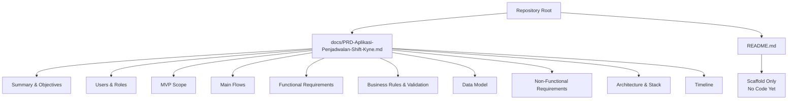
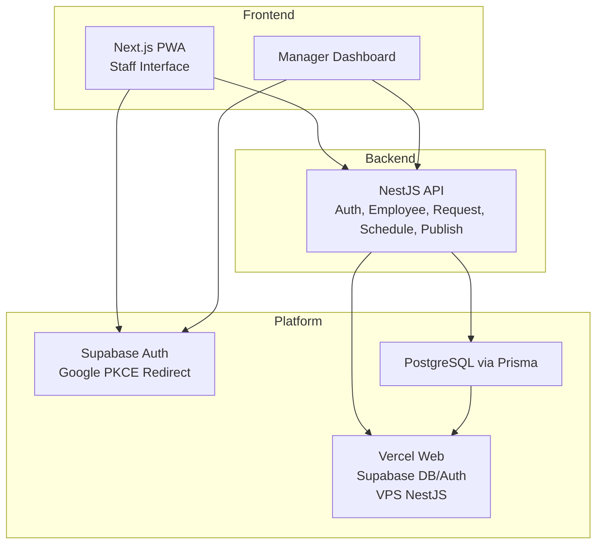
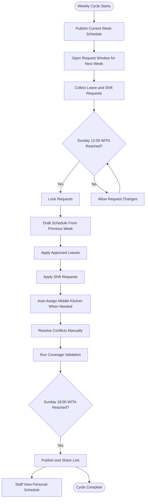

# Business Requirements

<cite>
**Referenced Files in This Document**
- [PRD-Aplikasi-Penjadwalan-Shift-Kyne.md](file://docs/PRD-Aplikasi-Penjadwalan-Shift-Kyne.md)
- [README.md](file://README.md)
</cite>

## Table of Contents
1. [Introduction](#introduction)
2. [Project Structure](#project-structure)
3. [Core Components](#core-components)
4. [Architecture Overview](#architecture-overview)
5. [Detailed Component Analysis](#detailed-component-analysis)
6. [Dependency Analysis](#dependency-analysis)
7. [Performance Considerations](#performance-considerations)
8. [Troubleshooting Guide](#troubleshooting-guide)
9. [Conclusion](#conclusion)

## Introduction
This document defines the business requirements for the Kyne café shift scheduling application MVP. It focuses on the core business problem, objectives, success metrics, constraints, and the transition path toward ERP integration. The content is derived from the product requirements document and repository context.

The MVP targets a weekly schedule for six staff members: four bar positions and two kitchen positions. The system centralizes shift requests, automates draft schedule generation from previous weeks, enforces coverage rules, and provides a mobile-first staff interface.

**Section sources**
- [PRD-Aplikasi-Penjadwalan-Shift-Kyne.md:5-25](file://docs/PRD-Aplikasi-Penjadwalan-Shift-Kyne.md#L5-L25)
- [README.md:1-5](file://README.md#L1-L5)

## Project Structure
At this stage, the repository is a scaffold with no implementation code yet. The primary source of business requirements is the product requirements document under `docs`. The root README confirms that the project is standalone and still awaiting stack and tooling decisions.

**Diagram sources**
- [PRD-Aplikasi-Penjadwalan-Shift-Kyne.md:5-267](file://docs/PRD-Aplikasi-Penjadwalan-Shift-Kyne.md#L5-L267)
- [README.md:1-25](file://README.md#L1-L25)

**Section sources**
- [README.md:1-25](file://README.md#L1-L25)
- [PRD-Aplikasi-Penjadwalan-Shift-Kyne.md:5-267](file://docs/PRD-Aplikasi-Penjadwalan-Shift-Kyne.md#L5-L267)

## Core Components
The business requirements center around seven functional modules that support the weekly scheduling cycle:

- Authentication with Google login and email whitelist
- Staff management including position, probation status, and active/inactive state
- Leave request and shift request submission through the app
- Manager dashboard showing all requests, conflicts, and missing requests
- Schedule drafting from the previous week with automated leave and middle-kitchen logic
- Publish and share workflow to WhatsApp
- Staff view showing personal schedule, middle-kitchen closure notices, and weekly hours

These components collectively address manual scheduling inefficiencies by centralizing requests, enforcing deadlines, and providing validation before publication.

**Section sources**
- [PRD-Aplikasi-Penjadwalan-Shift-Kyne.md:102-164](file://docs/PRD-Aplikasi-Penjadwalan-Shift-Kyne.md#L102-L164)

## Architecture Overview
The MVP is a standalone progressive web application designed to be mobile-first while keeping manager dashboards usable on laptops. The architecture aligns with the future ERP stack so that modules can later move into the ERP repository with minimal changes.

**Diagram sources**
- [PRD-Aplikasi-Penjadwalan-Shift-Kyne.md:230-248](file://docs/PRD-Aplikasi-Penjadwalan-Shift-Kyne.md#L230-L248)

**Section sources**
- [PRD-Aplikasi-Penjadwalan-Shift-Kyne.md:230-248](file://docs/PRD-Aplikasi-Penjadwalan-Shift-Kyne.md#L230-L248)

## Detailed Component Analysis

### Business Problem and Inefficiencies
Manual scheduling creates several operational risks:

- Weekly schedule creation happens manually every Sunday.
- Leave and shift requests are scattered across chat and verbal communication.
- Kitchen staffing conflicts are easily overlooked because only two kitchen staff exist.
- There is no centralized record of who has requested what before the schedule is built.

These issues lead to gaps in coverage, especially during busy periods, and make it difficult to track request history or enforce fairness.

**Section sources**
- [PRD-Aplikasi-Penjadwalan-Shift-Kyne.md:9-13](file://docs/PRD-Aplikasi-Penjadwalan-Shift-Kyne.md#L9-L13)

### MVP Goals
The MVP goals directly target the identified inefficiencies:

- Staff submit leave requests and morning/evening shift requests through the app within a defined weekly window.
- Managers build schedules from a copy of the previous week, applying approved leaves and shift requests automatically, then validating before publishing.
- Staff view their own schedule on mobile devices after publication.

These goals establish a single source of truth for requests and reduce reliance on informal communication channels.

**Section sources**
- [PRD-Aplikasi-Penjadwalan-Shift-Kyne.md:15-19](file://docs/PRD-Aplikasi-Penjadwalan-Shift-Kyne.md#L15-L19)

### Success Metrics
Success is measured by three clear outcomes:

- Next week’s schedule is published no later than Sunday 18:00 WITA every week.
- No Friday–Sunday shifts are understaffed at the time of publication.
- All non-probation staff submit requests through the app rather than chat.

These metrics tie operational reliability to a strict weekly deadline and enforce disciplined request behavior.

**Section sources**
- [PRD-Aplikasi-Penjadwalan-Shift-Kyne.md:21-25](file://docs/PRD-Aplikasi-Penjadwalan-Shift-Kyne.md#L21-L25)

### Business Constraints
Kyne café operations impose specific constraints:

- The café opens daily.
- Monday–Thursday are considered quiet and allow more flexibility.
- Friday–Sunday are considered busy and require full staffing.
- Staffing ratios are four bar positions and two kitchen positions per week.
- Shift types include morning, evening, and middle kitchen, with middle kitchen only when the other kitchen staff member is off.
- Coverage rules differ between quiet days and busy days.

These constraints shape the validation logic and the manager’s final adjustments before publication.

**Section sources**
- [PRD-Aplikasi-Penjadwalan-Shift-Kyne.md:167-195](file://docs/PRD-Aplikasi-Penjadwalan-Shift-Kyne.md#L167-L195)

### Weekly Scheduling Flow
The weekly flow ensures predictable timing for requests, drafting, validation, and publication:

**Diagram sources**
- [PRD-Aplikasi-Penjadwalan-Shift-Kyne.md:73-90](file://docs/PRD-Aplikasi-Penjadwalan-Shift-Kyne.md#L73-L90)

**Section sources**
- [PRD-Aplikasi-Penjadwalan-Shift-Kyne.md:73-90](file://docs/PRD-Aplikasi-Penjadwalan-Shift-Kyne.md#L73-L90)

### Request Management and Conflict Handling
Requests are managed centrally to prevent scattered communication:

- Leave requests are limited to Monday–Thursday, maximum one per week.
- Shift requests can be submitted for any day as morning or evening slots.
- Requests can be edited until the Sunday 12:00 WITA deadline.
- Conflicts occur when multiple staff in the same position request the same day off or exceed available shift slots.
- The manager reviews conflicts and decides approvals.
- Unapproved leave requests are treated like no request, leaving the manager to assign the day off.

This process replaces ad-hoc chat-based coordination with a controlled, auditable workflow.

**Section sources**
- [PRD-Aplikasi-Penjadwalan-Shift-Kyne.md:92-97](file://docs/PRD-Aplikasi-Penjadwalan-Shift-Kyne.md#L92-L97)
- [PRD-Aplikasi-Penjadwalan-Shift-Kyne.md:122-130](file://docs/PRD-Aplikasi-Penjadwalan-Shift-Kyne.md#L122-L130)
- [PRD-Aplikasi-Penjadwalan-Shift-Kyne.md:132-139](file://docs/PRD-Aplikasi-Penjadwalan-Shift-Kyne.md#L132-L139)

### Coverage Validation Rules
Coverage validation protects service quality during busy periods:

- Friday–Sunday requires two bar staff per shift and one kitchen staff per shift.
- Monday–Thursday requires at least one bar staff per shift and at least one kitchen staff (or middle kitchen).
- Coverage warnings are visible only to managers before publication.
- Staff do not see warning indicators for single-staff shifts.

These rules ensure that the busiest days meet minimum staffing expectations.

**Section sources**
- [PRD-Aplikasi-Penjadwalan-Shift-Kyne.md:179-195](file://docs/PRD-Aplikasi-Penjadwalan-Shift-Kyne.md#L179-L195)

### Data Model and ERP Transition Path
The data model is designed to be migration-ready for an ERP system:

- Entities include employee, shift type, schedule week, shift assignment, leave request, shift request, and settings.
- IDs use UUIDs instead of auto-increment numbers.
- Audit fields such as created_at, updated_at, and created_by are required.
- Soft deletes are preferred; records are deactivated rather than permanently removed.
- Dates and times are stored with timezone awareness, using WITA.
- The stack uses NestJS, PostgreSQL via Prisma, and Supabase Auth, matching the ERP stack plan.

This design reduces friction when moving the scheduling module into the ERP repository later.

**Section sources**
- [PRD-Aplikasi-Penjadwalan-Shift-Kyne.md:197-217](file://docs/PRD-Aplikasi-Penjadwalan-Shift-Kyne.md#L197-L217)
- [PRD-Aplikasi-Penjadwalan-Shift-Kyne.md:230-241](file://docs/PRD-Aplikasi-Penjadwalan-Shift-Kyne.md#L230-L241)

### Mobile-First Staff Interface
The staff interface emphasizes mobile usability:

- The application is a PWA optimized for Android and iPhone.
- Staff can install the app to the home screen.
- Login uses Google redirect flows rather than popups to avoid browser limitations.
- Privacy is enforced server-side: staff see only their own schedule.
- Timezone handling uses WITA for deadlines and shift times.

This approach ensures that the majority of staff can reliably access schedules and submit requests from their phones.

**Section sources**
- [PRD-Aplikasi-Penjadwalan-Shift-Kyne.md:218-228](file://docs/PRD-Aplikasi-Penjadwalan-Shift-Kyne.md#L218-L228)

## Dependency Analysis
The business requirements depend on several interconnected elements:

- Authentication depends on Google accounts and an email whitelist.
- Request windows depend on the publish action and fixed deadlines.
- Schedule drafting depends on previous-week data and automated middle-kitchen logic.
- Publication depends on successful coverage validation and manager approval.
- Staff visibility depends on role-based access and privacy enforcement.

**Diagram sources**
- [PRD-Aplikasi-Penjadwalan-Shift-Kyne.md:102-164](file://docs/PRD-Aplikasi-Penjadwalan-Shift-Kyne.md#L102-L164)

**Section sources**
- [PRD-Aplikasi-Penjadwalan-Shift-Kyne.md:102-164](file://docs/PRD-Aplikasi-Penjadwalan-Shift-Kyne.md#L102-L164)

## Performance Considerations
From a business perspective, performance means predictable weekly delivery and reliable coverage:

- The Sunday 18:00 WITA publication deadline must be consistently met.
- Coverage validation should run automatically whenever schedule changes occur.
- Request locking at Sunday 12:00 WITA prevents last-minute chaos.
- Mobile-first design reduces friction for staff accessing schedules on phones.
- Centralized tracking reduces manual reconciliation effort for managers.

[No sources needed since this section provides general guidance]

## Troubleshooting Guide
Common operational issues and their intended handling:

- **Login failures from WhatsApp links:** The product notes potential browser restrictions and recommends testing on Android and iPhone, possibly opening in Chrome or Safari or using an installed PWA.
- **Unauthorized access:** Email whitelist checks are enforced in the backend, and database row-level security denies direct frontend access.
- **Missing requests:** The manager dashboard highlights non-probation staff who have not submitted requests.
- **Post-publication changes:** During MVP, sudden leave requests are reported to the manager, who updates the schedule manually and notifies staff via WhatsApp.

**Section sources**
- [PRD-Aplikasi-Penjadwalan-Shift-Kyne.md:220-228](file://docs/PRD-Aplikasi-Penjadwalan-Shift-Kyne.md#L220-L228)
- [PRD-Aplikasi-Penjadwalan-Shift-Kyne.md:98-101](file://docs/PRD-Aplikasi-Penjadwalan-Shift-Kyne.md#L98-L101)

## Conclusion
The Kyne café shift scheduling MVP addresses manual scheduling inefficiencies by centralizing requests, automating draft generation, enforcing coverage rules, and delivering a mobile-first staff experience. Success hinges on meeting the Sunday 18:00 WITA publication deadline, maintaining Friday–Sunday coverage, and requiring app-based request submission. The data model and stack choices prepare the system for a future transition into the ERP, minimizing rework while stabilizing café operations.

[No sources needed since this section summarizes without analyzing specific files]