# Business Rules & Validation

<cite>
**Referenced Files in This Document**
- [README.md](file://README.md)
- [PRD-Aplikasi-Penjadwalan-Shift-Kyne.md](file://docs/PRD-Aplikasi-Penjadwalan-Shift-Kyne.md)
</cite>

## Table of Contents
1. [Introduction](#introduction)
2. [Project Structure](#project-structure)
3. [Core Components](#core-components)
4. [Architecture Overview](#architecture-overview)
5. [Detailed Component Analysis](#detailed-component-analysis)
6. [Dependency Analysis](#dependency-analysis)
7. [Performance Considerations](#performance-considerations)
8. [Troubleshooting Guide](#troubleshooting-guide)
9. [Conclusion](#conclusion)

## Introduction
This document defines the business rules and validation logic for the Kyne café scheduling system. It focuses on shift type definitions, leave allocation limits, coverage requirements, conflict resolution, probation restrictions, request window management, automatic middle-kitchen assignment, handover overlap handling, and special reduced-hours kitchen days. The content is derived from the product requirements document and repository context.

## Project Structure
The repository currently contains:
- A README describing the project as a standalone scheduling application scaffold.
- A product requirements document detailing roles, workflows, functional modules, business rules, data model draft, non-functional requirements, architecture, timeline, and open questions.

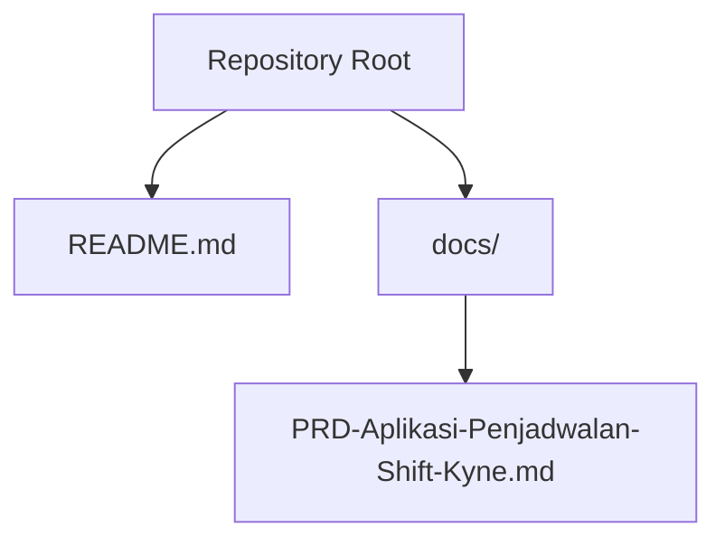

**Diagram sources**
- [README.md:1-25](file://README.md#L1-L25)
- [PRD-Aplikasi-Penjadwalan-Shift-Kyne.md:1-20](file://docs/PRD-Aplikasi-Penjadwalan-Shift-Kyne.md#L1-L20)

**Section sources**
- [README.md:1-25](file://README.md#L1-L25)
- [PRD-Aplikasi-Penjadwalan-Shift-Kyne.md:1-20](file://docs/PRD-Aplikasi-Penjadwalan-Shift-Kyne.md#L1-L20)

## Core Components
The core business rules are organized into the following areas:
- Shift types and operational constraints
- Leave allocation rules
- Coverage requirements
- Conflict resolution mechanisms
- Probation restrictions
- Request window management
- Middle kitchen automatic assignment
- Handover overlap and reduced-hours kitchen days

**Section sources**
- [PRD-Aplikasi-Penjadwalan-Shift-Kyne.md:165-195](file://docs/PRD-Aplikasi-Penjadwalan-Shift-Kyne.md#L165-L195)

## Architecture Overview
At a high level, the scheduling workflow follows a weekly cycle:
- Publish last week’s schedule to open the next week’s request window.
- Collect leave and shift requests within the defined window.
- Close the request window at the deadline.
- Manager drafts the schedule by copying last week, applying leave, applying shift requests, auto-assigning middle kitchen, and resolving conflicts.
- System runs coverage validation; manager publishes when satisfied.
- Staff view their own schedule after publish.

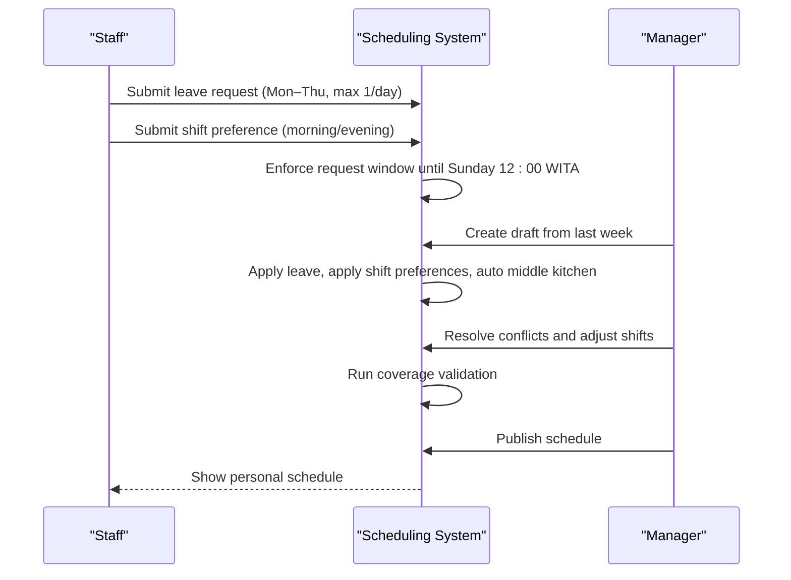

**Diagram sources**
- [PRD-Aplikasi-Penjadwalan-Shift-Kyne.md:73-90](file://docs/PRD-Aplikasi-Penjadwalan-Shift-Kyne.md#L73-L90)
- [PRD-Aplikasi-Penjadwalan-Shift-Kyne.md:122-130](file://docs/PRD-Aplikasi-Penjadwalan-Shift-Kyne.md#L122-L130)
- [PRD-Aplikasi-Penjadwalan-Shift-Kyne.md:140-147](file://docs/PRD-Aplikasi-Penjadwalan-Shift-Kyne.md#L140-L147)
- [PRD-Aplikasi-Penjadwalan-Shift-Kyne.md:157-163](file://docs/PRD-Aplikasi-Penjadwalan-Shift-Kyne.md#L157-L163)

## Detailed Component Analysis

### Shift Type Definitions and Operational Constraints
- Morning shift: 07:30–15:30, applies to bar and kitchen.
- Evening shift: 15:00–23:00, applies to bar and kitchen.
- Middle shift: 11:00–19:00, applies to kitchen only and only when a kitchen colleague is on leave that day.
- Morning and evening shifts overlap by 30 minutes (15:00–15:30) to allow handover between shifts.

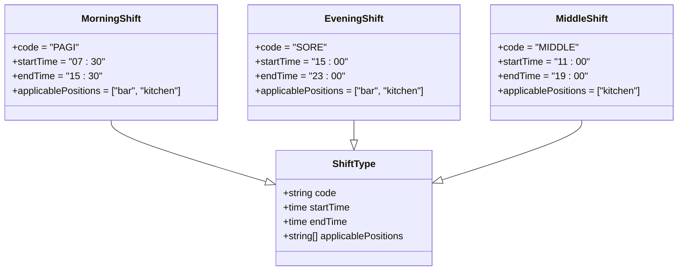

**Diagram sources**
- [PRD-Aplikasi-Penjadwalan-Shift-Kyne.md:169-177](file://docs/PRD-Aplikasi-Penjadwalan-Shift-Kyne.md#L169-L177)

**Section sources**
- [PRD-Aplikasi-Penjadwalan-Shift-Kyne.md:169-177](file://docs/PRD-Aplikasi-Penjadwalan-Shift-Kyne.md#L169-L177)

### Leave Allocation Rules
- Non-probation staff may request one day off per week.
- Leave requests are restricted to Monday through Thursday only.
- Maximum one bar staff and one kitchen staff can be on leave per day; conflicts are flagged for manager decision.
- If a staff member does not submit a leave request, the manager assigns their day off.

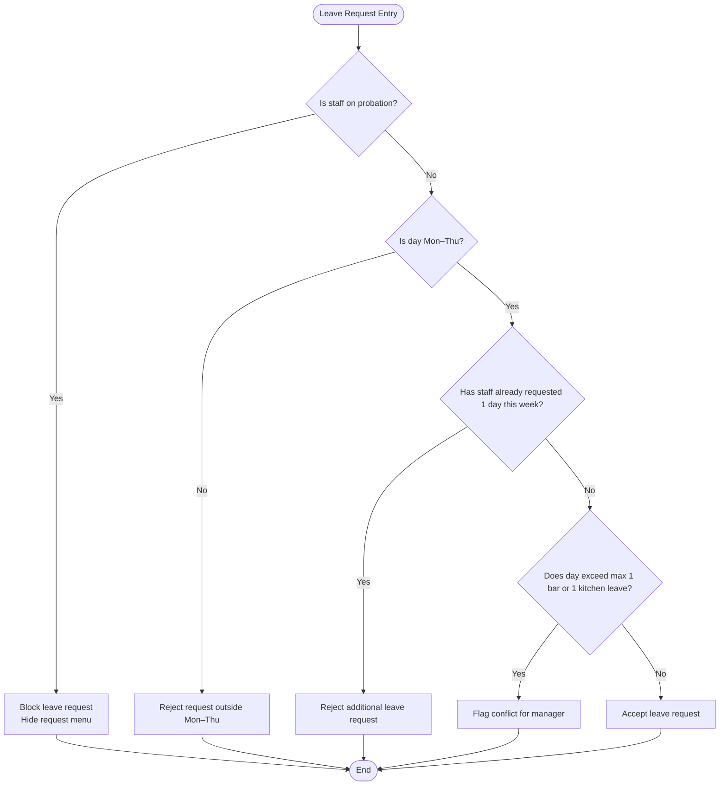

**Diagram sources**
- [PRD-Aplikasi-Penjadwalan-Shift-Kyne.md:181-189](file://docs/PRD-Aplikasi-Penjadwalan-Shift-Kyne.md#L181-L189)
- [PRD-Aplikasi-Penjadwalan-Shift-Kyne.md:122-130](file://docs/PRD-Aplikasi-Penjadwalan-Shift-Kyne.md#L122-L130)

**Section sources**
- [PRD-Aplikasi-Penjadwalan-Shift-Kyne.md:181-189](file://docs/PRD-Aplikasi-Penjadwalan-Shift-Kyne.md#L181-L189)
- [PRD-Aplikasi-Penjadwalan-Shift-Kyne.md:122-130](file://docs/PRD-Aplikasi-Penjadwalan-Shift-Kyne.md#L122-L130)

### Coverage Requirements
- Friday through Sunday: minimum 2 bar staff and 1 kitchen staff per shift.
- Monday through Thursday: minimum 1 bar staff and 1 kitchen staff per shift, or middle kitchen coverage instead of regular kitchen coverage.
- Coverage validation warnings are shown to the manager before publishing; staff do not see these indicators.

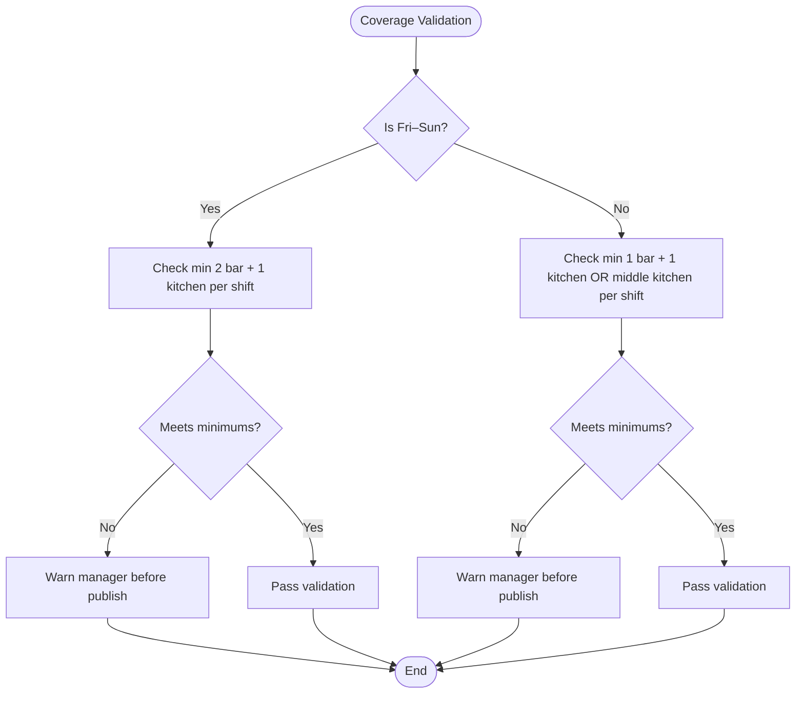

**Diagram sources**
- [PRD-Aplikasi-Penjadwalan-Shift-Kyne.md:191-195](file://docs/PRD-Aplikasi-Penjadwalan-Shift-Kyne.md#L191-L195)

**Section sources**
- [PRD-Aplikasi-Penjadwalan-Shift-Kyne.md:191-195](file://docs/PRD-Aplikasi-Penjadwalan-Shift-Kyne.md#L191-L195)

### Conflict Resolution Mechanisms
- Conflicts occur when two staff members with the same position request leave on the same day, or when shift preferences exceed available slots (for example, three bar staff requesting morning shift on Saturday).
- The system flags conflicts on the manager dashboard; the manager decides which requests to approve.
- Requests that are not approved are treated as if no request was submitted, leaving the manager to assign the day off.

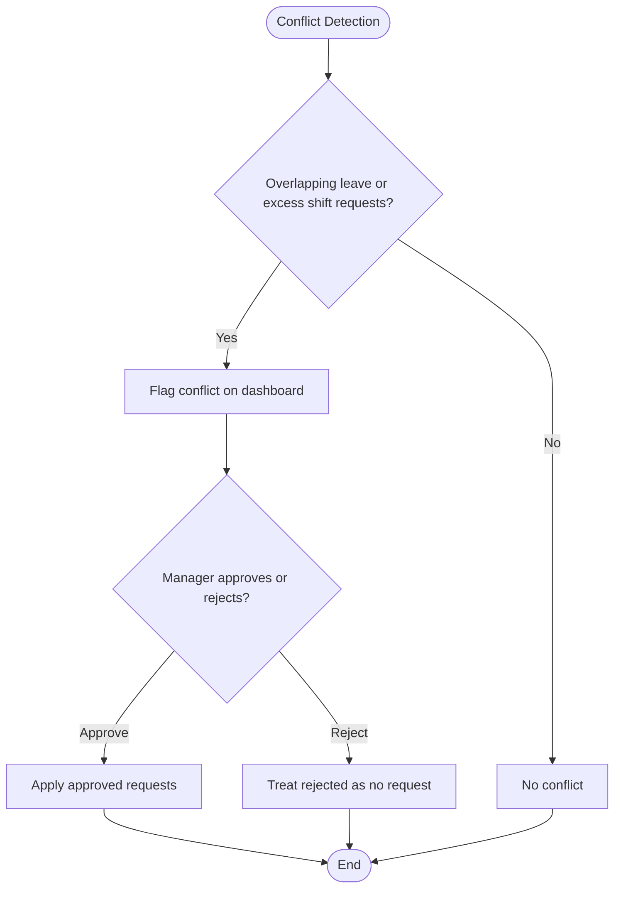

**Diagram sources**
- [PRD-Aplikasi-Penjadwalan-Shift-Kyne.md:92-96](file://docs/PRD-Aplikasi-Penjadwalan-Shift-Kyne.md#L92-L96)
- [PRD-Aplikasi-Penjadwalan-Shift-Kyne.md:132-138](file://docs/PRD-Aplikasi-Penjadwalan-Shift-Kyne.md#L132-L138)

**Section sources**
- [PRD-Aplikasi-Penjadwalan-Shift-Kyne.md:92-96](file://docs/PRD-Aplikasi-Penjadwalan-Shift-Kyne.md#L92-L96)
- [PRD-Aplikasi-Penjadwalan-Shift-Kyne.md:132-138](file://docs/PRD-Aplikasi-Penjadwalan-Shift-Kyne.md#L132-L138)

### Probation Restrictions
- Probationary staff cannot request leave or shift preferences.
- The request menu is hidden for probationary staff; visibility can be adjusted via settings.
- Probation status changes automatically after the end date passes.

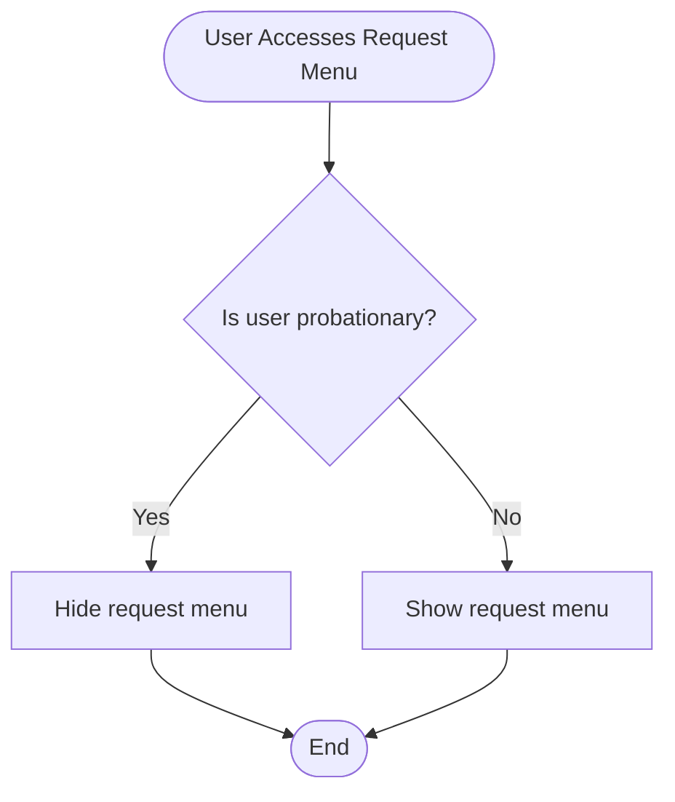

**Diagram sources**
- [PRD-Aplikasi-Penjadwalan-Shift-Kyne.md:187-188](file://docs/PRD-Aplikasi-Penjadwalan-Shift-Kyne.md#L187-L188)
- [PRD-Aplikasi-Penjadwalan-Shift-Kyne.md:118-120](file://docs/PRD-Aplikasi-Penjadwalan-Shift-Kyne.md#L118-L120)

**Section sources**
- [PRD-Aplikasi-Penjadwalan-Shift-Kyne.md:187-188](file://docs/PRD-Aplikasi-Penjadwalan-Shift-Kyne.md#L187-L188)
- [PRD-Aplikasi-Penjadwalan-Shift-Kyne.md:118-120](file://docs/PRD-Aplikasi-Penjadwalan-Shift-Kyne.md#L118-L120)

### Request Window Management
- The request window opens when the current week’s schedule is published.
- The window closes automatically at Sunday 12:00 WITA.
- Requests can be edited while the window is open; after closing, they are locked.

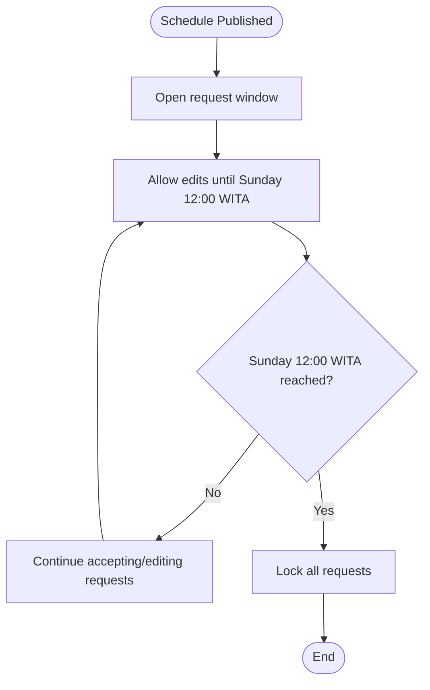

**Diagram sources**
- [PRD-Aplikasi-Penjadwalan-Shift-Kyne.md:77-81](file://docs/PRD-Aplikasi-Penjadwalan-Shift-Kyne.md#L77-L81)
- [PRD-Aplikasi-Penjadwalan-Shift-Kyne.md:126-128](file://docs/PRD-Aplikasi-Penjadwalan-Shift-Kyne.md#L126-L128)

**Section sources**
- [PRD-Aplikasi-Penjadwalan-Shift-Kyne.md:77-81](file://docs/PRD-Aplikasi-Penjadwalan-Shift-Kyne.md#L77-L81)
- [PRD-Aplikasi-Penjadwalan-Shift-Kyne.md:126-128](file://docs/PRD-Aplikasi-Penjadwalan-Shift-Kyne.md#L126-L128)

### Middle Kitchen Automatic Assignment
- When a kitchen colleague takes leave, the remaining kitchen staff assigned to work that day are automatically changed to middle shift.
- Any kitchen shift preference for that day is canceled because the kitchen operates with reduced hours during middle coverage.
- On middle days, the system displays a notice indicating kitchen closure during specific periods.

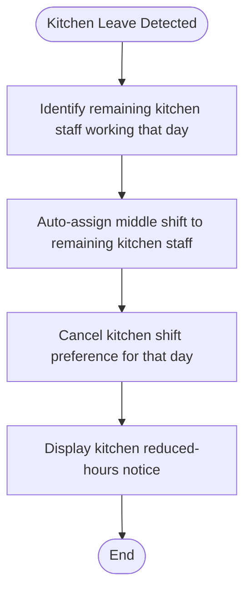

**Diagram sources**
- [PRD-Aplikasi-Penjadwalan-Shift-Kyne.md:86-87](file://docs/PRD-Aplikasi-Penjadwalan-Shift-Kyne.md#L86-L87)
- [PRD-Aplikasi-Penjadwalan-Shift-Kyne.md:190-190](file://docs/PRD-Aplikasi-Penjadwalan-Shift-Kyne.md#L190-L190)
- [PRD-Aplikasi-Penjadwalan-Shift-Kyne.md:162-163](file://docs/PRD-Aplikasi-Penjadwalan-Shift-Kyne.md#L162-L163)

**Section sources**
- [PRD-Aplikasi-Penjadwalan-Shift-Kyne.md:86-87](file://docs/PRD-Aplikasi-Penjadwalan-Shift-Kyne.md#L86-L87)
- [PRD-Aplikasi-Penjadwalan-Shift-Kyne.md:190-190](file://docs/PRD-Aplikasi-Penjadwalan-Shift-Kyne.md#L190-L190)
- [PRD-Aplikasi-Penjadwalan-Shift-Kyne.md:162-163](file://docs/PRD-Aplikasi-Penjadwalan-Shift-Kyne.md#L162-L163)

### Handover Overlap and Reduced-Hours Kitchen Days
- Morning and evening shifts overlap by 30 minutes (15:00–15:30) to support handover between shifts.
- On middle kitchen days, the kitchen operates with reduced hours: closed from 07:30–11:00 and from 19:00–23:00.
- These rules ensure smooth transitions and clear communication about kitchen availability.

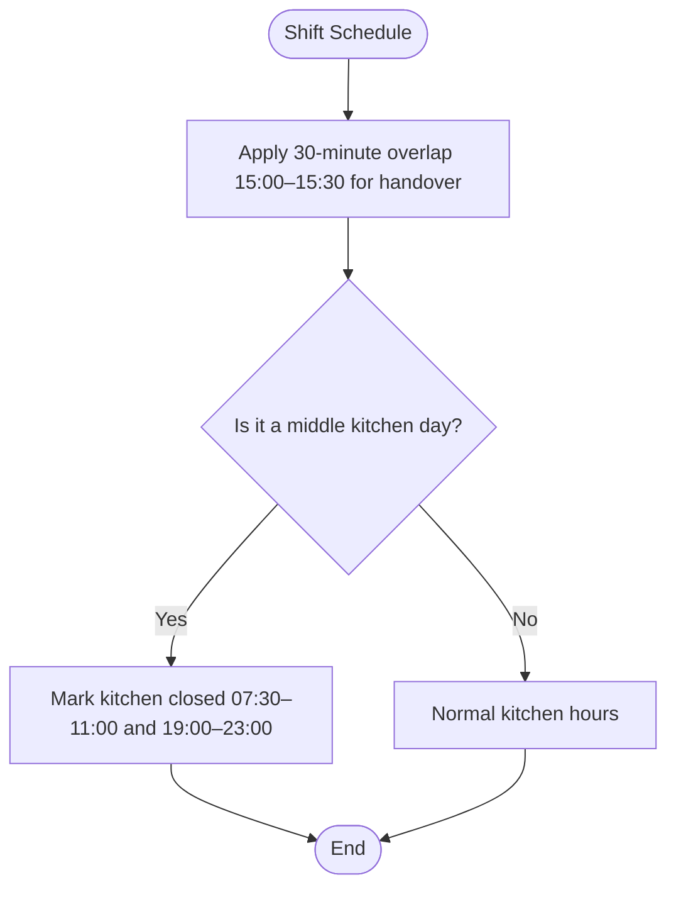

**Diagram sources**
- [PRD-Aplikasi-Penjadwalan-Shift-Kyne.md:177-177](file://docs/PRD-Aplikasi-Penjadwalan-Shift-Kyne.md#L177-L177)
- [PRD-Aplikasi-Penjadwalan-Shift-Kyne.md:190-190](file://docs/PRD-Aplikasi-Penjadwalan-Shift-Kyne.md#L190-L190)
- [PRD-Aplikasi-Penjadwalan-Shift-Kyne.md:162-163](file://docs/PRD-Aplikasi-Penjadwalan-Shift-Kyne.md#L162-L163)

**Section sources**
- [PRD-Aplikasi-Penjadwalan-Shift-Kyne.md:177-177](file://docs/PRD-Aplikasi-Penjadwalan-Shift-Kyne.md#L177-L177)
- [PRD-Aplikasi-Penjadwalan-Shift-Kyne.md:190-190](file://docs/PRD-Aplikasi-Penjadwalan-Shift-Kyne.md#L190-L190)
- [PRD-Aplikasi-Penjadwalan-Shift-Kyne.md:162-163](file://docs/PRD-Aplikasi-Penjadwalan-Shift-Kyne.md#L162-L163)

## Dependency Analysis
The business rules depend on several interconnected components:
- Employee role and probation status affect request eligibility.
- Weekly schedule state controls whether the request window is open or closed.
- Leave and shift requests influence draft generation and coverage validation.
- Middle-kitchen automation depends on kitchen leave patterns.
- Coverage validation depends on day-of-week classification and staffing levels.

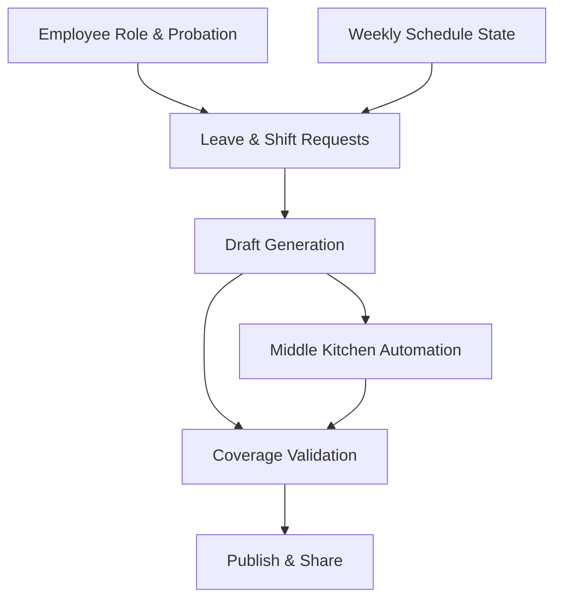

**Diagram sources**
- [PRD-Aplikasi-Penjadwalan-Shift-Kyne.md:73-90](file://docs/PRD-Aplikasi-Penjadwalan-Shift-Kyne.md#L73-L90)
- [PRD-Aplikasi-Penjadwalan-Shift-Kyne.md:122-130](file://docs/PRD-Aplikasi-Penjadwalan-Shift-Kyne.md#L122-L130)
- [PRD-Aplikasi-Penjadwalan-Shift-Kyne.md:140-147](file://docs/PRD-Aplikasi-Penjadwalan-Shift-Kyne.md#L140-L147)
- [PRD-Aplikasi-Penjadwalan-Shift-Kyne.md:191-195](file://docs/PRD-Aplikasi-Penjadwalan-Shift-Kyne.md#L191-L195)

**Section sources**
- [PRD-Aplikasi-Penjadwalan-Shift-Kyne.md:73-90](file://docs/PRD-Aplikasi-Penjadwalan-Shift-Kyne.md#L73-L90)
- [PRD-Aplikasi-Penjadwalan-Shift-Kyne.md:122-130](file://docs/PRD-Aplikasi-Penjadwalan-Shift-Kyne.md#L122-L130)
- [PRD-Aplikasi-Penjadwalan-Shift-Kyne.md:140-147](file://docs/PRD-Aplikasi-Penjadwalan-Shift-Kyne.md#L140-L147)
- [PRD-Aplikasi-Penjadwalan-Shift-Kyne.md:191-195](file://docs/PRD-Aplikasi-Penjadwalan-Shift-Kyne.md#L191-L195)

## Performance Considerations
- Keep validation checks efficient by evaluating day-of-week categories once per schedule draft.
- Cache request window state based on the current time and timezone to avoid repeated computations.
- Precompute coverage violations per day and shift to minimize re-validation cost during manual adjustments.
- Avoid heavy operations during peak request submission times; batch validations where possible.

[No sources needed since this section provides general guidance]

## Troubleshooting Guide
Common issues and resolutions:
- Request window remains open past Sunday 12:00 WITA: verify timezone configuration and deadline enforcement logic.
- Middle-kitchen notice not displayed: confirm that middle-day detection and kitchen closure notices are applied consistently.
- Coverage warnings not appearing: ensure validation runs after every change and that day-type classification is correct.
- Probation staff seeing request menu: check role and probation status evaluation logic.

**Section sources**
- [PRD-Aplikasi-Penjadwalan-Shift-Kyne.md:126-128](file://docs/PRD-Aplikasi-Penjadwalan-Shift-Kyne.md#L126-L128)
- [PRD-Aplikasi-Penjadwalan-Shift-Kyne.md:162-163](file://docs/PRD-Aplikasi-Penjadwalan-Shift-Kyne.md#L162-L163)
- [PRD-Aplikasi-Penjadwalan-Shift-Kyne.md:191-195](file://docs/PRD-Aplikasi-Penjadwalan-Shift-Kyne.md#L191-L195)
- [PRD-Aplikasi-Penjadwalan-Shift-Kyne.md:187-188](file://docs/PRD-Aplikasi-Penjadwalan-Shift-Kyne.md#L187-L188)

## Conclusion
The Kyne café scheduling system enforces clear business rules around shift types, leave allocation, coverage requirements, conflict resolution, probation restrictions, request windows, and middle-kitchen automation. These rules ensure predictable staffing, smooth handovers, and transparent communication about kitchen availability. The validation logic supports managers in making informed decisions while protecting operational standards across busy and quiet days.

[No sources needed since this section summarizes without analyzing specific files]