# Data Model Design

<cite>
**Referenced Files in This Document**
- [README.md](file://README.md)
- [PRD-Aplikasi-Penjadwalan-Shift-Kyne.md](file://docs/PRD-Aplikasi-Penjadwalan-Shift-Kyne.md)
</cite>

## Table of Contents
1. [Introduction](#introduction)
2. [Project Structure](#project-structure)
3. [Core Components](#core-components)
4. [Architecture Overview](#architecture-overview)
5. [Detailed Component Analysis](#detailed-component-analysis)
6. [Dependency Analysis](#dependency-analysis)
7. [Performance Considerations](#performance-considerations)
8. [Troubleshooting Guide](#troubleshooting-guide)
9. [Conclusion](#conclusion)
10. [Appendices](#appendices)

## Introduction
This document defines the data model for the Kyne shift scheduling application. It focuses on seven core entities that support weekly shift planning, leave and shift requests, manager publishing, and system configuration. The model is designed to be ERP-ready: it uses UUID identifiers, audit fields, soft delete patterns, and explicit timezone handling for WITA (Asia/Makassar).

The repository is currently an early scaffold without implementation code. The data model is therefore derived from the product requirements document and the project’s stated goals.

**Section sources**
- [README.md:1-25](file://README.md#L1-L25)
- [PRD-Aplikasi-Penjadwalan-Shift-Kyne.md:1-267](file://docs/PRD-Aplikasi-Penjadwalan-Shift-Kyne.md#L1-L267)

## Project Structure
At this stage, the repository contains:
- A top-level README describing the project as a standalone scheduling application scaffold.
- A product requirements document detailing business rules, user roles, weekly scheduling flow, and a draft data model.
- No backend, frontend, database schema, or migration files yet.

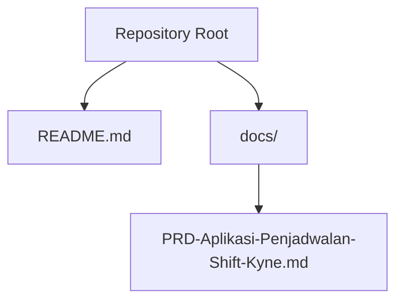

**Diagram sources**
- [README.md:1-25](file://README.md#L1-L25)
- [PRD-Aplikasi-Penjadwalan-Shift-Kyne.md:1-267](file://docs/PRD-Aplikasi-Penjadwalan-Shift-Kyne.md#L1-L267)

**Section sources**
- [README.md:1-25](file://README.md#L1-L25)
- [PRD-Aplikasi-Penjadwalan-Shift-Kyne.md:1-267](file://docs/PRD-Aplikasi-Penjadwalan-Shift-Kyne.md#L1-L267)

## Core Components
The MVP requires seven entities:

| Entity | Purpose | Key Fields | Notes |
|---|---|---|---|
| Employee | Staff identity and access control | id, name, google_email, position, role, status, probation_end_date, is_active | Email whitelist controls login; role distinguishes manager vs staff; status tracks probation vs permanent; is_active supports soft deactivation. |
| ShiftType | Reusable shift definitions | id, code, start_time, end_time, applicable_positions | Codes include PAGI, SORE, MIDDLE; times are local WITA; positions restrict eligibility. |
| ScheduleWeek | Weekly schedule container | id, start_date, status, request_deadline, published_at, published_by, copied_from_week_id | start_date is Monday; status is draft or published; deadline drives request window; copy source links to previous week. |
| ShiftAssignment | Core scheduling table | id, week_id, employee_id, date, shift_type_id, source | Links employees to dates and shifts; shift_type_id can be null for leave; source tracks how placement was created. |
| OffRequest | Leave request | id, week_id, employee_id, date, status, decided_by, decided_at | One leave per employee per week; status includes pending, approved, rejected. |
| ShiftRequest | Preferred shift request | id, week_id, employee_id, date, shift_type_id, status, decided_by, decided_at | Up to one per day per employee; preferred but not guaranteed until approved. |
| Setting | System configuration | key, value | Stores policies such as probation request policy, deadline settings, and timezone. |

These entities together enable:
- Manager-managed staff records with Google email whitelisting.
- Weekly scheduling cycles anchored to Monday.
- Automated middle kitchen logic when a kitchen colleague is off.
- Request windows bounded by weekly deadlines.
- Auditability through decision metadata and source tracking.

**Section sources**
- [PRD-Aplikasi-Penjadwalan-Shift-Kyne.md:197-217](file://docs/PRD-Aplikasi-Penjadwalan-Shift-Kyne.md#L197-L217)

## Architecture Overview
The data architecture centers on a weekly cadence. Employees are assigned to shifts within a ScheduleWeek. Requests are submitted before the deadline and then applied during schedule construction. Configuration controls behavior such as timezone and deadline timing.

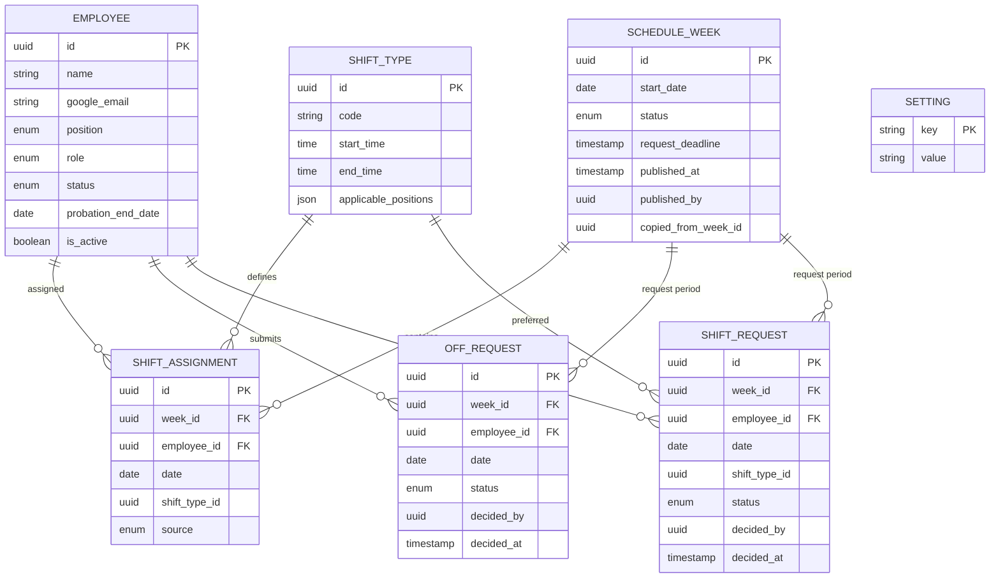

**Diagram sources**
- [PRD-Aplikasi-Penjadwalan-Shift-Kyne.md:197-217](file://docs/PRD-Aplikasi-Penjadwalan-Shift-Kyne.md#L197-L217)

## Detailed Component Analysis

### Employee
Employee represents staff members who can log in via Google and participate in scheduling.

- Identifier: UUID primary key.
- Identity: name and google_email.
- Position: bar or kitchen. Each staff has one fixed position.
- Role: manager or staff.
- Status: probation or permanent. Probation transitions automatically after probation_end_date.
- Active flag: is_active enables soft deactivation while preserving history.

Business implications:
- Only whitelisted google_email values may authenticate.
- Probation affects whether request menus are visible.
- Inactive employees cannot log in but retain historical schedules.

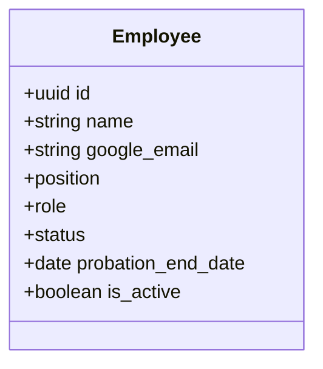

**Diagram sources**
- [PRD-Aplikasi-Penjadwalan-Shift-Kyne.md:114-121](file://docs/PRD-Aplikasi-Penjadwalan-Shift-Kyne.md#L114-L121)
- [PRD-Aplikasi-Penjadwalan-Shift-Kyne.md:197-217](file://docs/PRD-Aplikasi-Penjadwalan-Shift-Kyne.md#L197-L217)

**Section sources**
- [PRD-Aplikasi-Penjadwalan-Shift-Kyne.md:114-121](file://docs/PRD-Aplikasi-Penjadwalan-Shift-Kyne.md#L114-L121)
- [PRD-Aplikasi-Penjadwalan-Shift-Kyne.md:197-217](file://docs/PRD-Aplikasi-Penjadwalan-Shift-Kyne.md#L197-L217)

### ShiftType
ShiftType defines reusable shift templates used across weeks.

- Identifier: UUID primary key.
- Code: PAGI, SORE, or MIDDLE.
- Time range: start_time and end_time in local WITA.
- Applicable positions: restricts which positions can use the shift.

Rules:
- Pagi and Sore apply to both bar and kitchen.
- Middle applies only to kitchen and is typically used when a kitchen colleague is off.
- Overlap between Pagi and Sore supports handover.

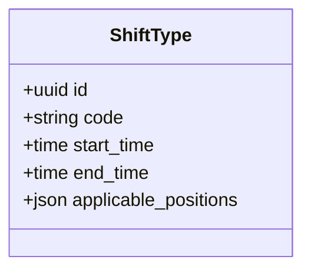

**Diagram sources**
- [PRD-Aplikasi-Penjadwalan-Shift-Kyne.md:169-178](file://docs/PRD-Aplikasi-Penjadwalan-Shift-Kyne.md#L169-L178)
- [PRD-Aplikasi-Penjadwalan-Shift-Kyne.md:197-217](file://docs/PRD-Aplikasi-Penjadwalan-Shift-Kyne.md#L197-L217)

**Section sources**
- [PRD-Aplikasi-Penjadwalan-Shift-Kyne.md:169-178](file://docs/PRD-Aplikasi-Penjadwalan-Shift-Kyne.md#L169-L178)
- [PRD-Aplikasi-Penjadwalan-Shift-Kyne.md:197-217](file://docs/PRD-Aplikasi-Penjadwalan-Shift-Kyne.md#L197-L217)

### ScheduleWeek
ScheduleWeek is the weekly container for all assignments and requests.

- Identifier: UUID primary key.
- Start date: Monday anchor for the week.
- Status: draft or published.
- Request deadline: closes the request window.
- Publication metadata: published_at and published_by.
- Copy source: copied_from_week_id references the previous week used as a template.

Lifecycle:
- When a week is published, the next week’s request window opens.
- Managers create drafts by copying the previous week and applying automatic rules.
- Coverage validation runs before publish.

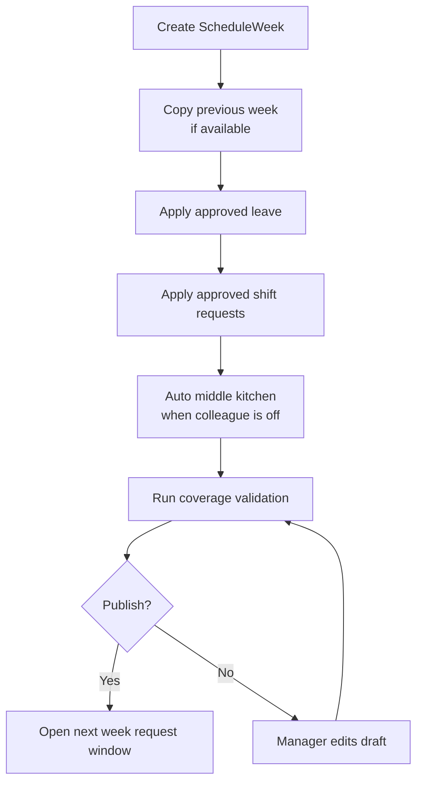

**Diagram sources**
- [PRD-Aplikasi-Penjadwalan-Shift-Kyne.md:73-90](file://docs/PRD-Aplikasi-Penjadwalan-Shift-Kyne.md#L73-L90)
- [PRD-Aplikasi-Penjadwalan-Shift-Kyne.md:140-155](file://docs/PRD-Aplikasi-Penjadwalan-Shift-Kyne.md#L140-L155)
- [PRD-Aplikasi-Penjadwalan-Shift-Kyne.md:197-217](file://docs/PRD-Aplikasi-Penjadwalan-Shift_Kyne.md#L197-L217)

**Section sources**
- [PRD-Aplikasi-Penjadwalan-Shift-Kyne.md:73-90](file://docs/PRD-Aplikasi-Penjadwalan-Shift-Kyne.md#L73-L90)
- [PRD-Aplikasi-Penjadwalan-Shift-Kyne.md:140-155](file://docs/PRD-Aplikasi-Penjadwalan-Shift-Kyne.md#L140-L155)
- [PRD-Aplikasi-Penjadwalan-Shift-Kyne.md:197-217](file://docs/PRD-Aplikasi-Penjadwalan-Shift-Kyne.md#L197-L217)

### ShiftAssignment
ShiftAssignment is the core scheduling table linking employees to dates and shifts.

- Identifier: UUID primary key.
- Week reference: week_id ties assignment to a ScheduleWeek.
- Employee reference: employee_id identifies the staff member.
- Date: date field marks the calendar day.
- Shift: shift_type_id references ShiftType; null means leave.
- Source: indicates how the assignment was created.

Source values:
- copy: inherited from previous week.
- request: applied from an approved shift request.
- auto_middle: automatic middle kitchen rule.
- manual: direct manager edit.

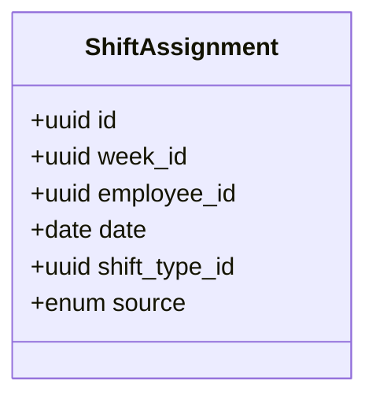

**Diagram sources**
- [PRD-Aplikasi-Penjadwalan-Shift-Kyne.md:206-206](file://docs/PRD-Aplikasi-Penjadwalan-Shift-Kyne.md#L206-L206)
- [PRD-Aplikasi-Penjadwalan-Shift-Kyne.md:140-155](file://docs/PRD-Aplikasi-Penjadwalan-Shift-Kyne.md#L140-L155)

**Section sources**
- [PRD-Aplikasi-Penjadwalan-Shift-Kyne.md:206-206](file://docs/PRD-Aplikasi-Penjadwalan-Shift-Kyne.md#L206-L206)
- [PRD-Aplikasi-Penjadwalan-Shift-Kyne.md:140-155](file://docs/PRD-Aplikasi-Penjadwalan-Shift-Kyne.md#L140-L155)

### OffRequest
OffRequest captures leave submissions.

- Identifier: UUID primary key.
- Period: week_id and date define the requested day.
- Employee: employee_id identifies the requester.
- Status: pending, approved, or rejected.
- Decision metadata: decided_by and decided_at record who approved or rejected and when.

Constraints:
- Maximum one leave per employee per week.
- Allowed days are Monday through Thursday.
- Probation staff do not see request menus.

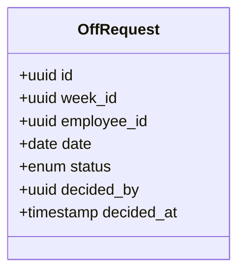

**Diagram sources**
- [PRD-Aplikasi-Penjadwalan-Shift-Kyne.md:122-131](file://docs/PRD-Aplikasi-Penjadwalan-Shift-Kyne.md#L122-L131)
- [PRD-Aplikasi-Penjadwalan-Shift-Kyne.md:197-217](file://docs/PRD-Aplikasi-Penjadwalan-Shift-Kyne.md#L197-L217)

**Section sources**
- [PRD-Aplikasi-Penjadwalan-Shift-Kyne.md:122-131](file://docs/PRD-Aplikasi-Penjadwalan-Shift-Kyne.md#L122-L131)
- [PRD-Aplikasi-Penjadwalan-Shift-Kyne.md:197-217](file://docs/PRD-Aplikasi-Penjadwalan-Shift-Kyne.md#L197-L217)

### ShiftRequest
ShiftRequest captures preferred shift submissions.

- Identifier: UUID primary key.
- Period: week_id and date define the requested day.
- Employee: employee_id identifies the requester.
- Shift preference: shift_type_id indicates PAGI or SORE.
- Status: pending, approved, or rejected.
- Decision metadata: decided_by and decided_at.

Constraints:
- Up to one request per day per employee.
- Preferred but not guaranteed; conflicts are resolved by the manager.
- Conflicts occur when too many employees request the same shift type on the same day.

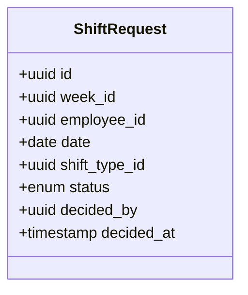

**Diagram sources**
- [PRD-Aplikasi-Penjadwalan-Shift-Kyne.md:122-131](file://docs/PRD-Aplikasi-Penjadwalan-Shift-Kyne.md#L122-L131)
- [PRD-Aplikasi-Penjadwalan-Shift-Kyne.md:197-217](file://docs/PRD-Aplikasi-Penjadwalan-Shift-Kyne.md#L197-L217)

**Section sources**
- [PRD-Aplikasi-Penjadwalan-Shift-Kyne.md:122-131](file://docs/PRD-Aplikasi-Penjadwalan-Shift-Kyne.md#L122-L131)
- [PRD-Aplikasi-Penjadwalan-Shift-Kyne.md:197-217](file://docs/PRD-Aplikasi-Penjadwalan-Shift-Kyne.md#L197-L217)

### Setting
Setting stores system-wide configuration.

- Primary key: key.
- Value: value stored as text.

Example keys:
- probation_can_request: controls whether probation staff can submit requests.
- deadline_day: weekday when request window closes.
- deadline_time: time of day for closing the request window.
- timezone: expected to be Asia/Makassar for WITA.

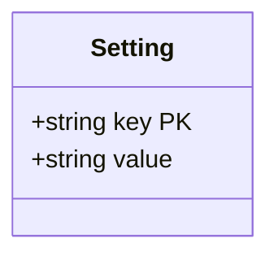

**Diagram sources**
- [PRD-Aplikasi-Penjadwalan-Shift-Kyne.md:209-209](file://docs/PRD-Aplikasi-Penjadwalan-Shift-Kyne.md#L209-L209)
- [PRD-Aplikasi-Penjadwalan-Shift-Kyne.md:226-226](file://docs/PRD-Aplikasi-Penjadwalan-Shift-Kyne.md#L226-L226)

**Section sources**
- [PRD-Aplikasi-Penjadwalan-Shift-Kyne.md:209-209](file://docs/PRD-Aplikasi-Penjadwalan-Shift-Kyne.md#L209-L209)
- [PRD-Aplikasi-Penjadwalan-Shift-Kyne.md:226-226](file://docs/PRD-Aplikasi-Penjadwalan-Shift-Kyne.md#L226-L226)

## Dependency Analysis
The following diagram shows entity relationships and constraints relevant to scheduling.

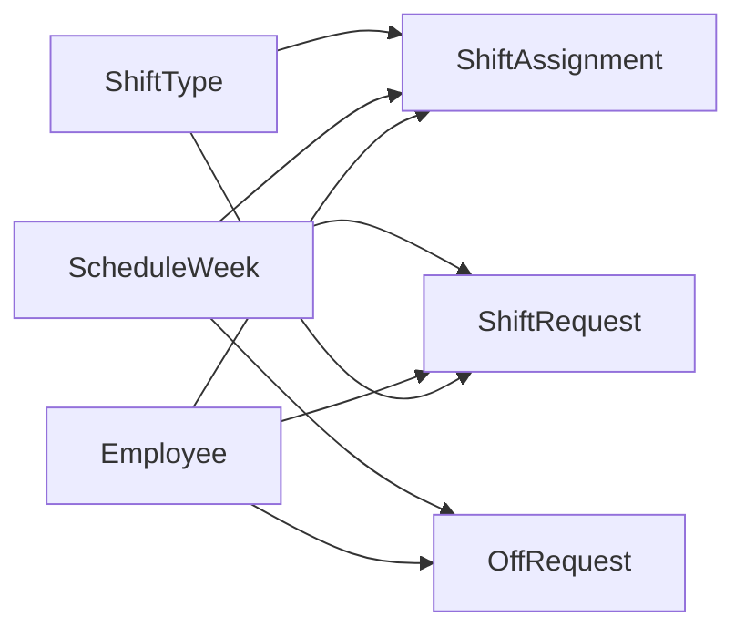

Key dependencies:
- ShiftAssignment depends on ScheduleWeek, Employee, and ShiftType.
- OffRequest and ShiftRequest depend on ScheduleWeek and Employee.
- ShiftRequest also depends on ShiftType.
- ScheduleWeek may reference another ScheduleWeek via copied_from_week_id.

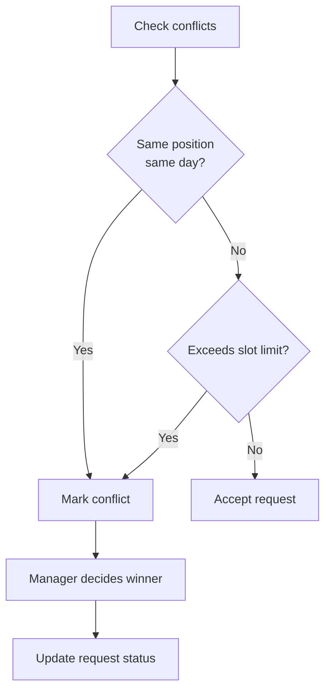

**Diagram sources**
- [PRD-Aplikasi-Penjadwalan-Shift-Kyne.md:92-97](file://docs/PRD-Aplikasi-Penjadwalan-Shift-Kyne.md#L92-L97)
- [PRD-Aplikasi-Penjadwalan-Shift-Kyne.md:197-217](file://docs/PRD-Aplikasi-Penjadwalan-Shift-Kyne.md#L197-L217)

**Section sources**
- [PRD-Aplikasi-Penjadwalan-Shift-Kyne.md:92-97](file://docs/PRD-Aplikasi-Penjadwalan-Shift-Kyne.md#L92-L97)
- [PRD-Aplikasi-Penjadwalan-Shift-Kyne.md:197-217](file://docs/PRD-Aplikasi-Penjadwalan-Shift-Kyne.md#L197-L217)

## Performance Considerations
- Use UUIDs consistently to avoid sequential ID exposure and to prepare for ERP integration.
- Index foreign keys: week_id, employee_id, shift_type_id, and copied_from_week_id.
- Partition or archive old ScheduleWeek rows if historical queries become heavy.
- Keep request_deadline checks server-side to prevent client bypass.
- Cache frequently read configurations from Setting to reduce repeated lookups.
- Avoid storing computed work hours in ShiftAssignment; calculate totals per week from ShiftType durations.

[No sources needed since this section provides general guidance]

## Troubleshooting Guide
Common issues and resolutions:

- Request window closed unexpectedly:
  - Verify request_deadline against current time using WITA.
  - Confirm timezone setting is Asia/Makassar.

- Duplicate leave or shift requests:
  - Enforce one OffRequest per employee per week.
  - Enforce one ShiftRequest per employee per day.

- Kitchen coverage gaps:
  - Ensure auto_middle logic runs when a kitchen colleague is off.
  - Validate Friday–Sunday coverage rules before publish.

- Probation staff seeing request menus:
  - Check probation_end_date and probation_can_request setting.

- Soft-deleted employees still appearing:
  - Filter by is_active where appropriate.
  - Preserve history for inactive employees.

**Section sources**
- [PRD-Aplikasi-Penjadwalan-Shift-Kyne.md:114-131](file://docs/PRD-Aplikasi-Penjadwalan-Shift-Kyne.md#L114-L131)
- [PRD-Aplikasi-Penjadwalan-Shift-Kyne.md:165-195](file://docs/PRD-Aplikasi-Penjadwalan-Shift-Kyne.md#L165-L195)
- [PRD-Aplikasi-Penjadwalan-Shift-Kyne.md:226-226](file://docs/PRD-Aplikasi-Penjadwalan-Shift-Kyne.md#L226-L226)

## Conclusion
The seven-entity data model provides a clear foundation for Kyne’s weekly shift scheduling workflow. It separates staff identity, shift definitions, weekly containers, assignments, requests, and configuration. With UUIDs, audit fields, soft delete patterns, and WITA timezone handling, the model is prepared for future ERP migration. Implementation should enforce business rules around request limits, conflict resolution, coverage validation, and publication workflows.

[No sources needed since this section summarizes without analyzing specific files]

## Appendices

### Database Design Principles for ERP Migration
- Identifier strategy:
  - Use UUID for all primary keys.
- Audit fields:
  - Add created_at, updated_at, and created_by to tables that benefit from change tracking.
- Soft delete pattern:
  - Prefer is_active or deleted_at flags instead of hard deletes.
- Timezone handling:
  - Store dates as calendar dates.
  - Store times as local WITA.
  - Record timezone in Setting as Asia/Makassar.
- Referential integrity:
  - Foreign keys from ShiftAssignment to ScheduleWeek, Employee, and ShiftType.
  - Foreign keys from OffRequest and ShiftRequest to ScheduleWeek and Employee.
- Constraints:
  - Unique constraints for OffRequest per employee per week.
  - Unique constraints for ShiftRequest per employee per day.
  - Enum constraints for status, role, position, and source.

**Section sources**
- [PRD-Aplikasi-Penjadwalan-Shift-Kyne.md:211-217](file://docs/PRD-Aplikasi-Penjadwalan-Shift-Kyne.md#L211-L217)
- [PRD-Aplikasi-Penjadwalan-Shift-Kyne.md:226-226](file://docs/PRD-Aplikasi-Penjadwalan-Shift-Kyne.md#L226-L226)