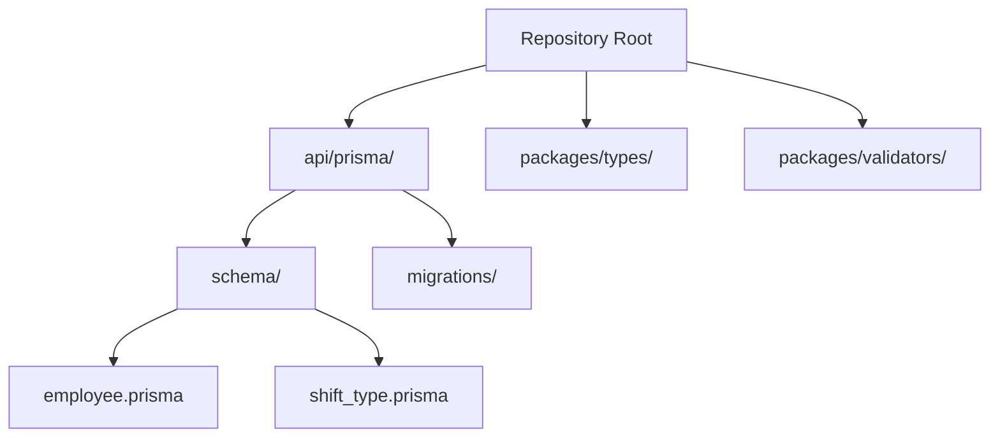
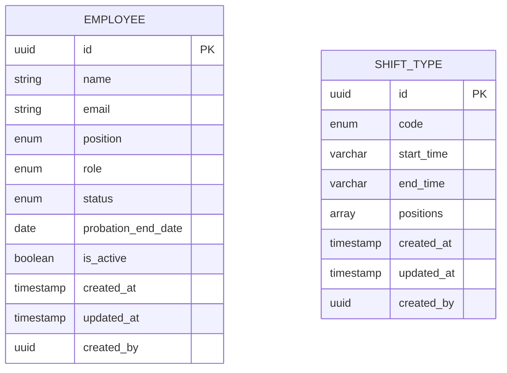
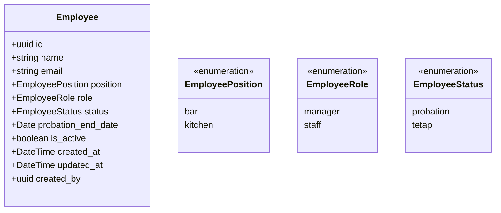
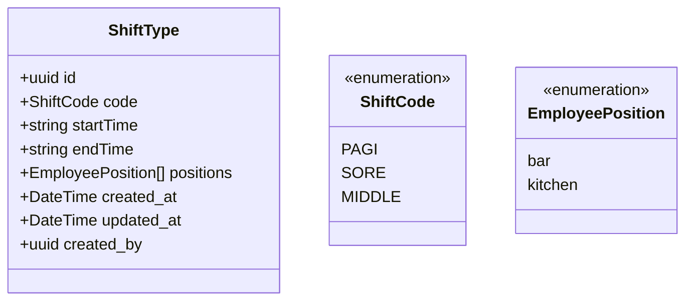
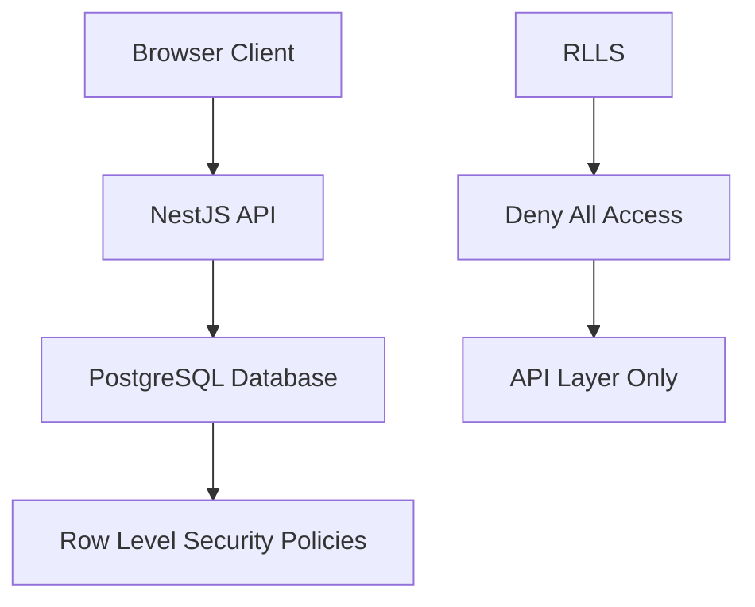
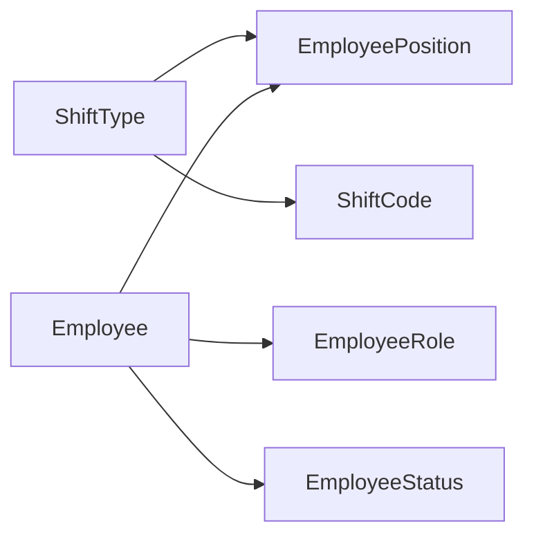

# Data Model Design

<cite>
**Referenced Files in This Document**
- [employee.prisma](file://api/prisma/schema/employee.prisma)
- [shift_type.prisma](file://api/prisma/schema/shift_type.prisma)
- [schema.prisma](file://api/prisma/schema/schema.prisma)
- [migration.sql](file://api/prisma/migrations/20261108120000_init/migration.sql)
- [hardening migration.sql](file://api/prisma/migrations/20261108120100_hardening/migration.sql)
- [seed.ts](file://api/prisma/seed.ts)
- [shift.ts](file://packages/types/src/shift.ts)
- [employee.ts](file://packages/types/src/employee.ts)
- [shift.ts](file://packages/validators/src/shift.ts)
</cite>

## Update Summary
**Changes Made**
- Updated Employee entity documentation to reflect actual Prisma implementation with UUID identifiers, audit fields, and soft delete patterns
- Updated ShiftType entity documentation to document varchar(5) time format and position array relationships
- Added database security features including Row Level Security (RLS) and CHECK constraints
- Documented the complete enum structure for positions, roles, and statuses
- Added seed data structure and validation schemas

## Table of Contents
1. [Introduction](#introduction)
2. [Project Structure](#project-structure)
3. [Core Components](#core-components)
4. [Architecture Overview](#architecture-overview)
5. [Detailed Component Analysis](#detailed-component-analysis)
6. [Database Implementation Details](#database-implementation-details)
7. [Security and Constraints](#security-and-constraints)
8. [Seed Data and Validation](#seed-data-and-validation)
9. [Dependency Analysis](#dependency-analysis)
10. [Performance Considerations](#performance-considerations)
11. [Troubleshooting Guide](#troubleshooting-guide)
12. [Conclusion](#conclusion)

## Introduction
This document defines the data model for the Kyne shift scheduling application, now implemented using Prisma ORM with PostgreSQL. The current implementation includes two core entities: Employee and ShiftType, with a foundation designed for ERP migration readiness. The model uses UUID identifiers, audit fields, soft delete patterns, and explicit timezone handling for WITA (Asia/Makassar).

The repository has progressed from an early scaffold to having a working Prisma schema with proper enums, constraints, and security measures.

**Section sources**
- [employee.prisma:1-37](file://api/prisma/schema/employee.prisma#L1-L37)
- [shift_type.prisma:1-28](file://api/prisma/schema/shift_type.prisma#L1-L28)

## Project Structure
The current implementation consists of:
- Prisma schema files defining Employee and ShiftType models
- Database migrations with hardening constraints
- Seed data for shift type catalog
- Type definitions and validation schemas
- Row Level Security policies for database protection

**Diagram sources**
- [employee.prisma:1-37](file://api/prisma/schema/employee.prisma#L1-L37)
- [shift_type.prisma:1-28](file://api/prisma/schema/shift_type.prisma#L1-L28)

**Section sources**
- [employee.prisma:1-37](file://api/prisma/schema/employee.prisma#L1-L37)
- [shift_type.prisma:1-28](file://api/prisma/schema/shift_type.prisma#L1-L28)

## Core Components
The current implementation focuses on two foundational entities that establish the core business concepts:

| Entity | Purpose | Key Fields | Notes |
|---|---|---|---|
| Employee | Staff identity and access control | id, name, email, position, role, status, probation_end_date, is_active, audit_fields | Email whitelist controls login; role distinguishes manager vs staff; status tracks probation vs permanent; is_active supports soft deactivation. |
| ShiftType | Reusable shift definitions | id, code, start_time, end_time, positions | Codes include PAGI, SORE, MIDDLE; times are local WITA as HH:MM strings; positions restrict eligibility via array. |

These entities together enable:
- Manager-managed staff records with Google email whitelisting.
- Standardized shift templates with position-based restrictions.
- Audit trail for all data changes through created_at, updated_at, and created_by fields.
- Soft deletion support while preserving historical data integrity.

**Section sources**
- [employee.prisma:21-36](file://api/prisma/schema/employee.prisma#L21-L36)
- [shift_type.prisma:16-27](file://api/prisma/schema/shift_type.prisma#L16-L27)

## Architecture Overview
The data architecture centers on two core entities that will serve as the foundation for future scheduling functionality. Employees are categorized by position and role, while ShiftType provides standardized shift templates with time management.

**Diagram sources**
- [employee.prisma:21-36](file://api/prisma/schema/employee.prisma#L21-L36)
- [shift_type.prisma:16-27](file://api/prisma/schema/shift_type.prisma#L16-L27)

## Detailed Component Analysis

### Employee
Employee represents staff members who can log in via Google and participate in scheduling.

**Updated** - Now reflects actual Prisma implementation with full audit trail and soft delete support.

- Identifier: UUID primary key with @default(uuid()) and @db.Uuid mapping.
- Identity: name and email (unique constraint for Google authentication whitelist).
- Position: EmployeePosition enum (bar or kitchen) - maps to HR position in ERP later.
- Role: EmployeeRole enum (manager or staff) with default 'staff'.
- Status: EmployeeStatus enum (probation or tetap/permanent) with default 'probation'.
- Probation management: probation_end_date as nullable Date field for automatic status transitions.
- Active flag: is_active Boolean with default true for soft deactivation.
- Audit fields: created_at, updated_at, and created_by for change tracking.

Business implications:
- Only whitelisted email values may authenticate via Google OAuth.
- Probation affects whether request menus are visible until probation_end_date passes.
- Inactive employees cannot log in but retain historical schedules.
- Index on is_active for efficient filtering of active employees.

**Diagram sources**
- [employee.prisma:3-17](file://api/prisma/schema/employee.prisma#L3-L17)
- [employee.prisma:21-36](file://api/prisma/schema/employee.prisma#L21-L36)

**Section sources**
- [employee.prisma:1-37](file://api/prisma/schema/employee.prisma#L1-L37)

### ShiftType
ShiftType defines reusable shift templates used across weeks.

**Updated** - Now reflects actual implementation with varchar(5) time format and position array relationship.

- Identifier: UUID primary key with @default(uuid()) and @db.Uuid mapping.
- Code: ShiftCode enum (PAGI, SORE, or MIDDLE) with unique constraint.
- Time range: startTime and endTime stored as VARCHAR(5) in HH:MM format for local WITA wall-clock times.
- Positions: EmployeePosition[] array (posisi_berlaku) restricting which positions can use the shift.
- Audit fields: created_at, updated_at, and created_by for change tracking.

Rules:
- Pagi (07:30-15:30) and Sore (15:00-23:00) apply to both bar and kitchen positions.
- Middle (11:00-19:00) applies only to kitchen position and is typically used when a kitchen colleague is off.
- Overlap between Pagi and Sore supports handover periods.
- Time validation enforced via CHECK constraints ensuring HH:MM format.

**Diagram sources**
- [shift_type.prisma:1-5](file://api/prisma/schema/shift_type.prisma#L1-L5)
- [shift_type.prisma:16-27](file://api/prisma/schema/shift_type.prisma#L16-L27)

**Section sources**
- [shift_type.prisma:1-28](file://api/prisma/schema/shift_type.prisma#L1-L28)

## Database Implementation Details

### Enum Definitions
The database uses PostgreSQL ENUM types for type safety and consistency:

- **EmployeePosition**: bar, kitchen
- **EmployeeRole**: manager, staff  
- **EmployeeStatus**: probation, tetap (Indonesian for permanent)
- **ShiftCode**: PAGI, SORE, MIDDLE

### Time Management Strategy
**Critical Implementation Detail**: Shift times are stored as VARCHAR(5) rather than TIME columns to avoid timezone conversion issues.

- Format: HH:MM (24-hour format)
- Storage: Local WITA wall-clock times
- Validation: CHECK constraints enforce valid time format
- Rationale: Prisma round-trips TIME through Date objects, causing timezone casting issues

### Audit Trail Implementation
All tables include standard audit fields:
- **created_at**: Timestamp when record was created
- **updated_at**: Timestamp when record was last modified  
- **created_by**: UUID of user who created the record

### Soft Delete Pattern
- **is_active**: Boolean field with default true
- Allows historical data preservation while preventing new assignments
- Indexed for efficient querying of active employees

**Section sources**
- [migration.sql:4-14](file://api/prisma/migrations/20261108120000_init/migration.sql#L4-L14)
- [shift_type.prisma:7-15](file://api/prisma/schema/shift_type.prisma#L7-L15)

## Security and Constraints

### Row Level Security (RLS)
**New Feature**: Database-level security has been implemented with Row Level Security policies.

- All tables have RLS enabled
- Default deny-all policies for anon and authenticated roles
- API layer runs as table owner with full access
- Browser clients cannot directly access these tables

### Data Validation Constraints
**Enhanced Security**: Additional database-level validation ensures data integrity.

- **Time format validation**: CHECK constraints ensure HH:MM format for shift times
- **Email uniqueness**: Unique constraint on employee email
- **Shift code uniqueness**: Unique constraint on shift_type code
- **Active employee indexing**: Performance index on is_active field

### Security Architecture

**Diagram sources**
- [hardening migration.sql:9-28](file://api/prisma/migrations/20261108120100_hardening/migration.sql#L9-L28)

**Section sources**
- [hardening migration.sql:1-29](file://api/prisma/migrations/20261108120100_hardening/migration.sql#L1-L29)

## Seed Data and Validation

### Shift Type Catalog
The system seeds three predefined shift types with validated data:

| Code | Start Time | End Time | Positions | Description |
|---|---|---|---|---|
| PAGI | 07:30 | 15:30 | bar, kitchen | Morning shift |
| SORE | 15:00 | 23:00 | bar, kitchen | Evening shift |
| MIDDLE | 11:00 | 19:00 | kitchen | Middle shift for kitchen coverage |

### Validation Schema
Comprehensive validation ensures data integrity at multiple layers:

- **TypeScript types**: Compile-time type safety
- **Zod schemas**: Runtime validation for seed data
- **Database constraints**: Final validation at storage level

### Seed Process
The seeding process is idempotent and uses upsert operations:
- Checks existing shift codes
- Updates hours if codes exist
- Creates new entries if missing
- Validates against Zod schemas before insertion

**Section sources**
- [seed.ts:1-43](file://api/prisma/seed.ts#L1-L43)
- [shift.ts:21-40](file://packages/types/src/shift.ts#L21-L40)
- [shift.ts:14-19](file://packages/validators/src/shift.ts#L14-L19)

## Dependency Analysis
The current implementation establishes clear dependencies between the two core entities:

Key relationships:
- Both Employee and ShiftType reference EmployeePosition enum
- Employee has additional role and status enums
- ShiftType uses ShiftCode enum for shift identification
- No direct foreign key relationships yet (future scheduling entities will create these)

## Performance Considerations
- **UUID usage**: Consistent UUID primary keys prevent sequential ID exposure
- **Indexing**: Strategic indexes on frequently queried fields (is_active, email)
- **ENUM types**: Database-level enums provide better performance than string comparisons
- **VARCHAR time format**: Avoids timezone conversion overhead
- **RLS policies**: Minimal performance impact with deny-all policies

## Troubleshooting Guide
Common issues and resolutions:

### Authentication Issues
- **Email not found**: Verify employee exists with matching Google email
- **Inactive employee**: Check is_active flag and restore if needed
- **Probation status**: Verify probation_end_date has passed for full access

### Shift Type Issues
- **Invalid time format**: Ensure HH:MM format (e.g., "07:30" not "7:30")
- **Position restrictions**: Verify shift positions match employee position
- **Duplicate codes**: Check for existing shift codes before creation

### Database Security
- **RLS policy errors**: Confirm API layer permissions and database connection
- **Constraint violations**: Validate time formats and required fields
- **Migration issues**: Review hardening constraints for time format compliance

**Section sources**
- [employee.prisma:21-36](file://api/prisma/schema/employee.prisma#L21-L36)
- [hardening migration.sql:3-7](file://api/prisma/migrations/20261108120100_hardening/migration.sql#L3-L7)

## Conclusion
The current Prisma implementation establishes a solid foundation for the Kyne shift scheduling application with two core entities: Employee and ShiftType. The design incorporates enterprise-grade features including UUID identifiers, comprehensive audit trails, soft delete patterns, row-level security, and strict data validation. The varchar(5) time format strategy effectively handles timezone considerations for WITA, while the enum-based approach ensures type safety throughout the application stack.

This foundation prepares the system for future expansion into weekly scheduling, shift assignments, and request management while maintaining ERP migration readiness through consistent naming conventions and structural patterns.