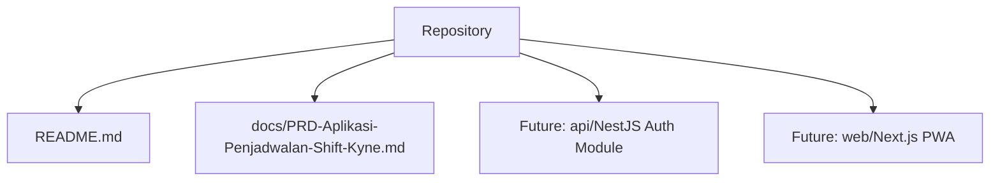
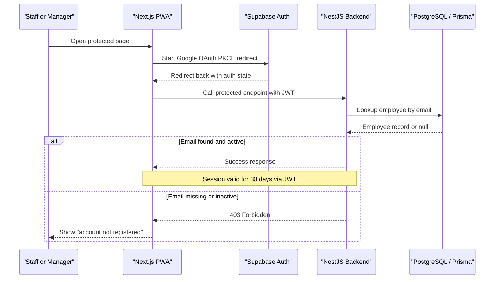
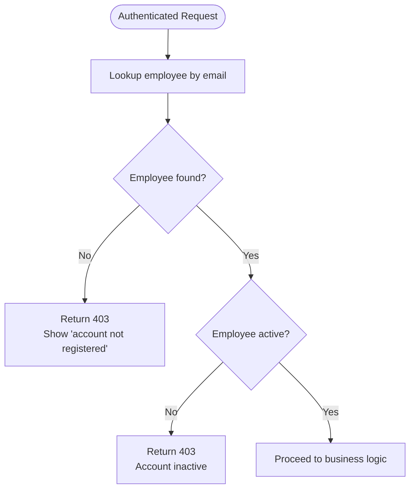
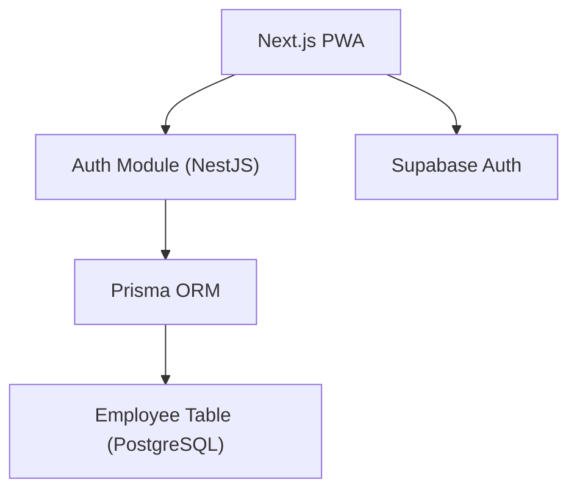

# Authentication Module (F1)

<cite>
**Referenced Files in This Document**
- [README.md](file://README.md)
- [PRD-Aplikasi-Penjadwalan-Shift-Kyne.md](file://docs/PRD-Aplikasi-Penjadwalan-Shift-Kyne.md)
</cite>

## Table of Contents
1. [Introduction](#introduction)
2. [Project Structure](#project-structure)
3. [Core Components](#core-components)
4. [Architecture Overview](#architecture-overview)
5. [Detailed Component Analysis](#detailed-component-analysis)
6. [Dependency Analysis](#dependency-analysis)
7. [Performance Considerations](#performance-considerations)
8. [Troubleshooting Guide](#troubleshooting-guide)
9. [Conclusion](#conclusion)

## Introduction
This document specifies the functional requirements and implementation guidance for the Authentication module (F1) of the Kyne Shift Scheduling application. The module provides Google OAuth login with PKCE, an email whitelist validation that restricts access to approved Kyne employees, and a 30-day session using JWT tokens. It also defines user stories, acceptance criteria, business rules, security considerations, error handling patterns, and integration points with the employee database lookup.

The project is currently a scaffold without source code; this specification is based on the product requirements document and repository metadata.

**Section sources**
- [README.md:1-25](file://README.md#L1-L25)
- [PRD-Aplikasi-Penjadwalan-Shift-Kyne.md:106-112](file://docs/PRD-Aplikasi-Penjadwalan-Shift-Kyne.md#L106-L112)

## Project Structure
At this stage, the repository contains only documentation and a README. The authentication module will be implemented as part of the backend NestJS service and frontend Next.js PWA according to the planned stack.

**Diagram sources**
- [README.md:1-25](file://README.md#L1-L25)
- [PRD-Aplikasi-Penjadwalan-Shift-Kyne.md:230-248](file://docs/PRD-Aplikasi-Penjadwalan-Shift-Kyne.md#L230-L248)

**Section sources**
- [README.md:1-25](file://README.md#L1-L25)
- [PRD-Aplikasi-Penjadwalan-Shift-Kyne.md:230-248](file://docs/PRD-Aplikasi-Penjadwalan-Shift-Kyne.md#L230-L248)

## Core Components
The Authentication module consists of the following core components:

- Google OAuth Client Configuration
  - Uses PKCE redirect flow.
  - Frontend uses Supabase Auth client for redirect-based login.
  - Backend verifies JWT issued by Supabase Auth on every request.

- Email Whitelist Validation
  - After Google identity verification, NestJS checks whether the email exists in the `employee` table.
  - Unregistered emails receive “account not registered” feedback.

- Session Management
  - 30-day session persistence via JWT.
  - Redirect back to the original destination after successful login.

- Role Resolution
  - Manager and staff roles are resolved from the `employee` table, not from JWT metadata.

- Integration Points
  - Employee database lookup via Prisma against PostgreSQL hosted on Supabase.
  - Optional Supabase Auth Hook to reject unknown emails at sign-up time.

**Section sources**
- [PRD-Aplikasi-Penjadwalan-Shift-Kyne.md:106-112](file://docs/PRD-Aplikasi-Penjadwalan-Shift-Kyne.md#L106-L112)
- [PRD-Aplikasi-Penjadwalan-Shift-Kyne.md:230-248](file://docs/PRD-Aplikasi-Penjadwalan-Shift-Kyne.md#L230-L248)

## Architecture Overview
The authentication architecture follows a redirect-based OAuth flow with server-side authorization enforcement.

**Diagram sources**
- [PRD-Aplikasi-Penjadwalan-Shift-Kyne.md:230-248](file://docs/PRD-Aplikasi-Penjadwalan-Shift-Kyne.md#L230-L248)
- [PRD-Aplikasi-Penjadwalan-Shift-Kyne.md:106-112](file://docs/PRD-Aplikasi-Penjadwalan-Shift-Kyne.md#L106-L112)

## Detailed Component Analysis

### Google OAuth Integration with PKCE
- Flow type: Redirect-based, not popup, to avoid issues in standalone PWA environments.
- Client configuration:
  - Frontend uses Supabase Auth client configured for Google provider.
  - PKCE ensures secure token exchange without exposing secrets on the client.
- Callback handling:
  - After Google redirects back, the frontend obtains a JWT from Supabase Auth.
  - The frontend then calls backend endpoints with the JWT.
  - The backend validates the JWT signature and claims before enforcing business logic.

Security notes:
- Do not trust role fields inside JWT metadata; always resolve roles from the employee table.
- Ensure HTTPS is enforced at the reverse proxy layer.

**Section sources**
- [PRD-Aplikasi-Penjadwalan-Shift-Kyne.md:230-248](file://docs/PRD-Aplikasi-Penjadwalan-Shift-Kyne.md#L230-L248)

### Email Whitelist Validation Mechanism
- Purpose: Restrict access to approved Kyne employees only.
- Behavior:
  - On each authenticated request, NestJS looks up the employee by email.
  - If no matching employee exists, return 403 Forbidden.
  - If the employee is inactive, deny access even if the email is whitelisted.
- Feedback:
  - Users whose email is not registered see “account not registered”.

Validation rules:
- Whitelist is derived from the `employee` table.
- Optional Supabase Auth Hook can reject unknown emails during sign-up, but NestJS must still enforce the whitelist.

**Diagram sources**
- [PRD-Aplikasi-Penjadwalan-Shift-Kyne.md:230-248](file://docs/PRD-Aplikasi-Penjadwalan-Shift-Kyne.md#L230-L248)
- [PRD-Aplikasi-Penjadwalan-Shift-Kyne.md:106-112](file://docs/PRD-Aplikasi-Penjadwalan-Shift-Kyne.md#L106-L112)

**Section sources**
- [PRD-Aplikasi-Penjadwalan-Shift-Kyne.md:106-112](file://docs/PRD-Aplikasi-Penjadwalan-Shift-Kyne.md#L106-L112)
- [PRD-Aplikasi-Penjadwalan-Shift-Kyne.md:230-248](file://docs/PRD-Aplikasi-Penjadwalan-Shift-Kyne.md#L230-L248)

### Session Management with 30-Day Expiry Using JWT
- Token issuer: Supabase Auth.
- Token lifetime: 30 days.
- Storage:
  - Frontend stores the JWT securely in memory or secure storage provided by the SDK.
  - Backend validates the JWT on every request.
- Redirect behavior:
  - If a user opens a protected link before logging in, they should be redirected to login and then returned to the original destination after successful authentication.

Operational considerations:
- Rotate signing keys through Supabase Auth configuration.
- Enforce HTTPS everywhere.
- Avoid storing sensitive data in JWT payload; use server-side sessions or short-lived tokens where appropriate.

**Section sources**
- [PRD-Aplikasi-Penjadwalan-Shift-Kyne.md:106-112](file://docs/PRD-Aplikasi-Penjadwalan-Shift-Kyne.md#L106-L112)
- [PRD-Aplikasi-Penjadwalan-Shift-Kyne.md:230-248](file://docs/PRD-Aplikasi-Penjadwalan-Shift-Kyne.md#L230-L248)

### User Stories and Acceptance Criteria

#### Staff Login Flow
- Story: As a staff member, I want to log in with my Google account so I do not need to remember a new password.
- Acceptance criteria:
  - A staff member can initiate Google login from the PWA.
  - After login, the staff member is redirected to the originally requested page.
  - Only employees with registered and active emails can access the application.
  - Unregistered emails receive “account not registered”.
  - The session remains valid for 30 days.

#### Manager Login Flow
- Story: As a manager, I want to log in with my Google account so I can manage schedules and requests.
- Acceptance criteria:
  - A manager can initiate Google login from the PWA.
  - After login, the manager sees manager-specific features such as dashboard and schedule management.
  - Roles are resolved from the employee table, not from JWT metadata.
  - Inactive managers cannot log in.

**Section sources**
- [PRD-Aplikasi-Penjadwalan-Shift-Kyne.md:106-112](file://docs/PRD-Aplikasi-Penjadwalan-Shift-Kyne.md#L106-L112)
- [PRD-Aplikasi-Penjadwalan-Shift-Kyne.md:230-248](file://docs/PRD-Aplikasi-Penjadwalan-Shift-Kyne.md#L230-L248)

### Business Rules for Account Activation and Deactivation
- An employee must exist in the `employee` table to authenticate.
- An inactive employee cannot log in, even if their email is present in the system.
- Deactivated accounts retain historical schedule data but lose access to the application.
- Probation status affects feature visibility, including request menus, but does not change the basic authentication rule that the employee must be active.

**Section sources**
- [PRD-Aplikasi-Penjadwalan-Shift-Kyne.md:114-121](file://docs/PRD-Aplikasi-Penjadwalan-Shift-Kyne.md#L114-L121)
- [PRD-Aplikasi-Penjadwalan-Shift-Kyne.md:106-112](file://docs/PRD-Aplikasi-Penjadwalan-Shift-Kyne.md#L106-L112)

### Security Considerations
- Use PKCE redirect flow instead of popups to avoid browser restrictions.
- Validate JWT on every backend request.
- Resolve roles from the `employee` table, not from JWT metadata.
- Enforce RLS deny-all at the database level; all data access goes through NestJS.
- Require HTTPS at the reverse proxy.
- Treat timezone and deadlines consistently using WITA (Asia/Makassar).

**Section sources**
- [PRD-Aplikasi-Penjadwalan-Shift-Kyne.md:230-248](file://docs/PRD-Aplikasi-Penjadwalan-Shift-Kyne.md#L230-L248)

### Error Handling Patterns
- Unknown email: Return 403 and display “account not registered”.
- Inactive employee: Return 403 and indicate that the account is inactive.
- Invalid or expired JWT: Reject the request and prompt re-authentication.
- Browser or environment errors:
  - Handle `disallowed_useragent` when opening links from in-app browsers by guiding users to open Chrome/Safari or the installed PWA.

**Section sources**
- [PRD-Aplikasi-Penjadwalan-Shift-Kyne.md:106-112](file://docs/PRD-Aplikasi-Penjadwalan-Shift-Kyne.md#L106-L112)
- [PRD-Aplikasi-Penjadwalan-Shift-Kyne.md:230-248](file://docs/PRD-Aplikasi-Penjadwalan-Shift-Kyne.md#L230-L248)

### Integration Points with Employee Database Lookup
- Data model:
  - `employee`: id, name, email, position, role, status, probation_end_date, is_active.
- Lookup process:
  - On authentication, look up the employee by email.
  - Check `is_active` to allow or deny access.
  - Resolve role from the employee record for authorization decisions.
- ERP readiness:
  - Use UUIDs, created_at/updated_at timestamps, and soft deletes to support future migration to an ERP system.

**Section sources**
- [PRD-Aplikasi-Penjadwalan-Shift-Kyne.md:197-217](file://docs/PRD-Aplikasi-Penjadwalan-Shift-Kyne.md#L197-L217)
- [PRD-Aplikasi-Penjadwalan-Shift-Kyne.md:230-248](file://docs/PRD-Aplikasi-Penjadwalan-Shift-Kyne.md#L230-L248)

## Dependency Analysis
Authentication depends on several external systems and internal modules:

**Diagram sources**
- [PRD-Aplikasi-Penjadwalan-Shift-Kyne.md:230-248](file://docs/PRD-Aplikasi-Penjadwalan-Shift-Kyne.md#L230-L248)
- [PRD-Aplikasi-Penjadwalan-Shift-Kyne.md:197-217](file://docs/PRD-Aplikasi-Penjadwalan-Shift-Kyne.md#L197-L217)

**Section sources**
- [PRD-Aplikasi-Penjadwalan-Shift-Kyne.md:230-248](file://docs/PRD-Aplikasi-Penjadwalan-Shift-Kyne.md#L230-L248)
- [PRD-Aplikasi-Penjadwalan-Shift-Kyne.md:197-217](file://docs/PRD-Aplikasi-Penjadwalan-Shift-Kyne.md#L197-L217)

## Performance Considerations
- Minimize database lookups by caching employee records when safe and consistent with RBAC.
- Keep JWT payloads small; store only necessary identifiers.
- Use connection pooling for PostgreSQL through Prisma.
- Prefer server-side validation and authorization to reduce client-side overhead.
- Test login flows under realistic mobile network conditions.

[No sources needed since this section provides general guidance]

## Troubleshooting Guide
Common issues and resolutions:

- Google login blocked in in-app browser:
  - Symptom: `disallowed_useragent`.
  - Resolution: Direct users to open the link in Chrome/Safari or install the PWA first.

- “Account not registered”:
  - Cause: Email not present in the `employee` table.
  - Resolution: Register the employee in the system before granting access.

- Login works but features are missing:
  - Cause: Role resolution from JWT metadata instead of employee table.
  - Resolution: Always resolve roles from the employee table.

- Session expires unexpectedly:
  - Cause: Incorrect token lifetime configuration or insecure storage.
  - Resolution: Verify 30-day expiry and ensure HTTPS and secure storage settings.

**Section sources**
- [PRD-Aplikasi-Penjadwalan-Shift-Kyne.md:106-112](file://docs/PRD-Aplikasi-Penjadwalan-Shift-Kyne.md#L106-L112)
- [PRD-Aplikasi-Penjadwalan-Shift-Kyne.md:230-248](file://docs/PRD-Aplikasi-Penjadwalan-Shift-Kyne.md#L230-L248)

## Conclusion
The Authentication module (F1) secures the Kyne Shift Scheduling application by combining Google OAuth with PKCE, strict email whitelist validation, and 30-day JWT sessions. Access is controlled server-side through NestJS, which validates tokens and resolves roles from the employee database. The design emphasizes security, privacy, and ERP readiness while providing a smooth login experience for both staff and managers.

[No sources needed since this section summarizes without analyzing specific files]