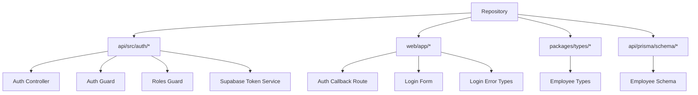
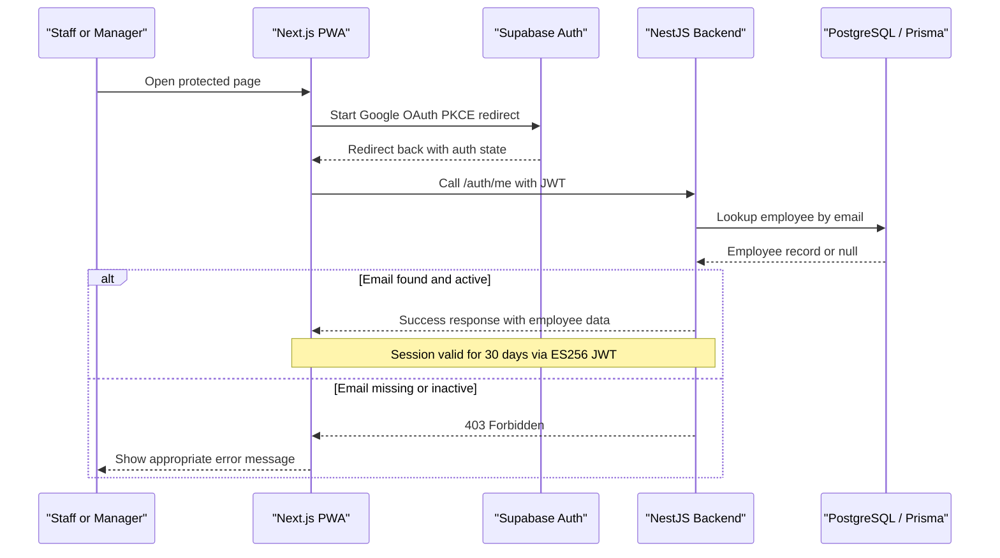
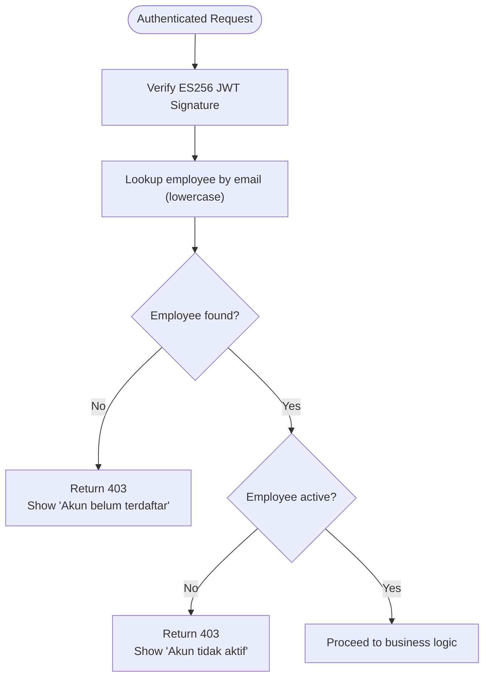
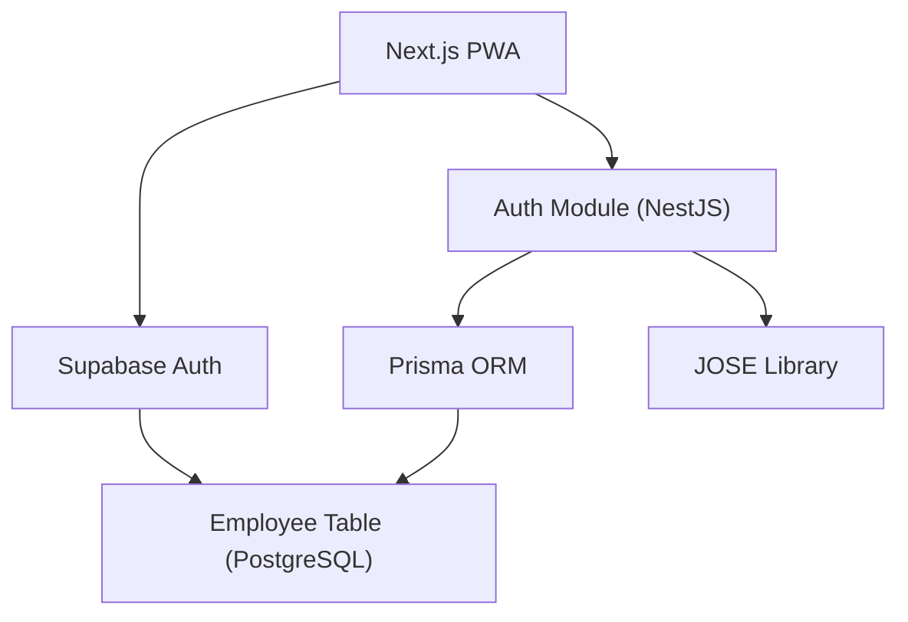

# Authentication Module (F1)

<cite>
**Referenced Files in This Document**
- [supabase-token.service.ts](file://api/src/auth/supabase-token.service.ts)
- [auth.controller.ts](file://api/src/auth/auth.controller.ts)
- [auth.guard.ts](file://api/src/auth/auth.guard.ts)
- [roles.guard.ts](file://api/src/auth/roles.guard.ts)
- [route.ts](file://web/app/auth/callback/route.ts)
- [login-form.tsx](file://web/app/login/login-form.tsx)
- [login-error.ts](file://web/lib/login-error.ts)
- [employee.prisma](file://api/prisma/schema/employee.prisma)
- [employee.ts](file://packages/types/src/employee.ts)
- [app.module.ts](file://api/src/app.module.ts)
- [supabase.ts](file://api/src/auth/supabase.ts)
- [current-employee.decorator.ts](file://api/src/auth/current-employee.decorator.ts)
</cite>

## Update Summary
**Changes Made**
- Updated architecture overview to reflect actual Supabase Auth implementation with ES256 JWT tokens
- Added detailed component analysis based on actual code implementation
- Enhanced security considerations with specific technical details from the codebase
- Updated error handling patterns to match actual implementation
- Added comprehensive RBAC system documentation
- Included specific file references throughout the document

## Table of Contents
1. [Introduction](#introduction)
2. [Project Structure](#project-structure)
3. [Core Components](#core-components)
4. [Architecture Overview](#architecture-overview)
5. [Detailed Component Analysis](#detailed-component-analysis)
6. [Dependency Analysis](#dependency-analysis)
7. [Performance Considerations](#performance-considerations)
8. [Troubleshooting Guide](#troubleshooting-guide)
9. [Conclusion](#conclusion)

## Introduction
This document specifies the functional requirements and implementation guidance for the Authentication module (F1) of the Kyne Shift Scheduling application. The module provides Google OAuth login with PKCE flow, an email whitelist validation that restricts access to approved Kyne employees only, and a 30-day session using ES256-signed JWT tokens issued by Supabase Auth. It also defines user stories, acceptance criteria, business rules, security considerations, error handling patterns, and integration points with the employee database lookup.

The project is fully implemented with NestJS backend and Next.js frontend, using Supabase Auth for identity management and PostgreSQL for data persistence.

**Section sources**
- [supabase-token.service.ts:13-20](file://api/src/auth/supabase-token.service.ts#L13-L20)
- [auth.guard.ts:14-20](file://api/src/auth/auth.guard.ts#L14-L20)
- [route.ts:6-14](file://web/app/auth/callback/route.ts#L6-L14)

## Project Structure
The authentication module is implemented across both backend and frontend components:

**Diagram sources**
- [auth.controller.ts:5-15](file://api/src/auth/auth.controller.ts#L5-L15)
- [auth.guard.ts:21-27](file://api/src/auth/auth.guard.ts#L21-L27)
- [route.ts:15-54](file://web/app/auth/callback/route.ts#L15-L54)

**Section sources**
- [auth.controller.ts:1-16](file://api/src/auth/auth.controller.ts#L1-L16)
- [route.ts:1-93](file://web/app/auth/callback/route.ts#L1-L93)

## Core Components
The Authentication module consists of the following core components:

### Google OAuth Client Configuration
- Uses PKCE redirect flow via Supabase Auth client
- Frontend uses `createBrowserSupabaseClient()` for redirect-based login
- Backend verifies ES256-signed JWT tokens issued by Supabase Auth
- JWKS endpoint used for local signature verification without external calls

### Email Whitelist Validation
- After Google identity verification, NestJS checks whether the email exists in the `employee` table
- Unregistered emails receive "Akun belum terdaftar" feedback
- Inactive employees are denied access even if registered

### Session Management
- 30-day session persistence via ES256-signed JWT tokens
- Redirect back to original destination after successful login
- Secure token storage and validation on every request

### Role-Based Access Control (RBAC)
- Manager and staff roles resolved from `employee` table, not JWT metadata
- Database-driven role management with `EmployeeRole` enum
- Global guards enforce authorization on all routes

### Integration Points
- Employee database lookup via Prisma against PostgreSQL hosted on Supabase
- Supabase Auth Hook capability for rejecting unknown emails at sign-up time

**Section sources**
- [supabase-token.service.ts:25-37](file://api/src/auth/supabase-token.service.ts#L25-L37)
- [auth.guard.ts:40-62](file://api/src/auth/auth.guard.ts#L40-L62)
- [roles.guard.ts:20-41](file://api/src/auth/roles.guard.ts#L20-L41)

## Architecture Overview
The authentication architecture follows a redirect-based OAuth flow with server-side authorization enforcement using Supabase Auth and ES256 JWT tokens.

**Diagram sources**
- [route.ts:37-53](file://web/app/auth/callback/route.ts#L37-L53)
- [auth.controller.ts:11-14](file://api/src/auth/auth.controller.ts#L11-L14)
- [auth.guard.ts:40-62](file://api/src/auth/auth.guard.ts#L40-L62)

## Detailed Component Analysis

### Google OAuth Integration with ES256 JWT Tokens
- **Flow type**: Redirect-based PKCE flow, avoiding popup issues in standalone PWA environments
- **Token signing**: ES256 algorithm with asymmetric key pairs published as JWKS
- **Client configuration**: 
  - Frontend uses Supabase Auth client configured for Google provider
  - Backend validates JWT signature locally using JWKS endpoint
- **Callback handling**:
  - After Google redirects back, frontend obtains JWT from Supabase Auth
  - Frontend calls `/auth/me` endpoint to validate employee existence
  - Backend validates JWT signature and claims before enforcing business logic

Security notes:
- Do not trust role fields inside JWT metadata; always resolve roles from employee table
- Ensure HTTPS is enforced at the reverse proxy layer
- Local signature verification avoids external calls for every request

**Section sources**
- [supabase-token.service.ts:39-50](file://api/src/auth/supabase-token.service.ts#L39-L50)
- [supabase.ts:14-20](file://api/src/auth/supabase.ts#L14-L20)
- [login-form.tsx:15-31](file://web/app/login/login-form.tsx#L15-L31)

### Email Whitelist Validation Mechanism
- **Purpose**: Restrict access to approved Kyne employees only
- **Behavior**:
  - On each authenticated request, NestJS looks up the employee by email
  - If no matching employee exists, return 403 Forbidden with "Akun belum terdaftar"
  - If the employee is inactive, deny access with "Akun tidak aktif"
- **Case sensitivity**: Email queries use lowercase comparison to handle Google's case variations

Validation rules:
- Whitelist derived from `employee` table with unique email constraint
- Optional Supabase Auth Hook can reject unknown emails during sign-up
- NestJS must still enforce the whitelist regardless of Auth Hook configuration

**Diagram sources**
- [auth.guard.ts:40-62](file://api/src/auth/auth.guard.ts#L40-L62)
- [route.ts:61-92](file://web/app/auth/callback/route.ts#L61-L92)

**Section sources**
- [auth.guard.ts:37-62](file://api/src/auth/auth.guard.ts#L37-L62)
- [login-error.ts:6-12](file://web/lib/login-error.ts#L6-L12)

### Session Management with 30-Day Expiry Using ES256 JWT
- **Token issuer**: Supabase Auth with ES256 algorithm
- **Token lifetime**: 30 days (configured in Supabase Auth settings)
- **Storage**:
  - Frontend stores JWT securely in memory via Supabase SDK
  - Backend validates JWT signature locally using JWKS endpoint
- **Redirect behavior**:
  - Protected pages redirect to login and return to original destination after authentication
  - Error states preserved through URL parameters

Operational considerations:
- Rotate signing keys through Supabase Auth configuration
- Enforce HTTPS everywhere
- Avoid storing sensitive data in JWT payload
- Use short-lived tokens where appropriate for enhanced security

**Section sources**
- [supabase-token.service.ts:41-45](file://api/src/auth/supabase-token.service.ts#L41-L45)
- [route.ts:44-53](file://web/app/auth/callback/route.ts#L44-L53)

### Role-Based Access Control (RBAC) System
- **Role resolution**: Manager and staff roles resolved from `employee.role` field
- **Database schema**: `EmployeeRole` enum with 'manager' and 'staff' values
- **Global guards**: Both `AuthGuard` and `RolesGuard` applied globally
- **Route protection**: Routes can be marked as public with `@Public()` decorator
- **Role-specific access**: Routes can require specific roles with `@Roles()` decorator

RBAC implementation:
- `RolesGuard` runs after `AuthGuard` to check employee role against route requirements
- Missing or invalid roles result in 403 Forbidden with "Peran akun tidak punya akses ke sini"
- Role changes in database take effect immediately without token refresh

**Section sources**
- [roles.guard.ts:12-41](file://api/src/auth/roles.guard.ts#L12-L41)
- [app.module.ts:11-16](file://api/src/app.module.ts#L11-L16)
- [employee.prisma:8-11](file://api/prisma/schema/employee.prisma#L8-L11)

### User Stories and Acceptance Criteria

#### Staff Login Flow
- **Story**: As a staff member, I want to log in with my Google account so I do not need to remember a new password.
- **Acceptance criteria**:
  - A staff member can initiate Google login from the PWA
  - After login, the staff member is redirected to the originally requested page
  - Only employees with registered and active emails can access the application
  - Unregistered emails receive "Akun belum terdaftar" message
  - Inactive accounts receive "Akun tidak aktif" message
  - The session remains valid for 30 days via ES256 JWT

#### Manager Login Flow
- **Story**: As a manager, I want to log in with my Google account so I can manage schedules and requests.
- **Acceptance criteria**:
  - A manager can initiate Google login from the PWA
  - After login, the manager sees manager-specific features such as dashboard and schedule management
  - Roles are resolved from the employee table, not from JWT metadata
  - Inactive managers cannot log in
  - Manager-only routes are protected by `@Roles(['manager'])` decorator

**Section sources**
- [login-form.tsx:15-31](file://web/app/login/login-form.tsx#L15-L31)
- [route.ts:44-53](file://web/app/auth/callback/route.ts#L44-L53)
- [roles.guard.ts:30-41](file://api/src/auth/roles.guard.ts#L30-L41)

### Business Rules for Account Activation and Deactivation
- An employee must exist in the `employee` table to authenticate
- An inactive employee cannot log in, even if their email is present in the system
- Deactivated accounts retain historical schedule data but lose access to the application
- Probation status affects feature visibility but does not change basic authentication rules
- Email addresses must be stored in lowercase for consistent lookup

**Section sources**
- [auth.guard.ts:53-59](file://api/src/auth/auth.guard.ts#L53-L59)
- [employee.prisma:19-36](file://api/prisma/schema/employee.prisma#L19-L36)

### Security Considerations
- Use PKCE redirect flow instead of popups to avoid browser restrictions
- Validate ES256 JWT signatures locally using JWKS endpoint
- Resolve roles from the `employee` table, never from JWT metadata
- Enforce RLS deny-all at the database level; all data access goes through NestJS
- Require HTTPS at the reverse proxy
- Treat timezone and deadlines consistently using WITA (Asia/Makassar)
- Use secure cookie settings for production deployments

**Section sources**
- [supabase-token.service.ts:41-45](file://api/src/auth/supabase-token.service.ts#L41-L45)
- [auth.guard.ts:14-20](file://api/src/auth/auth.guard.ts#L14-L20)

### Error Handling Patterns
- **Unknown email**: Return 403 with "Akun belum terdaftar"
- **Inactive employee**: Return 403 with "Akun tidak aktif"
- **Invalid or expired JWT**: Reject request with "Sesi login tidak valid"
- **Missing authorization header**: Return 401 with "Header login tidak ada"
- **Browser or environment errors**:
  - Handle connection failures gracefully
  - Provide user-friendly error messages in Indonesian
  - Preserve navigation state through URL parameters

Error types:
- `belum-terdaftar`: Account not registered
- `tidak-aktif`: Account inactive
- `gagal`: General login failure

**Section sources**
- [auth.guard.ts:53-59](file://api/src/auth/auth.guard.ts#L53-L59)
- [supabase-token.service.ts:29-31](file://api/src/auth/supabase-token.service.ts#L29-L31)
- [login-error.ts:6-12](file://web/lib/login-error.ts#L6-L12)

### Integration Points with Employee Database Lookup
- **Data model**:
  - `employee`: id, name, email, position, role, status, probation_end_date, is_active
  - Enums: `EmployeePosition`, `EmployeeRole`, `EmployeeStatus`
- **Lookup process**:
  - On authentication, look up employee by email (lowercase)
  - Check `is_active` to allow or deny access
  - Resolve role from employee record for authorization decisions
- **Type safety**: Shared TypeScript types ensure consistency between frontend and backend

ERP readiness:
- Use UUIDs, created_at/updated_at timestamps, and soft deletes support
- Generic naming conventions for future ERP migration
- Index on `isActive` for performance optimization

**Section sources**
- [employee.prisma:1-36](file://api/prisma/schema/employee.prisma#L1-L36)
- [employee.ts:13-26](file://packages/types/src/employee.ts#L13-L26)
- [auth.guard.ts:40-51](file://api/src/auth/auth.guard.ts#L40-L51)

## Dependency Analysis
Authentication depends on several external systems and internal modules:

**Diagram sources**
- [app.module.ts:9-16](file://api/src/app.module.ts#L9-L16)
- [supabase-token.service.ts:1-2](file://api/src/auth/supabase-token.service.ts#L1-L2)
- [auth.guard.ts:9-12](file://api/src/auth/auth.guard.ts#L9-L12)

**Section sources**
- [app.module.ts:1-19](file://api/src/app.module.ts#L1-L19)
- [supabase-token.service.ts:1-52](file://api/src/auth/supabase-token.service.ts#L1-L52)

## Performance Considerations
- Minimize database lookups by caching employee records when safe and consistent with RBAC
- Keep JWT payloads small; store only necessary identifiers
- Use connection pooling for PostgreSQL through Prisma
- Prefer server-side validation and authorization to reduce client-side overhead
- Test login flows under realistic mobile network conditions
- Local JWT signature verification avoids external API calls for every request

## Troubleshooting Guide
Common issues and resolutions:

- **Google login blocked in in-app browser**:
  - Symptom: Browser restrictions preventing OAuth flow
  - Resolution: Direct users to open link in Chrome/Safari or install PWA first

- **"Akun belum terdaftar"**:
  - Cause: Email not present in the `employee` table
  - Resolution: Register the employee in the system before granting access

- **"Akun tidak aktif"**:
  - Cause: Employee exists but `is_active` is false
  - Resolution: Activate the employee account in the database

- **Login works but features are missing**:
  - Cause: Role resolution from JWT metadata instead of employee table
  - Resolution: Always resolve roles from the employee table

- **Session expires unexpectedly**:
  - Cause: Incorrect token lifetime configuration or insecure storage
  - Resolution: Verify 30-day expiry and ensure HTTPS and secure storage settings

- **ES256 JWT validation failures**:
  - Cause: JWKS endpoint misconfiguration or key rotation issues
  - Resolution: Verify SUPABASE_URL and JWKS endpoint accessibility

**Section sources**
- [route.ts:20-35](file://web/app/auth/callback/route.ts#L20-L35)
- [auth.guard.ts:53-59](file://api/src/auth/auth.guard.ts#L53-L59)
- [supabase-token.service.ts:47-49](file://api/src/auth/supabase-token.service.ts#L47-L49)

## Conclusion
The Authentication module (F1) secures the Kyne Shift Scheduling application by combining Google OAuth with PKCE flow, strict email whitelist validation, and 30-day ES256-signed JWT sessions. Access is controlled server-side through NestJS, which validates tokens using local JWKS verification and resolves roles from the employee database. The design emphasizes security, privacy, and ERP readiness while providing a smooth login experience for both staff and managers. The implementation leverages Supabase Auth for identity management and maintains strict separation between authentication (identity verification) and authorization (access control).