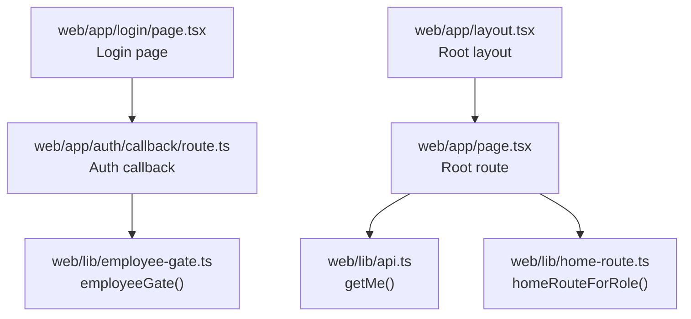
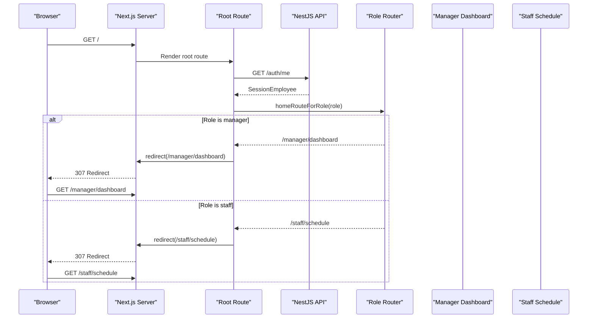
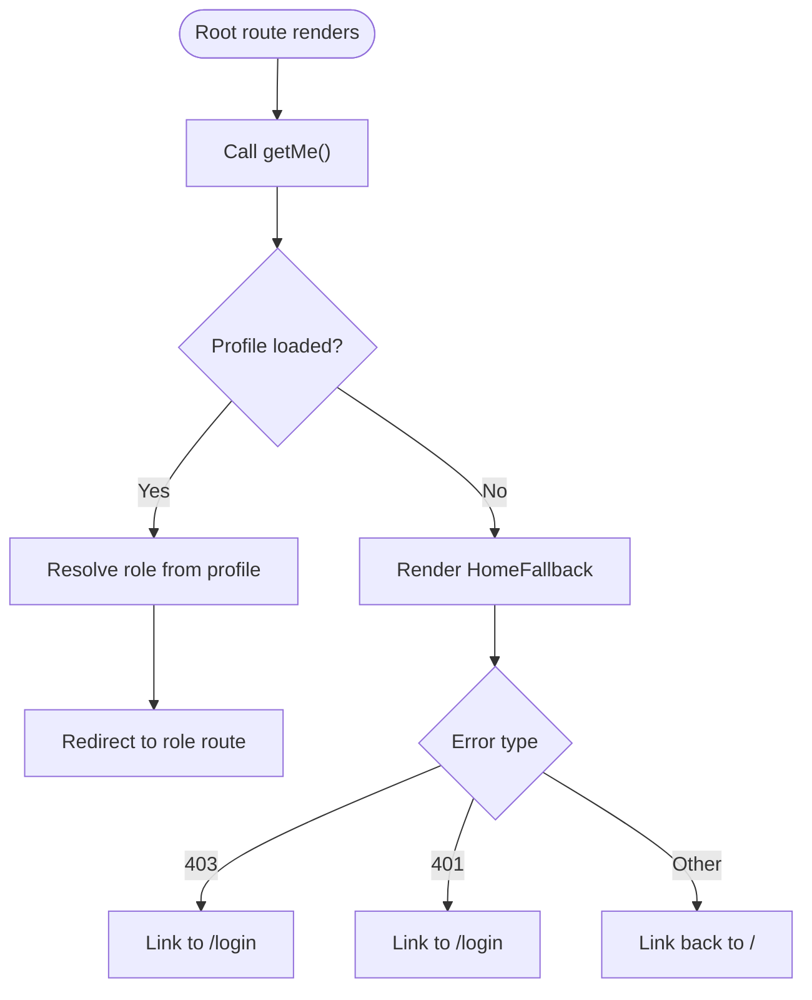
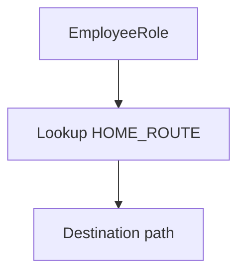
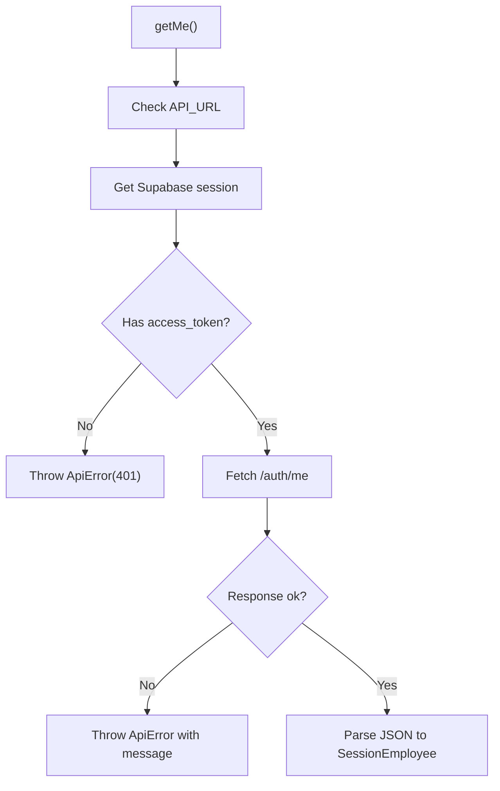
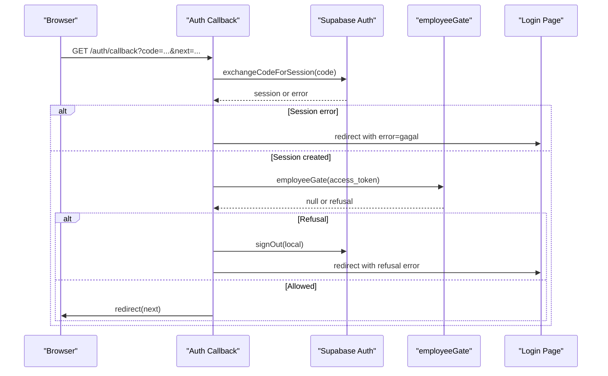
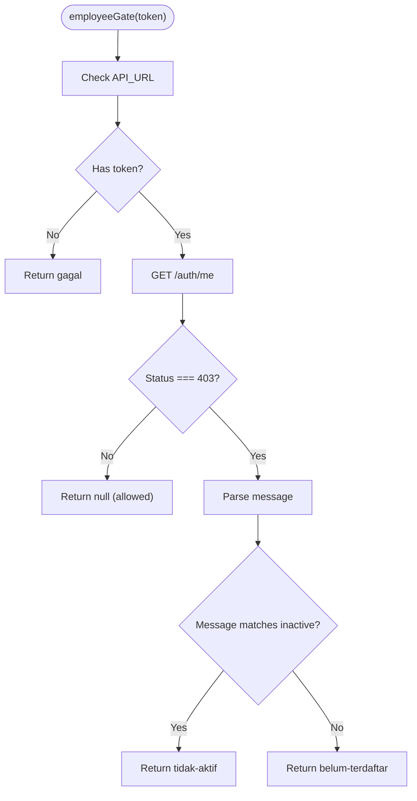
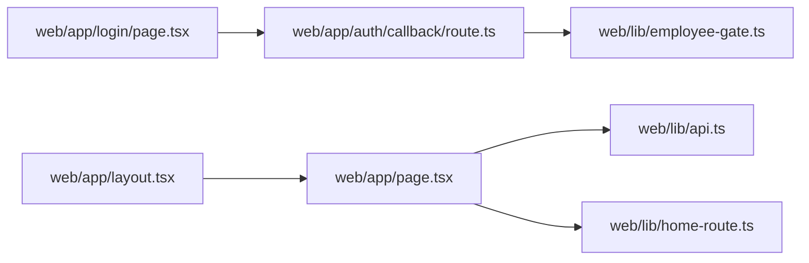

# Dynamic Home Page Router

<cite>
**Referenced Files in This Document**
- [page.tsx](file://web/app/page.tsx)
- [home-route.ts](file://web/lib/home-route.ts)
- [api.ts](file://web/lib/api.ts)
- [employee-gate.ts](file://web/lib/employee-gate.ts)
- [route.ts](file://web/app/auth/callback/route.ts)
- [login/page.tsx](file://web/app/login/page.tsx)
- [layout.tsx](file://web/app/layout.tsx)
</cite>

## Table of Contents
1. [Introduction](#introduction)
2. [Project Structure](#project-structure)
3. [Core Components](#core-components)
4. [Architecture Overview](#architecture-overview)
5. [Detailed Component Analysis](#detailed-component-analysis)
6. [Dependency Analysis](#dependency-analysis)
7. [Performance Considerations](#performance-considerations)
8. [Troubleshooting Guide](#troubleshooting-guide)
9. [Conclusion](#conclusion)

## Introduction
This document explains the dynamic home page router for the scheduling application. The root route is not a screen; it is an entry point that determines where a signed-in visitor should land based on their employee role. It reads the current session, validates access through the backend API, and redirects to either the manager dashboard or the staff schedule view.

The routing logic is intentionally split into small, testable pieces:
- A server-side component fetches the authenticated user profile.
- A pure function maps the resolved role to a URL path.
- An authentication callback verifies that the Google account is allowed to enter the system.
- A fallback UI handles missing sessions, unauthorized accounts, and API failures.

## Project Structure
The dynamic home page lives under the Next.js `app` directory and relies on shared utilities in `web/lib`. The relevant files are:

**Diagram sources**
- [page.tsx:1-27](file://web/app/page.tsx#L1-L27)
- [home-route.ts:10-17](file://web/lib/home-route.ts#L10-L17)
- [api.ts:94-98](file://web/lib/api.ts#L94-L98)
- [route.ts:16-54](file://web/app/auth/callback/route.ts#L16-L54)
- [employee-gate.ts:8-39](file://web/lib/employee-gate.ts#L8-L39)
- [login/page.tsx:11-39](file://web/app/login/page.tsx#L11-L39)
- [layout.tsx:9-19](file://web/app/layout.tsx#L9-L19)

**Section sources**
- [page.tsx:1-27](file://web/app/page.tsx#L1-L27)
- [home-route.ts:1-17](file://web/lib/home-route.ts#L1-L17)
- [api.ts:94-98](file://web/lib/api.ts#L94-L98)
- [route.ts:16-54](file://web/app/auth/callback/route.ts#L16-L54)
- [employee-gate.ts:1-39](file://web/lib/employee-gate.ts#L1-L39)
- [login/page.tsx:1-39](file://web/app/login/page.tsx#L1-L39)
- [layout.tsx:1-19](file://web/app/layout.tsx#L1-L19)

## Core Components
The dynamic home page router consists of four cooperating parts:

| Component | Responsibility | Key Behavior |
|---|---|---|
| Root route (`web/app/page.tsx`) | Resolves the signed-in user and redirects them | Forces dynamic rendering, calls `/auth/me`, then redirects using the role |
| Role router (`web/lib/home-route.ts`) | Maps roles to destination paths | Pure lookup: manager → dashboard, staff → schedule |
| API client (`web/lib/api.ts`) | Makes authenticated requests to the NestJS backend | Wraps errors with safe messages and carries the Supabase access token |
| Auth callback (`web/app/auth/callback/route.ts`) | Completes login and checks whitelist | Exchanges the code for a session, runs the employee gate, and redirects or signs out |
| Employee gate (`web/lib/employee-gate.ts`) | Checks whether the email is allowed | Returns a refusal reason only when the API explicitly rejects the account |
| Login page (`web/app/login/page.tsx`) | Shows login controls and error messages | Reads `next` and `error` search parameters safely |

**Section sources**
- [page.tsx:7-27](file://web/app/page.tsx#L7-L27)
- [home-route.ts:3-17](file://web/lib/home-route.ts#L3-L17)
- [api.ts:17-32](file://web/lib/api.ts#L17-L32)
- [route.ts:7-15](file://web/app/auth/callback/route.ts#L7-L15)
- [employee-gate.ts:3-39](file://web/lib/employee-gate.ts#L3-L39)
- [login/page.tsx:7-39](file://web/app/login/page.tsx#L7-L39)

## Architecture Overview
The home page router participates in two flows:

1. **Initial navigation flow**: The browser lands on `/`, the root route resolves the current employee, and Next.js redirects to the correct role-based route.
2. **Authentication flow**: After Google returns a one-time code, the callback exchanges it for a session, checks whether the account is whitelisted, and then redirects to the intended destination.

**Diagram sources**
- [page.tsx:16-27](file://web/app/page.tsx#L16-L27)
- [home-route.ts:10-17](file://web/lib/home-route.ts#L10-L17)
- [api.ts:94-98](file://web/lib/api.ts#L94-L98)

## Detailed Component Analysis

### Root Route: Dynamic Entry Point
The root route is explicitly marked as dynamic so it always executes against the caller’s live session rather than a cached render. Its responsibilities are:
- Fetch the current employee profile from the backend.
- Catch network or authorization failures and show a fallback UI.
- Use the resolved role to compute the redirect target.

**Diagram sources**
- [page.tsx:14-27](file://web/app/page.tsx#L14-L27)
- [page.tsx:35-70](file://web/app/page.tsx#L35-L70)

**Section sources**
- [page.tsx:7-27](file://web/app/page.tsx#L7-L27)
- [page.tsx:29-70](file://web/app/page.tsx#L29-L70)

### Role Router: Pure Mapping Function
The role router is intentionally simple: it maps each allowed `EmployeeRole` to a static route string. This makes the routing decision easy to test without mocking HTTP calls.

| Role | Destination |
|---|---|
| manager | `/manager/dashboard` |
| staff | `/staff/schedule` |

**Diagram sources**
- [home-route.ts:10-17](file://web/lib/home-route.ts#L10-L17)

**Section sources**
- [home-route.ts:1-17](file://web/lib/home-route.ts#L1-L17)

### API Client: Authenticated Profile Fetch
The root route uses `getMe()` to call `/auth/me`. The API client:
- Requires `API_URL`.
- Retrieves the Supabase session.
- Attaches the access token.
- Converts non-OK responses into a typed `ApiError`.
- Provides safe, user-facing messages for missing sessions and forbidden access.

**Diagram sources**
- [api.ts:34-70](file://web/lib/api.ts#L34-L70)
- [api.ts:94-98](file://web/lib/api.ts#L94-L98)

**Section sources**
- [api.ts:17-32](file://web/lib/api.ts#L17-L32)
- [api.ts:34-87](file://web/lib/api.ts#L34-L87)
- [api.ts:94-98](file://web/lib/api.ts#L94-L98)

### Authentication Callback: Whitelist Gate
After Google completes the PKCE flow, the callback:
- Exchanges the code for a session.
- Calls `employeeGate` with the access token.
- Rejects the login if the API returns a 403 indicating the account is not active or not registered.
- Signs out locally before redirecting to the login page when rejected.
- Preserves the original `next` parameter so users return to the page they opened.

**Diagram sources**
- [route.ts:16-54](file://web/app/auth/callback/route.ts#L16-L54)
- [employee-gate.ts:8-39](file://web/lib/employee-gate.ts#L8-L39)

**Section sources**
- [route.ts:7-54](file://web/app/auth/callback/route.ts#L7-L54)
- [employee-gate.ts:3-39](file://web/lib/employee-gate.ts#L3-L39)

### Employee Gate: Access Decision
The employee gate performs a lightweight check against `/auth/me`:
- If `API_URL` is missing, it throws because the whitelist must be enforced.
- If no access token exists, it returns a generic failure.
- If the API responds with 403, it parses the response message and returns a specific refusal.
- Any other response is treated as allowed, because later routes still enforce permissions.

**Diagram sources**
- [employee-gate.ts:8-39](file://web/lib/employee-gate.ts#L8-L39)

**Section sources**
- [employee-gate.ts:1-39](file://web/lib/employee-gate.ts#L1-L39)

### Login Page: User-Facing Error Handling
The login page reads the `next` and `error` query parameters safely and displays localized error text when present. It does not perform authentication itself; it delegates to the form component and the auth callback.

**Section sources**
- [login/page.tsx:7-39](file://web/app/login/page.tsx#L7-L39)

### Root Layout: Application Shell
The root layout defines metadata and the HTML shell. It does not participate directly in routing but provides the environment for all pages, including the dynamic home route.

**Section sources**
- [layout.tsx:1-19](file://web/app/layout.tsx#L1-L19)

## Dependency Analysis
The dynamic home page router has clear boundaries between presentation, routing, authentication, and API access.

**Diagram sources**
- [page.tsx:1-27](file://web/app/page.tsx#L1-L27)
- [home-route.ts:1-17](file://web/lib/home-route.ts#L1-L17)
- [api.ts:94-98](file://web/lib/api.ts#L94-L98)
- [route.ts:16-54](file://web/app/auth/callback/route.ts#L16-L54)
- [employee-gate.ts:8-39](file://web/lib/employee-gate.ts#L8-L39)
- [login/page.tsx:11-39](file://web/app/login/page.tsx#L11-L39)
- [layout.tsx:9-19](file://web/app/layout.tsx#L9-L19)

Key dependency characteristics:
- The root route depends on both the API client and the role router.
- The role router has no runtime dependencies beyond types, making it highly testable.
- The API client centralizes authentication headers and error translation.
- The auth callback depends on Supabase Auth and the employee gate.
- The employee gate depends on the backend `/auth/me` endpoint.

**Section sources**
- [page.tsx:1-27](file://web/app/page.tsx#L1-L27)
- [home-route.ts:1-17](file://web/lib/home-route.ts#L1-L17)
- [api.ts:34-87](file://web/lib/api.ts#L34-L87)
- [route.ts:16-54](file://web/app/auth/callback/route.ts#L16-L54)
- [employee-gate.ts:8-39](file://web/lib/employee-gate.ts#L8-L39)

## Performance Considerations
- The root route forces dynamic rendering, ensuring the current session is evaluated per request rather than at build time.
- The role router is a constant-time lookup with no I/O.
- The API client disables caching for authenticated calls, which is necessary for session-sensitive data but means every load may hit the backend.
- The employee gate catches network failures gracefully and treats non-403 responses as allowed, avoiding accidental lockouts during backend outages.

[No sources needed since this section provides general guidance]

## Troubleshooting Guide
Common issues and their likely causes:

| Symptom | Likely Cause | Resolution |
|---|---|---|
| Redirect loop or blank home page | Missing or invalid `API_URL` | Ensure the web server has `API_URL` configured. |
| Immediate redirect to login after successful Google login | Account not whitelisted | Verify the employee record exists and is active in the backend. |
| “Session ended” message | Missing Supabase access token | Re-authenticate through the login page. |
| “Cannot contact server” message | Backend unreachable | Check the NestJS API availability and network configuration. |
| Manager-only page shown to staff | Incorrect role returned by `/auth/me` | Inspect the backend’s `/auth/me` response and role mapping. |

Relevant error handling locations:
- Root fallback UI distinguishes 403, 401, and other errors.
- API client wraps failures with typed status codes and safe messages.
- Employee gate returns structured refusal reasons for whitelist failures.
- Login page displays localized error messages based on the callback result.

**Section sources**
- [page.tsx:35-70](file://web/app/page.tsx#L35-L70)
- [api.ts:34-87](file://web/lib/api.ts#L34-L87)
- [employee-gate.ts:8-39](file://web/lib/employee-gate.ts#L8-L39)
- [login/page.tsx:30-34](file://web/app/login/page.tsx#L30-L34)

## Conclusion
The dynamic home page router cleanly separates concerns:
- Authentication and whitelist validation happen in the callback.
- Role resolution happens in the root route via the backend API.
- Routing decisions are isolated in a pure function.
- Errors are handled with explicit, user-safe messages.

This design makes the router predictable, testable, and resilient to backend failures while keeping the manager and staff experiences strictly separated by role.

[No sources needed since this section summarizes without analyzing specific files]