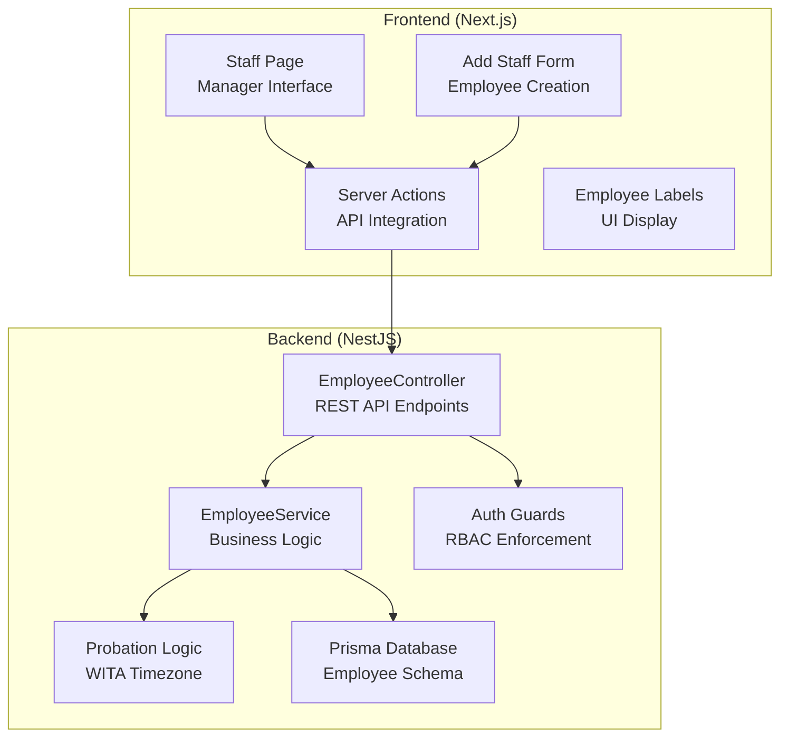
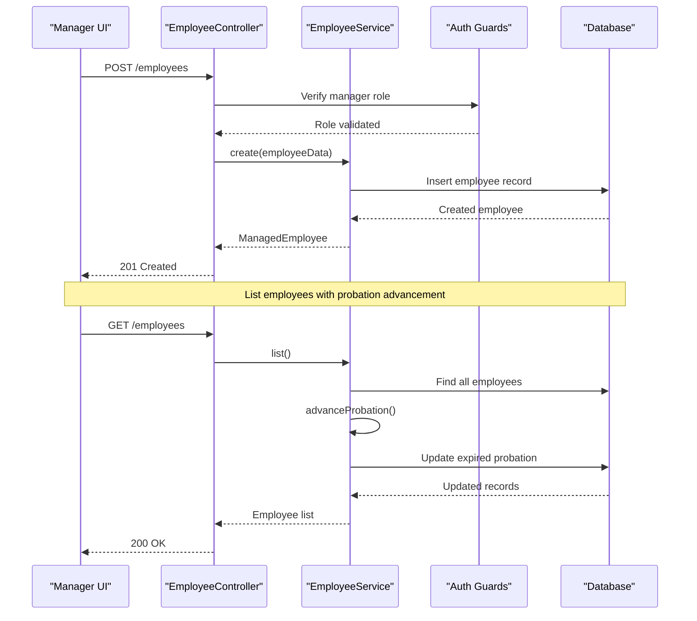
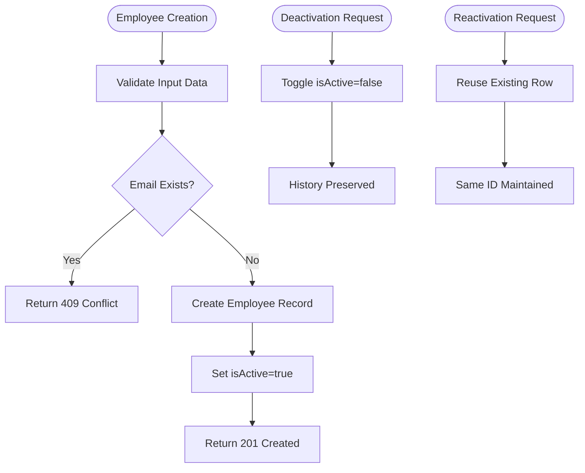
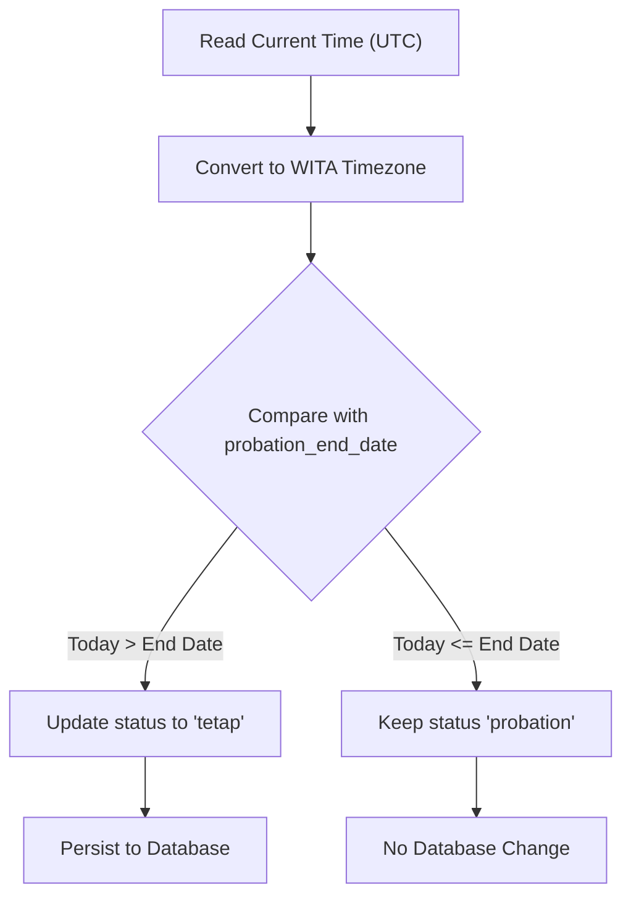
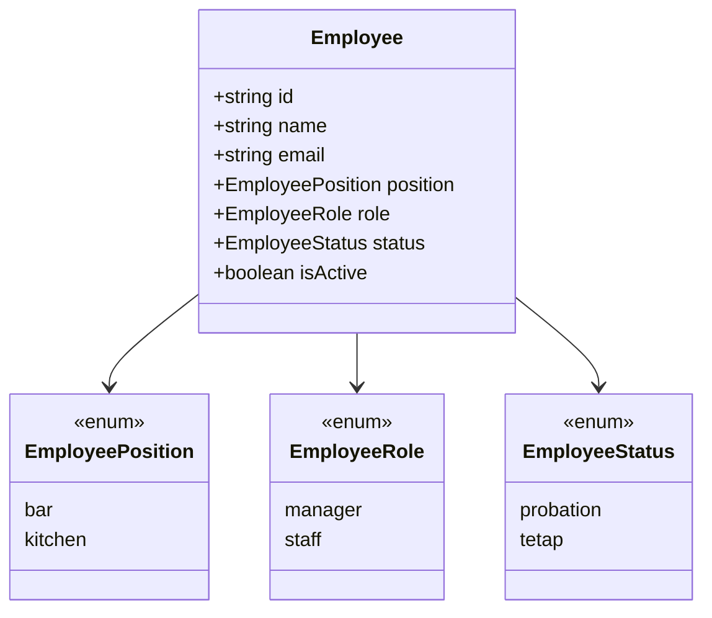
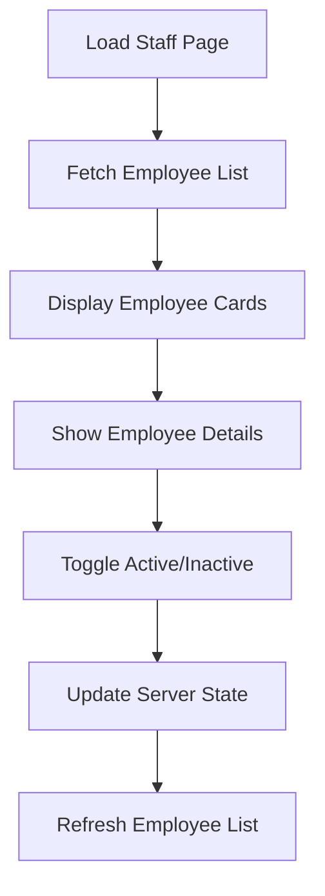
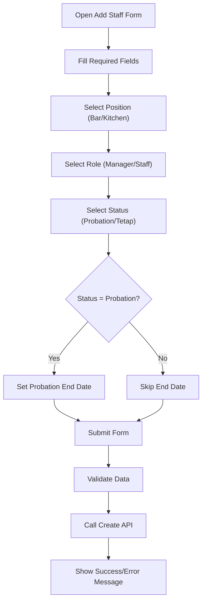
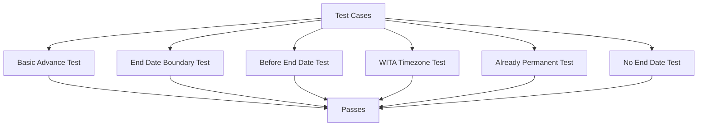
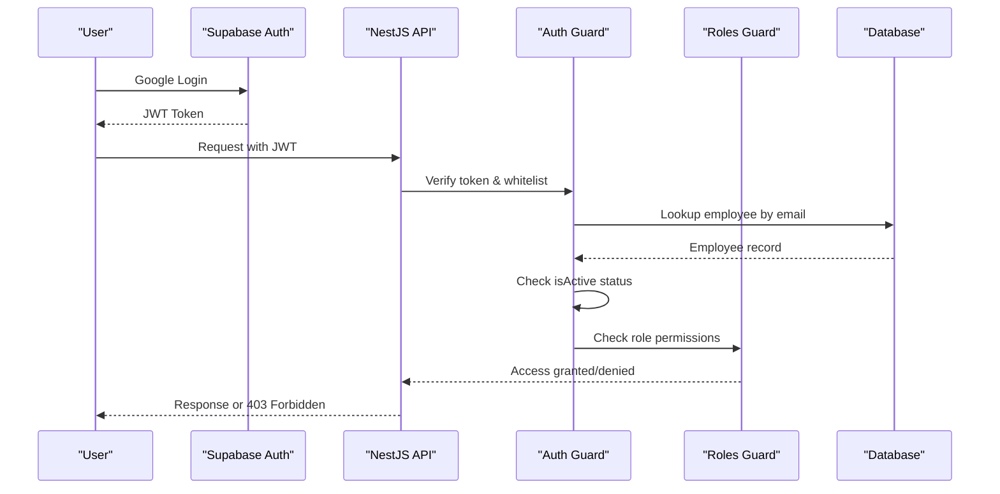

# Employee Management Module (F2)

<cite>
**Referenced Files in This Document**
- [employee.controller.ts](file://api/src/employee/employee.controller.ts)
- [employee.service.ts](file://api/src/employee/employee.service.ts)
- [probation.ts](file://api/src/employee/probation.ts)
- [probation.spec.ts](file://api/src/employee/probation.spec.ts)
- [employee.api-spec.ts](file://api/test/employee.api-spec.ts)
- [page.tsx](file://web/app/manager/staff/page.tsx)
- [add-staff-form.tsx](file://web/app/manager/staff/add-staff-form.tsx)
- [actions.ts](file://web/app/manager/staff/actions.ts)
- [api.ts](file://web/lib/api.ts)
- [employee-labels.ts](file://web/lib/employee-labels.ts)
- [auth.guard.ts](file://api/src/auth/auth.guard.ts)
- [roles.guard.ts](file://api/src/auth/roles.guard.ts)
- [employee.prisma](file://api/prisma/schema/employee.prisma)
- [index.ts](file://packages/types/src/index.ts)
- [employee.ts](file://packages/types/src/employee.ts)
- [PRD-Aplikasi-Penjadwalan-Shift-Kyne.md](file://docs/PRD-Aplikasi-Penjadwalan-Shift-Kyne.md)
</cite>

## Update Summary
**Changes Made**
- Updated from scaffold specification to fully implemented module documentation
- Added complete backend API endpoints with RBAC enforcement
- Documented frontend staff management interface and forms
- Included probation advancement logic with WITA timezone handling
- Added comprehensive testing coverage details
- Updated data models and validation rules based on actual implementation
- Enhanced integration points with authentication system

## Table of Contents
1. [Introduction](#introduction)
2. [Project Structure](#project-structure)
3. [Core Components](#core-components)
4. [Architecture Overview](#architecture-overview)
5. [Detailed Component Analysis](#detailed-component-analysis)
6. [API Endpoints](#api-endpoints)
7. [Frontend Implementation](#frontend-implementation)
8. [Testing Coverage](#testing-coverage)
9. [Data Models and Validation](#data-models-and-validation)
10. [Integration with Authentication](#integration-with-authentication)
11. [Performance Considerations](#performance-considerations)
12. [Troubleshooting Guide](#troubleshooting-guide)
13. [Conclusion](#conclusion)

## Introduction
The Employee Management module (F2) is now fully implemented for the Kyne shift scheduling application. This document specifies the complete functional implementation including backend API endpoints, frontend staff management interface, probation advancement logic, and comprehensive testing coverage. The module provides manager-only CRUD operations with soft-delete capabilities and strict RBAC enforcement.

The implemented module supports:
- Complete CRUD operations for employee records via REST API
- Manager-only access control through role-based authorization
- Probation status tracking with automatic transitions based on WITA timezone
- Active/inactive status management affecting login eligibility
- Soft-delete capabilities preserving historical data
- Comprehensive testing coverage for all business logic

**Section sources**
- [employee.controller.ts:16-23](file://api/src/employee/employee.controller.ts#L16-L23)
- [employee.service.ts:35-40](file://api/src/employee/employee.service.ts#L35-L40)
- [PRD-Aplikasi-Penjadwalan-Shift-Kyne.md:114-121](file://docs/PRD-Aplikasi-Penjadwalan-Shift-Kyne.md#L114-L121)

## Project Structure
The Employee Management module spans both backend (NestJS) and frontend (Next.js) components with clear separation of concerns:



**Diagram sources**
- [employee.controller.ts:21-24](file://api/src/employee/employee.controller.ts#L21-L24)
- [employee.service.ts:42-43](file://api/src/employee/employee.service.ts#L42-L43)
- [page.tsx:27-29](file://web/app/manager/staff/page.tsx#L27-L29)

**Section sources**
- [employee.controller.ts:1-60](file://api/src/employee/employee.controller.ts#L1-L60)
- [employee.service.ts:1-137](file://api/src/employee/employee.service.ts#L1-L137)
- [page.tsx:1-130](file://web/app/manager/staff/page.tsx#L1-L130)

## Core Components
The Employee Management module consists of several key components working together:

### Backend Components
- **EmployeeController**: REST API endpoints with manager-only access
- **EmployeeService**: Business logic for employee lifecycle management
- **Probation Logic**: Automatic status transitions with WITA timezone support
- **Authentication Guards**: RBAC enforcement and whitelist validation

### Frontend Components
- **Staff Page**: Manager interface for viewing and managing employees
- **Add Staff Form**: Employee creation with validation
- **Server Actions**: API integration and form handling
- **Employee Labels**: UI display labels for enums

**Section sources**
- [employee.controller.ts:21-59](file://api/src/employee/employee.controller.ts#L21-L59)
- [employee.service.ts:42-136](file://api/src/employee/employee.service.ts#L42-L136)
- [page.tsx:27-129](file://web/app/manager/staff/page.tsx#L27-L129)

## Architecture Overview
The Employee Management module follows a layered architecture with clear separation between presentation, business logic, and data access layers:



**Diagram sources**
- [employee.controller.ts:31-42](file://api/src/employee/employee.controller.ts#L31-L42)
- [employee.service.ts:51-70](file://api/src/employee/employee.service.ts#L51-L70)
- [auth.guard.ts:29-63](file://api/src/auth/auth.guard.ts#L29-L63)

**Section sources**
- [employee.controller.ts:16-59](file://api/src/employee/employee.controller.ts#L16-L59)
- [employee.service.ts:45-70](file://api/src/employee/employee.service.ts#L45-L70)
- [auth.guard.ts:14-63](file://api/src/auth/auth.guard.ts#L14-L63)

## Detailed Component Analysis

### Employee Lifecycle Management
The EmployeeService implements complete employee lifecycle management with soft-delete capabilities:



**Diagram sources**
- [employee.service.ts:72-103](file://api/src/employee/employee.service.ts#L72-L103)
- [employee.service.ts:113-135](file://api/src/employee/employee.service.ts#L113-L135)

**Section sources**
- [employee.service.ts:72-103](file://api/src/employee/employee.service.ts#L72-L103)
- [employee.service.ts:113-135](file://api/src/employee/employee.service.ts#L113-L135)

### Probation Advancement Logic
The probation system automatically advances employees from probation to permanent status based on WITA timezone calculations:



**Diagram sources**
- [probation.ts:31-45](file://api/src/employee/probation.ts#L31-L45)
- [employee.service.ts:56-67](file://api/src/employee/employee.service.ts#L56-L67)

**Section sources**
- [probation.ts:1-46](file://api/src/employee/probation.ts#L1-L46)
- [employee.service.ts:51-70](file://api/src/employee/employee.service.ts#L51-L70)

### Position Assignment and Role Management
Each employee has exactly one fixed position (bar or kitchen) with corresponding role assignments:



**Diagram sources**
- [employee.prisma:3-17](file://api/prisma/schema/employee.prisma#L3-L17)
- [employee.ts:1-11](file://packages/types/src/employee.ts#L1-L11)

**Section sources**
- [employee.prisma:1-37](file://api/prisma/schema/employee.prisma#L1-L37)
- [employee.ts:1-26](file://packages/types/src/employee.ts#L1-L26)

## API Endpoints
The Employee Management module exposes RESTful API endpoints with strict manager-only access control:

### Employee Management Endpoints

#### List Employees
- **Method**: GET
- **Path**: `/employees`
- **Authorization**: Manager role required
- **Response**: Array of `ManagedEmployee` objects
- **Features**: Automatic probation advancement during read operation

#### Create Employee
- **Method**: POST
- **Path**: `/employees`
- **Authorization**: Manager role required
- **Request Body**: Employee creation data with validation
- **Response**: Created `ManagedEmployee` object (201 Created)
- **Validation**: Email uniqueness, required fields, probation date validation

#### Deactivate Employee
- **Method**: PATCH
- **Path**: `/employees/:id/deactivate`
- **Authorization**: Manager role required
- **Response**: Updated `ManagedEmployee` object with `isActive=false`
- **Protection**: Prevents self-deactivation of manager accounts

#### Reactivate Employee
- **Method**: PATCH
- **Path**: `/employees/:id/reactivate`
- **Authorization**: Manager role required
- **Response**: Updated `ManagedEmployee` object with `isActive=true`
- **Behavior**: Reuses existing row maintaining same ID

**Section sources**
- [employee.controller.ts:26-59](file://api/src/employee/employee.controller.ts#L26-L59)
- [employee.api-spec.ts:158-317](file://api/test/employee.api-spec.ts#L158-L317)

## Frontend Implementation
The frontend provides a comprehensive staff management interface for managers:

### Staff Management Page
The main page displays all employees with their current status and allows for active/inactive toggling:



**Diagram sources**
- [page.tsx:27-69](file://web/app/manager/staff/page.tsx#L27-L69)
- [page.tsx:72-129](file://web/app/manager/staff/page.tsx#L72-L129)

**Section sources**
- [page.tsx:1-130](file://web/app/manager/staff/page.tsx#L1-L130)

### Add Staff Form
The form handles employee creation with proper validation and user feedback:



**Diagram sources**
- [add-staff-form.tsx:19-154](file://web/app/manager/staff/add-staff-form.tsx#L19-L154)
- [actions.ts:18-47](file://web/app/manager/staff/actions.ts#L18-L47)

**Section sources**
- [add-staff-form.tsx:1-155](file://web/app/manager/staff/add-staff-form.tsx#L1-L155)
- [actions.ts:1-62](file://web/app/manager/staff/actions.ts#L1-L62)

## Testing Coverage
The module includes comprehensive testing coverage ensuring reliability and correctness:

### Backend Test Coverage
- **RBAC Testing**: Verifies manager-only access and staff member rejection
- **CRUD Operations**: Tests create, list, deactivate, and reactivate functionality
- **Probation Logic**: Validates automatic status transitions with timezone handling
- **Error Handling**: Tests duplicate emails, invalid IDs, and self-deactivation prevention

### Probation Logic Testing
The probation advancement logic is thoroughly tested with various timezone scenarios:



**Diagram sources**
- [probation.spec.ts:7-40](file://api/src/employee/probation.spec.ts#L7-L40)

**Section sources**
- [employee.api-spec.ts:48-319](file://api/test/employee.api-spec.ts#L48-L319)
- [probation.spec.ts:1-48](file://api/src/employee/probation.spec.ts#L1-L48)

## Data Models and Validation
The data model enforces strict validation rules and maintains data integrity:

### Employee Model Schema
```prisma
model Employee {
  id               String           @id @default(uuid()) @db.Uuid
  name             String
  email            String           @unique
  position         EmployeePosition
  role             EmployeeRole     @default(staff)
  status           EmployeeStatus   @default(probation)
  probationEndDate DateTime?        @map("probation_end_date") @db.Date
  isActive         Boolean          @default(true) @map("is_active")
  createdAt        DateTime         @default(now()) @map("created_at")
  updatedAt        DateTime         @updatedAt @map("updated_at")
  createdBy        String?          @map("created_by") @db.Uuid
  
  @@index([isActive])
  @@map("employee")
}
```

### Validation Rules
- **Email Uniqueness**: Prevents duplicate employee registration
- **Position Constraint**: Each employee has exactly one position (bar/kitchen)
- **Role Assignment**: Manager vs staff roles with appropriate permissions
- **Status Transitions**: Probation automatically advances to permanent
- **Soft Delete**: Uses `isActive` flag instead of hard deletion
- **Timezone Handling**: Probation dates use WITA timezone for accurate transitions

**Section sources**
- [employee.prisma:21-36](file://api/prisma/schema/employee.prisma#L21-L36)
- [employee.service.ts:72-103](file://api/src/employee/employee.service.ts#L72-L103)

## Integration with Authentication
The Employee Management module integrates tightly with the authentication system for security and access control:

### Authentication Flow


**Diagram sources**
- [auth.guard.ts:29-63](file://api/src/auth/auth.guard.ts#L29-L63)
- [roles.guard.ts:20-41](file://api/src/auth/roles.guard.ts#L20-L41)

### Security Features
- **Whitelist Enforcement**: Only registered employees can authenticate
- **Active Status Check**: Inactive employees are blocked from logging in
- **Role-Based Access Control**: Manager-only access to employee management
- **JWT Verification**: Secure token validation against Supabase keys
- **Session Management**: Proper session handling throughout the application

**Section sources**
- [auth.guard.ts:14-82](file://api/src/auth/auth.guard.ts#L14-L82)
- [roles.guard.ts:12-43](file://api/src/auth/roles.guard.ts#L12-L43)

## Performance Considerations
Several performance optimizations are implemented in the Employee Management module:

### Database Optimization
- **Index Usage**: `isActive` field is indexed for faster filtering
- **Soft Deletes**: Avoids expensive JOIN operations with deleted records
- **Batch Processing**: Probation advancement processes all employees in parallel

### API Optimization
- **Lazy Loading**: Probation advancement only occurs during list operations
- **Connection Pooling**: Efficient database connection management
- **Caching Strategy**: Frontend uses server-side rendering for initial load

### Memory Management
- **Stream Processing**: Large employee lists are processed efficiently
- **Resource Cleanup**: Proper cleanup of database connections and resources
- **Error Handling**: Graceful error handling prevents memory leaks

## Troubleshooting Guide
Common issues and their resolutions in the Employee Management module:

### Authentication Issues
- **Login Denied for Registered Email**: Ensure `employee.isActive=true` and email exists in whitelist
- **403 Forbidden Errors**: Verify manager role assignment and proper JWT token
- **Session Expired**: Check Supabase session configuration and token expiration

### Employee Management Issues
- **Duplicate Email Error**: Employee already exists; check if they were previously deactivated
- **Self-Deactivation Prevention**: Managers cannot deactivate their own accounts
- **Probation Not Transitioning**: Verify `probationEndDate` is correctly set and less than current WITA date

### Data Integrity Issues
- **Missing Historical Data**: Remember deactivation is soft; ensure queries include inactive records when necessary
- **Position Conflicts**: Confirm each employee has exactly one position; middle shift only applies to kitchen
- **Status Mismatch**: Probation status should match current date according to WITA timezone

**Section sources**
- [employee.service.ts:113-135](file://api/src/employee/employee.service.ts#L113-L135)
- [probation.ts:31-45](file://api/src/employee/probation.ts#L31-L45)
- [auth.guard.ts:53-59](file://api/src/auth/auth.guard.ts#L53-L59)

## Conclusion
The Employee Management module (F2) is now fully implemented and production-ready. It provides comprehensive employee lifecycle management with robust security, timezone-aware probation handling, and extensive testing coverage. The module successfully integrates with the authentication system while maintaining data integrity and providing a user-friendly interface for managers.

Key achievements include:
- Complete REST API with manager-only access control
- Frontend staff management interface with proper validation
- Automatic probation advancement with WITA timezone support
- Comprehensive testing coverage ensuring reliability
- Soft-delete capabilities preserving historical data
- Tight integration with authentication and authorization systems

This implementation aligns perfectly with the PRD requirements and provides a solid foundation for the Kyne shift scheduling application's employee management needs.