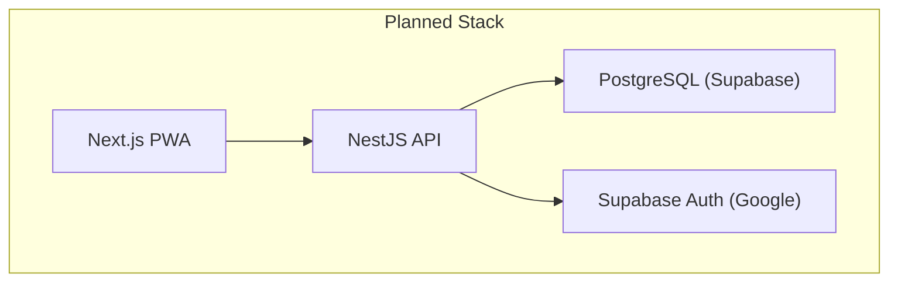
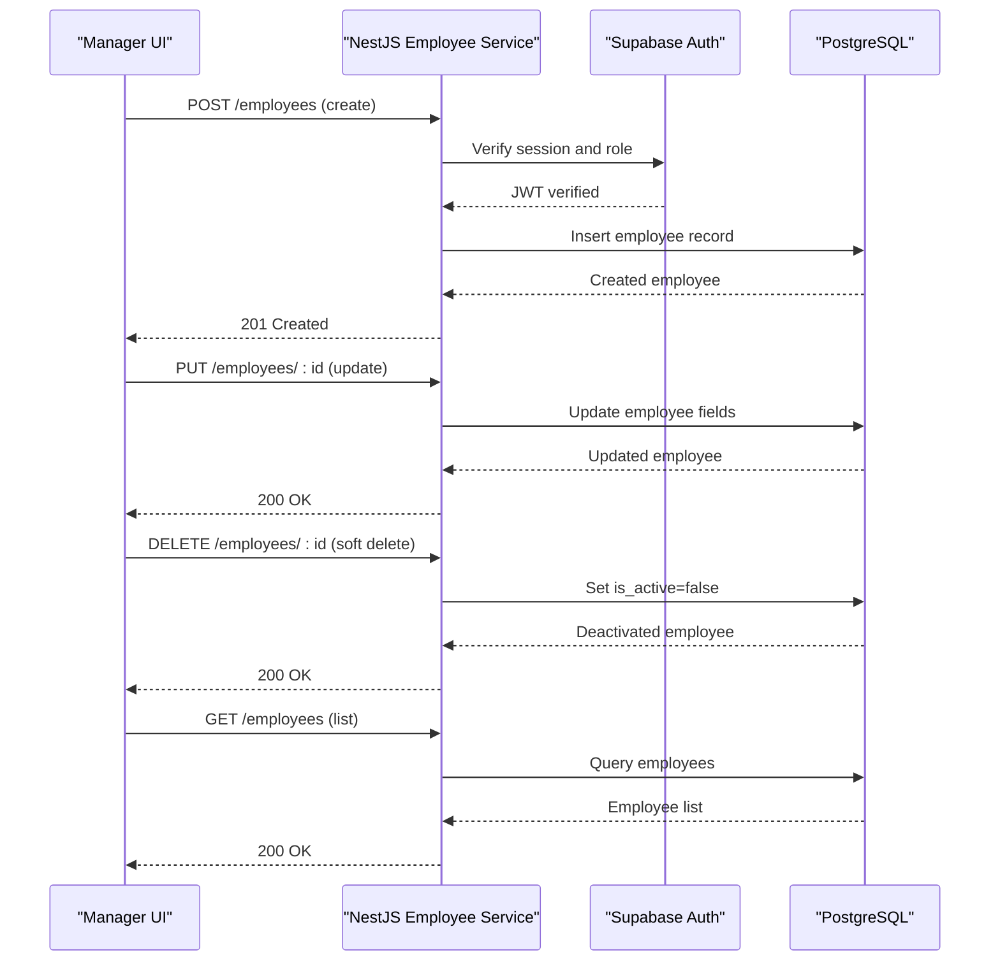
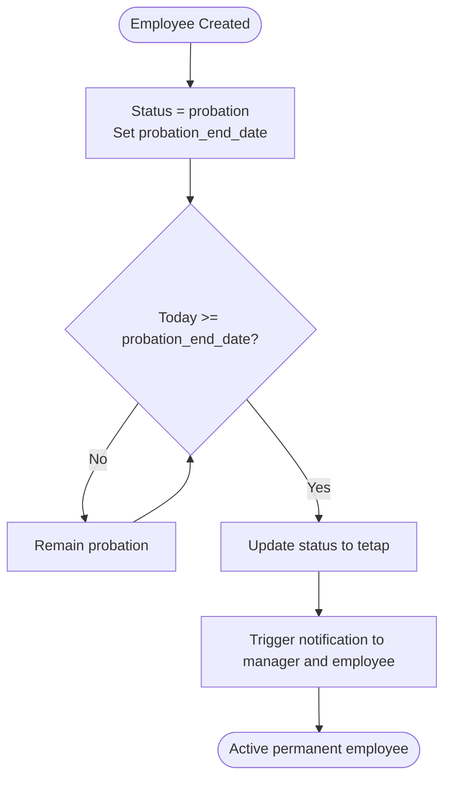
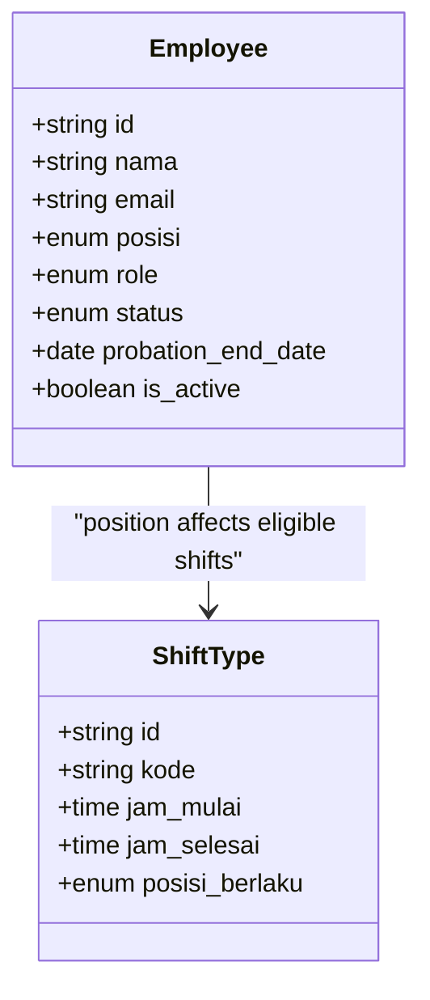
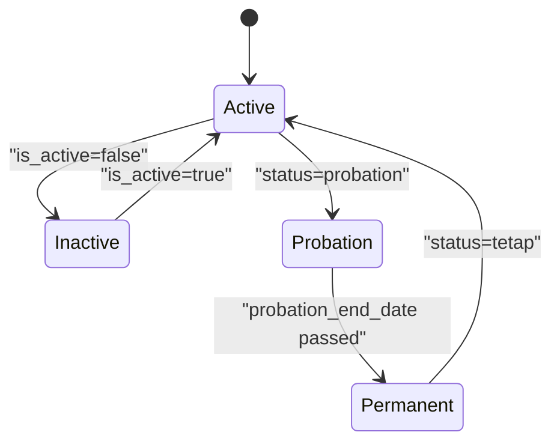
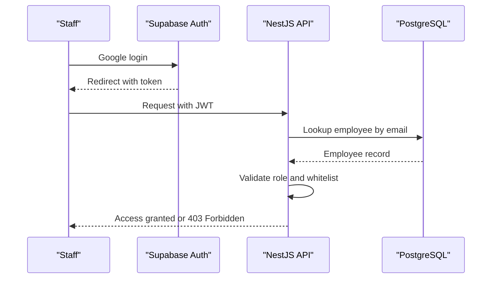
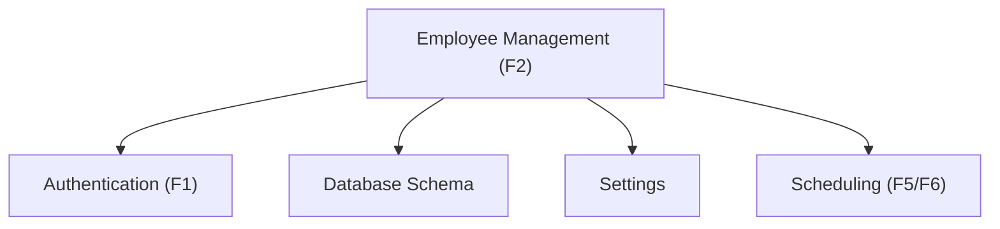

# Employee Management Module (F2)

<cite>
**Referenced Files in This Document**
- [README.md](file://README.md)
- [PRD-Aplikasi-Penjadwalan-Shift-Kyne.md](file://docs/PRD-Aplikasi-Penjadwalan-Shift-Kyne.md)
</cite>

## Table of Contents
1. [Introduction](#introduction)
2. [Project Structure](#project-structure)
3. [Core Components](#core-components)
4. [Architecture Overview](#architecture-overview)
5. [Detailed Component Analysis](#detailed-component-analysis)
6. [Dependency Analysis](#dependency-analysis)
7. [Performance Considerations](#performance-considerations)
8. [Troubleshooting Guide](#troubleshooting-guide)
9. [Conclusion](#conclusion)
10. [Appendices](#appendices)

## Introduction
This document specifies the Employee Management module (F2) for the Kyne shift scheduling application. It defines functional requirements, data models, business rules, user stories, acceptance criteria, and integration points with authentication and scheduling modules. The repository is currently a scaffold without implementation code; this specification serves as the authoritative blueprint for building F2 consistently with the Product Requirements Document (PRD).

The module supports:
- CRUD operations for employee records
- Position assignment distinguishing bar and kitchen roles
- Probation status tracking with automatic transitions
- Active/inactive status management affecting login and scheduling eligibility
- Integration with Google-based authentication and whitelist enforcement
- Data model alignment for future migration to an ERP system

**Section sources**
- [README.md:1-25](file://README.md#L1-L25)
- [PRD-Aplikasi-Penjadwalan-Shift-Kyne.md:230-249](file://docs/PRD-Aplikasi-Penjadwalan-Shift-Kyne.md#L230-L249)

## Project Structure
At this stage, the repository contains only documentation and scaffolding notes. There are no source files yet. The PRD outlines the intended stack and module boundaries:
- Frontend: Next.js PWA
- Backend: NestJS modules including Auth, Employee, Request, Schedule, Publish
- Database: PostgreSQL via Prisma
- Authentication: Supabase Auth with Google provider and JWT verification in NestJS

**Diagram sources**
- [PRD-Aplikasi-Penjadwalan-Shift-Kyne.md:230-241](file://docs/PRD-Aplikasi-Penjadwalan-Shift-Kyne.md#L230-L241)

**Section sources**
- [README.md:1-25](file://README.md#L1-L25)
- [PRD-Aplikasi-Penjadwalan-Shift-Kyne.md:230-249](file://docs/PRD-Aplikasi-Penjadwalan-Shift-Kyne.md#L230-L249)

## Core Components
Employee Management (F2) centers on managing employee entities and their lifecycle attributes. Key responsibilities include:
- Creating, updating, retrieving, and deactivating employees
- Assigning positions (bar or kitchen)
- Managing probation status and end dates
- Enforcing active/inactive status constraints
- Integrating with authentication whitelist and role resolution

Data model elements relevant to F2:
- employee: id, nama, email, posisi (bar/kitchen), role (manager/staff), status (probation/tetap), probation_end_date, is_active
- shift_type: id, kode (PAGI/SORE/MIDDLE), jam_mulai, jam_selesai, posisi_berlaku
- schedule_week: id, start_date, status, request_deadline, published_at, published_by, copied_from_week_id
- off_request: id, week_id, employee_id, tanggal, status, decided_by, decided_at
- shift_request: id, week_id, employee_id, tanggal, shift_type_id, status, decided_by, decided_at
- setting: key, value

These entities underpin F2’s CRUD and state transitions.

**Section sources**
- [PRD-Aplikasi-Penjadwalan-Shift-Kyne.md:197-217](file://docs/PRD-Aplikasi-Penjadwalan-Shift-Kyne.md#L197-L217)

## Architecture Overview
F2 integrates with:
- Authentication: Whitelist enforcement in NestJS using employee.email; roles resolved from employee table
- Scheduling: Employee position influences shift coverage validation and middle-kitchen logic
- Settings: Probation request behavior controlled by settings such as probation_can_request

**Diagram sources**
- [PRD-Aplikasi-Penjadwalan-Shift-Kyne.md:230-249](file://docs/PRD-Aplikasi-Penjadwalan-Shift-Kyne.md#L230-L249)
- [PRD-Aplikasi-Penjadwalan-Shift-Kyne.md:197-217](file://docs/PRD-Aplikasi-Penjadwalan-Shift-Kyne.md#L197-L217)

## Detailed Component Analysis

### Employee Lifecycle and Status Transitions
Probation-to-permanent transition is automatic based on probation_end_date. When the date passes, the system updates status to tetap (permanent). Notifications can be triggered when probation ends to inform managers and employees.

**Diagram sources**
- [PRD-Aplikasi-Penjadwalan-Shift-Kyne.md:118-121](file://docs/PRD-Aplikasi-Penjadwalan-Shift-Kyne.md#L118-L121)

**Section sources**
- [PRD-Aplikasi-Penjadwalan-Shift-Kyne.md:118-121](file://docs/PRD-Aplikasi-Penjadwalan-Shift-Kyne.md#L118-L121)

### Position Assignment: Bar vs Kitchen
Each employee has exactly one fixed position: bar or kitchen. This determines:
- Eligibility for certain shifts (e.g., middle applies to kitchen only)
- Coverage validation rules per day and shift type
- Conflict detection for leave requests within the same position

**Diagram sources**
- [PRD-Aplikasi-Penjadwalan-Shift-Kyne.md:197-217](file://docs/PRD-Aplikasi-Penjadwalan-Shift-Kyne.md#L197-L217)

**Section sources**
- [PRD-Aplikasi-Penjadwalan-Shift-Kyne.md:37-37](file://docs/PRD-Aplikasi-Penjadwalan-Shift-Kyne.md#L37-L37)
- [PRD-Aplikasi-Penjadwalan-Shift-Kyne.md:169-177](file://docs/PRD-Aplikasi-Penjadwalan-Shift-Kyne.md#L169-L177)
- [PRD-Aplikasi-Penjadwalan-Shift-Kyne.md:197-217](file://docs/PRD-Aplikasi-Penjadwalan-Shift-Kyne.md#L197-L217)

### Active/Inactive Status and Scheduling Eligibility
Inactive employees cannot log in, but historical schedules remain intact. Active status impacts:
- Login eligibility via whitelist enforcement
- Visibility in scheduling workflows
- Eligibility for request submission (subject to probation status)

**Diagram sources**
- [PRD-Aplikasi-Penjadwalan-Shift-Kyne.md:118-121](file://docs/PRD-Aplikasi-Penjadwalan-Shift-Kyne.md#L118-L121)

**Section sources**
- [PRD-Aplikasi-Penjadwalan-Shift-Kyne.md:118-121](file://docs/PRD-Aplikasi-Penjadwalan-Shift-Kyne.md#L118-L121)

### User Stories for Manager Workflows
- As a manager, I can add new employees with name, Google email, position (bar/kitchen), initial status (probation/permanent), probation end date, and active flag.
- As a manager, I can update employee details including position, status, and active flag.
- As a manager, I can deactivate employees so they cannot log in while preserving historical data.
- As a manager, I can view all employees and filter by position, status, and active flag.

Acceptance criteria:
- Adding an employee requires valid email format and a defined position (bar or kitchen).
- Updating position must not allow multiple positions per employee.
- Deactivation sets is_active=false and prevents login via whitelist check.
- Retrieval returns only active employees unless explicitly requested otherwise.

**Section sources**
- [PRD-Aplikasi-Penjadwalan-Shift-Kyne.md:114-121](file://docs/PRD-Aplikasi-Penjadwalan-Shift-Kyne.md#L114-L121)
- [PRD-Aplikasi-Penjadwalan-Shift-Kyne.md:197-217](file://docs/PRD-Aplikasi-Penjadwalan-Shift-Kyne.md#L197-L217)

### Business Logic for Employee Lifecycle Management
- Probation auto-transition: When today >= probation_end_date, set status to tetap and trigger notifications.
- Active/inactive enforcement: Inactive employees cannot authenticate; whitelist checks reject unknown emails.
- Position constraints: Each employee has exactly one position; middle shift applies only to kitchen.
- Data integrity: Use UUIDs, created_at/updated_at timestamps, and soft deletes (no hard deletes).

**Section sources**
- [PRD-Aplikasi-Penjadwalan-Shift-Kyne.md:118-121](file://docs/PRD-Aplikasi-Penjadwalan-Shift-Kyne.md#L118-L121)
- [PRD-Aplikasi-Penjadwalan-Shift-Kyne.md:169-177](file://docs/PRD-Aplikasi-Penjadwalan-Shift-Kyne.md#L169-L177)
- [PRD-Aplikasi-Penjadwalan-Shift-Kyne.md:211-217](file://docs/PRD-Aplikasi-Penjadwalan-Shift-Kyne.md#L211-L217)

### API Endpoints (Proposed)
Endpoints align with NestJS module structure and RBAC enforced by the Employee service.

- Create Employee
  - Method: POST
  - Path: /employees
  - Role: manager
  - Body: nama, email, posisi, status, probation_end_date, is_active
  - Response: 201 Created with employee object

- Update Employee
  - Method: PUT
  - Path: /employees/:id
  - Role: manager
  - Body: nama, email, posisi, status, probation_end_date, is_active
  - Response: 200 OK with updated employee

- Deactivate Employee
  - Method: PATCH
  - Path: /employees/:id/deactivate
  - Role: manager
  - Response: 200 OK with is_active=false

- Retrieve Employees
  - Method: GET
  - Path: /employees
  - Role: manager
  - Query params: position, status, isActive
  - Response: 200 OK with array of employees

- Retrieve Single Employee
  - Method: GET
  - Path: /employees/:id
  - Role: manager
  - Response: 200 OK with employee object

Integration notes:
- All endpoints require authenticated sessions verified by NestJS against Supabase Auth.
- Roles are resolved from the employee table, not JWT metadata.
- Whitelist enforcement rejects unregistered emails at the API layer.

**Section sources**
- [PRD-Aplikasi-Penjadwalan-Shift-Kyne.md:230-249](file://docs/PRD-Aplikasi-Penjadwalan-Shift-Kyne.md#L230-L249)
- [PRD-Aplikasi-Penjadwalan-Shift-Kyne.md:197-217](file://docs/PRD-Aplikasi-Penjadwalan-Shift-Kyne.md#L197-L217)

### Data Models and Validation Rules
Core fields and constraints:
- employee.id: UUID
- employee.nama: string, required
- employee.email: string, unique, used for whitelist login
- employee.posisi: enum bar/kitchen, required
- employee.role: enum manager/staff, derived from organizational needs
- employee.status: enum probation/tetap, auto-transitioned
- employee.probation_end_date: date, required if status=probation
- employee.is_active: boolean, default true

Validation rules:
- Email must exist in whitelist; otherwise, access denied.
- Position must be exactly one of bar or kitchen.
- Probation end date must be in the future when creating probation employees.
- Soft delete via is_active; no hard deletes.

**Section sources**
- [PRD-Aplikasi-Penjadwalan-Shift-Kyne.md:197-217](file://docs/PRD-Aplikasi-Penjadwalan-Shift-Kyne.md#L197-L217)
- [PRD-Aplikasi-Penjadwalan-Shift-Kyne.md:243-249](file://docs/PRD-Aplikasi-Penjadwalan-Shift-Kyne.md#L243-L249)

### Integration with Authentication System
Authentication flow:
- Google login via Supabase Auth with PKCE redirect
- NestJS verifies JWT on every request
- Whitelist enforcement in NestJS denies unregistered emails
- Roles resolved from employee table

**Diagram sources**
- [PRD-Aplikasi-Penjadwalan-Shift-Kyne.md:230-249](file://docs/PRD-Aplikasi-Penjadwalan-Shift-Kyne.md#L230-L249)

**Section sources**
- [PRD-Aplikasi-Penjadwalan-Shift-Kyne.md:230-249](file://docs/PRD-Aplikasi-Penjadwalan-Shift-Kyne.md#L230-L249)

## Dependency Analysis
F2 depends on:
- Authentication module for session verification and role resolution
- Database schema for employee, shift_type, schedule_week, off_request, shift_request, and setting
- Settings module for controlling probation request behavior and deadlines

**Diagram sources**
- [PRD-Aplikasi-Penjadwalan-Shift-Kyne.md:230-249](file://docs/PRD-Aplikasi-Penjadwalan-Shift-Kyne.md#L230-L249)
- [PRD-Aplikasi-Penjadwalan-Shift-Kyne.md:197-217](file://docs/PRD-Aplikasi-Penjadwalan-Shift-Kyne.md#L197-L217)

**Section sources**
- [PRD-Aplikasi-Penjadwalan-Shift-Kyne.md:230-249](file://docs/PRD-Aplikasi-Penjadwalan-Shift-Kyne.md#L230-L249)
- [PRD-Aplikasi-Penjadwalan-Shift-Kyne.md:197-217](file://docs/PRD-Aplikasi-Penjadwalan-Shift-Kyne.md#L197-L217)

## Performance Considerations
- Use UUIDs for IDs to support distributed systems and ERP migration.
- Index employee.email and employee.is_active for fast lookup and filtering.
- Avoid hard deletes; use soft deletes to preserve history and reduce rework.
- Batch probation transitions during scheduled jobs to minimize runtime overhead.
- Cache frequently accessed employee lists for dashboard performance.

[No sources needed since this section provides general guidance]

## Troubleshooting Guide
Common issues and resolutions:
- Login denied for registered email: Ensure employee.is_active=true and email exists in whitelist.
- Probation not transitioning: Verify probation_end_date is correctly set and less than or equal to current date.
- Position conflicts: Confirm each employee has exactly one position; middle shift only applies to kitchen.
- Historical data missing after deactivation: Remember deactivation is soft; ensure queries include inactive records when necessary.

**Section sources**
- [PRD-Aplikasi-Penjadwalan-Shift-Kyne.md:118-121](file://docs/PRD-Aplikasi-Penjadwalan-Shift-Kyne.md#L118-L121)
- [PRD-Aplikasi-Penjadwalan-Shift-Kyne.md:169-177](file://docs/PRD-Aplikasi-Penjadwalan-Shift-Kyne.md#L169-L177)
- [PRD-Aplikasi-Penjadwalan-Shift-Kyne.md:211-217](file://docs/PRD-Aplikasi-Penjadwalan-Shift-Kyne.md#L211-L217)

## Conclusion
The Employee Management module (F2) provides foundational capabilities for managing staff records, positions, probation states, and active status. It integrates tightly with authentication and scheduling modules, ensuring secure access, consistent data modeling, and robust lifecycle management. Implementing these specifications will enable reliable employee administration aligned with the PRD’s goals and future ERP migration.

[No sources needed since this section summarizes without analyzing specific files]

## Appendices

### Acceptance Criteria Summary
- CRUD operations enforce data validation and role-based access.
- Position assignment restricts eligible shifts and conflict detection.
- Probation transitions occur automatically upon reaching end date.
- Active/inactive status controls login eligibility and visibility.
- Integration with authentication ensures whitelist enforcement and role resolution.

**Section sources**
- [PRD-Aplikasi-Penjadwalan-Shift-Kyne.md:114-121](file://docs/PRD-Aplikasi-Penjadwalan-Shift-Kyne.md#L114-L121)
- [PRD-Aplikasi-Penjadwalan-Shift-Kyne.md:197-217](file://docs/PRD-Aplikasi-Penjadwalan-Shift-Kyne.md#L197-L217)
- [PRD-Aplikasi-Penjadwalan-Shift-Kyne.md:230-249](file://docs/PRD-Aplikasi-Penjadwalan-Shift-Kyne.md#L230-L249)