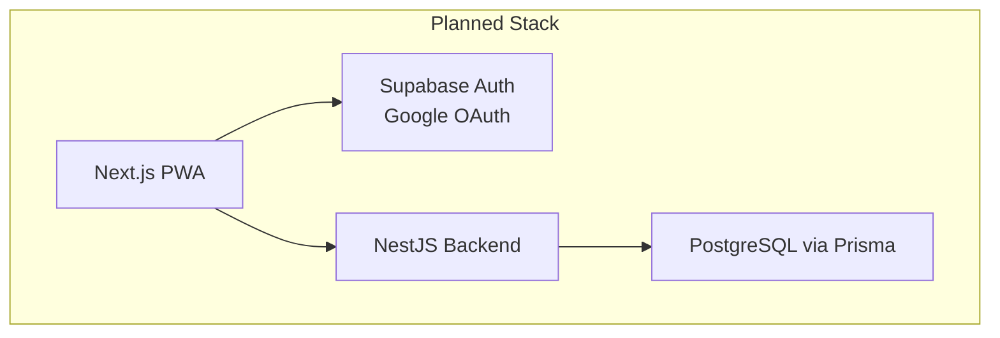
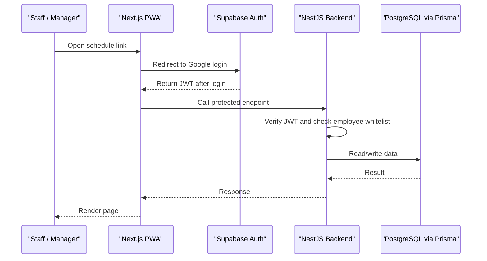
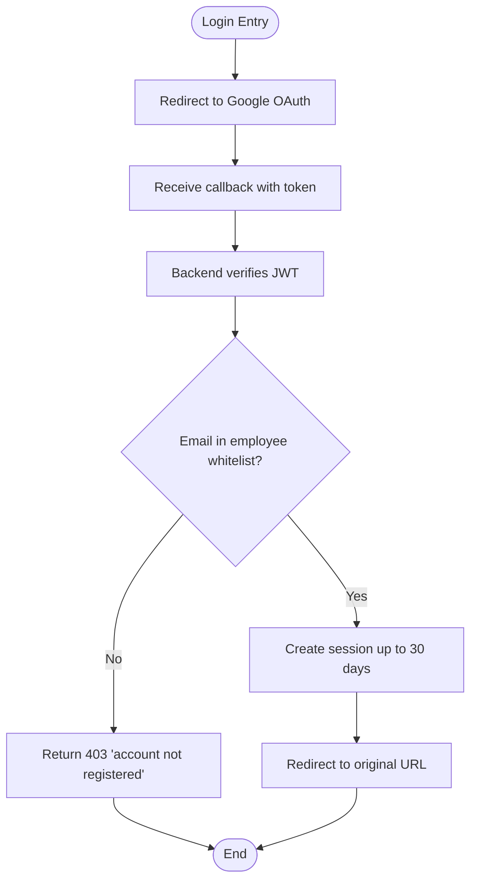
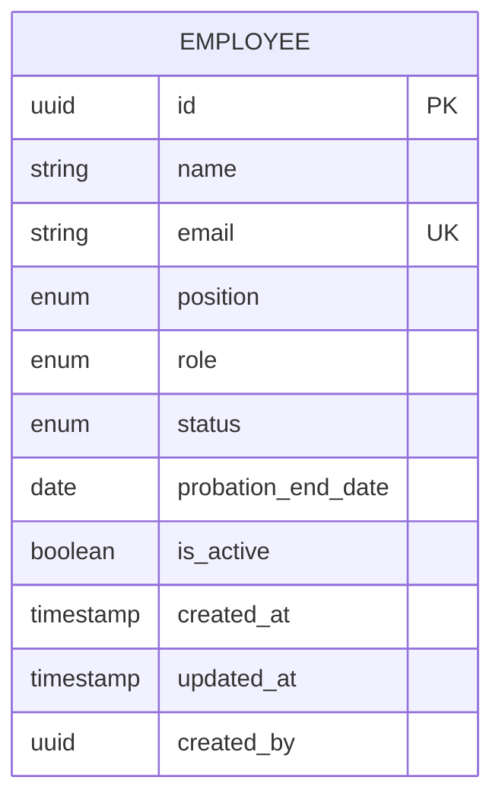
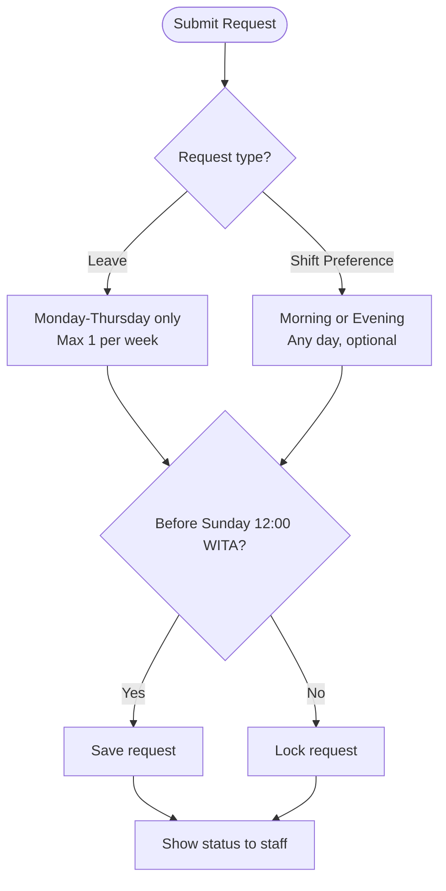
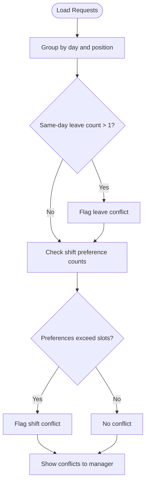
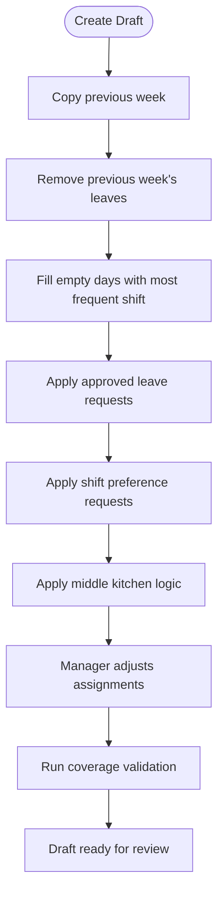
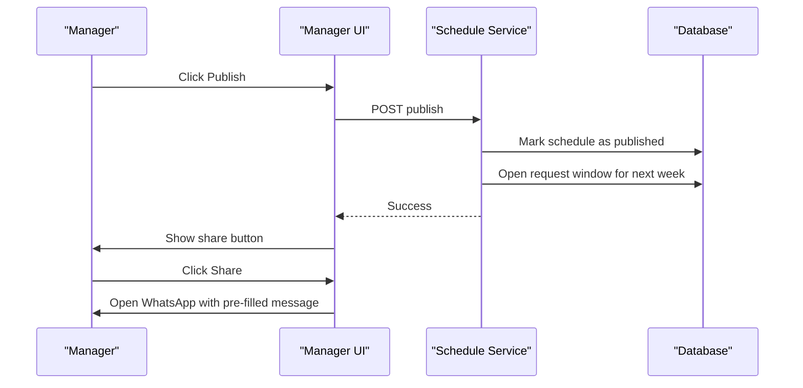
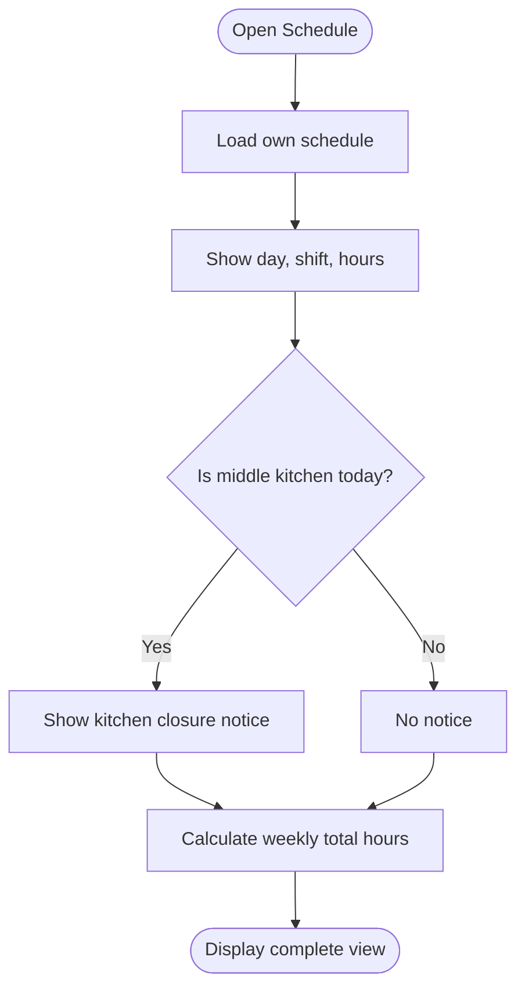
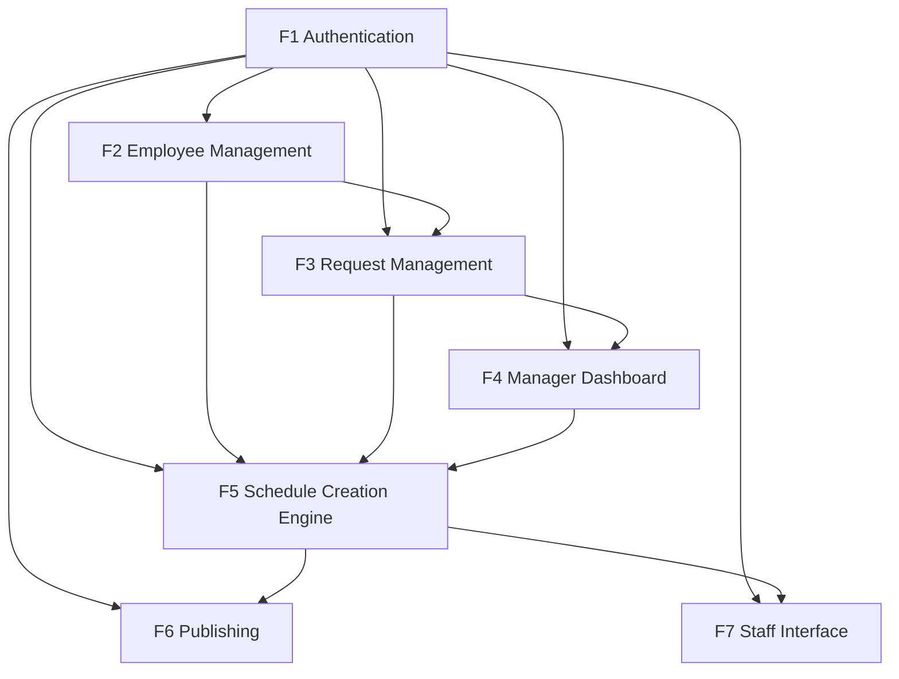

# Functional Specifications

<cite>
**Referenced Files in This Document**   
- [README.md](file://README.md)
- [PRD-Aplikasi-Penjadwalan-Shift-Kyne.md](file://docs/PRD-Aplikasi-Penjadwalan-Shift-Kyne.md)
</cite>

## Table of Contents
1. [Introduction](#introduction)
2. [Project Structure](#project-structure)
3. [Core Components](#core-components)
4. [Architecture Overview](#architecture-overview)
5. [Detailed Component Analysis](#detailed-component-analysis)
6. [Dependency Analysis](#dependency-analysis)
7. [Performance Considerations](#performance-considerations)
8. [Troubleshooting Guide](#troubleshooting-guide)
9. [Conclusion](#conclusion)

## Introduction
This document specifies the functional requirements for the Kyne scheduling application MVP. The system is a standalone PWA that creates weekly shift schedules for six staff members across bar and kitchen roles, supports leave and shift preference requests, provides a manager dashboard, automates schedule drafting from the previous week, publishes schedules with WhatsApp sharing, and exposes a personal schedule view for staff.

The product definition identifies seven core modules: Authentication (F1), Employee Management (F2), Request Management (F3), Manager Dashboard (F4), Schedule Creation Engine (F5), Publishing (F6), and Staff Interface (F7). It also defines business rules around shifts, coverage, probation, request windows, and middle kitchen logic.

**Section sources**
- [README.md:1-25](file://README.md#L1-L25)
- [PRD-Aplikasi-Penjadwalan-Shift-Kyne.md:5-26](file://docs/PRD-Aplikasi-Penjadwalan-Shift-Kyne.md#L5-L26)

## Project Structure
At this stage, the repository contains only documentation and an initial README. There is no implementation code yet. The intended stack includes Next.js for the frontend, NestJS for the backend, PostgreSQL via Prisma on Supabase, and Supabase Auth for Google OAuth. The data model draft outlines seven entities to support the MVP.

**Diagram sources**
- [PRD-Aplikasi-Penjadwalan-Shift-Kyne.md:230-241](file://docs/PRD-Aplikasi-Penjadwalan-Shift-Kyne.md#L230-L241)

**Section sources**
- [README.md:1-25](file://README.md#L1-L25)
- [PRD-Aplikasi-Penjadwalan-Shift-Kyne.md:230-241](file://docs/PRD-Aplikasi-Penjadwalan-Shift-Kyne.md#L230-L241)

## Core Components
The seven functional modules are defined below with user stories, acceptance criteria, and business rules derived from the product definition.

### F1. Authentication
User story: As a staff member, I can log in with my Google account so I do not need to remember a new password.

Acceptance criteria:
- Login uses Google OAuth redirect flow.
- Only emails present in the employee whitelist can access the app; others receive “account not registered.”
- Session persists for 30 days.
- After login, users are redirected to the originally requested URL.

Business rules:
- Role and permissions are read from the employee table, not JWT metadata.
- Whitelist validation occurs in the backend.
- All pages require authentication, including shared schedule links.

Security constraints:
- Supabase Auth allows any Google account to authenticate; NestJS enforces the whitelist.
- RLS deny-all is used; clients never query tables directly.

**Section sources**
- [PRD-Aplikasi-Penjadwalan-Shift-Kyne.md:106-112](file://docs/PRD-Aplikasi-Penjadwalan-Shift-Kyne.md#L106-L112)
- [PRD-Aplikasi-Penjadwalan-Shift-Kyne.md:243-248](file://docs/PRD-Aplikasi-Penjadwalan-Shift-Kyne.md#L243-L248)

### F2. Employee Management
User story: As a manager, I can register and deactivate employees so only active team members can access the system.

Acceptance criteria:
- Employee records include name, Google email, position (bar/kitchen), role (manager/staff), status (probation/tetap), probation end date, and active/inactive flag.
- Inactive employees cannot log in; historical schedule data remains intact.
- Probation status automatically transitions to regular after the end date passes.

Business rules:
- Each employee has one fixed position: bar or kitchen.
- Email serves as the login whitelist entry.
- Data design supports future mapping to an ERP HR module.

Operational notes:
- Initial data collection should include names, Google emails, positions, probation status, and end dates for all six staff.

**Section sources**
- [PRD-Aplikasi-Penjadwalan-Shift-Kyne.md:114-121](file://docs/PRD-Aplikasi-Penjadwalan-Shift-Kyne.md#L114-L121)
- [PRD-Aplikasi-Penjadwalan-Shift-Kyne.md:27-38](file://docs/PRD-Aplikasi-Penjadwalan-Shift-Kyne.md#L27-L38)
- [PRD-Aplikasi-Penjadwalan-Shift-Kyne.md:264-266](file://docs/PRD-Aplikasi-Penjadwalan-Shift-Kyne.md#L264-L266)

### F3. Request Management
User story: As a staff member, I can choose my day off and preferred shift for next week.

Acceptance criteria:
- Leave requests allow selecting Monday through Thursday, maximum one day per week.
- Shift preference requests allow choosing morning or evening per day, for any day, and may be left empty.
- Requests can be edited until Sunday 12:00 WITA; after that they lock.
- Staff see their own request status, such as “Day off: Tuesday.”
- Probation staff do not see the request menu.

Business rules:
- One day off per week for non-probation staff.
- Day off allowed only Monday–Thursday.
- Maximum one bar and one kitchen day off per day; conflicts are flagged for manager resolution.
- Shift preferences are best-effort and decided by the manager.
- Request window opens when the current week’s schedule is published and closes at Sunday 12:00 WITA.

Conflict handling:
- Conflicts occur when two same-position staff request the same day off or when shift preferences exceed available slots.
- The manager decides which conflict is approved; unapproved leave requests are treated as if no request was made.

**Section sources**
- [PRD-Aplikasi-Penjadwalan-Shift-Kyne.md:122-131](file://docs/PRD-Aplikasi-Penjadwalan-Shift-Kyne.md#L122-L131)
- [PRD-Aplikasi-Penjadwalan-Shift-Kyne.md:92-97](file://docs/PRD-Aplikasi-Penjadwalan-Shift-Kyne.md#L92-L97)
- [PRD-Aplikasi-Penjadwalan-Shift-Kyne.md:181-193](file://docs/PRD-Aplikasi-Penjadwalan-Shift-Kyne.md#L181-L193)

### F4. Manager Dashboard
User story: As a manager, I can see all next-week requests on one screen before creating the schedule.

Acceptance criteria:
- Dashboard shows each staff member’s leave and shift preference requests.
- Conflicts are highlighted: same-day leave for same position and shift preference overflows.
- A list shows non-probation staff who have not submitted requests.

Business rules:
- Conflict detection follows the same rules as F3.
- Unrequested leave days will be assigned by the manager during schedule creation.

**Section sources**
- [PRD-Aplikasi-Penjadwalan-Shift-Kyne.md:132-139](file://docs/PRD-Aplikasi-Penjadwalan-Shift-Kyne.md#L132-L139)
- [PRD-Aplikasi-Penjadwalan-Shift-Kyne.md:92-97](file://docs/PRD-Aplikasi-Penjadwalan-Shift-Kyne.md#L92-L97)

### F5. Schedule Creation Engine
User story: As a manager, I can create a draft schedule from last week so I do not start from scratch.

Acceptance criteria:
- “Create draft from last week” triggers automated steps: copy previous week, remove previous week’s leaves, fill empty days with the employee’s most frequent shift, apply leave requests, apply shift preference requests, and apply middle kitchen logic.
- Manager can manually adjust each staff member’s daily assignment: morning, evening, middle (kitchen), or day off.
- Coverage validation runs on every change.
- Drafts are hidden from staff until published.

Business rules:
- Middle kitchen applies when a kitchen colleague is off; the other kitchen staff becomes middle on that day, invalidating any kitchen shift preference for that day.
- Coverage rules:
  - Friday–Sunday: bar requires two people per shift; kitchen requires one person per shift.
  - Monday–Thursday: bar requires at least one person per shift; kitchen requires at least one person or middle.
- When one bar staff is off, the manager chooses who works morning or evening.

Validation output:
- Coverage warnings appear before publish; staff do not see these indicators.

**Section sources**
- [PRD-Aplikasi-Penjadwalan-Shift-Kyne.md:140-147](file://docs/PRD-Aplikasi-Penjadwalan-Shift-Kyne.md#L140-L147)
- [PRD-Aplikasi-Penjadwalan-Shift-Kyne.md:79-90](file://docs/PRD-Aplikasi-Penjadwalan-Shift-Kyne.md#L79-L90)
- [PRD-Aplikasi-Penjadwalan-Shift-Kyne.md:179-195](file://docs/PRD-Aplikasi-Penjadwalan-Shift-Kyne.md#L179-L195)

### F6. Publishing and Sharing
User story: As a manager, I can publish the schedule and share it to the WhatsApp group.

Acceptance criteria:
- Publishing makes the schedule visible to staff and opens the request window for the following week.
- Share button opens WhatsApp with pre-filled text containing the schedule period, link, and next-week request deadline.
- Manager can still edit the schedule after publishing.

Business rules:
- Publish must occur no later than Sunday 18:00 WITA according to success metrics.
- Shared links require login and enforce privacy: staff see only their own schedule.

**Section sources**
- [PRD-Aplikasi-Penjadwalan-Shift-Kyne.md:149-156](file://docs/PRD-Aplikasi-Penjadwalan-Shift-Kyne.md#L149-L156)
- [PRD-Aplikasi-Penjadwalan-Shift-Kyne.md:21-25](file://docs/PRD-Aplikasi-Penjadwalan-Shift-Kyne.md#L21-L25)
- [PRD-Aplikasi-Penjadwalan-Shift-Kyne.md:223-227](file://docs/PRD-Aplikasi-Penjadwalan-Shift-Kyne.md#L223-L227)

### F7. Staff Interface
User story: As a staff member, I can view my schedule for this week and next week on my phone.

Acceptance criteria:
- Staff see only their own schedule: day, shift, and working hours.
- On middle kitchen days, a notice indicates kitchen closure times.
- Weekly total working hours are displayed.

Business rules:
- Working hours are calculated from shift types, not stored separately.
- Middle kitchen notice appears only when applicable.

**Section sources**
- [PRD-Aplikasi-Penjadwalan-Shift-Kyne.md:157-164](file://docs/PRD-Aplikasi-Penjadwalan-Shift-Kyne.md#L157-L164)
- [PRD-Aplikasi-Penjadwalan-Shift-Kyne.md:197-217](file://docs/PRD-Aplikasi-Penjadwalan-Shift-Kyne.md#L197-L217)

## Architecture Overview
The system follows a layered architecture aligned with the planned stack. Frontend and backend communicate through authenticated API calls; the backend enforces business rules and data integrity.

**Diagram sources**
- [PRD-Aplikasi-Penjadwalan-Shift-Kyne.md:230-248](file://docs/PRD-Aplikasi-Penjadwalan-Shift-Kyne.md#L230-L248)

## Detailed Component Analysis

### Authentication Flow
Authentication uses Google OAuth with PKCE redirect. The backend validates the JWT and checks the employee whitelist before granting access.

**Diagram sources**
- [PRD-Aplikasi-Penjadwalan-Shift-Kyne.md:106-112](file://docs/PRD-Aplikasi-Penjadwalan-Shift-Kyne.md#L106-L112)
- [PRD-Aplikasi-Penjadwalan-Shift-Kyne.md:243-248](file://docs/PRD-Aplikasi-Penjadwalan-Shift-Kyne.md#L243-L248)

**Section sources**
- [PRD-Aplikasi-Penjadwalan-Shift-Kyne.md:106-112](file://docs/PRD-Aplikasi-Penjadwalan-Shift-Kyne.md#L106-L112)
- [PRD-Aplikasi-Penjadwalan-Shift-Kyne.md:243-248](file://docs/PRD-Aplikasi-Penjadwalan-Shift-Kyne.md#L243-L248)

### Employee Management Model
The employee entity stores identity, role, position, probation state, and activation status.

**Diagram sources**
- [PRD-Aplikasi-Penjadwalan-Shift-Kyne.md:197-217](file://docs/PRD-Aplikasi-Penjadwalan-Shift-Kyne.md#L197-L217)

**Section sources**
- [PRD-Aplikasi-Penjadwalan-Shift-Kyne.md:114-121](file://docs/PRD-Aplikasi-Penjadwalan-Shift-Kyne.md#L114-L121)
- [PRD-Aplikasi-Penjadwalan-Shift-Kyne.md:197-217](file://docs/PRD-Aplikasi-Penjadwalan-Shift-Kyne.md#L197-L217)

### Request Management Rules
Leave and shift preference requests follow strict constraints and deadlines.

**Diagram sources**
- [PRD-Aplikasi-Penjadwalan-Shift-Kyne.md:122-131](file://docs/PRD-Aplikasi-Penjadwalan-Shift-Kyne.md#L122-L131)
- [PRD-Aplikasi-Penjadwalan-Shift-Kyne.md:181-193](file://docs/PRD-Aplikasi-Penjadwalan-Shift-Kyne.md#L181-L193)

**Section sources**
- [PRD-Aplikasi-Penjadwalan-Shift-Kyne.md:122-131](file://docs/PRD-Aplikasi-Penjadwalan-Shift-Kyne.md#L122-L131)
- [PRD-Aplikasi-Penjadwalan-Shift-Kyne.md:181-193](file://docs/PRD-Aplikasi-Penjadwalan-Shift-Kyne.md#L181-L193)

### Manager Dashboard Conflict Detection
The dashboard highlights conflicts based on position and slot limits.

**Diagram sources**
- [PRD-Aplikasi-Penjadwalan-Shift-Kyne.md:132-139](file://docs/PRD-Aplikasi-Penjadwalan-Shift-Kyne.md#L132-L139)
- [PRD-Aplikasi-Penjadwalan-Shift-Kyne.md:92-97](file://docs/PRD-Aplikasi-Penjadwalan-Shift-Kyne.md#L92-L97)

**Section sources**
- [PRD-Aplikasi-Penjadwalan-Shift-Kyne.md:132-139](file://docs/PRD-Aplikasi-Penjadwalan-Shift-Kyne.md#L132-L139)
- [PRD-Aplikasi-Penjadwalan-Shift-Kyne.md:92-97](file://docs/PRD-Aplikasi-Penjadwalan-Shift-Kyne.md#L92-L97)

### Schedule Creation Engine Workflow
Drafting copies the previous week and applies rules before manual adjustments.

**Diagram sources**
- [PRD-Aplikasi-Penjadwalan-Shift-Kyne.md:79-90](file://docs/PRD-Aplikasi-Penjadwalan-Shift-Kyne.md#L79-L90)
- [PRD-Aplikasi-Penjadwalan-Shift-Kyne.md:140-147](file://docs/PRD-Aplikasi-Penjadwalan-Shift-Kyne.md#L140-L147)
- [PRD-Aplikasi-Penjadwalan-Shift-Kyne.md:179-195](file://docs/PRD-Aplikasi-Penjadwalan-Shift-Kyne.md#L179-L195)

**Section sources**
- [PRD-Aplikasi-Penjadwalan-Shift-Kyne.md:79-90](file://docs/PRD-Aplikasi-Penjadwalan-Shift-Kyne.md#L79-L90)
- [PRD-Aplikasi-Penjadwalan-Shift-Kyne.md:140-147](file://docs/PRD-Aplikasi-Penjadwalan-Shift-Kyne.md#L140-L147)
- [PRD-Aplikasi-Penjadwalan-Shift-Kyne.md:179-195](file://docs/PRD-Aplikasi-Penjadwalan-Shift-Kyne.md#L179-L195)

### Publishing and WhatsApp Sharing
Publishing exposes the schedule and opens the next request window.

**Diagram sources**
- [PRD-Aplikasi-Penjadwalan-Shift-Kyne.md:149-156](file://docs/PRD-Aplikasi-Penjadwalan-Shift-Kyne.md#L149-L156)

**Section sources**
- [PRD-Aplikasi-Penjadwalan-Shift-Kyne.md:149-156](file://docs/PRD-Aplikasi-Penjadwalan-Shift-Kyne.md#L149-L156)

### Staff Interface Display Logic
Staff view their own schedule with working hours and middle kitchen notices.

**Diagram sources**
- [PRD-Aplikasi-Penjadwalan-Shift-Kyne.md:157-164](file://docs/PRD-Aplikasi-Penjadwalan-Shift-Kyne.md#L157-L164)
- [PRD-Aplikasi-Penjadwalan-Shift-Kyne.md:197-217](file://docs/PRD-Aplikasi-Penjadwalan-Shift-Kyne.md#L197-L217)

**Section sources**
- [PRD-Aplikasi-Penjadwalan-Shift-Kyne.md:157-164](file://docs/PRD-Aplikasi-Penjadwalan-Shift-Kyne.md#L157-L164)
- [PRD-Aplikasi-Penjadwalan-Shift-Kyne.md:197-217](file://docs/PRD-Aplikasi-Penjadwalan-Shift-Kyne.md#L197-L217)

## Dependency Analysis
The modules depend on shared data entities and cross-cutting concerns like authentication, time zones, and coverage validation.

**Diagram sources**
- [PRD-Aplikasi-Penjadwalan-Shift-Kyne.md:102-164](file://docs/PRD-Aplikasi-Penjadwalan-Shift-Kyne.md#L102-L164)

**Section sources**
- [PRD-Aplikasi-Penjadwalan-Shift-Kyne.md:102-164](file://docs/PRD-Aplikasi-Penjadwalan-Shift-Kyne.md#L102-L164)

## Performance Considerations
- Use server-side validation for all business rules to avoid client bypass.
- Cache shift types and settings to reduce database reads.
- Compute weekly working hours incrementally when shifts change.
- Avoid heavy queries on the staff interface; load only the current and next week.
- Ensure timezone calculations use WITA consistently for deadlines and shift times.

[No sources needed since this section provides general guidance]

## Troubleshooting Guide
Common issues and resolutions:
- Google login blocked in in-app browser: instruct users to open the link in Chrome or Safari or via the installed PWA.
- Unauthorized access despite login: verify employee whitelist and backend JWT verification.
- Request editing locked unexpectedly: confirm current time against Sunday 12:00 WITA deadline.
- Coverage warnings preventing publish: review Friday–Sunday and Monday–Thursday staffing rules and resolve conflicts.
- Missing middle kitchen notice: ensure middle kitchen logic runs and displays correctly for applicable days.

**Section sources**
- [PRD-Aplikasi-Penjadwalan-Shift-Kyne.md:223-227](file://docs/PRD-Aplikasi-Penjadwalan-Shift-Kyne.md#L223-L227)
- [PRD-Aplikasi-Penjadwalan-Shift-Kyne.md:179-195](file://docs/PRD-Aplikasi-Penjadwalan-Shift-Kyne.md#L179-L195)

## Conclusion
The Kyne scheduling MVP is well-scoped and clearly defined across seven modules. The product specification establishes robust business rules for authentication, employee management, requests, dashboard visibility, schedule drafting, publishing, and staff viewing. With the planned stack and data model, the system can evolve toward an ERP integration while maintaining a focused MVP timeline.

[No sources needed since this section summarizes without analyzing specific files]