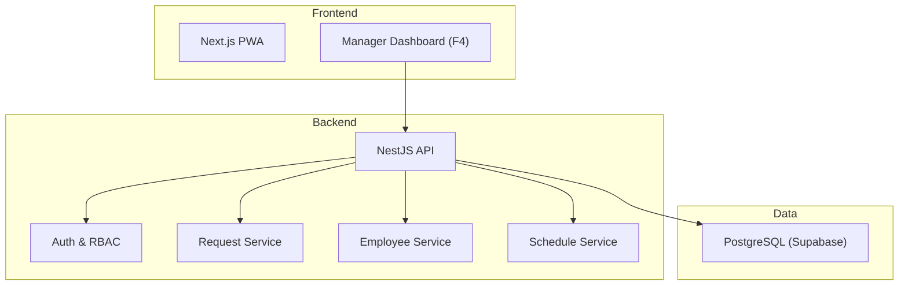
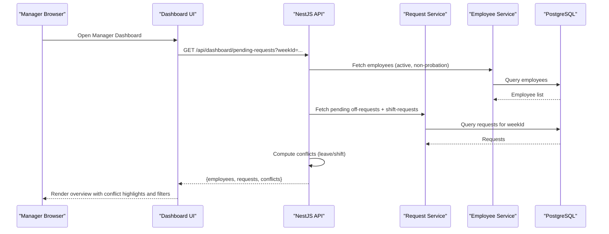
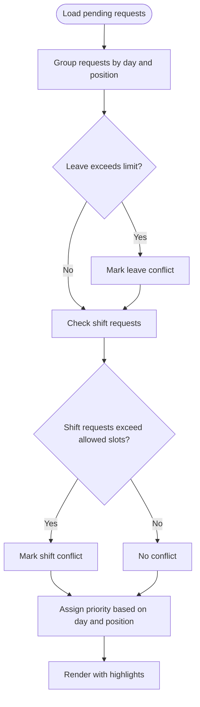
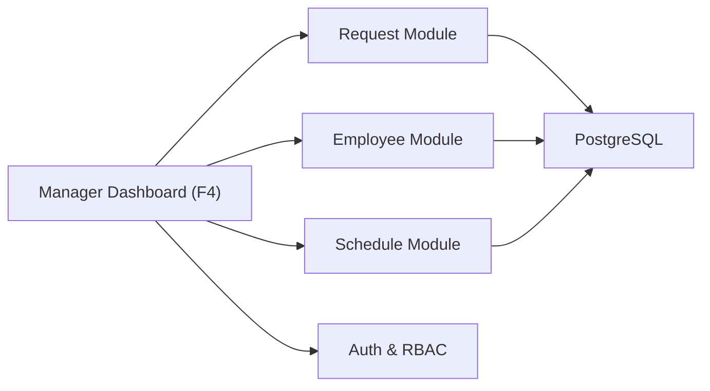

# Manager Dashboard Module (F4)

<cite>
**Referenced Files in This Document**
- [README.md](file://README.md)
- [PRD-Aplikasi-Penjadwalan-Shift-Kyne.md](file://docs/PRD-Aplikasi-Penjadwalan-Shift-Kyne.md)
</cite>

## Table of Contents
1. [Introduction](#introduction)
2. [Project Structure](#project-structure)
3. [Core Components](#core-components)
4. [Architecture Overview](#architecture-overview)
5. [Detailed Component Analysis](#detailed-component-analysis)
6. [Dependency Analysis](#dependency-analysis)
7. [Performance Considerations](#performance-considerations)
8. [Troubleshooting Guide](#troubleshooting-guide)
9. [Conclusion](#conclusion)
10. [Appendices](#appendices)

## Introduction
This document defines the functional specifications for the Manager Dashboard module (F4) within the Kyne Shift Scheduling application. The dashboard is the manager’s single screen to review all upcoming-week requests, identify conflicts, and prepare for schedule drafting. It must clearly show pending approvals with priority indicators, highlight scheduling conflicts, and provide filtering by request type, date range, and employee.

The project is currently a scaffold without implementation code; this specification is derived from the product requirements and intended stack described in the repository documentation.

**Section sources**
- [README.md:1-25](file://README.md#L1-L25)
- [PRD-Aplikasi-Penjadwalan-Shift-Kyne.md:1-267](file://docs/PRD-Aplikasi-Penjadwalan-Shift-Kyne.md#L1-L267)

## Project Structure
At this stage, the repository contains only documentation and scaffolding files. The intended architecture is a monorepo with Next.js frontend (PWA), NestJS backend, PostgreSQL via Prisma on Supabase, and Google authentication through Supabase Auth. The Manager Dashboard will be part of the Next.js frontend and will consume NestJS APIs.

**Diagram sources**
- [PRD-Aplikasi-Penjadwalan-Shift-Kyne.md:230-249](file://docs/PRD-Aplikasi-Penjadwalan-Shift-Kyne.md#L230-L249)

**Section sources**
- [PRD-Aplikasi-Penjadwalan-Shift-Kyne.md:230-249](file://docs/PRD-Aplikasi-Penjadwalan-Shift-Kyne.md#L230-L249)

## Core Components
The Manager Dashboard (F4) provides:
- Request overview showing all pending approval items for the upcoming week.
- Conflict highlighting for leave and shift requests that exceed allowed slots or violate business rules.
- Pending request lists with filters by type, date range, and employee.
- Visual priority indicators to help managers triage urgent or problematic requests.

Key data entities involved:
- Employee: role, position (bar/kitchen), probation status, active status.
- Off-request: weekly leave request per employee, with status and decision metadata.
- Shift-request: weekly shift preference per employee per day, with status and decision metadata.
- Schedule week: weekly context including deadline and status.

These entities are defined in the PRD and will be exposed via backend services.

**Section sources**
- [PRD-Aplikasi-Penjadwalan-Shift-Kyne.md:132-139](file://docs/PRD-Aplikasi-Penjadwalan-Shift-Kyne.md#L132-L139)
- [PRD-Aplikasi-Penjadwalan-Shift-Kyne.md:197-209](file://docs/PRD-Aplikasi-Penjadwalan-Shift-Kyne.md#L197-L209)

## Architecture Overview
The Manager Dashboard is a client-side view that calls backend endpoints to retrieve:
- Employees eligible to request (non-probation).
- Pending off-requests and shift-requests for the current upcoming week.
- Conflict detection results computed by the backend based on business rules.

**Diagram sources**
- [PRD-Aplikasi-Penjadwalan-Shift-Kyne.md:132-139](file://docs/PRD-Aplikasi-Penjadwalan-Shift-Kyne.md#L132-L139)
- [PRD-Aplikasi-Penjadwalan-Shift-Kyne.md:197-209](file://docs/PRD-Aplikasi-Penjadwalan-Shift-Kyne.md#L197-L209)
- [PRD-Aplikasi-Penjadwalan-Shift-Kyne.md:230-249](file://docs/PRD-Aplikasi-Penjadwalan-Shift-Kyne.md#L230-L249)

## Detailed Component Analysis

### Request Overview Interface
Purpose:
- Show all pending leave and shift requests for the upcoming week.
- Indicate which requests are still open for change before the weekly deadline.
- Provide quick access to details for each request.

UI elements:
- Summary cards: total pending requests, number of conflicts, number of employees who have not requested yet.
- Priority indicators:
  - High: conflicts involving kitchen coverage or weekend coverage violations.
  - Medium: conflicts in bar positions or weekday coverage concerns.
  - Normal: valid requests awaiting decision.
- Status badges: pending, approved, rejected.
- Action buttons: approve, reject, mark for manual review.

Data model mapping:
- Off-request: employee, date, status, decided_by, decided_at.
- Shift-request: employee, date, shift_type (morning/evening), status, decided_by, decided_at.
- Employee: name, position, probation status, active flag.

Acceptance criteria:
- All pending requests for the upcoming week load within the performance target (see Performance section).
- Conflicts are visually highlighted with clear labels and colors.
- Managers can sort and filter requests by type, date, and employee.
- The interface reflects real-time updates after decisions are made.

**Section sources**
- [PRD-Aplikasi-Penjadwalan-Shift-Kyne.md:132-139](file://docs/PRD-Aplikasi-Penjadwalan-Shift-Kyne.md#L132-L139)
- [PRD-Aplikasi-Penjadwalan-Shift-Kyne.md:197-209](file://docs/PRD-Aplikasi-Penjadwalan-Shift-Kyne.md#L197-L209)

### Conflict Highlighting System
Purpose:
- Automatically detect and visually highlight conflicting requests so managers can resolve them quickly.

Conflict types:
- Leave conflict: two employees in the same position requesting leave on the same day when the rule allows only one per position per day.
- Shift conflict: more employees requesting the same shift type on the same day than allowed slots.

Business rules applied:
- Maximum one bar leave and one kitchen leave per day.
- Weekend coverage requires minimum staffing levels; conflicts affecting weekends are high priority.
- Kitchen middle assignment logic affects shift availability; if a kitchen colleague is off, the other becomes middle, making certain shift requests invalid.

Visual behavior:
- Conflict rows are highlighted with a warning color and an icon.
- Tooltip explains the reason for the conflict and suggests resolution options.
- Filters allow focusing on conflict-only views.

Algorithm outline:

**Diagram sources**
- [PRD-Aplikasi-Penjadwalan-Shift-Kyne.md:92-97](file://docs/PRD-Aplikasi-Penjadwalan-Shift-Kyne.md#L92-L97)
- [PRD-Aplikasi-Penjadwalan-Shift-Kyne.md:181-193](file://docs/PRD-Aplikasi-Penjadwalan-Shift-Kyne.md#L181-L193)

**Section sources**
- [PRD-Aplikasi-Penjadwalan-Shift-Kyne.md:92-97](file://docs/PRD-Aplikasi-Penjadwalan-Shift-Kyne.md#L92-L97)
- [PRD-Aplikasi-Penjadwalan-Shift-Kyne.md:181-193](file://docs/PRD-Aplikasi-Penjadwalan-Shift-Kyne.md#L181-L193)

### Pending Request Lists with Filtering
Capabilities:
- Filter by request type: leave vs shift.
- Filter by date range: specific days within the upcoming week.
- Filter by employee: search by name or position.
- Sort by priority, date, employee, or status.

User interactions:
- Multi-select filters for position and status.
- Date picker for custom ranges within the upcoming week.
- Quick actions: approve/reject selected requests in bulk.

Data flow:
- Frontend sends filter parameters to backend.
- Backend returns filtered dataset along with conflict flags.
- Frontend renders paginated or virtualized list for performance.

**Section sources**
- [PRD-Aplikasi-Penjadwalan-Shift-Kyne.md:132-139](file://docs/PRD-Aplikasi-Penjadwalan-Shift-Kyne.md#L132-L139)

### User Stories for Manager Workflows
- As a manager, I want to see all pending leave and shift requests for next week in one screen so I can decide efficiently.
- As a manager, I want conflicts to be highlighted automatically so I can focus on resolving issues first.
- As a manager, I want to filter requests by type, date, and employee so I can narrow down my review.
- As a manager, I want to approve or reject multiple requests at once to save time.
- As a manager, I want every decision to be logged with who decided and when, so there is an audit trail.

Acceptance criteria:
- Dashboard loads all pending requests and conflicts within the performance targets.
- Filters return accurate subsets of data matching the selected criteria.
- Bulk actions update request statuses and persist decisions with timestamps and manager identity.
- Decisions are visible in request detail and exportable if needed later.

**Section sources**
- [PRD-Aplikasi-Penjadwalan-Shift-Kyne.md:132-139](file://docs/PRD-Aplikasi-Penjadwalan-Shift-Kyne.md#L132-L139)
- [PRD-Aplikasi-Penjadwalan-Shift-Kyne.md:197-209](file://docs/PRD-Aplikasi-Penjadwalan-Shift-Kyne.md#L197-L209)

### Data Visualization Elements
- Summary metrics: pending count, conflict count, unrequested employees count.
- Conflict heatmap: days with highest conflict density highlighted.
- Position breakdown: counts of pending requests by bar vs kitchen.
- Timeline view: requests mapped across the upcoming week for quick scanning.

These visualizations should be responsive and optimized for mobile and desktop.

**Section sources**
- [PRD-Aplikasi-Penjadwalan-Shift-Kyne.md:220-228](file://docs/PRD-Aplikasi-Penjadwalan-Shift-Kyne.md#L220-L228)

## Dependency Analysis
The Manager Dashboard depends on:
- Employee module: to determine eligible employees and their positions.
- Request module: to read pending off-requests and shift-requests and to record decisions.
- Schedule module: to understand the upcoming week context and deadlines.
- Authentication/RBAC: to ensure only managers can access the dashboard.

**Diagram sources**
- [PRD-Aplikasi-Penjadwalan-Shift-Kyne.md:230-249](file://docs/PRD-Aplikasi-Penjadwalan-Shift-Kyne.md#L230-L249)

**Section sources**
- [PRD-Aplikasi-Penjadwalan-Shift-Kyne.md:230-249](file://docs/PRD-Aplikasi-Penjadwalan-Shift-Kyne.md#L230-L249)

## Performance Considerations
Target behaviors:
- Dashboard initial load under 2 seconds on typical mobile networks.
- Filter operations respond within 500 milliseconds.
- Real-time updates reflect new decisions within 3 seconds using efficient polling or server-sent events.
- Conflict computation runs on the backend to avoid heavy client-side processing.

Optimization strategies:
- Paginate or virtualize large request lists.
- Cache summary metrics for short intervals.
- Use indexed queries for weekId, employeeId, and status fields.
- Avoid unnecessary re-renders by memoizing components and minimizing state changes.

[No sources needed since this section provides general guidance]

## Troubleshooting Guide
Common issues and resolutions:
- Dashboard shows no requests: verify the upcoming week’s request window is open and the manager has proper role permissions.
- Conflicts not appearing: confirm business rules for leave and shift limits are correctly applied; check that weekend coverage constraints are evaluated.
- Filters returning empty results: validate date range selection and employee filters; ensure timezone settings align with WITA.
- Slow loading: inspect network requests for large payloads; enable pagination and reduce returned fields.

Operational checks:
- Confirm database indexes exist for frequently queried columns.
- Validate that auth middleware enforces RBAC for dashboard endpoints.
- Ensure error responses include actionable messages for managers.

**Section sources**
- [PRD-Aplikasi-Penjadwalan-Shift-Kyne.md:220-249](file://docs/PRD-Aplikasi-Penjadwalan-Shift-Kyne.md#L220-L249)

## Conclusion
The Manager Dashboard (F4) centralizes request review and conflict resolution for the upcoming week. It must present pending approvals with clear priority indicators, highlight scheduling conflicts, and support robust filtering and bulk actions. Acceptance criteria emphasize performance, real-time updates, and accurate visualization. Integration with employee, request, and schedule modules ensures consistent data and reliable decision logging.

[No sources needed since this section summarizes without analyzing specific files]

## Appendices

### API Contract Outline (Conceptual)
- GET /api/dashboard/pending-requests
  - Query params: weekId, type, dateFrom, dateTo, employeeId
  - Response: { employees, requests, conflicts }
- POST /api/dashboard/bulk-decide
  - Body: { requestIds, decision, decidedBy }
  - Response: { updatedRequests }

[No sources needed since this section provides conceptual contract outlines]