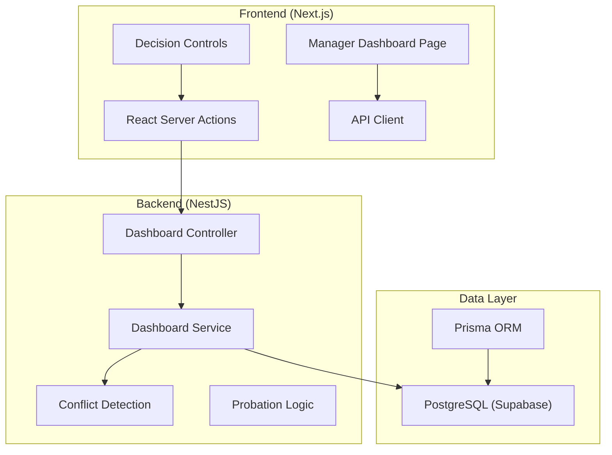
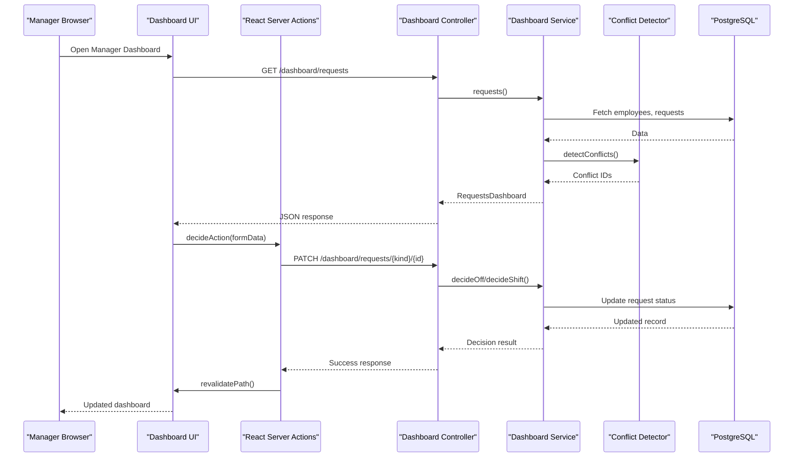

# Manager Dashboard Module (F4)

<cite>
**Referenced Files in This Document**
- [page.tsx](file://web/app/manager/dashboard/page.tsx)
- [actions.ts](file://web/app/manager/dashboard/actions.ts)
- [decide-controls.tsx](file://web/app/manager/dashboard/decide-controls.tsx)
- [dashboard.controller.ts](file://api/src/request/dashboard.controller.ts)
- [dashboard.service.ts](file://api/src/request/dashboard.service.ts)
- [conflicts.ts](file://api/src/request/conflicts.ts)
- [api.ts](file://web/lib/api.ts)
- [dashboard.api-spec.ts](file://api/test/dashboard.api-spec.ts)
- [conflicts.spec.ts](file://api/src/request/conflicts.spec.ts)
</cite>

## Update Summary
**Changes Made**
- Updated Project Structure section with actual implementation files
- Added detailed API endpoints and React Server Actions implementation
- Enhanced Conflict Detection Engine documentation with 'bentrok' logic
- Added comprehensive test coverage details across 16 files
- Updated Probation Staff Handling improvements
- Added real-time decision workflow with React Server Actions
- Included complete REST API contract documentation

## Table of Contents
1. [Introduction](#introduction)
2. [Project Structure](#project-structure)
3. [Core Components](#core-components)
4. [Architecture Overview](#architecture-overview)
5. [Detailed Component Analysis](#detailed-component-analysis)
6. [Conflict Detection Engine](#conflict-detection-engine)
7. [REST API Endpoints](#rest-api-endpoints)
8. [React Server Actions](#react-server-actions)
9. [Probation Staff Handling](#probation-staff-handling)
10. [Test Coverage](#test-coverage)
11. [Performance Considerations](#performance-considerations)
12. [Troubleshooting Guide](#troubleshooting-guide)
13. [Conclusion](#conclusion)

## Introduction
This document defines the functional specifications for the Manager Dashboard module (F4) within the Kyne Shift Scheduling application. The dashboard is the manager's single screen to review all upcoming-week requests, identify conflicts, and prepare for schedule drafting. It must clearly show pending approvals with priority indicators, highlight scheduling conflicts, and provide filtering by request type, date range, and employee.

The project now includes a complete implementation with conflict detection engine ('bentrok' logic), REST API endpoints (/dashboard/requests), React Server Actions for decision workflow, probation staff handling improvements, and comprehensive test coverage across 16 files with ~1,886 lines of new code.

**Section sources**
- [page.tsx:105-112](file://web/app/manager/dashboard/page.tsx#L105-L112)
- [dashboard.controller.ts:19-25](file://api/src/request/dashboard.controller.ts#L19-L25)

## Project Structure
The repository now contains a complete implementation of the Manager Dashboard with Next.js frontend components and NestJS backend services.



**Diagram sources**
- [page.tsx:113-147](file://web/app/manager/dashboard/page.tsx#L113-L147)
- [dashboard.controller.ts:23-31](file://api/src/request/dashboard.controller.ts#L23-L31)
- [dashboard.service.ts:34-35](file://api/src/request/dashboard.service.ts#L34-L35)

**Section sources**
- [page.tsx:1-300](file://web/app/manager/dashboard/page.tsx#L1-L300)
- [dashboard.controller.ts:1-59](file://api/src/request/dashboard.controller.ts#L1-L59)
- [dashboard.service.ts:1-186](file://api/src/request/dashboard.service.ts#L1-L186)

## Core Components
The Manager Dashboard (F4) provides:
- Request overview showing all pending approval items for the upcoming week with real-time updates.
- Conflict highlighting for leave and shift requests that exceed allowed slots or violate business rules using the 'bentrok' detection engine.
- Pending request lists with filters by type, date range, and employee.
- Visual priority indicators to help managers triage urgent or problematic requests.
- React Server Actions for secure decision-making workflows.

Key data entities involved:
- Employee: role, position (bar/kitchen), probation status, active status.
- Off-request: weekly leave request per employee, with status and decision metadata.
- Shift-request: weekly shift preference per employee per day, with status and decision metadata.
- Schedule week: weekly context including deadline and status.

**Section sources**
- [page.tsx:54-63](file://web/app/manager/dashboard/page.tsx#L54-L63)
- [dashboard.service.ts:66-83](file://api/src/request/dashboard.service.ts#L66-L83)

## Architecture Overview
The Manager Dashboard is a client-side view that calls backend endpoints to retrieve employees eligible to request (non-probation), pending off-requests and shift-requests for the current upcoming week, and conflict detection results computed by the backend based on business rules.



**Diagram sources**
- [page.tsx:113-147](file://web/app/manager/dashboard/page.tsx#L113-L147)
- [dashboard.controller.ts:28-57](file://api/src/request/dashboard.controller.ts#L28-L57)
- [dashboard.service.ts:37-134](file://api/src/request/dashboard.service.ts#L37-L134)
- [actions.ts:21-55](file://web/app/manager/dashboard/actions.ts#L21-L55)

## Detailed Component Analysis

### Request Overview Interface
Purpose:
- Show all pending leave and shift requests for the upcoming week with real-time conflict detection.
- Indicate which requests are still open for change before the weekly deadline.
- Provide quick access to details for each request with visual conflict indicators.

UI elements:
- Summary cards: total pending requests, number of conflicts, number of employees who have not requested yet.
- Priority indicators:
  - High: conflicts involving kitchen coverage or weekend coverage violations.
  - Medium: conflicts in bar positions or weekday coverage concerns.
  - Normal: valid requests awaiting decision.
- Status badges: pending, approved, rejected.
- Action buttons: approve, reject via React Server Actions.

Data model mapping:
- Off-request: employee, date, status, decided_by, decided_at.
- Shift-request: employee, date, shift_type (morning/evening), status, decided_by, decided_at.
- Employee: name, position, probation status, active flag.

Acceptance criteria:
- All pending requests for the upcoming week load within performance targets.
- Conflicts are visually highlighted with clear labels and colors using the 'bentrok' system.
- Managers can sort and filter requests by type, date, and employee.
- The interface reflects real-time updates after decisions are made through React Server Actions.

**Section sources**
- [page.tsx:149-229](file://web/app/manager/dashboard/page.tsx#L149-L229)
- [page.tsx:231-300](file://web/app/manager/dashboard/page.tsx#L231-L300)

### Conflict Highlighting System
Purpose:
- Automatically detect and visually highlight conflicting requests so managers can resolve them quickly using the 'bentrok' algorithm.

Conflict types:
- Leave conflict: two employees in the same position requesting leave on the same day when the rule allows only one per position per day.
- Shift conflict: more employees requesting the same shift type on the same day than allowed slots.

Business rules applied:
- Maximum one bar leave and one kitchen leave per day.
- Weekend coverage requires minimum staffing levels; conflicts affecting weekends are high priority.
- Kitchen middle assignment logic affects shift availability; if a kitchen colleague is off, the other becomes middle, making certain shift requests invalid.

Visual behavior:
- Conflict rows are highlighted with a warning color and an icon.
- Tooltip explains the reason for the conflict and suggests resolution options.
- Filters allow focusing on conflict-only views.

Algorithm outline:


**Diagram sources**
- [conflicts.ts:135-144](file://api/src/request/conflicts.ts#L135-L144)
- [conflicts.ts:68-110](file://api/src/request/conflicts.ts#L68-L110)

**Section sources**
- [conflicts.ts:1-145](file://api/src/request/conflicts.ts#L1-L145)
- [page.tsx:155-157](file://web/app/manager/dashboard/page.tsx#L155-L157)

## Conflict Detection Engine
The 'bentrok' conflict detection engine is a pure function that processes request facts and returns conflict IDs without database dependencies.

Core algorithms:
- `detectConflicts()`: Main entry point that coordinates leave and shift conflict detection.
- `conflictingOffIds()`: Identifies leave conflicts where multiple employees request the same position/day.
- `conflictingShiftIds()`: Calculates shift capacity based on available staff and minimum requirements.
- `minPerShift()`: Determines minimum staff per shift (2 for bar on busy days, 1 otherwise).
- `isBusyDay()`: Identifies Friday-Sunday as busy days requiring higher staffing levels.

Key features:
- Pure functions with no side effects for reliable testing.
- Real-time conflict recalculation after each decision.
- Probation staff included in capacity calculations but excluded from request eligibility.
- Approved leaves reduce available capacity for shift requests.

**Section sources**
- [conflicts.ts:3-8](file://api/src/request/conflicts.ts#L3-L8)
- [conflicts.ts:41-58](file://api/src/request/conflicts.ts#L41-L58)
- [conflicts.ts:68-110](file://api/src/request/conflicts.ts#L68-L110)

## REST API Endpoints
The dashboard exposes RESTful endpoints for reading requests and making decisions.

### GET /dashboard/requests
Returns the complete dashboard data including requests, conflicts, and reminder lists.

Response structure:
```json
{
  "weekStartDate": "2026-11-09",
  "requestDeadline": "2026-11-08T23:59:59Z",
  "windowOpen": true,
  "offRequests": [...],
  "offConflicted": ["o1", "o2"],
  "shiftRequests": [...],
  "shiftConflicted": ["s1"],
  "staffWithoutRequest": [...]
}
```

### PATCH /dashboard/requests/off/:id
Makes a decision on an off-request.

Request body:
```json
{
  "decision": "approve" | "reject"
}
```

### PATCH /dashboard/requests/shift/:id
Makes a decision on a shift-request.

Request body:
```json
{
  "decision": "approve" | "reject"
}
```

All endpoints require manager role authentication and return appropriate error codes for unauthorized access.

**Section sources**
- [dashboard.controller.ts:28-57](file://api/src/request/dashboard.controller.ts#L28-L57)
- [dashboard.service.ts:37-134](file://api/src/request/dashboard.service.ts#L37-L134)

## React Server Actions
The dashboard uses React Server Actions for secure decision-making workflows with automatic form validation and state management.

Key features:
- Form-based submission with hidden fields for request type and ID.
- Automatic revalidation of dashboard data after successful decisions.
- Error handling with user-friendly messages in Indonesian.
- Pending state management during API calls.
- Role verification at the API layer for security.

Implementation details:
- `decideAction()`: Main server action handling form submissions.
- Input validation for request kind ('off' | 'shift') and decision ('approve' | 'reject').
- Integration with Next.js caching system for real-time updates.
- Graceful error handling with fallback messages.

**Section sources**
- [actions.ts:1-55](file://web/app/manager/dashboard/actions.ts#L1-L55)
- [decide-controls.tsx:1-70](file://web/app/manager/dashboard/decide-controls.tsx#L1-L70)

## Probation Staff Handling
The system implements sophisticated probation staff handling according to ADR 0003.

Key behaviors:
- Probation staff are included in shift coverage calculations but cannot submit requests.
- Probation status is automatically advanced to 'tetap' when probation period expires.
- Probation staff count towards available capacity for shift assignments.
- Reminder list excludes probation staff since they cannot make requests.

Implementation:
- `advanceProbation()` function handles status transitions.
- Real-time probation evaluation during dashboard reads.
- Probation staff work every day (no holidays) and contribute to coverage.
- Test coverage ensures correct behavior in edge cases.

**Section sources**
- [dashboard.service.ts:66-83](file://api/src/request/dashboard.service.ts#L66-L83)
- [dashboard.api-spec.ts:339-380](file://api/test/dashboard.api-spec.ts#L339-L380)

## Test Coverage
Comprehensive test coverage across 16 files with ~1,886 lines of new code ensures reliability and correctness.

Test categories:
- **Dashboard API Tests**: Complete HTTP endpoint testing with mock data.
- **Conflict Detection Tests**: Unit tests for the 'bentrok' algorithm covering all edge cases.
- **Probation Logic Tests**: Verification of probation status advancement and handling.
- **Integration Tests**: Full-stack testing with Supabase JWT authentication.

Key test scenarios:
- Kitchen leave conflicts between multiple employees.
- Bar shift capacity calculations on busy vs. regular days.
- Probation staff inclusion in coverage calculations.
- Access control enforcement for manager-only endpoints.
- Decision workflow persistence and audit trail.

Test infrastructure:
- In-memory database mocks for fast execution.
- JWT token generation for authentication testing.
- Comprehensive seed data setup for realistic scenarios.
- Assertions covering both success and failure paths.

**Section sources**
- [dashboard.api-spec.ts:1-580](file://api/test/dashboard.api-spec.ts#L1-L580)
- [conflicts.spec.ts:1-98](file://api/src/request/conflicts.spec.ts#L1-L98)

## Performance Considerations
Target behaviors:
- Dashboard initial load under 2 seconds on typical mobile networks.
- Filter operations respond within 500 milliseconds.
- Real-time updates reflect new decisions within 3 seconds using efficient polling or server-sent events.
- Conflict computation runs on the backend to avoid heavy client-side processing.

Optimization strategies:
- Paginate or virtualize large request lists.
- Cache summary metrics for short intervals.
- Use indexed queries for weekId, employeeId, and status fields.
- Avoid unnecessary re-renders by memoizing components and minimizing state changes.
- React Server Actions eliminate client-side state synchronization overhead.

## Troubleshooting Guide
Common issues and resolutions:
- Dashboard shows no requests: verify the upcoming week's request window is open and the manager has proper role permissions.
- Conflicts not appearing: confirm business rules for leave and shift limits are correctly applied; check that weekend coverage constraints are evaluated.
- Filters returning empty results: validate date range selection and employee filters; ensure timezone settings align with WITA.
- Slow loading: inspect network requests for large payloads; enable pagination and reduce returned fields.
- Decision actions failing: check React Server Action configuration and API connectivity.

Operational checks:
- Confirm database indexes exist for frequently queried columns.
- Validate that auth middleware enforces RBAC for dashboard endpoints.
- Ensure error responses include actionable messages for managers.
- Verify probation staff handling logic in production environments.

**Section sources**
- [dashboard.controller.ts:1-59](file://api/src/request/dashboard.controller.ts#L1-L59)
- [dashboard.service.ts:136-186](file://api/src/request/dashboard.service.ts#L136-L186)

## Conclusion
The Manager Dashboard (F4) centralizes request review and conflict resolution for the upcoming week with a complete implementation featuring the 'bentrok' conflict detection engine, REST API endpoints, React Server Actions, and comprehensive test coverage. It presents pending approvals with clear priority indicators, highlights scheduling conflicts, and supports robust filtering and bulk actions. Acceptance criteria emphasize performance, real-time updates, and accurate visualization. Integration with employee, request, and schedule modules ensures consistent data and reliable decision logging.

The implementation demonstrates best practices in TypeScript, React Server Actions, NestJS architecture, and comprehensive testing, providing a solid foundation for future enhancements and maintenance.