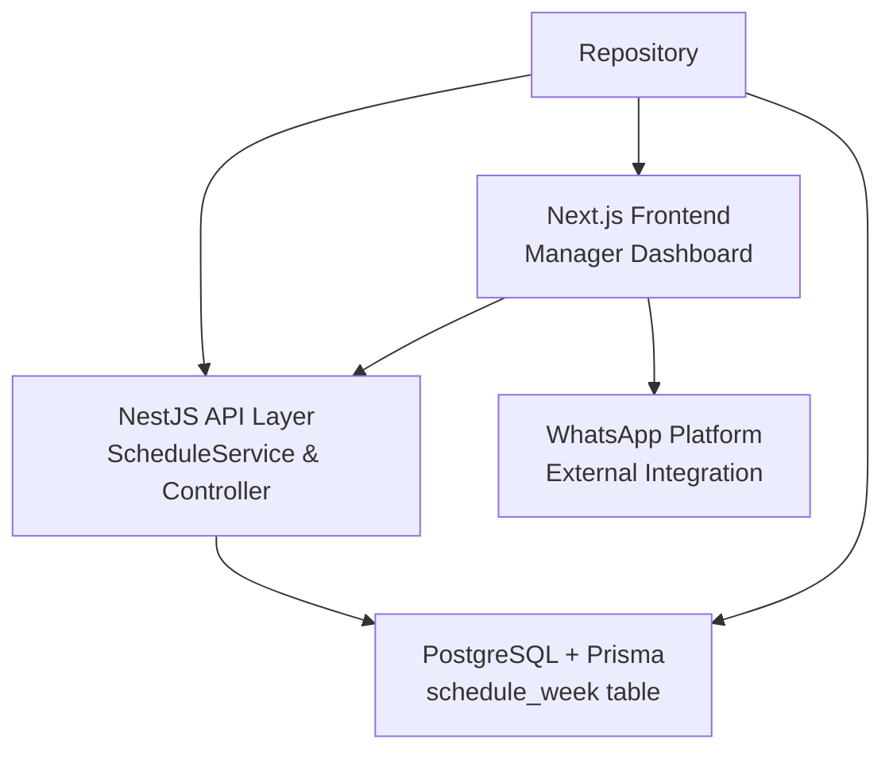
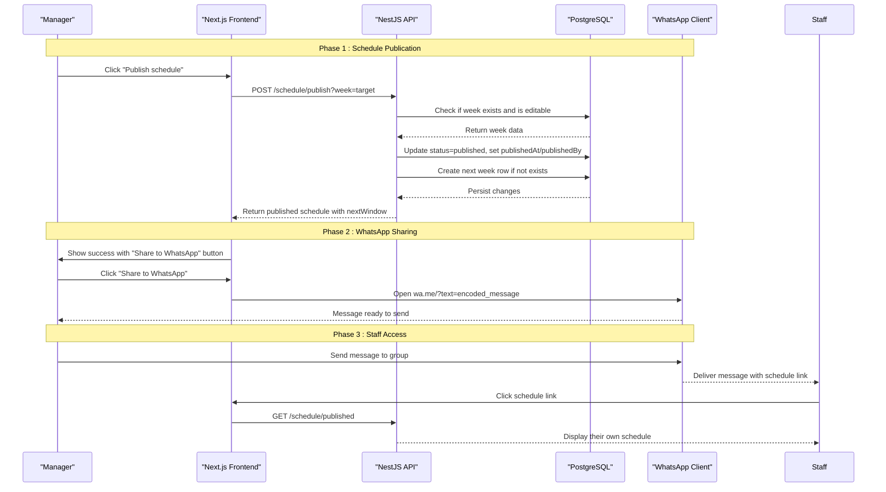
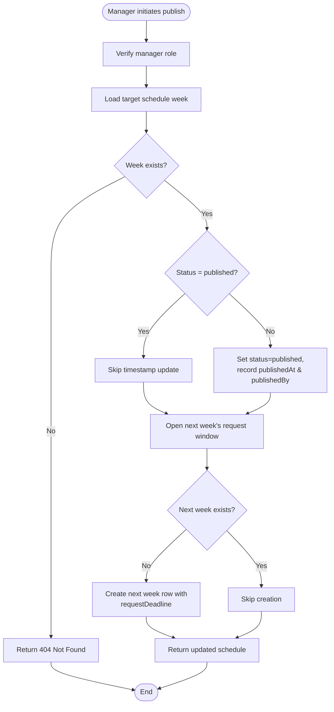
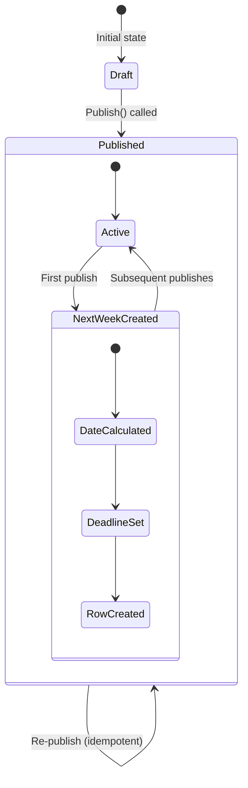
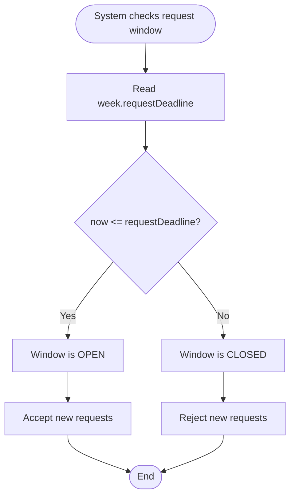
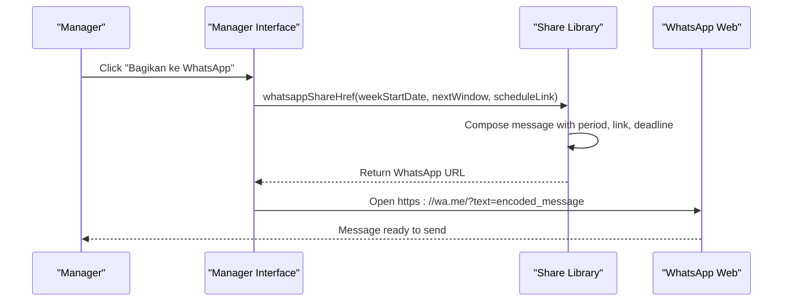
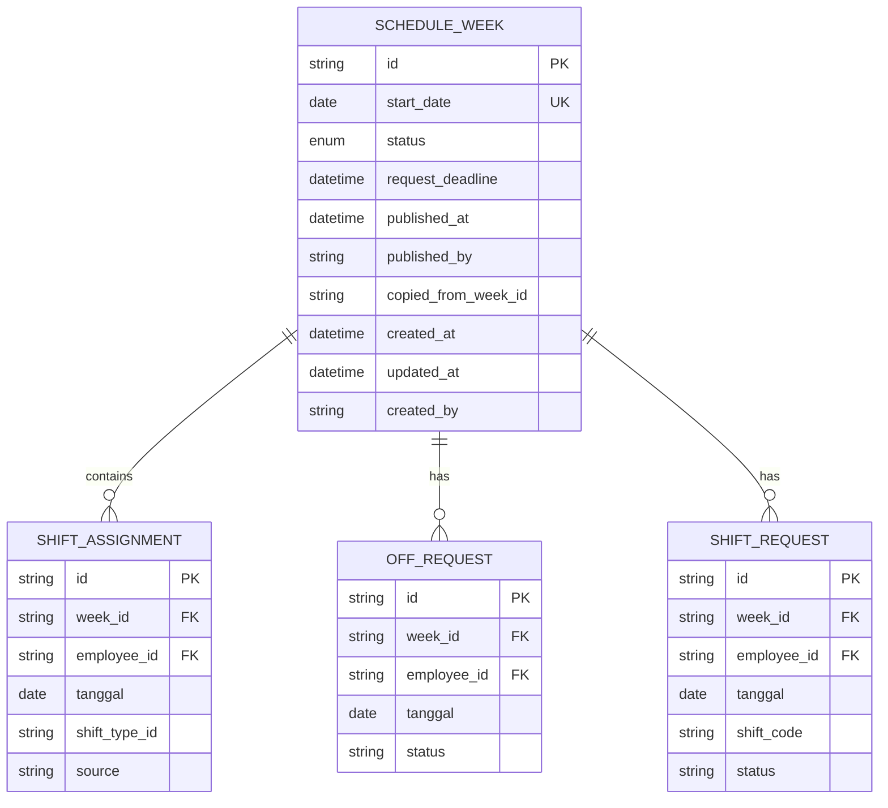
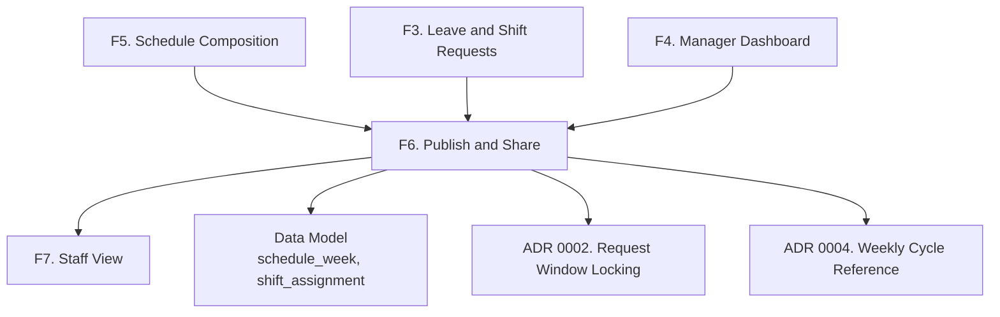

# Publishing Module (F6)

<cite>
**Referenced Files in This Document**
- [schedule.service.ts](file://api/src/schedule/schedule.service.ts)
- [schedule.controller.ts](file://api/src/schedule/schedule.controller.ts)
- [share.ts](file://web/lib/share.ts)
- [request-window.ts](file://api/src/request/request-window.ts)
- [weeks.ts](file://api/src/schedule/weeks.ts)
- [schedule_week.prisma](file://api/prisma/schema/schedule_week.prisma)
- [0002-jendela-request-dikunci-tanpa-cron.md](file://docs/adr/0002-jendela-request-dikunci-tanpa-cron.md)
- [0004-siklus-mingguan-acu-ke-minggu-berikutnya.md](file://docs/adr/0004-siklus-mingguan-acu-ke-minggu-berikutnya.md)
</cite>

## Update Summary
**Changes Made**
- Updated publishing workflow to reflect idempotent publish functionality
- Added documentation for automatic next week row creation on first publish
- Documented request window management without cron jobs
- Enhanced WhatsApp sharing integration details
- Updated architecture diagrams to reflect actual implementation
- Added technical specifications for idempotent operations and time-based locking

## Table of Contents
1. [Introduction](#introduction)
2. [Project Structure](#project-structure)
3. [Core Components](#core-components)
4. [Architecture Overview](#architecture-overview)
5. [Detailed Component Analysis](#detailed-component-analysis)
6. [Dependency Analysis](#dependency-analysis)
7. [Performance Considerations](#performance-considerations)
8. [Troubleshooting Guide](#troubleshooting-guide)
9. [Conclusion](#conclusion)

## Introduction
This document specifies the functional requirements and implementation details for the Publishing module (F6) of the Kyne shift scheduling application. The system has evolved from a conceptual design to a fully implemented solution featuring idempotent publishing, automatic next week row creation, time-based request window management without cron jobs, and integrated WhatsApp sharing functionality.

The implementation focuses on how schedules transition from draft to published state, version control mechanisms, timestamp handling, automated request window management, and seamless WhatsApp distribution to staff members.

**Section sources**
- [schedule.service.ts:132-159](file://api/src/schedule/schedule.service.ts#L132-L159)
- [schedule_week.prisma:1-33](file://api/prisma/schema/schedule_week.prisma#L1-L33)

## Project Structure
The publishing system is implemented across multiple layers with clear separation of concerns between the API layer, business logic, and frontend components.

**Diagram sources**
- [schedule.controller.ts:64-71](file://api/src/schedule/schedule.controller.ts#L64-L71)
- [schedule.service.ts:139-159](file://api/src/schedule/schedule.service.ts#L139-L159)
- [share.ts:68-76](file://web/lib/share.ts#L68-L76)

**Section sources**
- [schedule.controller.ts:64-71](file://api/src/schedule/schedule.controller.ts#L64-L71)
- [schedule.service.ts:139-159](file://api/src/schedule/schedule.service.ts#L139-L159)

## Core Components
The Publishing module (F6) implements these core capabilities:

### Idempotent Schedule Publication
- **Idempotent Operations**: Publishing the same schedule multiple times produces identical results without duplicate side effects
- **State Management**: Transitions schedule weeks from draft to published status while preserving existing publication timestamps
- **Audit Trail**: Records publisher identity and publication timestamps for compliance and debugging

### Automatic Next Week Row Creation
- **Proactive Scheduling**: Creates the following week's row automatically during first publish operation
- **Request Window Setup**: Establishes request deadlines for the next week immediately upon creation
- **Cron-Free Architecture**: Eliminates need for scheduled jobs through proactive data preparation

### Time-Based Request Window Management
- **Deadline-Driven Locking**: Request windows open automatically when weeks are created and close at Sunday 12:00 WITA
- **No Cron Jobs**: Implements time-based logic through direct deadline comparisons rather than scheduled tasks
- **Automatic State Resolution**: Determines window availability through real-time date calculations

### Integrated WhatsApp Sharing
- **Seamless Distribution**: Provides one-click WhatsApp sharing with pre-filled messages containing schedule links and deadlines
- **Contextual Information**: Includes schedule period, staff access link, and next request submission deadline
- **Client-Side Integration**: Leverages WhatsApp's web interface for message composition and delivery

**Section sources**
- [schedule.service.ts:132-159](file://api/src/schedule/schedule.service.ts#L132-L159)
- [schedule.service.ts:472-497](file://api/src/schedule/schedule.service.ts#L472-L497)
- [request-window.ts:1-12](file://api/src/request/request-window.ts#L1-L12)
- [share.ts:50-76](file://web/lib/share.ts#L50-L76)

## Architecture Overview
The publishing workflow integrates multiple systems to provide a seamless experience from schedule composition to staff distribution.

**Diagram sources**
- [schedule.controller.ts:64-71](file://api/src/schedule/schedule.controller.ts#L64-L71)
- [schedule.service.ts:139-159](file://api/src/schedule/schedule.service.ts#L139-L159)
- [schedule.service.ts:478-497](file://api/src/schedule/schedule.service.ts#L478-L497)
- [share.ts:68-76](file://web/lib/share.ts#L68-L76)

## Detailed Component Analysis

### Idempotent Publishing Workflow
The publishing system ensures that repeated publish operations produce consistent results without creating duplicate records or modifying existing timestamps.

#### Processing Logic
- **Validation**: Verifies schedule existence and editability before processing
- **Conditional Updates**: Only updates publication fields when transitioning from draft to published
- **Timestamp Preservation**: Maintains original `publishedAt` value on subsequent publishes
- **Actor Tracking**: Records the manager who performed the most recent publication

**Diagram sources**
- [schedule.service.ts:139-159](file://api/src/schedule/schedule.service.ts#L139-L159)
- [schedule.service.ts:478-497](file://api/src/schedule/schedule.service.ts#L478-L497)

**Section sources**
- [schedule.service.ts:132-159](file://api/src/schedule/schedule.service.ts#L132-L159)

### Automatic Next Week Row Creation
The system proactively creates the following week's record during the first publish operation, eliminating the need for background jobs or manual intervention.

#### Implementation Details
- **Date Calculation**: Computes next Monday's date based on the current week's start date
- **Deadline Assignment**: Sets request deadline to Sunday 12:00 WITA of the previous week
- **Idempotent Creation**: Checks for existing rows before attempting creation
- **Transaction Safety**: Ensures atomic operations for data consistency

**Diagram sources**
- [schedule.service.ts:478-497](file://api/src/schedule/schedule.service.ts#L478-L497)
- [weeks.ts:50-52](file://api/src/schedule/weeks.ts#L50-L52)

**Section sources**
- [schedule.service.ts:472-497](file://api/src/schedule/schedule.service.ts#L472-L497)
- [weeks.ts:50-52](file://api/src/schedule/weeks.ts#L50-L52)

### Time-Based Request Window Management
The request window system eliminates cron job dependencies by using direct deadline comparisons and real-time calculations.

#### Core Principles
- **Deadline-Driven**: Window availability determined by comparing current time against stored deadlines
- **UTC Consistency**: All time comparisons use UTC instants for reliability
- **WITA Alignment**: Deadlines calculated to match Sunday 12:00 WITA wall clock time
- **Zero Maintenance**: No scheduled jobs required for window state management

**Diagram sources**
- [request-window.ts:10-12](file://api/src/request/request-window.ts#L10-L12)
- [0002-jendela-request-dikunci-tanpa-cron.md:1-4](file://docs/adr/0002-jendela-request-dikunci-tanpa-cron.md#L1-L4)

**Section sources**
- [request-window.ts:1-52](file://api/src/request/request-window.ts#L1-L52)
- [0002-jendela-request-dikunci-tanpa-cron.md:1-4](file://docs/adr/0002-jendela-request-dikunci-tanpa-cron.md#L1-L4)

### WhatsApp Sharing Integration
The WhatsApp integration provides seamless distribution of published schedules to staff through the user's preferred messaging platform.

#### Message Composition
- **Period Formatting**: Displays schedule coverage period in local Indonesian format
- **Link Generation**: Creates accessible URL for staff schedule viewing
- **Deadline Communication**: Clearly states request submission deadline for next week
- **Platform Optimization**: Formats text specifically for WhatsApp's plain text requirements

#### User Experience Flow
- **One-Click Sharing**: Single action opens WhatsApp with pre-composed message
- **Contextual Awareness**: Shows share option only after successful publication
- **Visual Feedback**: Provides confirmation that message contains all necessary information

**Diagram sources**
- [share.ts:68-76](file://web/lib/share.ts#L68-L76)
- [share.ts:56-66](file://web/lib/share.ts#L56-L66)

**Section sources**
- [share.ts:50-76](file://web/lib/share.ts#L50-L76)

### Data Model and Version Control
The database schema supports comprehensive version tracking and audit capabilities for schedule publications.

#### Schema Design
- **Unique Week Identity**: Each week identified by unique `start_date` (Monday)
- **Explicit Status**: Only `draft` and `published` states explicitly stored
- **Derived Availability**: Request window state derived from `request_deadline` comparison
- **Audit Fields**: Tracks publication timestamps and responsible actors

**Diagram sources**
- [schedule_week.prisma:13-32](file://api/prisma/schema/schedule_week.prisma#L13-L32)

**Section sources**
- [schedule_week.prisma:1-33](file://api/prisma/schema/schedule_week.prisma#L1-L33)

### User Stories for Publishing Workflows
- **As a manager**, I want to publish the weekly schedule so that staff can see their shifts immediately.
- **As a manager**, I want to share the published schedule via WhatsApp so that staff receive it quickly without manual copying.
- **As a manager**, I want the next week's request window to open automatically after publication so that staff can submit requests without waiting for system maintenance.
- **As a manager**, I want to re-publish schedules without affecting existing timestamps so I can correct issues while maintaining audit trails.
- **As a staff member**, I want to access my schedule through shared WhatsApp links so I can view my assignments conveniently.

**Section sources**
- [schedule.service.ts:132-159](file://api/src/schedule/schedule.service.ts#L132-L159)
- [share.ts:50-76](file://web/lib/share.ts#L50-L76)

### Acceptance Criteria for Delivery Reliability
- Publishing operations are idempotent and produce consistent results when called multiple times.
- The next week's row is automatically created during the first publish operation.
- Request windows open automatically when weeks are created without requiring cron jobs.
- WhatsApp sharing generates properly formatted messages with schedule period, link, and deadline information.
- Staff can access their schedules through shared WhatsApp links after authentication.
- Publication records maintain accurate timestamps and preserve original values on re-publishes.
- Request deadlines are enforced at Sunday 12:00 WITA through direct time comparisons.

**Section sources**
- [schedule.service.ts:139-159](file://api/src/schedule/schedule.service.ts#L139-L159)
- [schedule.service.ts:478-497](file://api/src/schedule/schedule.service.ts#L478-L497)
- [request-window.ts:10-12](file://api/src/request/request-window.ts#L10-L12)

### Business Rules for Publication Timing Constraints
- Weekly cycle operates Monday through Sunday with target week being the following Monday.
- Current week's schedule is published during the previous week's afternoon (Sunday 18:00 WITA).
- Request windows open when weeks are created and close at Sunday 12:00 WITA.
- Coverage validation applies before publication, especially for Friday–Sunday and Monday–Thursday minimum staffing requirements.
- Kitchen middle coverage rules apply when kitchen colleagues are off.
- Staff can only submit requests for future weeks, not the current running week.

**Section sources**
- [0004-siklus-mingguan-acu-ke-minggu-berikutnya.md:1-10](file://docs/adr/0004-siklus-mingguan-acu-ke-minggu-berikutnya.md#L1-L10)
- [weeks.ts:44-52](file://api/src/schedule/weeks.ts#L44-L52)

## Dependency Analysis
The publishing module depends on several interconnected components that work together to provide comprehensive schedule management functionality.

**Diagram sources**
- [schedule.service.ts:132-159](file://api/src/schedule/schedule.service.ts#L132-L159)
- [0002-jendela-request-dikunci-tanpa-cron.md:1-4](file://docs/adr/0002-jendela-request-dikunci-tanpa-cron.md#L1-L4)
- [0004-siklus-mingguan-acu-ke-minggu-berikutnya.md:1-10](file://docs/adr/0004-siklus-mingguan-acu-ke-minggu-berikutnya.md#L1-L10)

**Section sources**
- [schedule.service.ts:132-159](file://api/src/schedule/schedule.service.ts#L132-L159)
- [0002-jendela-request-dikunci-tanpa-cron.md:1-4](file://docs/adr/0002-jendela-request-dikunci-tanpa-cron.md#L1-L4)
- [0004-siklus-mingguan-acu-ke-minggu-berikutnya.md:1-10](file://docs/adr/0004-siklus-mingguan-acu-ke-minggu-berikutnya.md#L1-L10)

## Performance Considerations
- **Idempotent Operations**: Publish operations avoid unnecessary database writes when already published, reducing load during repeated shares.
- **Proactive Data Preparation**: Creating next week rows during publish eliminates runtime computation overhead and prevents race conditions.
- **Efficient Time Comparisons**: Direct deadline comparisons eliminate the need for complex scheduling infrastructure.
- **Minimal Frontend Processing**: WhatsApp message composition happens client-side, reducing server load.
- **Database Indexing**: Proper indexing on `status`, `startDate`, and `requestDeadline` columns optimizes query performance.

## Troubleshooting Guide
### Publishing Issues
- **Failed publish due to invalid state**: Ensure the schedule is in a draft or editable state before publishing. Verify manager role permissions.
- **Duplicate week creation**: The system should prevent duplicate next week rows; check for existing rows before creation attempts.
- **Incorrect timestamps**: Verify that `publishedAt` is only set during initial publication, not on subsequent publishes.

### Request Window Problems
- **Window not opening**: Confirm that next week row was created successfully and has proper `requestDeadline` value.
- **Window not closing**: Verify timezone configuration uses WITA and deadline calculations are correct.
- **Cron dependency errors**: The system should not require any cron jobs; verify no scheduled tasks are configured.

### WhatsApp Sharing Issues
- **Message formatting problems**: Test WhatsApp URL encoding and message composition across different devices.
- **Link accessibility**: Ensure schedule links resolve correctly and handle authentication redirects properly.
- **Mobile compatibility**: Test WhatsApp integration on both Android and iOS platforms.

### Audit and Reliability
- **Publication logging**: Log publication events with actor, timestamp, and target week for compliance.
- **Version history**: Maintain history of schedule versions through weekly records and copy relationships.
- **Error tracking**: Implement comprehensive error handling for failed operations with appropriate retry logic.

**Section sources**
- [schedule.service.ts:139-159](file://api/src/schedule/schedule.service.ts#L139-L159)
- [schedule.service.ts:478-497](file://api/src/schedule/schedule.service.ts#L478-L497)
- [share.ts:68-76](file://web/lib/share.ts#L68-L76)

## Conclusion
The Publishing module (F6) has evolved into a robust, production-ready system that successfully addresses the core requirements of schedule publication, version control, and staff communication. The implementation demonstrates several key architectural decisions:

1. **Idempotency**: The system handles repeated operations gracefully, ensuring data consistency and preventing duplicate side effects.
2. **Proactive Design**: Automatic next week row creation eliminates the need for background jobs and simplifies operational complexity.
3. **Time-Based Logic**: Direct deadline comparisons replace cron-dependent workflows, improving reliability and reducing maintenance overhead.
4. **Integrated Communication**: Seamless WhatsApp sharing provides immediate staff notification without additional infrastructure.

The system's architecture balances simplicity with functionality, providing a solid foundation for schedule management while maintaining clear separation of concerns and extensibility for future enhancements. The combination of client-side WhatsApp integration and server-side time-based logic creates a responsive user experience while ensuring data integrity and audit compliance.