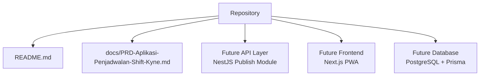
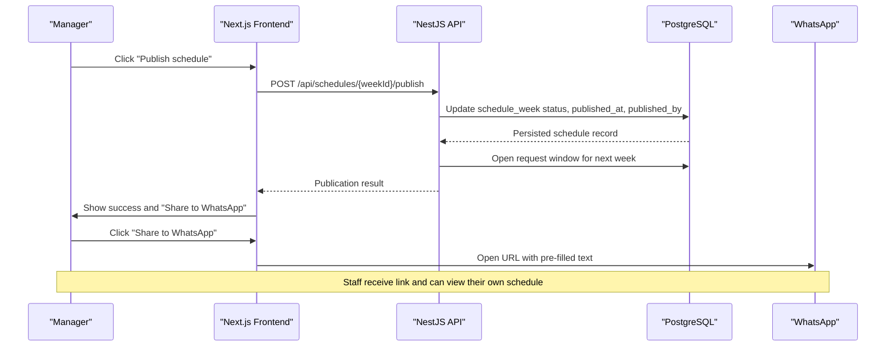
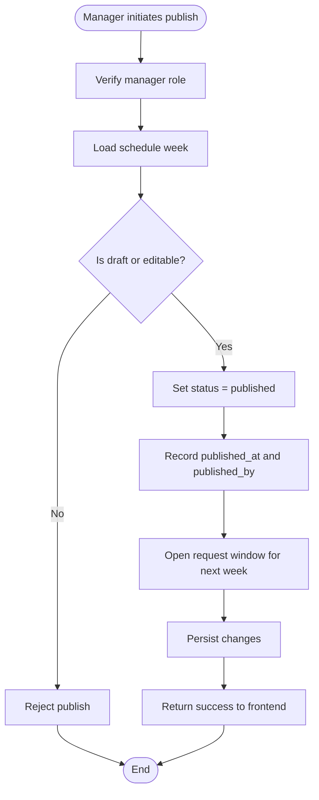
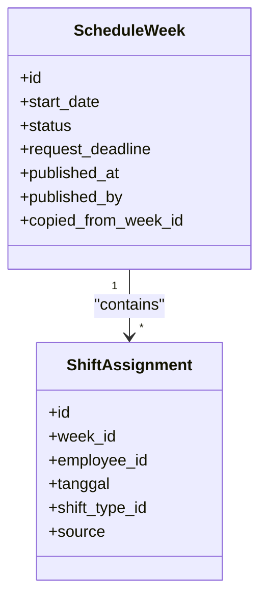
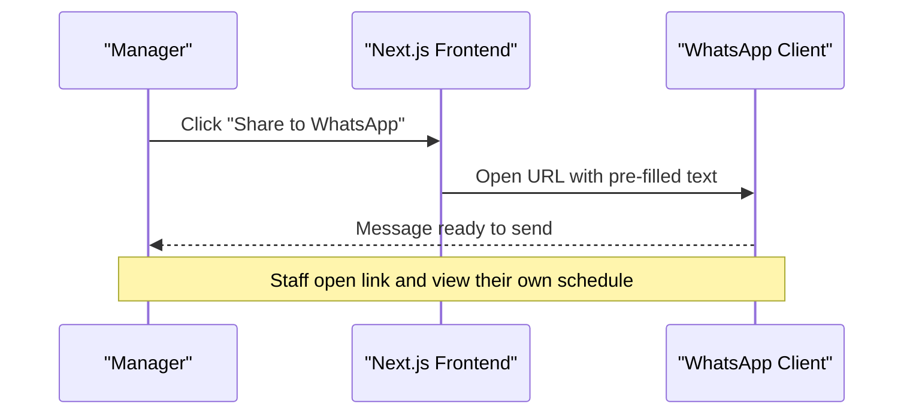
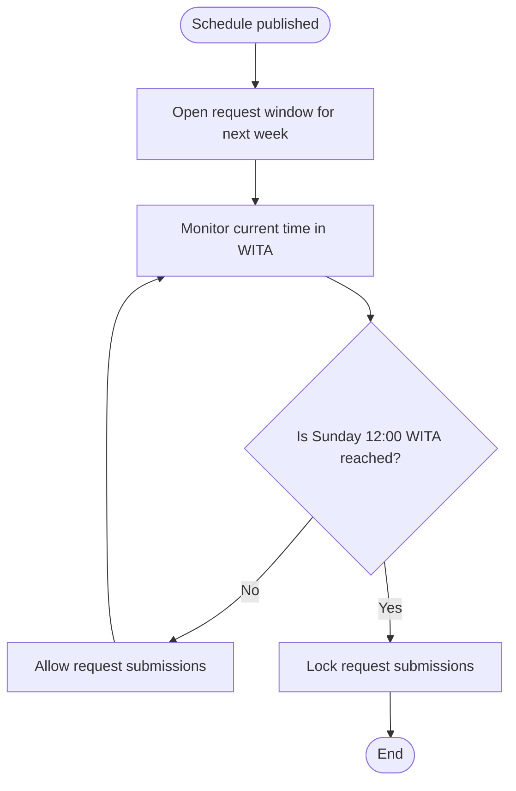
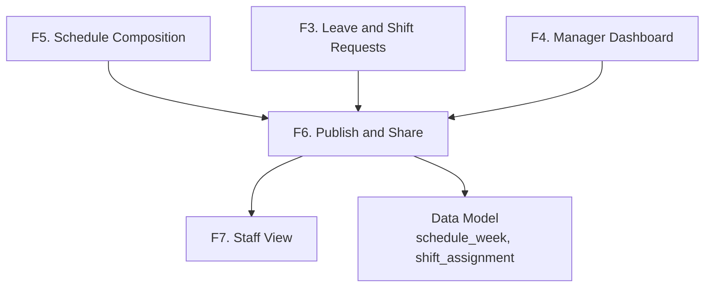

# Publishing Module (F6)

<cite>
**Referenced Files in This Document**
- [README.md](file://README.md)
- [PRD-Aplikasi-Penjadwalan-Shift-Kyne.md](file://docs/PRD-Aplikasi-Penjadwalan-Shift-Kyne.md)
</cite>

## Table of Contents
1. [Introduction](#introduction)
2. [Project Structure](#project-structure)
3. [Core Components](#core-components)
4. [Architecture Overview](#architecture-overview)
5. [Detailed Component Analysis](#detailed-component-analysis)
6. [Dependency Analysis](#dependency-analysis)
7. [Performance Considerations](#performance-considerations)
8. [Troubleshooting Guide](#troubleshooting-guide)
9. [Conclusion](#conclusion)

## Introduction
This document specifies the functional requirements for the Publishing module (F6) of the Kyne shift scheduling application. It focuses on how schedules move from draft to published state, how versioning and timestamps are handled, how WhatsApp sharing integrates into the workflow, and how request windows are controlled relative to publication. It also provides user stories, acceptance criteria, business rules, error handling guidance, retry strategies, and audit logging expectations.

The repository is currently a scaffold with no implementation code yet. Therefore, this specification is derived from the product requirements document and intended as a design contract for future development.

**Section sources**
- [README.md:1-25](file://README.md#L1-L25)
- [PRD-Aplikasi-Penjadwalan-Shift-Kyne.md:1-20](file://docs/PRD-Aplikasi-Penjadwalan-Shift-Kyne.md#L1-L20)

## Project Structure
At this stage, the project contains only documentation and a minimal README. The publishing functionality will be implemented later according to the architecture described in the PRD, which targets a NestJS backend with a Next.js frontend and PostgreSQL via Prisma.

**Diagram sources**
- [README.md:1-25](file://README.md#L1-L25)
- [PRD-Aplikasi-Penjadwalan-Shift-Kyne.md:230-249](file://docs/PRD-Aplikasi-Penjadwalan-Shift-Kyne.md#L230-L249)

**Section sources**
- [README.md:1-25](file://README.md#L1-L25)
- [PRD-Aplikasi-Penjadwalan-Shift-Kyne.md:230-249](file://docs/PRD-Aplikasi-Penjadwalan-Shift-Kyne.md#L230-L249)

## Core Components
The Publishing module (F6) centers around these capabilities:

- Schedule publication workflow
  - Transition schedule weeks from draft to published.
  - Make the schedule visible to staff after publish.
  - Open the next week’s request window when the current schedule is published.
- Version control and timestamps
  - Track publication time and publisher identity.
  - Preserve previous schedule versions through weekly records.
- WhatsApp sharing integration
  - Provide a share action that opens WhatsApp with a pre-filled message containing the schedule period, link, and next request deadline.
- Request window management
  - Automatically open request submission for the following week upon publication.
  - Enforce the weekly request deadline at Sunday 12:00 WITA.

These behaviors are defined by the product requirements and must be enforced server-side.

**Section sources**
- [PRD-Aplikasi-Penjadwalan-Shift-Kyne.md:149-155](file://docs/PRD-Aplikasi-Penjadwalan-Shift-Kyne.md#L149-L155)
- [PRD-Aplikasi-Penjadwalan-Shift-Kyne.md:73-90](file://docs/PRD-Aplikasi-Penjadwalan-Shift-Kyne.md#L73-L90)
- [PRD-Aplikasi-Penjadwalan-Shift-Kyne.md:197-217](file://docs/PRD-Aplikasi-Penjadwalan-Shift-Kyne.md#L197-L217)

## Architecture Overview
The publishing workflow spans the frontend, backend, database, and external messaging platform.

**Diagram sources**
- [PRD-Aplikasi-Penjadwalan-Shift-Kyne.md:149-155](file://docs/PRD-Aplikasi-Penjadwalan-Shift-Kyne.md#L149-L155)
- [PRD-Aplikasi-Penjadwalan-Shift-Kyne.md:197-217](file://docs/PRD-Aplikasi-Penjadwalan-Shift-Kyne.md#L197-L217)

## Detailed Component Analysis

### Publishing Workflow Specification
The publishing workflow controls the transition of a schedule week from draft to published and triggers downstream effects.

- Inputs
  - Manager role authentication.
  - Target schedule week identifier.
- Processing
  - Validate that the schedule exists and is editable.
  - Set schedule status to published.
  - Record publication timestamp and publisher.
  - Open the request window for the following week.
- Outputs
  - Updated schedule record.
  - Visible schedule for staff.
  - Success response enabling WhatsApp sharing.

**Diagram sources**
- [PRD-Aplikasi-Penjadwalan-Shift-Kyne.md:149-155](file://docs/PRD-Aplikasi-Penjadwalan-Shift-Kyne.md#L149-L155)
- [PRD-Aplikasi-Penjadwalan-Shift-Kyne.md:197-217](file://docs/PRD-Aplikasi-Penjadwalan-Shift-Kyne.md#L197-L217)

**Section sources**
- [PRD-Aplikasi-Penjadwalan-Shift-Kyne.md:149-155](file://docs/PRD-Aplikasi-Penjadwalan-Shift-Kyne.md#L149-L155)
- [PRD-Aplikasi-Penjadwalan-Shift-Kyne.md:197-217](file://docs/PRD-Aplikasi-Penjadwalan-Shift-Kyne.md#L197-L217)

### Draft States and Version Control
Drafts and versions are represented by weekly schedule records.

- Draft state
  - A schedule week starts as draft while being composed.
  - Drafts are not visible to staff until published.
- Version control
  - Each week has its own record with identifiers and lifecycle fields.
  - Copying behavior supports creating new drafts from previous weeks.
- Timestamps
  - `published_at` captures when a schedule becomes visible.
  - `published_by` captures who performed the publication.
- Editability after publish
  - Managers may still edit schedules after publication; visibility remains to staff.

**Diagram sources**
- [PRD-Aplikasi-Penjadwalan-Shift-Kyne.md:197-217](file://docs/PRD-Aplikasi-Penjadwalan-Shift-Kyne.md#L197-L217)

**Section sources**
- [PRD-Aplikasi-Penjadwalan-Shift-Kyne.md:140-155](file://docs/PRD-Aplikasi-Penjadwalan-Shift-Kyne.md#L140-L155)
- [PRD-Aplikasi-Penjadwalan-Shift-Kyne.md:197-217](file://docs/PRD-Aplikasi-Penjadwalan-Shift-Kyne.md#L197-L217)

### WhatsApp Sharing Integration
The sharing feature provides a convenient way to distribute the published schedule link to staff through WhatsApp.

- Behavior
  - After successful publication, the frontend shows a share button.
  - Clicking the button opens WhatsApp with a pre-filled message including:
    - Schedule period.
    - Link to the schedule.
    - Deadline for submitting requests for the next week.
- Delivery model
  - The system does not send messages directly; it delegates delivery to the user’s WhatsApp client.
  - Reliability depends on the user opening the link and staff accessing it.

**Diagram sources**
- [PRD-Aplikasi-Penjadwalan-Shift-Kyne.md:149-155](file://docs/PRD-Aplikasi-Penjadwalan-Shift-Kyne.md#L149-L155)

**Section sources**
- [PRD-Aplikasi-Penjadwalan-Shift-Kyne.md:149-155](file://docs/PRD-Aplikasi-Penjadwalan-Shift-Kyne.md#L149-L155)

### Request Window Management
Request windows are tightly coupled to publication timing.

- Opening rule
  - When the current week’s schedule is published, the request window for the next week opens automatically.
- Closing rule
  - Requests close automatically at Sunday 12:00 WITA.
- Visibility and locking
  - Before closing, staff can modify requests.
  - After closing, requests are locked.

**Diagram sources**
- [PRD-Aplikasi-Penjadwalan-Shift-Kyne.md:73-90](file://docs/PRD-Aplikasi-Penjadwalan-Shift-Kyne.md#L73-L90)
- [PRD-Aplikasi-Penjadwalan-Shift-Kyne.md:188-189](file://docs/PRD-Aplikasi-Penjadwalan-Shift-Kyne.md#L188-L189)

**Section sources**
- [PRD-Aplikasi-Penjadwalan-Shift-Kyne.md:73-90](file://docs/PRD-Aplikasi-Penjadwalan-Shift-Kyne.md#L73-L90)
- [PRD-Aplikasi-Penjadwalan-Shift-Kyne.md:188-189](file://docs/PRD-Aplikasi-Penjadwalan-Shift-Kyne.md#L188-L189)

### User Stories for Publishing Workflows
- As a manager, I want to publish the weekly schedule so that staff can see their shifts.
- As a manager, I want to share the published schedule link to WhatsApp so that staff receive it quickly.
- As a manager, I want the next week’s request window to open automatically after publication so that staff can submit requests without manual setup.
- As a manager, I want to keep editing schedules after publication so I can correct issues before staff notice them.

**Section sources**
- [PRD-Aplikasi-Penjadwalan-Shift-Kyne.md:149-155](file://docs/PRD-Aplikasi-Penjadwalan-Shift-Kyne.md#L149-L155)

### Acceptance Criteria for Delivery Reliability
- Publishing makes the schedule visible to staff immediately after the operation succeeds.
- The next week’s request window opens automatically after publication.
- The WhatsApp share action opens a message with the correct schedule period, link, and next request deadline.
- Staff can access their own schedule through the shared link after logging in.
- The system enforces the request deadline at Sunday 12:00 WITA.
- Publication records include accurate timestamps and publisher identity.

**Section sources**
- [PRD-Aplikasi-Penjadwalan-Shift-Kyne.md:149-155](file://docs/PRD-Aplikasi-Penjadwalan-Shift-Kyne.md#L149-L155)
- [PRD-Aplikasi-Penjadwalan-Shift-Kyne.md:197-217](file://docs/PRD-Aplikasi-Penjadwalan-Shift-Kyne.md#L197-L217)

### Business Rules for Publication Timing Constraints
- Weekly cycle runs Monday through Sunday.
- The current week’s schedule is published during the previous week’s afternoon.
- Request window opens when the current schedule is published.
- Request window closes at Sunday 12:00 WITA.
- Coverage validation applies before publication, especially for Friday–Sunday and Monday–Thursday minimum staffing.
- Kitchen middle coverage rules apply when kitchen colleagues are off.

**Section sources**
- [PRD-Aplikasi-Penjadwalan-Shift-Kyne.md:73-90](file://docs/PRD-Aplikasi-Penjadwalan-Shift-Kyne.md#L73-L90)
- [PRD-Aplikasi-Penjadwalan-Shift-Kyne.md:165-195](file://docs/PRD-Aplikasi-Penjadwalan-Shift-Kyne.md#L165-L195)

## Dependency Analysis
The publishing module depends on several other modules and data structures defined in the PRD.

**Diagram sources**
- [PRD-Aplikasi-Penjadwalan-Shift-Kyne.md:140-163](file://docs/PRD-Aplikasi-Penjadwalan-Shift-Kyne.md#L140-L163)
- [PRD-Aplikasi-Penjadwalan-Shift-Kyne.md:197-217](file://docs/PRD-Aplikasi-Penjadwalan-Shift-Kyne.md#L197-L217)

**Section sources**
- [PRD-Aplikasi-Penjadwalan-Shift-Kyne.md:140-163](file://docs/PRD-Aplikasi-Penjadwalan-Shift-Kyne.md#L140-L163)
- [PRD-Aplikasi-Penjadwalan-Shift-Kyne.md:197-217](file://docs/PRD-Aplikasi-Penjadwalan-Shift-Kyne.md#L197-L217)

## Performance Considerations
- Keep publish operations fast and idempotent where possible to avoid duplicate publications.
- Avoid heavy computation during publish; defer expensive validations to composition and pre-publish checks.
- Use database transactions to ensure consistent updates to schedule status, timestamps, and request window settings.
- Minimize frontend re-renders after publish by returning minimal but sufficient state updates.

[No sources needed since this section provides general guidance]

## Troubleshooting Guide
- Failed publish due to invalid state
  - Ensure the schedule is in a draft or editable state before publishing.
  - Check manager role permissions.
- Incorrect request window behavior
  - Verify timezone configuration uses WITA.
  - Confirm that publication triggers the next week’s request window.
- WhatsApp share not working
  - Test opening links from WhatsApp on Android and iPhone.
  - Handle cases where in-app browsers block login redirects.
- Audit and reliability
  - Log publication events with actor, timestamp, and target week.
  - Retain history of schedule versions through weekly records.
  - For direct integrations in the future, implement retry logic with exponential backoff and dead-letter tracking.

**Section sources**
- [PRD-Aplikasi-Penjadwalan-Shift-Kyne.md:220-228](file://docs/PRD-Aplikasi-Penjadwalan-Shift-Kyne.md#L220-L228)
- [PRD-Aplikasi-Penjadwalan-Shift-Kyne.md:197-217](file://docs/PRD-Aplikasi-Penjadwalan-Shift-Kyne.md#L197-L217)

## Conclusion
The Publishing module (F6) connects schedule composition, staff visibility, and communication. Its core responsibilities are to transition schedules to published state, manage request windows, preserve versioning and timestamps, and provide WhatsApp-based distribution. Because the repository is still a scaffold, these specifications serve as the contract for future implementation in the planned NestJS backend and Next.js frontend.

[No sources needed since this section summarizes without analyzing specific files]