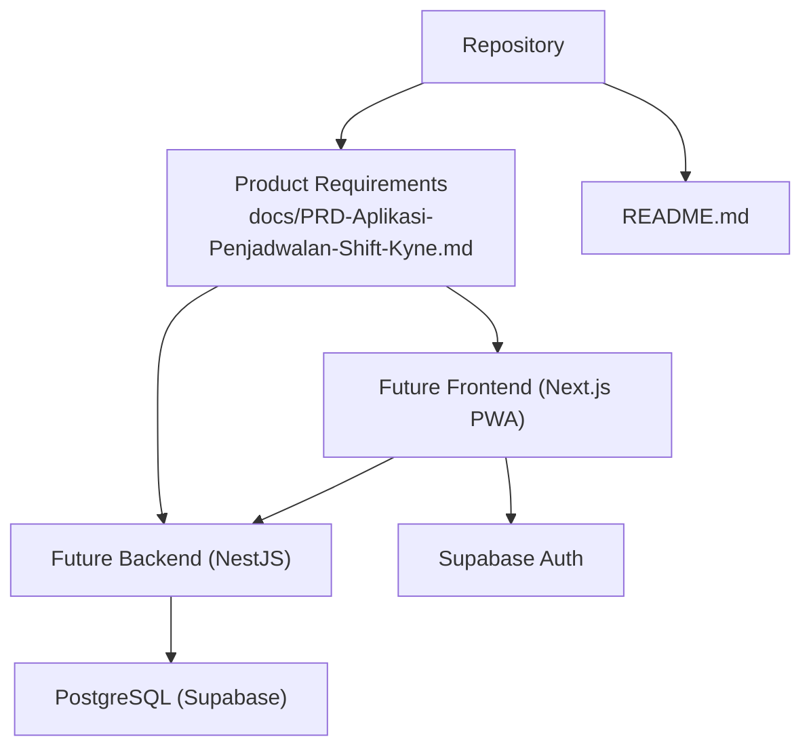
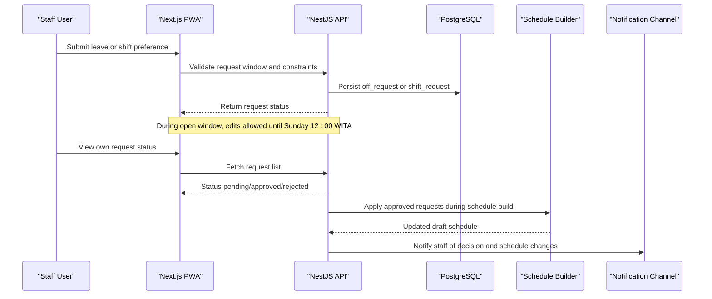
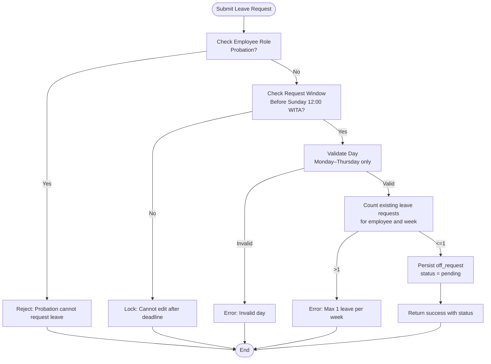
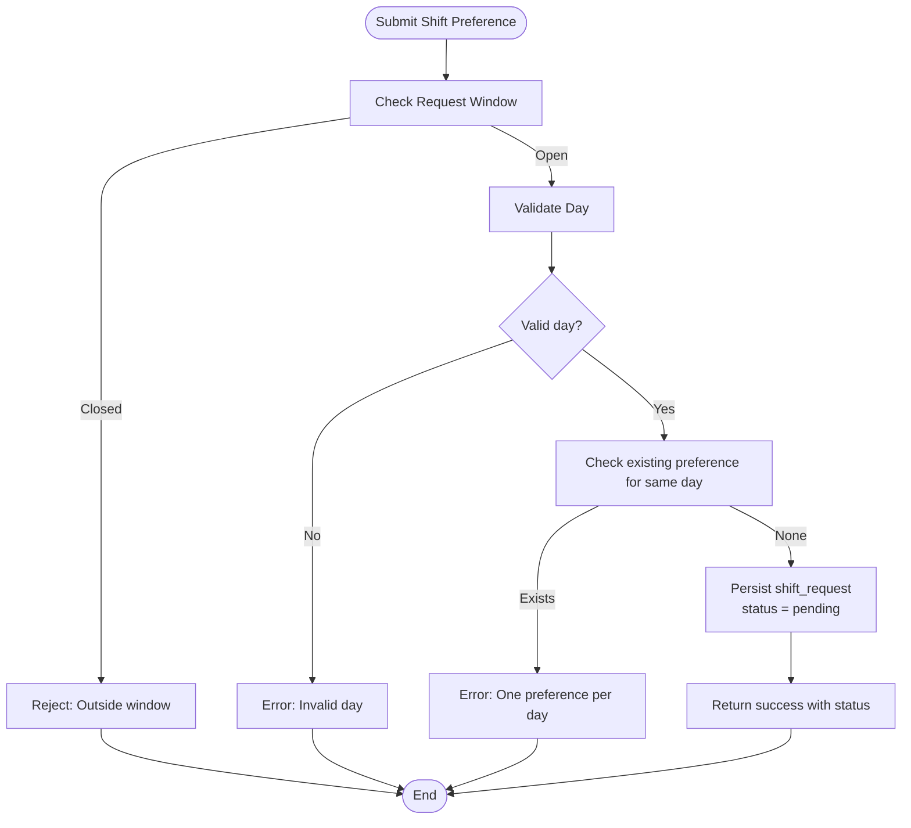
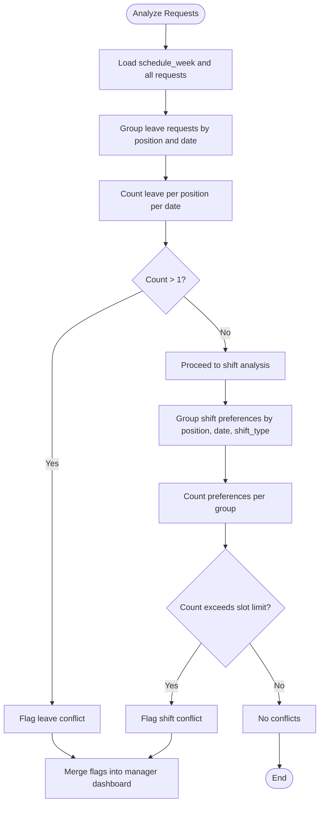
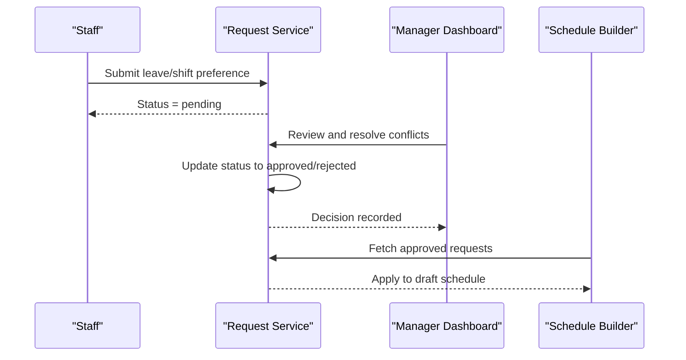
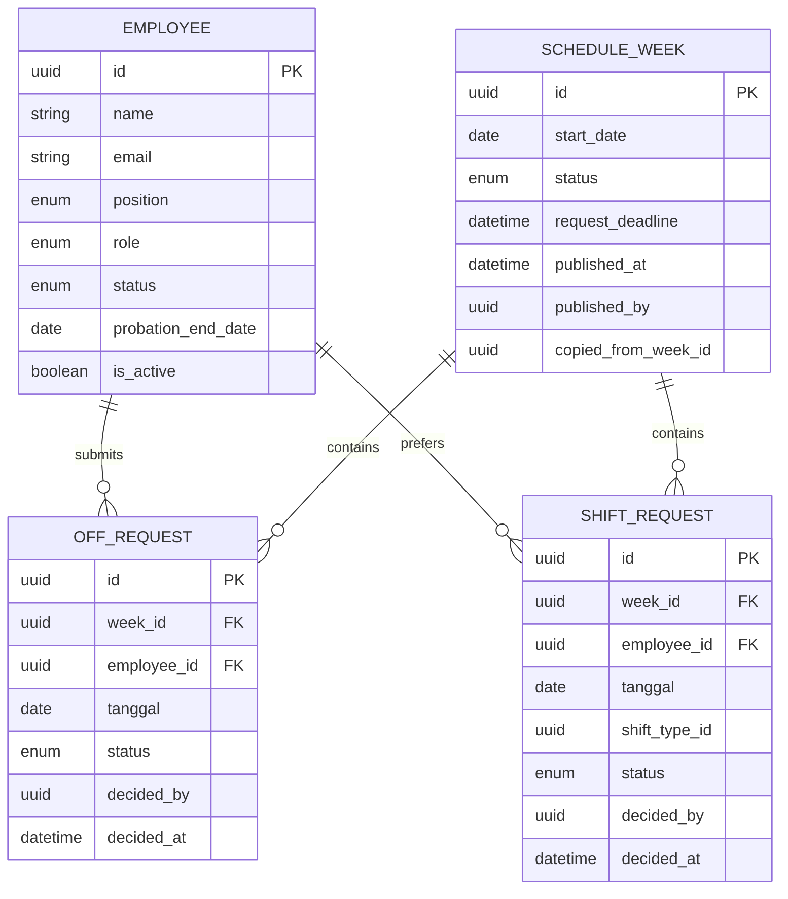
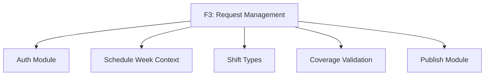

# Request Management Module (F3)

<cite>
**Referenced Files in This Document**
- [README.md](file://README.md)
- [PRD-Aplikasi-Penjadwalan-Shift-Kyne.md](file://docs/PRD-Aplikasi-Penjadwalan-Shift-Kyne.md)
</cite>

## Table of Contents
1. [Introduction](#introduction)
2. [Project Structure](#project-structure)
3. [Core Components](#core-components)
4. [Architecture Overview](#architecture-overview)
5. [Detailed Component Analysis](#detailed-component-analysis)
6. [Dependency Analysis](#dependency-analysis)
7. [Performance Considerations](#performance-considerations)
8. [Troubleshooting Guide](#troubleshooting-guide)
9. [Conclusion](#conclusion)
10. [Appendices](#appendices)

## Introduction
This document defines the functional specification for the Request Management module (F3) within the Kyne Shift Scheduling application. It covers leave request submission, shift preference requests, conflict detection, approval workflow, user stories, acceptance criteria, business logic, notifications, and audit trails. The specification is derived from the product requirements document and current repository state.

The project is currently a scaffold with no implementation code yet. Therefore, this document focuses on behavior, rules, data model alignment, and end-to-end flows that should be implemented when building F3.

**Section sources**
- [README.md:1-25](file://README.md#L1-L25)
- [PRD-Aplikasi-Penjadwalan-Shift-Kyne.md:1-267](file://docs/PRD-Aplikasi-Penjadwalan-Shift-Kyne.md#L1-L267)

## Project Structure
At this stage, the repository contains only documentation and a placeholder README. There is no backend or frontend code yet. The PRD describes the intended architecture using NestJS for the API, Next.js for the web/PWA, PostgreSQL via Prisma, and Supabase Auth.

**Diagram sources**
- [PRD-Aplikasi-Penjadwalan-Shift-Kyne.md:230-249](file://docs/PRD-Aplikasi-Penjadwalan-Shift-Kyne.md#L230-L249)

**Section sources**
- [README.md:1-25](file://README.md#L1-L25)
- [PRD-Aplikasi-Penjadwalan-Shift-Kyne.md:230-249](file://docs/PRD-Aplikasi-Penjadwalan-Shift-Kyne.md#L230-L249)

## Core Components
F3 consists of two primary request types:
- Leave request: one day per week, Monday through Thursday only.
- Shift preference request: morning or evening preference per day, any day of the week.

Key capabilities include:
- Submission and editing during the open request window.
- Conflict detection for overlapping leave and over-subscription of preferred shifts.
- Approval workflow with status tracking.
- Manager dashboard visibility of conflicts and missing requests.
- Audit trail for request history.

Data model alignment:
- off_request: leave request entity.
- shift_request: shift preference entity.
- schedule_week: weekly context including deadline and status.
- employee: requester identity and role.

**Section sources**
- [PRD-Aplikasi-Penjadwalan-Shift-Kyne.md:122-130](file://docs/PRD-Aplikasi-Penjadwalan-Shift-Kyne.md#L122-L130)
- [PRD-Aplikasi-Penjadwalan-Shift-Kyne.md:197-209](file://docs/PRD-Aplikasi-Penjadwalan-Shift-Kyne.md#L197-L209)

## Architecture Overview
F3 integrates with authentication, scheduling, and publishing modules. The request lifecycle spans from staff submission to manager review and eventual scheduling application.

**Diagram sources**
- [PRD-Aplikasi-Penjadwalan-Shift-Kyne.md:73-90](file://docs/PRD-Aplikasi-Penjadwalan-Shift-Kyne.md#L73-L90)
- [PRD-Aplikasi-Penjadwalan-Shift-Kyne.md:122-130](file://docs/PRD-Aplikasi-Penjadwalan-Shift-Kyne.md#L122-L130)
- [PRD-Aplikasi-Penjadwalan-Shift-Kyne.md:230-249](file://docs/PRD-Aplikasi-Penjadwalan-Shift-Kyne.md#L230-L249)

## Detailed Component Analysis

### Leave Request Submission
Business rules:
- Only employees who are not probationary can submit leave requests.
- Leave days must be Monday through Thursday.
- Maximum one leave request per employee per week.
- Requests can be edited while the request window is open; after Sunday 12:00 WITA, they are locked.

Acceptance criteria:
- Form restricts selectable days to Monday–Thursday.
- System prevents more than one leave request per employee per week.
- UI shows “Leave: Tuesday” style status once submitted.
- After the deadline, submissions are rejected or locked depending on timing.

Validation flow:

**Diagram sources**
- [PRD-Aplikasi-Penjadwalan-Shift-Kyne.md:122-130](file://docs/PRD-Aplikasi-Penjadwalan-Shift-Kyne.md#L122-L130)
- [PRD-Aplikasi-Penjadwalan-Shift-Kyne.md:165-195](file://docs/PRD-Aplikasi-Penjadwalan-Shift-Kyne.md#L165-L195)

**Section sources**
- [PRD-Aplikasi-Penjadwalan-Shift-Kyne.md:122-130](file://docs/PRD-Aplikasi-Penjadwalan-Shift-Kyne.md#L122-L130)
- [PRD-Aplikasi-Penjadwalan-Shift-Kyne.md:165-195](file://docs/PRD-Aplikasi-Penjadwalan-Shift-Kyne.md#L165-L195)

### Shift Preference Request
Business rules:
- Employees may request morning or evening preferences per day.
- Any day of the week is eligible.
- Preferences are “best effort,” not guaranteed; managers decide final assignments.
- Multiple shift preference requests are allowed per employee per week, but at most one per day.

Acceptance criteria:
- UI allows selecting morning or evening per day.
- System enforces one preference per day.
- Submitted preferences appear in manager dashboard with status.
- Approved preferences are applied during schedule building; unapproved ones do not force assignment.

Submission flow:

**Diagram sources**
- [PRD-Aplikasi-Penjadwalan-Shift-Kyne.md:122-130](file://docs/PRD-Aplikasi-Penjadwalan-Shift-Kyne.md#L122-L130)
- [PRD-Aplikasi-Penjadwalan-Shift-Kyne.md:197-209](file://docs/PRD-Aplikasi-Penjadwalan-Shift-Kyne.md#L197-L209)

**Section sources**
- [PRD-Aplikasi-Penjadwalan-Shift-Kyne.md:122-130](file://docs/PRD-Aplikasi-Penjadwalan-Shift-Kyne.md#L122-L130)
- [PRD-Aplikasi-Penjadwalan-Shift-Kyne.md:197-209](file://docs/PRD-Aplikasi-Penjadwalan-Shift-Kyne.md#L197-L209)

### Conflict Detection Algorithms
Two categories of conflicts are defined:

- Leave conflicts: Two employees in the same position requesting leave on the same day.
- Shift preference conflicts: Too many employees requesting the same shift type on the same day, exceeding available slots.

Detection algorithm overview:

Manager resolution:
- For leave conflicts, the manager chooses which employee’s leave is approved.
- For shift preference conflicts, the manager decides who gets the preferred shift.
- Unapproved leave requests are treated like no request; the manager assigns the employee’s day off.

**Diagram sources**
- [PRD-Aplikasi-Penjadwalan-Shift-Kyne.md:92-96](file://docs/PRD-Aplikasi-Penjadwalan-Shift-Kyne.md#L92-L96)
- [PRD-Aplikasi-Penjadwalan-Shift-Kyne.md:132-138](file://docs/PRD-Aplikasi-Penjadwalan-Shift-Kyne.md#L132-L138)

**Section sources**
- [PRD-Aplikasi-Penjadwalan-Shift-Kyne.md:92-96](file://docs/PRD-Aplikasi-Penjadwalan-Shift-Kyne.md#L92-L96)
- [PRD-Aplikasi-Penjadwalan-Shift-Kyne.md:132-138](file://docs/PRD-Aplikasi-Penjadwalan-Shift-Kyne.md#L132-L138)

### Approval Workflow and Status Tracking
Statuses:
- Pending: Initial state upon submission.
- Approved: Request accepted by the manager.
- Rejected: Request denied by the manager.

Workflow:
- Staff submits request; system records it as pending.
- Manager reviews requests on the dashboard, resolves conflicts, and sets decisions.
- Decisions update request status and record decision metadata (who decided and when).
- Approved leave requests are applied during schedule building; approved shift preferences are considered for assignment.

Sequence diagram:

**Diagram sources**
- [PRD-Aplikasi-Penjadwalan-Shift-Kyne.md:122-130](file://docs/PRD-Aplikasi-Penjadwalan-Shift-Kyne.md#L122-L130)
- [PRD-Aplikasi-Penjadwalan-Shift-Kyne.md:197-209](file://docs/PRD-Aplikasi-Penjadwalan-Shift-Kyne.md#L197-L209)

**Section sources**
- [PRD-Aplikasi-Penjadwalan-Shift-Kyne.md:122-130](file://docs/PRD-Aplikasi-Penjadwalan-Shift-Kyne.md#L122-L130)
- [PRD-Aplikasi-Penjadwalan-Shift-Kyne.md:197-209](file://docs/PRD-Aplikasi-Penjadwalan-Shift-Kyne.md#L197-L209)

### Data Model Alignment
Entities relevant to F3:
- employee: requester identity, role, position, probation status.
- off_request: leave request with status and decision fields.
- shift_request: shift preference with status and decision fields.
- schedule_week: weekly context including deadlines and status.

Constraints enforced by the model:
- One leave request per employee per week.
- One shift preference per employee per day.
- Status fields track lifecycle and accountability.

Entity relationships:

**Diagram sources**
- [PRD-Aplikasi-Penjadwalan-Shift-Kyne.md:197-209](file://docs/PRD-Aplikasi-Penjadwalan-Shift-Kyne.md#L197-L209)

**Section sources**
- [PRD-Aplikasi-Penjadwalan-Shift-Kyne.md:197-209](file://docs/PRD-Aplikasi-Penjadwalan-Shift-Kyne.md#L197-L209)

### Notification Systems
MVP notification approach:
- No push notifications.
- Communication occurs via WhatsApp sharing of the published schedule link.
- In-app status indicates request outcomes and schedule availability.

Implications for F3:
- When a request is approved or rejected, the staff sees updated status in the app.
- Managers share the schedule link to notify staff about the published roster.
- Any post-publish changes are handled manually by the manager and communicated via WhatsApp.

**Section sources**
- [PRD-Aplikasi-Penjadwalan-Shift-Kyne.md:149-155](file://docs/PRD-Aplikasi-Penjadwalan-Shift-Kyne.md#L149-L155)
- [PRD-Aplikasi-Penjadwalan-Shift-Kyne.md:218-228](file://docs/PRD-Aplikasi-Penjadwalan-Shift-Kyne.md#L218-L228)

### Audit Trails and Request History
Audit requirements:
- Every request should capture created_at, updated_at, and created_by.
- Decisions should capture decided_by and decided_at.
- Deletions should be soft deletes to preserve history.

Implementation guidance:
- Use UUIDs for IDs.
- Maintain created_by and updated_by where applicable.
- Preserve historical records even if employees are deactivated.

**Section sources**
- [PRD-Aplikasi-Penjadwalan-Shift-Kyne.md:210-217](file://docs/PRD-Aplikasi-Penjadwalan-Shift-Kyne.md#L210-L217)

## Dependency Analysis
F3 depends on:
- Authentication and authorization to ensure only eligible employees can submit requests and managers can review them.
- Weekly scheduling context to enforce deadlines and apply approved requests.
- Shift type definitions to validate morning/evening preferences.
- Coverage validation rules to inform manager decisions before publishing.

**Diagram sources**
- [PRD-Aplikasi-Penjadwalan-Shift-Kyne.md:165-195](file://docs/PRD-Aplikasi-Penjadwalan-Shift-Kyne.md#L165-L195)
- [PRD-Aplikasi-Penjadwalan-Shift-Kyne.md:230-249](file://docs/PRD-Aplikasi-Penjadwalan-Shift-Kyne.md#L230-L249)

**Section sources**
- [PRD-Aplikasi-Penjadwalan-Shift-Kyne.md:165-195](file://docs/PRD-Aplikasi-Penjadwalan-Shift-Kyne.md#L165-L195)
- [PRD-Aplikasi-Penjadwalan-Shift-Kyne.md:230-249](file://docs/PRD-Aplikasi-Penjadwalan-Shift-Kyne.md#L230-L249)

## Performance Considerations
- Keep request validation lightweight and server-side to prevent client bypass.
- Cache weekly request counts and conflict flags to reduce repeated queries during peak submission times.
- Batch conflict detection runs during schedule building rather than on every request mutation.
- Ensure timezone handling is consistent (WITA) to avoid edge-case deadline errors.

[No sources needed since this section provides general guidance]

## Troubleshooting Guide
Common issues and resolutions:
- Request submitted outside the window:
  - Verify request_deadline and current time in WITA.
  - Reject or lock based on policy.
- Duplicate leave request:
  - Enforce one leave per employee per week.
- Invalid leave day:
  - Restrict form to Monday–Thursday.
- Excessive shift preferences:
  - Enforce one preference per day and respect slot limits.
- Conflicts unresolved:
  - Prompt manager to choose approvers for leave and preferred shifts.
- Post-publish changes:
  - Manual process via manager; communicate via WhatsApp.

**Section sources**
- [PRD-Aplikasi-Penjadwalan-Shift-Kyne.md:73-90](file://docs/PRD-Aplikasi-Penjadwalan-Shift-Kyne.md#L73-L90)
- [PRD-Aplikasi-Penjadwalan-Shift-Kyne.md:122-130](file://docs/PRD-Aplikasi-Penjadwalan-Shift-Kyne.md#L122-L130)
- [PRD-Aplikasi-Penjadwalan-Shift-Kyne.md:165-195](file://docs/PRD-Aplikasi-Penjadwalan-Shift-Kyne.md#L165-L195)

## Conclusion
F3 defines clear boundaries for leave and shift preference requests, with strict constraints and robust conflict detection. The approval workflow ensures accountability and traceability, while the manager dashboard centralizes oversight. Notifications rely on in-app status and WhatsApp sharing in the MVP. The data model supports auditability and future ERP integration.

[No sources needed since this section summarizes without analyzing specific files]

## Appendices

### User Stories
- As a staff member, I want to submit leave requests for Monday–Thursday, maximum one per week, so that my time off is recorded and considered during scheduling.
- As a staff member, I want to submit morning or evening shift preferences for any day, so that my preferred shifts are considered.
- As a manager, I want to see all requests, identify conflicts, and approve or reject them, so that the schedule reflects team needs and constraints.

**Section sources**
- [PRD-Aplikasi-Penjadwalan-Shift-Kyne.md:122-138](file://docs/PRD-Aplikasi-Penjadwalan-Shift-Kyne.md#L122-L138)

### Acceptance Criteria Summary
- Leave requests restricted to Monday–Thursday and one per week.
- Shift preferences allowed per day, any day, with one per day.
- Request window opens when the previous week’s schedule is published and closes Sunday 12:00 WITA.
- Conflicts flagged for same-position leave overlaps and excessive shift preferences.
- Manager decides approvals; unapproved leave treated as no request.
- Audit fields capture creation, updates, and decisions.

**Section sources**
- [PRD-Aplikasi-Penjadwalan-Shift-Kyne.md:122-130](file://docs/PRD-Aplikasi-Penjadwalan-Shift-Kyne.md#L122-L130)
- [PRD-Aplikasi-Penjadwalan-Shift-Kyne.md:165-195](file://docs/PRD-Aplikasi-Penjadwalan-Shift-Kyne.md#L165-L195)
- [PRD-Aplikasi-Penjadwalan-Shift-Kyne.md:210-217](file://docs/PRD-Aplikasi-Penjadwalan-Shift-Kyne.md#L210-L217)