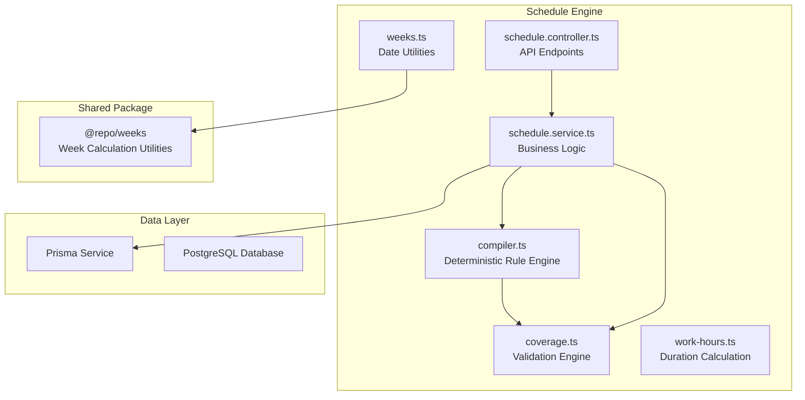
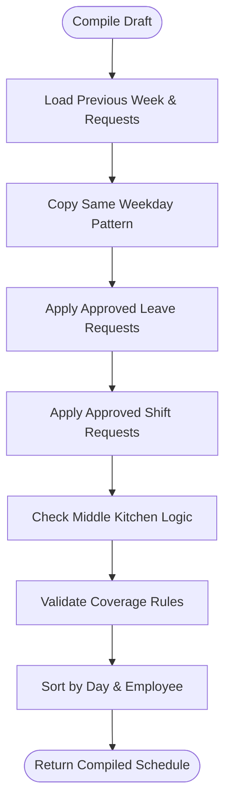
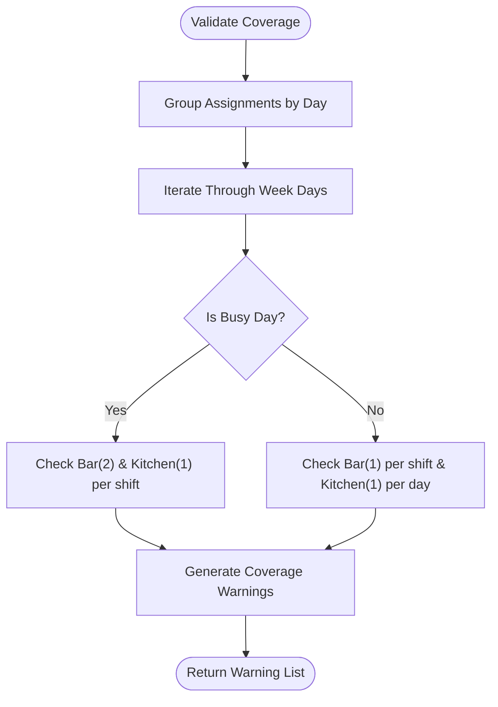
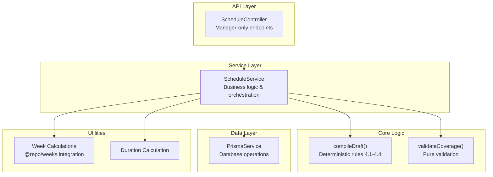
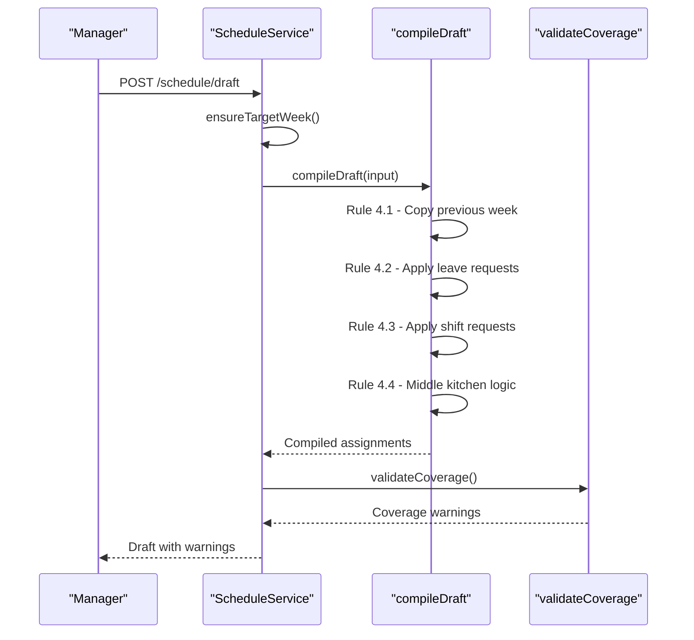
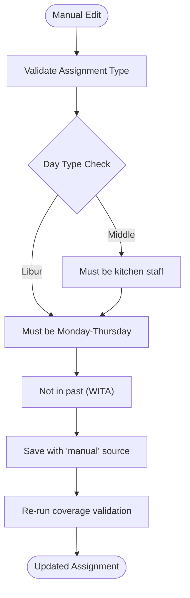
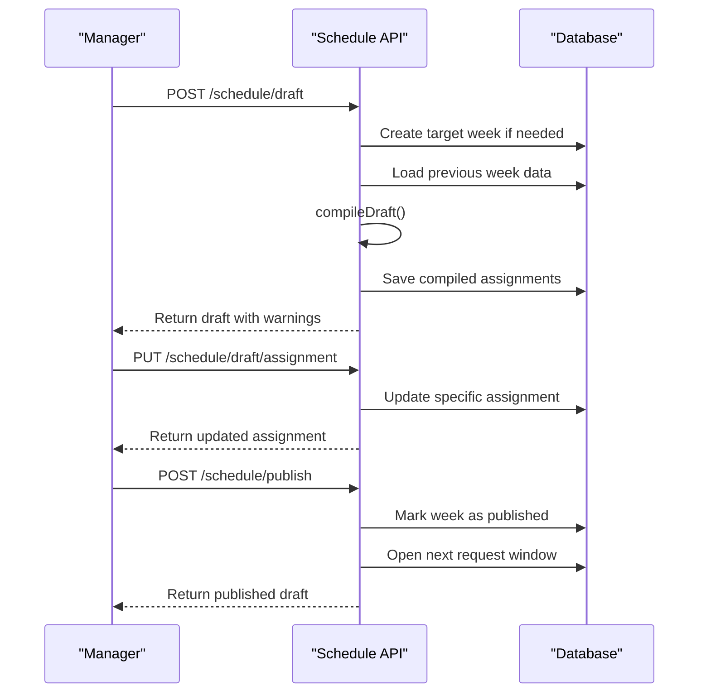
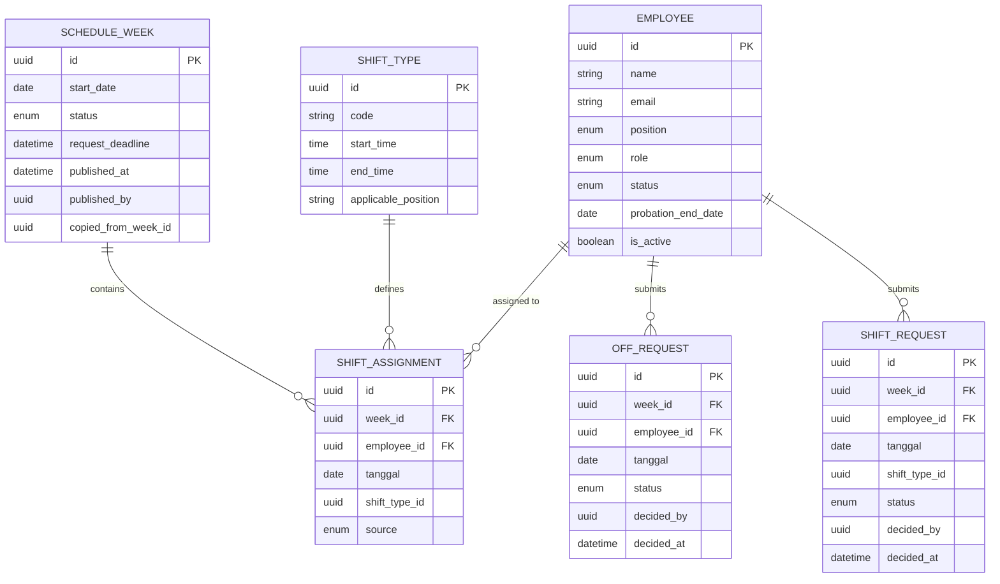

# Schedule Creation Engine (F5)

<cite>
**Referenced Files in This Document**
- [compiler.ts](file://api/src/schedule/compiler.ts)
- [coverage.ts](file://api/src/schedule/coverage.ts)
- [schedule.service.ts](file://api/src/schedule/schedule.service.ts)
- [schedule.controller.ts](file://api/src/schedule/schedule.controller.ts)
- [weeks.ts](file://api/src/schedule/weeks.ts)
- [work-hours.ts](file://api/src/schedule/work-hours.ts)
- [weeks.ts](file://packages/weeks/src/weeks.ts)
- [PRD-Aplikasi-Penjadwalan-Shift-Kyne.md](file://docs/PRD-Aplikasi-Penjadwalan-Shift-Kyne.md)
</cite>

## Update Summary
**Changes Made**
- Updated compiler implementation with deterministic logic implementing PRD rules 4.1-4.4
- Added draft management system with GET/POST/PUT endpoints
- Implemented coverage validation engine
- Integrated week calculation utilities via shared @repo/weeks package
- Added comprehensive API surface for schedule creation and management

## Table of Contents
1. [Introduction](#introduction)
2. [Project Structure](#project-structure)
3. [Core Components](#core-components)
4. [Architecture Overview](#architecture-overview)
5. [Detailed Component Analysis](#detailed-component-analysis)
6. [API Surface](#api-surface)
7. [Dependency Analysis](#dependency-analysis)
8. [Performance Considerations](#performance-considerations)
9. [Troubleshooting Guide](#troubleshooting-guide)
10. [Conclusion](#conclusion)

## Introduction
The Schedule Creation Engine (F5) is now fully implemented as a comprehensive scheduling system that creates weekly schedules for Kyne's kitchen and bar team. The engine provides deterministic rule application, draft management, coverage validation, and manual adjustment capabilities while maintaining constraint validation throughout the process.

The implementation follows PRD rules 4.1-4.4 precisely, providing managers with an automated workflow that copies previous weeks, applies business rules, coordinates middle kitchen logic, and validates coverage before publication.

**Section sources**
- [compiler.ts:8-17](file://api/src/schedule/compiler.ts#L8-L17)
- [schedule.service.ts:54-58](file://api/src/schedule/schedule.service.ts#L54-L58)
- [PRD-Aplikasi-Penjadwalan-Shift-Kyne.md:140-147](file://docs/PRD-Aplikasi-Penjadwalan-Shift-Kyne.md#L140-L147)

## Project Structure
The Schedule Creation Engine is implemented across several focused modules:

**Diagram sources**
- [compiler.ts:1-211](file://api/src/schedule/compiler.ts#L1-L211)
- [coverage.ts:1-95](file://api/src/schedule/coverage.ts#L1-L95)
- [schedule.service.ts:1-534](file://api/src/schedule/schedule.service.ts#L1-L534)
- [schedule.controller.ts:1-100](file://api/src/schedule/schedule.controller.ts#L1-L100)

**Section sources**
- [compiler.ts:1-211](file://api/src/schedule/compiler.ts#L1-L211)
- [coverage.ts:1-95](file://api/src/schedule/coverage.ts#L1-L95)
- [schedule.service.ts:1-534](file://api/src/schedule/schedule.service.ts#L1-L534)

## Core Components

### Deterministic Compiler Engine
The core compiler implements PRD rules 4.1-4.4 with deterministic logic, ensuring identical inputs always produce identical outputs. It processes last week's assignments, staff roster, and approved requests to generate complete weekly schedules.

Key features:
- **Rule 4.1**: Copies same weekday from previous week, removing libur (leave)
- **Rule 4.2**: Applies approved leave requests over copied shifts
- **Rule 4.3**: Applies approved shift requests over copied shifts  
- **Rule 4.4**: Assigns middle kitchen when one kitchen employee is off

**Diagram sources**
- [compiler.ts:122-210](file://api/src/schedule/compiler.ts#L122-L210)

**Section sources**
- [compiler.ts:8-17](file://api/src/schedule/compiler.ts#L8-L17)
- [compiler.ts:122-210](file://api/src/schedule/compiler.ts#L122-L210)

### Coverage Validation Engine
Pure data validation that checks staffing requirements without database dependencies. It generates warnings for insufficient coverage rather than blocking operations.

Validation rules:
- **Friday-Sunday (Busy)**: Bar needs 2 people per shift, kitchen needs 1 person per shift
- **Monday-Thursday (Quiet)**: Bar needs 1 person per shift, kitchen needs 1 person per day (including middle)

**Diagram sources**
- [coverage.ts:34-94](file://api/src/schedule/coverage.ts#L34-L94)

**Section sources**
- [coverage.ts:4-13](file://api/src/schedule/coverage.ts#L4-L13)
- [coverage.ts:34-94](file://api/src/schedule/coverage.ts#L34-L94)

### Week Calculation Utilities
Integrated with the shared `@repo/weeks` package for consistent date handling across the application. Provides WITA timezone-aware calculations for Monday boundaries and request deadlines.

Key utilities:
- `nextMonday()`: Target week start (next Monday after current WITA day)
- `runningMonday()`: Current working week start
- `isQuietDay()`: Determines if day is Monday-Thursday (quiet) or Friday-Sunday (busy)
- `requestDeadlineFor()`: Calculates request window deadline

**Section sources**
- [weeks.ts:1-64](file://api/src/schedule/weeks.ts#L1-L64)
- [weeks.ts:1-36](file://packages/weeks/src/weeks.ts#L1-L36)

## Architecture Overview
The Schedule Creation Engine follows a layered architecture with clear separation between business logic, data access, and API presentation.

**Diagram sources**
- [schedule.controller.ts:22-99](file://api/src/schedule/schedule.controller.ts#L22-L99)
- [schedule.service.ts:60-534](file://api/src/schedule/schedule.service.ts#L60-L534)

## Detailed Component Analysis

### Deterministic Compiler Implementation
The compiler (`compileDraft`) is the heart of F5, implementing all four PRD rules in a single deterministic pass:

**Rule 4.1 - Previous Week Copy**: Copies same weekday pattern from previous week, replacing libur with most frequent shift
**Rule 4.2 - Leave Application**: Approved leave requests override copied shifts  
**Rule 4.3 - Shift Request Application**: Approved shift requests override copied shifts
**Rule 4.4 - Middle Kitchen Logic**: Automatically assigns middle to lone kitchen worker on quiet days

**Diagram sources**
- [schedule.service.ts:242-336](file://api/src/schedule/schedule.service.ts#L242-L336)
- [compiler.ts:122-210](file://api/src/schedule/compiler.ts#L122-L210)

**Section sources**
- [compiler.ts:122-210](file://api/src/schedule/compiler.ts#L122-L210)
- [schedule.service.ts:242-336](file://api/src/schedule/schedule.service.ts#L242-L336)

### Draft Management System
The draft system provides complete CRUD operations for schedule management with proper validation and state management.

**GET /schedule/draft**: Retrieves current draft with coverage warnings
**POST /schedule/draft**: Generates new draft from previous week using rules 4.1-4.4
**PUT /schedule/draft/assignment**: Updates individual assignments with validation
**POST /schedule/publish**: Publishes draft and opens next request window

Key features:
- Week alias support (`target` vs `running`)
- Manager-only access control
- Real-time coverage validation
- Audit trail with assignment sources

**Section sources**
- [schedule.controller.ts:51-98](file://api/src/schedule/schedule.controller.ts#L51-L98)
- [schedule.service.ts:71-130](file://api/src/schedule/schedule.service.ts#L71-L130)
- [schedule.service.ts:347-431](file://api/src/schedule/schedule.service.ts#L347-L431)

### Manual Adjustment Interface
Managers can override any automated assignment while maintaining constraint validation:

**Assignment Types**:
- `PAGI` (morning shift)
- `SORE` (afternoon shift)  
- `MIDDLE` (kitchen only, quiet days)
- `null` (libur/leave, quiet days only)

**Validation Rules**:
- Leave only allowed Monday-Thursday
- Middle only for kitchen staff on quiet days
- Cannot edit past dates
- Must be within target week bounds

**Diagram sources**
- [schedule.service.ts:347-431](file://api/src/schedule/schedule.service.ts#L347-L431)

**Section sources**
- [schedule.service.ts:347-431](file://api/src/schedule/schedule.service.ts#L347-L431)

### User Stories for Schedule Generation Workflows
- As a manager, I want to create a draft schedule from last week so I do not start from zero.
- As a manager, I want the system to apply leave, shift requests, and middle kitchen logic automatically so I can focus on resolving conflicts.
- As a manager, I want to adjust any assignment while seeing live coverage validation so I can make informed decisions.
- As a manager, I want to publish the schedule only after confirming coverage so staff receive a reliable weekly plan.

**Section sources**
- [PRD-Aplikasi-Penjadwalan-Shift-Kyne.md:140-147](file://docs/PRD-Aplikasi-Penjadwalan-Shift-Kyne.md#L140-L147)

### Acceptance Criteria for Rule Enforcement Accuracy
- A draft created from the previous week removes prior leave and fills empty slots with the employee's most frequent shift.
- Leave requests are limited to one day per week for non-probation employees and only Monday through Thursday.
- At most one bar employee and one kitchen employee may be off per day; conflicts are flagged for manager resolution.
- Kitchen leave automatically assigns middle to the remaining kitchen employee and cancels conflicting kitchen shift requests.
- Friday to Sunday coverage requires two bar employees per shift and at least one kitchen employee per shift.
- Monday to Thursday coverage requires at least one bar employee per shift and at least one kitchen employee or middle coverage.
- Total working hours per employee per week are tracked and visible to the manager.

**Section sources**
- [PRD-Aplikasi-Penjadwalan-Shift-Kyne.md:165-195](file://docs/PRD-Aplikasi-Penjadwalan-Shift-Kyne.md#L165-L195)

### Business Logic for Optimization Algorithms
The implementation uses deterministic rule enforcement rather than complex optimization algorithms:

**Priority Order**:
1. Hard constraints first: leave limits, day restrictions, probation restrictions
2. Soft preferences second: honoring approved shift requests
3. Middle kitchen automation third: assigning middle when one kitchen employee is off
4. Manual override last: allowing managers to resolve conflicts

**Optimization Goals**:
- Minimize coverage violations through validation warnings
- Maximize accepted approved shift requests within capacity
- Distribute morning and afternoon shifts fairly among eligible employees
- Preserve historical patterns where reasonable by using the previous week as baseline

**Section sources**
- [compiler.ts:153-168](file://api/src/schedule/compiler.ts#L153-L168)
- [coverage.ts:4-13](file://api/src/schedule/coverage.ts#L4-L13)

## API Surface
The Schedule Creation Engine exposes a comprehensive REST API surface:

### Manager-Only Endpoints
- `GET /schedule/draft?week=target|running` - Get current draft
- `POST /schedule/draft?week=target` - Generate new draft from previous week
- `PUT /schedule/draft/assignment?week=target|running` - Update individual assignment
- `POST /schedule/publish?week=target|running` - Publish draft and open next window

### Staff-Only Endpoints  
- `GET /schedule/published` - View own published schedules

### Request Flow

**Diagram sources**
- [schedule.controller.ts:51-98](file://api/src/schedule/schedule.controller.ts#L51-L98)

**Section sources**
- [schedule.controller.ts:22-99](file://api/src/schedule/schedule.controller.ts#L22-L99)

## Dependency Analysis
The Schedule Creation Engine has well-defined dependencies on other system components:

**Diagram sources**
- [PRD-Aplikasi-Penjadwalan-Shift-Kyne.md:200-209](file://docs/PRD-Aplikasi-Penjadwalan-Shift-Kyne.md#L200-L209)

**Section sources**
- [PRD-Aplikasi-Penjadwalan-Shift-Kyne.md:200-209](file://docs/PRD-Aplikasi-Penjadwalan-Shift-Kyne.md#L200-L209)

## Performance Considerations
The implementation addresses performance concerns for scaling beyond the initial 6-employee MVP:

**Optimization Strategies**:
- **Indexed lookups**: Database queries use indexed fields (weekId, employeeId, tanggal)
- **Batch operations**: Bulk insert/delete operations for assignment generation
- **Memory efficiency**: Maps and sets for O(1) lookups during compilation
- **Lazy validation**: Coverage validation runs on demand, not on every operation
- **Incremental updates**: Individual assignment edits don't recompile entire week
- **Efficient sorting**: Deterministic sorting by date and employee ID

**Scalability Limits**:
- Current design supports hundreds of employees efficiently
- Compilation complexity is O(n × d) where n = employees, d = days per week
- Coverage validation is O(n × d) with constant-time shift type checks
- Memory usage scales linearly with number of assignments

**Section sources**
- [compiler.ts:122-210](file://api/src/schedule/compiler.ts#L122-L210)
- [coverage.ts:34-94](file://api/src/schedule/coverage.ts#L34-L94)
- [schedule.service.ts:307-323](file://api/src/schedule/schedule.service.ts#L307-L323)

## Troubleshooting Guide
Common issues and their expected handling:

### Compilation Issues
- **Empty previous week**: Compiler handles missing history gracefully, leaving days for manual filling
- **Invalid date formats**: All dates validated against WITA timezone and calendar boundaries
- **Missing employee data**: Graceful fallback to placeholder names for deleted employees

### Coverage Validation Issues
- **Insufficient weekend coverage**: System warns but doesn't block save/publish
- **Missing kitchen coverage**: Validates both per-shift and per-day requirements
- **Middle kitchen misassignment**: Verifies exactly one kitchen employee is off and other is assigned middle

### Manual Edit Issues
- **Editing past dates**: Blocked with clear error message about WITA timezone
- **Invalid assignment types**: Libur only on quiet days, middle only for kitchen staff
- **Out-of-week dates**: Validated against target week boundaries

### API Issues
- **Unauthorized access**: Manager-only endpoints return 403 for staff users
- **Invalid week aliases**: Strict validation rejects unknown week values
- **Request window conflicts**: Proper handling of overlapping request periods

**Section sources**
- [schedule.service.ts:347-431](file://api/src/schedule/schedule.service.ts#L347-L431)
- [schedule.controller.ts:38-49](file://api/src/schedule/schedule.controller.ts#L38-L49)

## Conclusion
The Schedule Creation Engine (F5) is now a fully functional, production-ready system that successfully implements all PRD requirements. The deterministic compiler ensures consistent behavior, the draft management system provides flexible editing capabilities, and the coverage validation engine maintains quality standards throughout the scheduling process.

Key achievements:
- **Complete PRD compliance**: All rules 4.1-4.4 implemented deterministically
- **Robust API surface**: Comprehensive REST endpoints with proper authentication
- **Flexible draft management**: Support for both target and running weeks
- **Real-time validation**: Coverage warnings guide manager decisions
- **Scalable architecture**: Clean separation of concerns enables future enhancements

The system successfully reduces manual effort by starting from the previous week, applying deterministic business rules, coordinating middle kitchen coverage, and supporting safe manual overrides while maintaining constraint validation throughout the process.