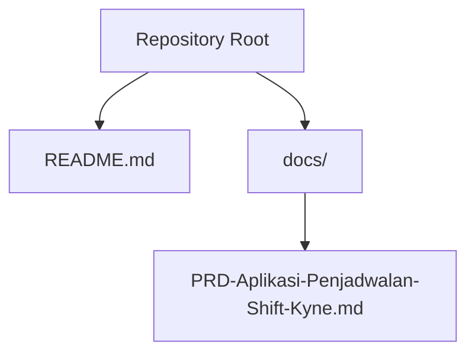
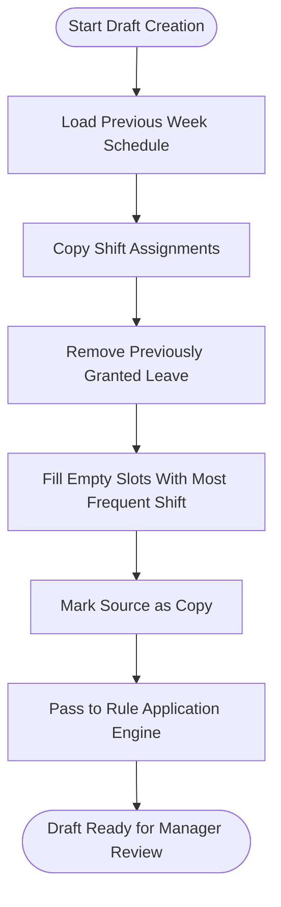
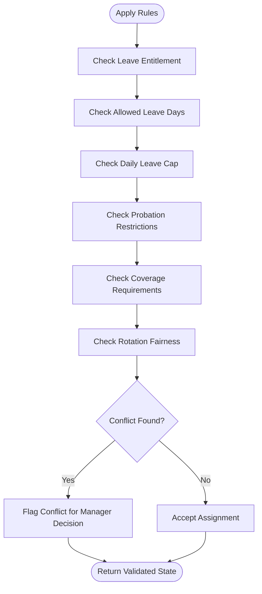
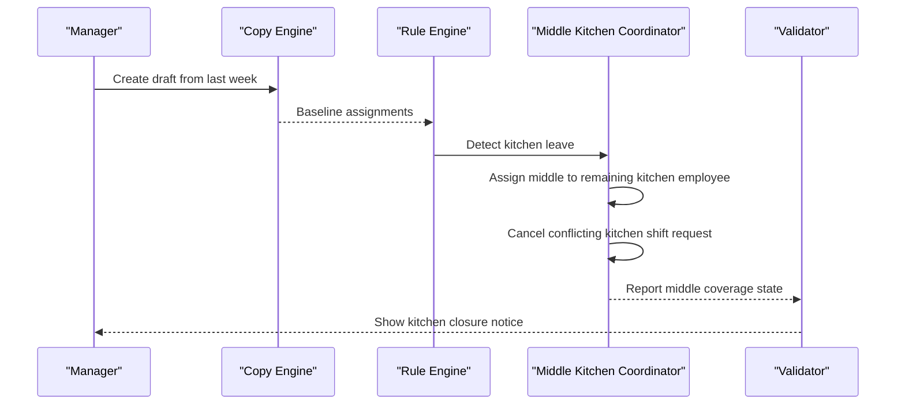
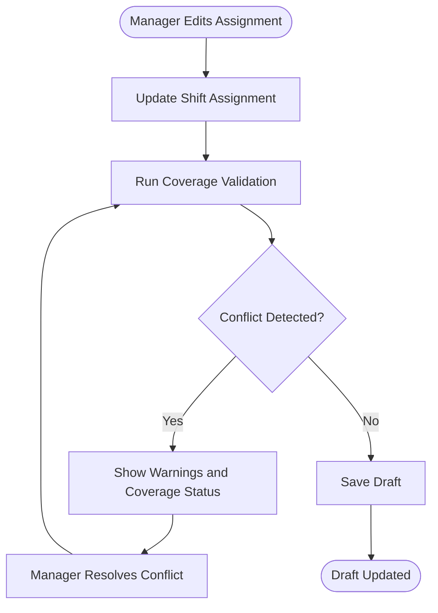
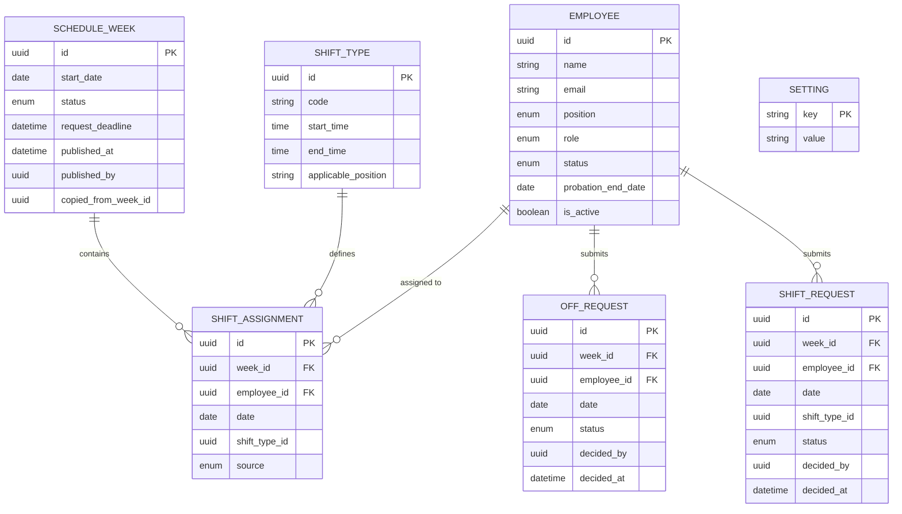

# Schedule Creation Engine (F5)

<cite>
**Referenced Files in This Document**
- [README.md](file://README.md)
- [PRD-Aplikasi-Penjadwalan-Shift-Kyne.md](file://docs/PRD-Aplikasi-Penjadwalan-Shift-Kyne.md)
</cite>

## Table of Contents
1. [Introduction](#introduction)
2. [Project Structure](#project-structure)
3. [Core Components](#core-components)
4. [Architecture Overview](#architecture-overview)
5. [Detailed Component Analysis](#detailed-component-analysis)
6. [Dependency Analysis](#dependency-analysis)
7. [Performance Considerations](#performance-considerations)
8. [Troubleshooting Guide](#troubleshooting-guide)
9. [Conclusion](#conclusion)

## Introduction
This document specifies the functional behavior of the Schedule Creation Engine, labeled F5 in the product requirements. The engine supports a weekly scheduling cycle for a small kitchen and bar team. Its main responsibilities are:
- Creating a draft schedule by copying the previous week as a baseline template.
- Applying business rules to enforce minimum staffing levels, rotation fairness, and availability respect.
- Coordinating middle kitchen logic across kitchen sections and shift handovers.
- Allowing manual adjustments while preserving constraint validation.
- Providing user stories, acceptance criteria, and optimization guidance for large staff datasets.

The repository is currently an early scaffold without implementation code. Therefore, this specification derives its requirements from the product documentation and describes how the engine should behave once implemented.

**Section sources**
- [README.md:1-25](file://README.md#L1-L25)
- [PRD-Aplikasi-Penjadwalan-Shift-Kyne.md:1-20](file://docs/PRD-Aplikasi-Penjadwalan-Shift-Kyne.md#L1-L20)

## Project Structure
At this stage, the project contains:
- A README describing the repository status and layout.
- A product requirements document that defines roles, workflows, business rules, data model concepts, architecture stack, timeline, and open questions.

**Diagram sources**
- [README.md:1-25](file://README.md#L1-L25)
- [PRD-Aplikasi-Penjadwalan-Shift-Kyne.md:1-267](file://docs/PRD-Aplikasi-Penjadwalan-Shift-Kyne.md#L1-L267)

**Section sources**
- [README.md:1-25](file://README.md#L1-L25)
- [PRD-Aplikasi-Penjadwalan-Shift-Kyne.md:1-20](file://docs/PRD-Aplikasi-Penjadwalan-Shift-Kyne.md#L1-L20)

## Core Components
The Schedule Creation Engine (F5) is centered around these core components:

- Previous-week copy engine
  - Copies last week’s schedule into the new week.
  - Removes previously granted leave.
  - Fills empty slots with shifts most frequently held by each employee.

- Rule application engine
  - Enforces minimum staffing levels per day and shift type.
  - Enforces rotation fairness and request limits.
  - Respects availability through approved requests and probation constraints.

- Middle kitchen coordinator
  - Assigns middle kitchen shifts when one kitchen employee is off.
  - Marks kitchen closure periods during middle coverage.
  - Cancels conflicting kitchen shift requests on those days.

- Manual adjustment interface
  - Lets managers change any assignment.
  - Runs coverage validation after every change.
  - Keeps draft visibility hidden until publish.

- Validation and publishing gate
  - Warns about insufficient coverage before publish.
  - Tracks total working hours per employee per week.
  - Publishes the schedule and opens the next request window.

**Section sources**
- [PRD-Aplikasi-Penjadwalan-Shift-Kyne.md:73-90](file://docs/PRD-Aplikasi-Penjadwalan-Shift-Kyne.md#L73-L90)
- [PRD-Aplikasi-Penjadwalan-Shift-Kyne.md:140-147](file://docs/PRD-Aplikasi-Penjadwalan-Shift-Kyne.md#L140-L147)
- [PRD-Aplikasi-Penjadwalan-Shift-Kyne.md:165-195](file://docs/PRD-Aplikasi-Penjadwalan-Shift-Kyne.md#L165-L195)

## Architecture Overview
The Schedule Creation Engine participates in the broader MVP architecture described in the product requirements. It sits between request management, manager dashboard operations, and publish/share flows.

```mermaid
graph TB
subgraph "Manager Workflow"
Dashboard["Manager Dashboard"]
CreateDraft["Create Draft from Last Week"]
AdjustSchedule["Manual Adjustment"]
ValidateCoverage["Coverage Validation"]
Publish["Publish & Share"]
end
subgraph "Schedule Creation Engine F5"
CopyEngine["Previous-Week Copy Engine"]
RuleEngine["Rule Application Engine"]
MiddleKitchen["Middle Kitchen Coordinator"]
Validator["Constraint Validator"]
end
subgraph "Data Layer"
Employees["Employees"]
Requests["Requests"]
ScheduleWeek["Schedule Week"]
ShiftAssignment["Shift Assignment"]
end
Dashboard --> CreateDraft
CreateDraft --> CopyEngine
CopyEngine --> RuleEngine
RuleEngine --> MiddleKitchen
MiddleKitchen --> Validator
AdjustSchedule --> Validator
Validator --> Publish
CreateDraft --> ScheduleWeek
AdjustSchedule --> ShiftAssignment
Publish --> ScheduleWeek
RequestFlow["Request Flow"] --> Requests
Requests --> RuleEngine
Employees --> RuleEngine
```

**Diagram sources**
- [PRD-Aplikasi-Penjadwalan-Shift-Kyne.md:73-90](file://docs/PRD-Aplikasi-Penjadwalan-Shift-Kyne.md#L73-L90)
- [PRD-Aplikasi-Penjadwalan-Shift-Kyne.md:140-147](file://docs/PRD-Aplikasi-Penjadwalan-Shift-Kyne.md#L140-L147)
- [PRD-Aplikasi-Penjadwalan-Shift-Kyne.md:197-217](file://docs/PRD-Aplikasi-Penjadwalan-Shift-Kyne.md#L197-L217)

## Detailed Component Analysis

### Previous-Week Copy Engine
The copy engine creates a draft schedule by reusing the prior week’s assignments. Its behavior includes:
- Copying all shift assignments from the previous week.
- Removing previously granted leave so the new week starts clean.
- Replacing removed leave with the shift type most frequently assigned to that employee.
- Preserving source metadata so later audits can distinguish copied, requested, automatically generated, or manually changed assignments.

**Diagram sources**
- [PRD-Aplikasi-Penjadwalan-Shift-Kyne.md:83-84](file://docs/PRD-Aplikasi-Penjadwalan-Shift-Kyne.md#L83-L84)
- [PRD-Aplikasi-Penjadwalan-Shift-Kyne.md:140-147](file://docs/PRD-Aplikasi-Penjadwalan-Shift-Kyne.md#L140-L147)
- [PRD-Aplikasi-Penjadwalan-Shift-Kyne.md:197-217](file://docs/PRD-Aplikasi-Penjadwalan-Shift-Kyne.md#L197-L217)

**Section sources**
- [PRD-Aplikasi-Penjadwalan-Shift-Kyne.md:83-84](file://docs/PRD-Aplikasi-Penjadwalan-Shift-Kyne.md#L83-L84)
- [PRD-Aplikasi-Penjadwalan-Shift-Kyne.md:140-147](file://docs/PRD-Aplikasi-Penjadwalan-Shift-Kyne.md#L140-L147)
- [PRD-Aplikasi-Penjadwalan-Shift-Kyne.md:197-217](file://docs/PRD-Aplikasi-Penjadwalan-Shift-Kyne.md#L197-L217)

### Rule Application Engine
The rule application engine enforces business constraints during automatic generation and manual editing. Key constraints include:
- Leave entitlement: one day per week for non-probation employees.
- Leave day restrictions: only Monday through Thursday.
- Daily leave caps: at most one bar employee and one kitchen employee off per day.
- Shift requests: morning or afternoon requests are encouraged but not guaranteed.
- Probation restrictions: probation employees cannot submit leave or shift requests.
- Coverage requirements:
  - Friday to Sunday: bar needs two people per shift; kitchen needs at least one person per shift.
  - Monday to Thursday: bar needs at least one person per shift; kitchen needs at least one person or middle coverage.
- Rotation fairness: when only one bar employee works, the manager decides who takes morning or afternoon.

**Diagram sources**
- [PRD-Aplikasi-Penjadwalan-Shift-Kyne.md:122-130](file://docs/PRD-Aplikasi-Penjadwalan-Shift-Kyne.md#L122-L130)
- [PRD-Aplikasi-Penjadwalan-Shift-Kyne.md:165-195](file://docs/PRD-Aplikasi-Penjadwalan-Shift-Kyne.md#L165-L195)

**Section sources**
- [PRD-Aplikasi-Penjadwalan-Shift-Kyne.md:122-130](file://docs/PRD-Aplikasi-Penjadwalan-Shift-Kyne.md#L122-L130)
- [PRD-Aplikasi-Penjadwalan-Shift-Kyne.md:165-195](file://docs/PRD-Aplikasi-Penjadwalan-Shift-Kyne.md#L165-L195)

### Middle Kitchen Coordinator
Middle kitchen logic coordinates kitchen coverage when one kitchen employee is off:
- When a kitchen employee has leave, the other kitchen employee assigned to that day becomes middle.
- Middle coverage implies specific kitchen closure periods.
- Any kitchen shift request for that day is canceled because middle replaces regular kitchen shifts.
- The system marks middle coverage so staff can see kitchen closure notices.

**Diagram sources**
- [PRD-Aplikasi-Penjadwalan-Shift-Kyne.md:86-87](file://docs/PRD-Aplikasi-Penjadwalan-Shift-Kyne.md#L86-L87)
- [PRD-Aplikasi-Penjadwalan-Shift-Kyne.md:175-177](file://docs/PRD-Aplikasi-Penjadwalan-Shift-Kyne.md#L175-L177)
- [PRD-Aplikasi-Penjadwalan-Shift-Kyne.md:190-195](file://docs/PRD-Aplikasi-Penjadwalan-Shift-Kyne.md#L190-L195)

**Section sources**
- [PRD-Aplikasi-Penjadwalan-Shift-Kyne.md:86-87](file://docs/PRD-Aplikasi-Penjadwalan-Shift-Kyne.md#L86-L87)
- [PRD-Aplikasi-Penjadwalan-Shift-Kyne.md:175-177](file://docs/PRD-Aplikasi-Penjadwalan-Shift-Kyne.md#L175-L177)
- [PRD-Aplikasi-Penjadwalan-Shift-Kyne.md:190-195](file://docs/PRD-Aplikasi-Penjadwalan-Shift-Kyne.md#L190-L195)

### Manual Adjustment Interface
Manual adjustments allow managers to override automated assignments while keeping validation active:
- Managers can set any employee’s daily shift to morning, afternoon, middle, or leave.
- Every change triggers coverage validation.
- Draft schedules remain invisible to staff until published.
- Managers resolve conflicts flagged by the system, such as overlapping leaves or exceeding shift capacity.

**Diagram sources**
- [PRD-Aplikasi-Penjadwalan-Shift-Kyne.md:140-147](file://docs/PRD-Aplikasi-Penjadwalan-Shift-Kyne.md#L140-L147)
- [PRD-Aplikasi-Penjadwalan-Shift-Kyne.md:165-195](file://docs/PRD-Aplikasi-Penjadwalan-Shift-Kyne.md#L165-L195)

**Section sources**
- [PRD-Aplikasi-Penjadwalan-Shift-Kyne.md:140-147](file://docs/PRD-Aplikasi-Penjadwalan-Shift-Kyne.md#L140-L147)
- [PRD-Aplikasi-Penjadwalan-Shift-Kyne.md:165-195](file://docs/PRD-Aplikasi-Penjadwalan-Shift-Kyne.md#L165-L195)

### User Stories for Schedule Generation Workflows
- As a manager, I want to create a draft schedule from last week so I do not start from zero.
- As a manager, I want the system to apply leave, shift requests, and middle kitchen logic automatically so I can focus on resolving conflicts.
- As a manager, I want to adjust any assignment while seeing live coverage validation so I can make informed decisions.
- As a manager, I want to publish the schedule only after confirming coverage so staff receive a reliable weekly plan.

**Section sources**
- [PRD-Aplikasi-Penjadwalan-Shift-Kyne.md:140-147](file://docs/PRD-Aplikasi-Penjadwalan-Shift-Kyne.md#L140-L147)
- [PRD-Aplikasi-Penjadwalan-Shift-Kyne.md:149-155](file://docs/PRD-Aplikasi-Penjadwalan-Shift-Kyne.md#L149-L155)

### Acceptance Criteria for Rule Enforcement Accuracy
- A draft created from the previous week removes prior leave and fills empty slots with the employee’s most frequent shift.
- Leave requests are limited to one day per week for non-probation employees and only Monday through Thursday.
- At most one bar employee and one kitchen employee may be off per day; conflicts are flagged for manager resolution.
- Kitchen leave automatically assigns middle to the remaining kitchen employee and cancels conflicting kitchen shift requests.
- Friday to Sunday coverage requires two bar employees per shift and at least one kitchen employee per shift.
- Monday to Thursday coverage requires at least one bar employee per shift and at least one kitchen employee or middle coverage.
- Total working hours per employee per week are tracked and visible to the manager.

**Section sources**
- [PRD-Aplikasi-Penjadwalan-Shift-Kyne.md:83-87](file://docs/PRD-Aplikasi-Penjadwalan-Shift-Kyne.md#L83-L87)
- [PRD-Aplikasi-Penjadwalan-Shift-Kyne.md:122-130](file://docs/PRD-Aplikasi-Penjadwalan-Shift-Kyne.md#L122-L130)
- [PRD-Aplikasi-Penjadwalan-Shift-Kyne.md:165-195](file://docs/PRD-Aplikasi-Penjadwalan-Shift-Kyne.md#L165-L195)
- [PRD-Aplikasi-Penjadwalan-Shift-Kyne.md:197-217](file://docs/PRD-Aplikasi-Penjadwalan-Shift-Kyne.md#L197-L217)

### Business Logic for Optimization Algorithms
The product requirements describe deterministic rule enforcement rather than a general-purpose optimizer. The practical algorithmic approach should prioritize:
- Hard constraints first: leave limits, day restrictions, probation restrictions, daily leave caps, and coverage requirements.
- Soft preferences second: honoring shift requests and balancing morning/afternoon distribution.
- Middle kitchen automation third: assigning middle when one kitchen employee is off and canceling conflicting requests.
- Manual override last: allowing managers to resolve conflicts while keeping validation warnings visible.

Optimization goals should be expressed as:
- Minimize coverage violations.
- Maximize accepted shift requests within capacity.
- Distribute morning and afternoon shifts fairly among eligible employees.
- Preserve historical patterns where reasonable by using the previous week as a baseline.

**Section sources**
- [PRD-Aplikasi-Penjadwalan-Shift-Kyne.md:83-87](file://docs/PRD-Aplikasi-Penjadwalan-Shift-Kyne.md#L83-L87)
- [PRD-Aplikasi-Penjadwalan-Shift-Kyne.md:165-195](file://docs/PRD-Aplikasi-Penjadwalan-Shift-Kyne.md#L165-L195)

## Dependency Analysis
The Schedule Creation Engine depends on several entities and processes defined in the product requirements:

**Diagram sources**
- [PRD-Aplikasi-Penjadwalan-Shift-Kyne.md:197-217](file://docs/PRD-Aplikasi-Penjadwalan-Shift-Kyne.md#L197-L217)

**Section sources**
- [PRD-Aplikasi-Penjadwalan-Shift-Kyne.md:197-217](file://docs/PRD-Aplikasi-Penjadwalan-Shift-Kyne.md#L197-L217)

## Performance Considerations
Although the current MVP targets six employees, the specification should account for scaling concerns:
- Use indexed lookups by week, employee, and date for fast retrieval of assignments and requests.
- Cache computed coverage counts per day and shift type to avoid recomputing on every edit.
- Process middle kitchen logic in a single pass over kitchen employees to prevent repeated scans.
- Defer heavy validation until save or publish when possible, but keep lightweight checks interactive for better UX.
- Store total working hours incrementally and refresh them when assignments change.
- Avoid deep recursion in rule evaluation; prefer iterative passes over days and employees.
- Keep audit trails compact by recording source metadata instead of duplicating full assignment snapshots.

[No sources needed since this section provides general guidance]

## Troubleshooting Guide
Common issues and their expected handling:
- Conflicting leave requests: the system flags overlaps for the same position on the same day; the manager approves one and treats the other as unrequested.
- Excess shift requests: if more employees request the same shift slot than available, the system flags the conflict and lets the manager decide.
- Missing coverage on busy days: the system warns before publish when Friday to Sunday coverage is insufficient.
- Missing coverage on quiet days: the system warns when Monday to Thursday coverage falls below minimums.
- Middle kitchen misassignment: verify that exactly one kitchen employee is off and that the other is assigned middle; confirm that conflicting kitchen shift requests were canceled.
- Probation employees submitting requests: ensure the UI hides request menus for probation employees and that backend validation rejects invalid submissions.

**Section sources**
- [PRD-Aplikasi-Penjadwalan-Shift-Kyne.md:92-97](file://docs/PRD-Aplikasi-Penjadwalan-Shift-Kyne.md#L92-L97)
- [PRD-Aplikasi-Penjadwalan-Shift-Kyne.md:122-130](file://docs/PRD-Aplikasi-Penjadwalan-Shift-Kyne.md#L122-L130)
- [PRD-Aplikasi-Penjadwalan-Shift-Kyne.md:165-195](file://docs/PRD-Aplikasi-Penjadwalan-Shift-Kyne.md#L165-L195)

## Conclusion
The Schedule Creation Engine (F5) is designed to reduce manual effort by starting from the previous week, applying deterministic business rules, coordinating middle kitchen coverage, and supporting safe manual overrides. Its success depends on accurate rule enforcement, clear conflict signaling, and consistent validation before publish. Once implemented, the engine should align with the MVP workflow, data model principles, and security expectations described in the product requirements.

[No sources needed since this section summarizes without analyzing specific files]