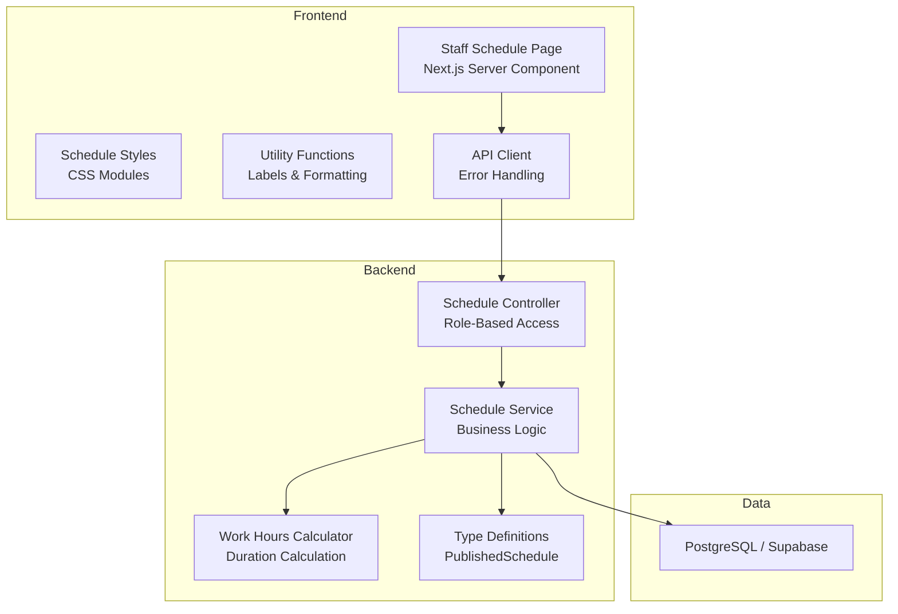
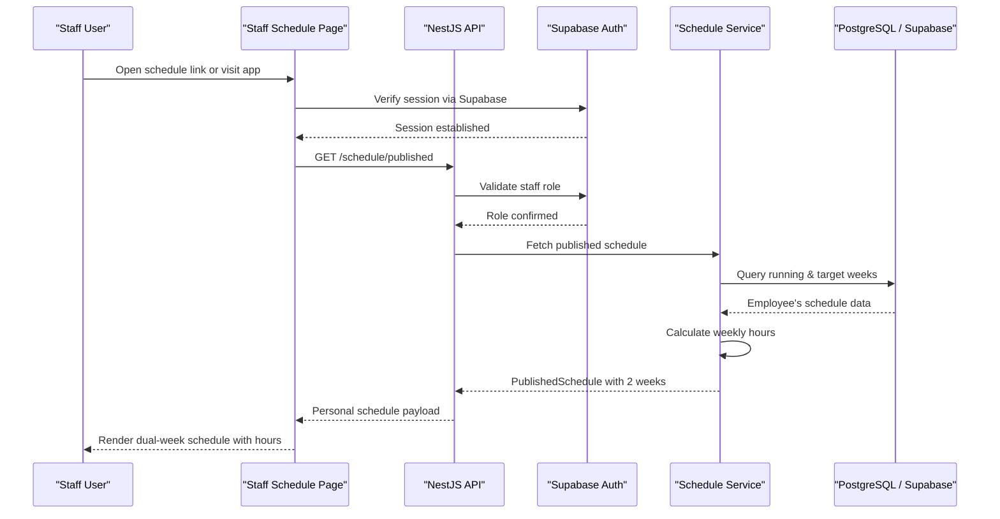
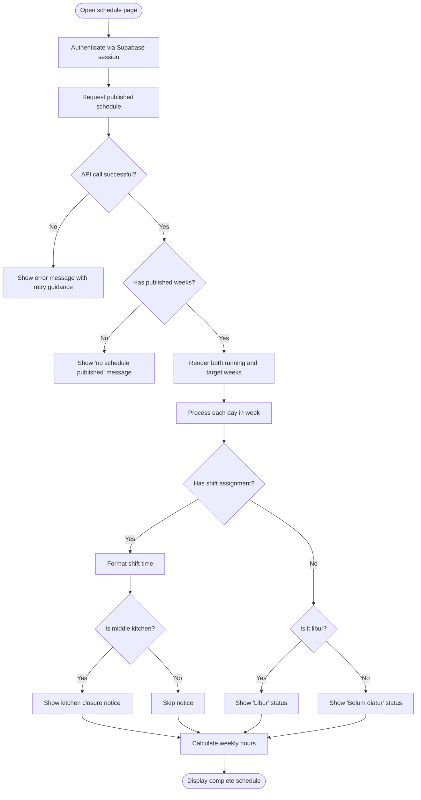
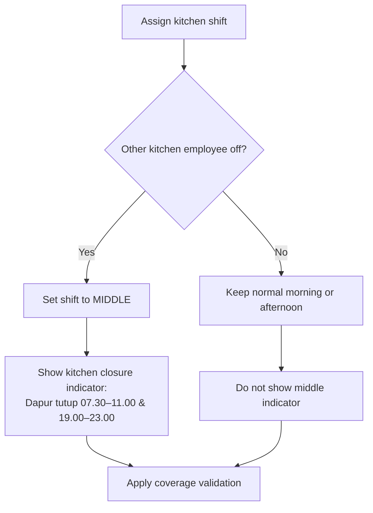
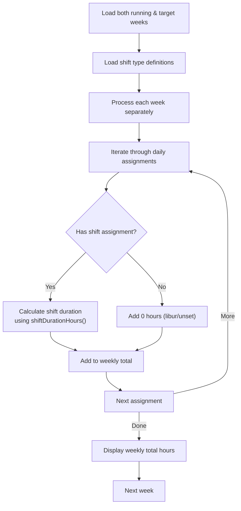
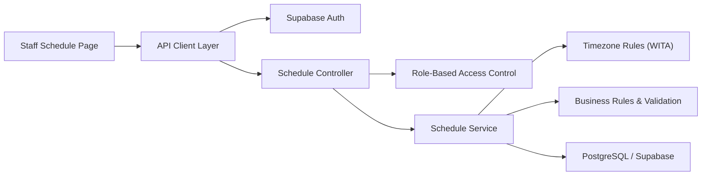

# Staff Interface Module (F7)

<cite>
**Referenced Files in This Document**   
- [page.tsx](file://web/app/staff/schedule/page.tsx)
- [schedule.module.css](file://web/app/staff/schedule/schedule.module.css)
- [api.ts](file://web/lib/api.ts)
- [request-labels.ts](file://web/lib/request-labels.ts)
- [share.ts](file://web/lib/share.ts)
- [schedule.controller.ts](file://api/src/schedule/schedule.controller.ts)
- [schedule.service.ts](file://api/src/schedule/schedule.service.ts)
- [work-hours.ts](file://api/src/schedule/work-hours.ts)
- [schedule.ts](file://packages/types/src/schedule.ts)
</cite>

## Update Summary
**Changes Made**   
- Updated personal schedule viewing interface to reflect actual implementation showing both running and target weeks
- Added detailed shift information display with kitchen closing notices for middle shifts
- Documented weekly hours calculation system with proper business logic
- Enhanced error handling documentation covering API failures, empty states, and loading conditions
- Updated architecture diagrams to reflect actual component interactions
- Added comprehensive acceptance criteria based on implemented features

## Table of Contents
1. [Introduction](#introduction)
2. [Project Structure](#project-structure)
3. [Core Components](#core-components)
4. [Architecture Overview](#architecture-overview)
5. [Detailed Component Analysis](#detailed-component-analysis)
6. [Dependency Analysis](#dependency-analysis)
7. [Performance Considerations](#performance-considerations)
8. [Troubleshooting Guide](#troubleshooting-guide)
9. [Conclusion](#conclusion)

## Introduction
This document specifies the functional requirements, user experience, and business logic for the Staff Interface module (F7). The module is a mobile-first Next.js application that lets staff view their own weekly schedule across both the running week and target week, understand kitchen section responsibilities through middle-kitchen indicators, and see total working hours per week. It also documents offline capability expectations, push notification behavior, and integration points with personal calendar systems as outlined by the product requirements.

The project implements a complete staff schedule viewing interface with robust error handling, displaying both the current running week and the upcoming target week with detailed shift information and kitchen closing notices.

**Section sources**
- [page.tsx:23-64](file://web/app/staff/schedule/page.tsx#L23-L64)
- [schedule.service.ts:168-230](file://api/src/schedule/schedule.service.ts#L168-L230)

## Project Structure
The repository contains a fully implemented staff interface with Next.js frontend and NestJS backend. The staff schedule page serves as both the main interface and the WhatsApp share link destination.

**Diagram sources**
- [page.tsx:1-18](file://web/app/staff/schedule/page.tsx#L1-L18)
- [schedule.controller.ts:73-85](file://api/src/schedule/schedule.controller.ts#L73-L85)
- [schedule.service.ts:168-230](file://api/src/schedule/schedule.service.ts#L168-L230)

**Section sources**
- [page.tsx:1-18](file://web/app/staff/schedule/page.tsx#L1-L18)
- [schedule.controller.ts:73-85](file://api/src/schedule/schedule.controller.ts#L73-L85)

## Core Components
The Staff Interface module (F7) provides:

- **Dual-week display**: Shows both the running week (current) and target week (upcoming)
- **Detailed shift information**: Displays shift type, start/end times, and special notes
- **Middle kitchen indicators**: Shows kitchen closure periods for middle shifts
- **Weekly hours totals**: Calculates and displays total working hours per week
- **Mobile-first responsive design**: Optimized for Android and iPhone browsers
- **Robust error handling**: Handles API failures, empty schedules, and loading states
- **Privacy enforcement**: Staff can only see their own schedule data

Key behaviors defined by the implementation include:

- Display both published running week and target week
- Show detailed shift information with time formatting
- Apply middle kitchen indicator logic with closure notices
- Calculate total weekly hours from shift definitions
- Handle errors gracefully with user-friendly messages
- Maintain mobile-first layout and accessibility standards

**Section sources**
- [page.tsx:65-102](file://web/app/staff/schedule/page.tsx#L65-L102)
- [schedule.service.ts:168-230](file://api/src/schedule/schedule.service.ts#L168-L230)
- [request-labels.ts:97-102](file://web/lib/request-labels.ts#L97-L102)

## Architecture Overview
The staff interface interacts with the backend through authenticated API calls. The server-side Next.js component fetches schedule data and renders it directly, ensuring privacy and security. Business rules such as shift types, coverage validation, and middle kitchen assignment are handled by the backend service layer.

**Diagram sources**
- [page.tsx:65-102](file://web/app/staff/schedule/page.tsx#L65-L102)
- [schedule.controller.ts:73-85](file://api/src/schedule/schedule.controller.ts#L73-L85)
- [schedule.service.ts:168-230](file://api/src/schedule/schedule.service.ts#L168-L230)

## Detailed Component Analysis

### Personal Schedule Viewing Interface
The staff interface displays two weeks at a time: the running week (current) and the target week (upcoming), focusing on the employee's personal assignments. Each week shows seven days with detailed shift information.

**Updated** The interface now displays both running and target weeks with comprehensive error handling and detailed shift information.

Responsibilities:

- Fetch both running and target weeks from the API
- Render detailed shift information including times and special notices
- Apply middle kitchen indicator logic with closure notices
- Calculate and display total weekly hours
- Handle loading states, empty schedules, and API errors gracefully
- Maintain mobile-first layout optimized for small screens

Acceptance criteria:

- A logged-in staff member sees both the running week and target week
- Days without a shift show appropriate status ("Belum diatur" or "Libur")
- Shifts display correct start and end times formatted for Indonesian locale
- Middle kitchen days show the specified kitchen closure notice
- Total weekly hours are calculated and displayed for each week
- Error states handle network failures, authentication issues, and empty data
- The interface works on Android and iPhone browsers

**Diagram sources**
- [page.tsx:65-102](file://web/app/staff/schedule/page.tsx#L65-L102)
- [page.tsx:39-56](file://web/app/staff/schedule/page.tsx#L39-L56)

**Section sources**
- [page.tsx:65-102](file://web/app/staff/schedule/page.tsx#L65-L102)
- [page.tsx:39-56](file://web/app/staff/schedule/page.tsx#L39-L56)

### Middle Kitchen Indicators
Middle kitchen is a kitchen-only shift used when the other kitchen colleague is off. On those days, the kitchen closes during two periods:

- 07:30–11:00
- 19:00–23:00

The staff interface clearly indicates these closures so staff understand service limitations on middle days.

Business rules:

- Middle applies only to kitchen staff
- Middle occurs when the other kitchen employee is off
- Middle replaces conflicting kitchen shift requests on that day
- Coverage rules require at least one kitchen person or middle per shift on weekdays, and at least one kitchen person per shift on weekends

**Diagram sources**
- [request-labels.ts:97-102](file://web/lib/request-labels.ts#L97-L102)
- [schedule.service.ts:393-402](file://api/src/schedule/schedule.service.ts#L393-L402)

**Section sources**
- [request-labels.ts:97-102](file://web/lib/request-labels.ts#L97-L102)
- [schedule.service.ts:393-402](file://api/src/schedule/schedule.service.ts#L393-L402)

### Working Hours Calculation System
Working hours are derived from shift definitions rather than stored directly. The system uses shift type records to calculate start and end times, then computes total weekly hours per employee.

**Updated** The calculation system now processes both running and target weeks, providing accurate hourly totals for each week displayed.

Shift definitions:

- Morning (PAGI): 07:30–15:30
- Afternoon (SORE): 15:00–23:00
- Middle (MIDDLE): 11:00–19:00, kitchen only

Overlap rule:

- Morning and afternoon overlap by 30 minutes for handover

Calculation logic:

- For each assigned shift, compute duration from start and end times using `shiftDurationHours`
- Sum durations across all days in each week separately
- Display the weekly total to the staff member for both running and target weeks
- Libur days contribute zero hours to the total

Compliance considerations:

- The MVP tracks total working hours but does not implement payroll or attendance
- Labor regulation compliance checks are outside MVP scope, but the calculation foundation supports future compliance features
- Gross duration calculation without break deductions aligns with PRD requirements

**Diagram sources**
- [schedule.service.ts:196-227](file://api/src/schedule/schedule.service.ts#L196-L227)
- [work-hours.ts:12-14](file://api/src/schedule/work-hours.ts#L12-L14)

**Section sources**
- [schedule.service.ts:196-227](file://api/src/schedule/schedule.service.ts#L196-L227)
- [work-hours.ts:12-14](file://api/src/schedule/work-hours.ts#L12-L14)

### Error Handling System
The interface implements comprehensive error handling for various failure scenarios:

**Updated** Enhanced error handling covers API connectivity issues, authentication problems, empty schedules, and server errors with user-friendly messages.

Error categories:

- **Network failures**: "Tidak bisa menghubungi server. Coba lagi."
- **Authentication errors**: "Sesi login hilang. Masuk lagi."
- **Permission errors**: "Halaman ini khusus manager."
- **Server errors**: "Terjadi kesalahan di server."
- **Empty schedule**: "Belum ada jadwal yang dipublish. Cek lagi setelah manager membagikan jadwal."
- **Loading state**: Graceful loading with dynamic rendering

User experience:

- Errors are displayed in styled alert boxes with appropriate styling
- Empty states provide clear guidance about next steps
- Loading states prevent partial or incomplete data display
- All error messages are localized in Indonesian

**Section sources**
- [page.tsx:69-76](file://web/app/staff/schedule/page.tsx#L69-L76)
- [page.tsx:88-96](file://web/app/staff/schedule/page.tsx#L88-L96)
- [api.ts:60-86](file://web/lib/api.ts#L60-L86)

### User Stories for Staff Daily Interactions
- As a staff member, I want to open the schedule link and immediately see both my current and upcoming weekly schedules after logging in.
- As a staff member, I want to understand which days I work morning, afternoon, or middle kitchen with specific time details.
- As a kitchen staff member, I want to see clear indicators when the kitchen is closed during middle shifts with exact closure times.
- As a staff member, I want to see my total working hours for both the current and upcoming weeks so I can track my workload.
- As a staff member using an iPhone or Android phone, I want the schedule to be easy to read and interact with on a small screen.
- As a staff member, I want to receive helpful error messages if the schedule cannot be loaded or if there are no published schedules.

Acceptance criteria:

- Login redirects work reliably from WhatsApp links where possible
- Only the authenticated employee's schedule is visible across both weeks
- Middle kitchen days show the exact closure periods (07.30–11.00 & 19.00–23.00)
- Weekly hours are accurate based on shift definitions for both running and target weeks
- The interface handles errors gracefully with clear user feedback
- The interface is usable on mobile devices and supports PWA installation

**Section sources**
- [page.tsx:65-102](file://web/app/staff/schedule/page.tsx#L65-L102)
- [request-labels.ts:97-102](file://web/lib/request-labels.ts#L97-L102)

### Acceptance Criteria for Responsiveness and Accessibility
Responsiveness:

- Primary layout targets mobile screens with max-width 760px
- Text, buttons, and schedule cards remain readable on small viewports
- Touch targets are large enough for finger interaction
- Layout adapts gracefully to different screen sizes
- Two weeks display efficiently on single screen without scrolling overflow

Accessibility:

- Color choices do not convey meaning alone; indicators include text descriptions
- Screen readers can announce shift types and middle kitchen indicators
- Contrast meets basic readability standards with proper color usage
- Keyboard navigation remains usable where applicable
- Semantic HTML structure with proper heading hierarchy
- ARIA labels for week sections improve screen reader experience

**Section sources**
- [schedule.module.css:1-141](file://web/app/staff/schedule/schedule.module.css#L1-L141)
- [page.tsx:112-140](file://web/app/staff/schedule/page.tsx#L112-L140)

### Offline Capability Features
The application uses Next.js server components for schedule rendering, which means the schedule data is fetched server-side before being sent to the client. While explicit offline behavior is not detailed in the MVP scope, the architecture enables potential caching strategies.

Recommended behavior:

- Server-side rendering ensures initial load works without client-side JavaScript
- Static assets can be cached via Next.js built-in caching mechanisms
- Schedule data is fetched fresh on every visit due to `dynamic = 'force-dynamic'`
- No client-side schedule caching is implemented in the current version
- Network errors are handled gracefully with user feedback

**Section sources**
- [page.tsx:23-25](file://web/app/staff/schedule/page.tsx#L23-L25)
- [api.ts:51-58](file://web/lib/api.ts#L51-L58)

### Push Notifications for Schedule Changes
The MVP does not include push notifications. Communication relies on:

- Publishing the schedule through the manager interface
- Sharing a link via WhatsApp with schedule information
- In-app status updates when users revisit the schedule page
- Fresh data loading on every visit to ensure latest schedule information

Future enhancements may add push notifications, but they are out of scope for the current MVP.

**Section sources**
- [page.tsx:83-86](file://web/app/staff/schedule/page.tsx#L83-L86)
- [share.ts:50-66](file://web/lib/share.ts#L50-L66)

### Integration with Personal Calendar Systems
The current MVP does not define direct integration with personal calendar systems. However, the data model stores dates and times, which could support future export or calendar import features.

Current approach:

- Provide a shareable link as the primary distribution method
- Include schedule period information in WhatsApp messages
- Support future export options such as image or spreadsheet generation
- Calendar file generation could be added in later phases if requested

**Section sources**
- [share.ts:50-77](file://web/lib/share.ts#L50-L77)
- [schedule.ts:139-146](file://packages/types/src/schedule.ts#L139-L146)

## Dependency Analysis
The staff interface depends on several cross-cutting concerns defined in the implementation:

- Authentication via Supabase with email whitelist enforcement
- Role-based access control ensuring staff cannot view other employees' schedules
- Timezone handling using WITA for deadlines and shift times
- Data integrity through server-side validation and privacy controls
- Mobile-first CSS architecture with semantic class naming

**Diagram sources**
- [page.tsx:1-18](file://web/app/staff/schedule/page.tsx#L1-L18)
- [schedule.controller.ts:73-85](file://api/src/schedule/schedule.controller.ts#L73-L85)
- [schedule.service.ts:168-230](file://api/src/schedule/schedule.service.ts#L168-L230)

**Section sources**
- [page.tsx:1-18](file://web/app/staff/schedule/page.tsx#L1-L18)
- [schedule.controller.ts:73-85](file://api/src/schedule/schedule.controller.ts#L73-L85)

## Performance Considerations
- Server-side rendering eliminates client-side JavaScript overhead for initial load
- Dynamic rendering ensures fresh schedule data on every visit
- Efficient data fetching for personal schedule endpoints with minimal payload
- Server-side computation for total hours and middle kitchen indicators reduces client complexity
- CSS modules provide scoped styles without global namespace pollution
- Mobile-first design optimizes for smaller screen performance
- No client-side caching ensures data freshness at the cost of repeated network requests

## Troubleshooting Guide
Common issues and resolutions:

- **Login fails from WhatsApp link**:
  - Verify redirect-based Supabase login flow
  - Test on both Android and iPhone browsers
  - If blocked in in-app browser, instruct users to open in Chrome or Safari or use the installed PWA
- **Schedule not visible**:
  - Confirm the schedule has been published by the manager
  - Confirm the user is authenticated and authorized as staff
  - Check timezone settings for deadline and shift calculations
- **Incorrect middle kitchen indicator**:
  - Verify kitchen colleague off-day logic
  - Confirm middle shift assignment rules
  - Ensure coverage validation did not override assignments unexpectedly
- **Wrong weekly hours**:
  - Verify shift type definitions in the database
  - Confirm overlap handling between morning and afternoon shifts
  - Check timezone consistency across the system
- **API connection errors**:
  - Verify API_URL environment variable is set correctly
  - Check network connectivity to the backend server
  - Review server logs for authentication or authorization failures
- **Empty schedule display**:
  - Confirm manager has published at least one week
  - Verify the employee has valid shift assignments
  - Check that the employee is active in the system

**Section sources**
- [page.tsx:69-76](file://web/app/staff/schedule/page.tsx#L69-L76)
- [api.ts:37-40](file://web/lib/api.ts#L37-L40)
- [schedule.service.ts:168-179](file://api/src/schedule/schedule.service.ts#L168-L179)

## Conclusion
The Staff Interface module (F7) delivers a comprehensive, mobile-first experience for staff to view their personal weekly schedule across both the running and target weeks, understand middle kitchen responsibilities with detailed closure notices, and track weekly working hours. The implementation prioritizes clarity, privacy, reliability, and robust error handling over advanced features like push notifications and calendar integrations.

The design successfully addresses the core requirements: dual-week display, detailed shift information, middle kitchen indicators, weekly hours calculation, and comprehensive error handling. The server-side rendering approach ensures security and performance while maintaining simplicity. Future iterations can extend offline capabilities, notifications, and calendar exports while preserving the core principles of mobile usability, data security, and user-friendly error handling.