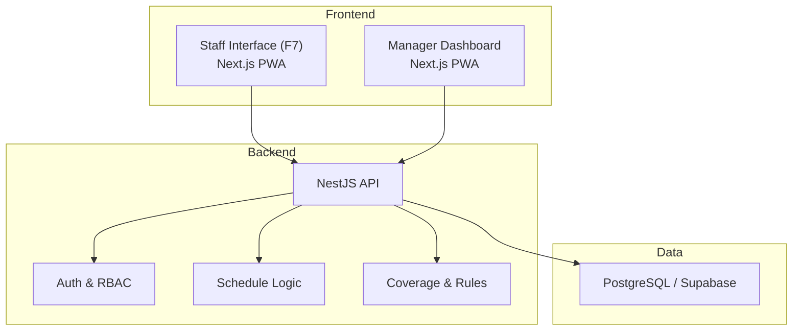
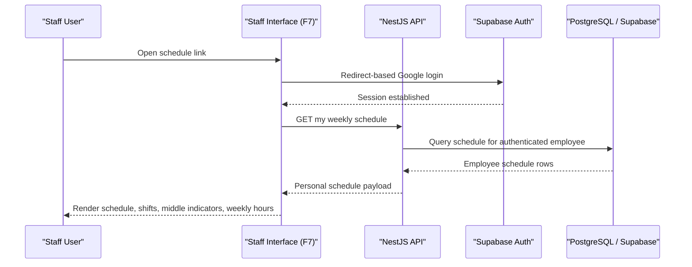
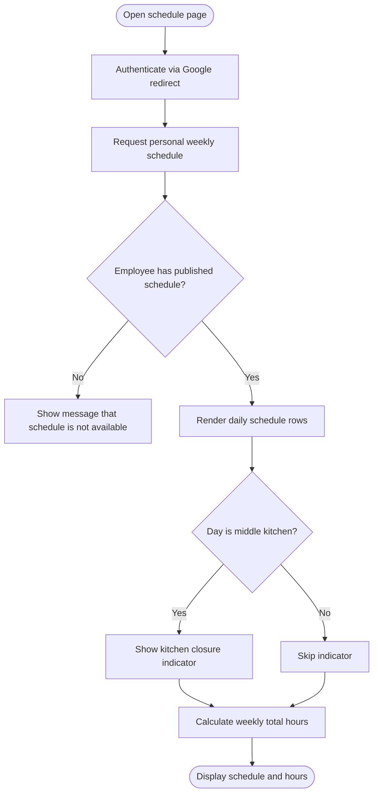
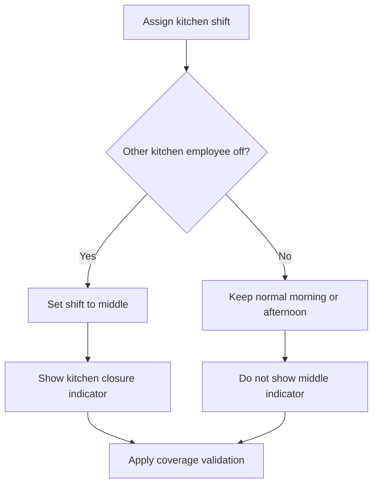
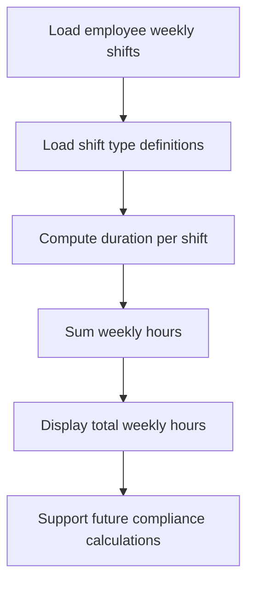
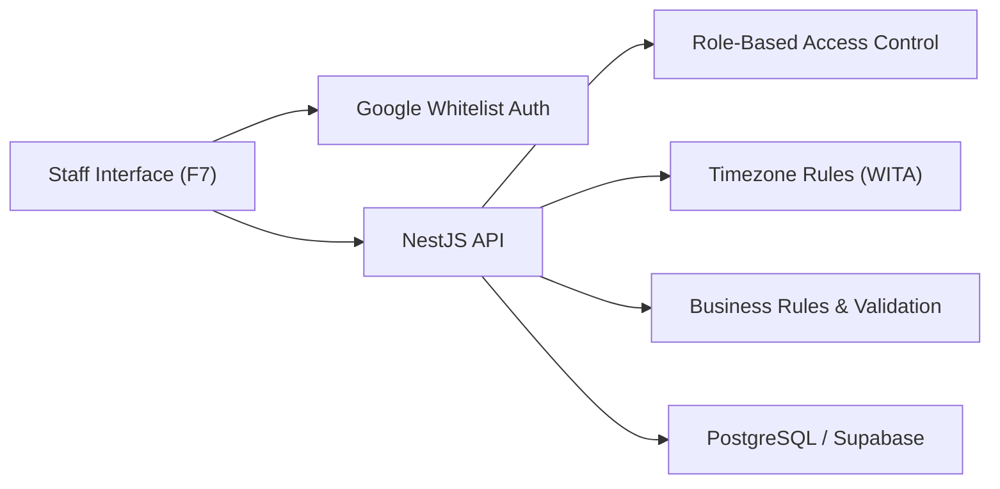

# Staff Interface Module (F7)

<cite>
**Referenced Files in This Document**   
- [README.md](file://README.md)
- [PRD-Aplikasi-Penjadwalan-Shift-Kyne.md](file://docs/PRD-Aplikasi-Penjadwalan-Shift-Kyne.md)
</cite>

## Table of Contents
1. [Introduction](#introduction)
2. [Project Structure](#project-structure)
3. [Core Components](#core-components)
4. [Architecture Overview](#architecture-overview)
5. [Detailed Component Analysis](#detailed-component-analysis)
6. [Dependency Analysis](#dependency-analysis)
7. [Performance Considerations](#performance-considerations)
8. [Troubleshooting Guide](#troubleshooting-guide)
9. [Conclusion](#conclusion)

## Introduction
This document specifies the functional requirements, user experience, and business logic for the Staff Interface module (F7). The module is a mobile-first Progressive Web Application that lets staff view their own weekly schedule, understand kitchen section responsibilities through middle-kitchen indicators, and see total working hours per week. It also documents offline capability expectations, push notification behavior, and integration points with personal calendar systems as outlined by the product requirements.

The project is currently an early scaffold without implementation code; therefore, this specification focuses on behavior, rules, acceptance criteria, and integration design rather than source-level details.

**Section sources**
- [README.md:1-25](file://README.md#L1-L25)
- [PRD-Aplikasi-Penjadwalan-Shift-Kyne.md:1-20](file://docs/PRD-Aplikasi-Penjadwalan-Shift-Kyne.md#L1-L20)

## Project Structure
At this stage, the repository contains only documentation and a minimal README. The actual application modules are not yet implemented. The PRD describes the intended stack and layering:

- Frontend: Next.js PWA for staff interface and manager dashboard
- Backend: NestJS API handling authentication, requests, scheduling, publishing, and validation
- Database: PostgreSQL via Supabase with Prisma schema
- Authentication: Supabase Auth with Google login and JWT verification in NestJS

**Diagram sources**
- [PRD-Aplikasi-Penjadwalan-Shift-Kyne.md:230-249](file://docs/PRD-Aplikasi-Penjadwalan-Shift-Kyne.md#L230-L249)

**Section sources**
- [PRD-Aplikasi-Penjadwalan-Shift-Kyne.md:230-249](file://docs/PRD-Aplikasi-Penjadwalan-Shift-Kyne.md#L230-L249)

## Core Components
The Staff Interface module (F7) provides:

- Personal weekly schedule view
- Shift labels including morning, afternoon, and middle kitchen
- Middle kitchen indicators showing kitchen closure periods
- Weekly total working hours summary
- Mobile-first responsive layout optimized for Android and iPhone
- Privacy enforcement so staff can only see their own schedule

Key behaviors defined by the product requirements include:

- Display only the current employee’s schedule: day, shift, and hours
- Show middle kitchen indicator text when applicable
- Show total weekly working hours

These behaviors must be enforced server-side to prevent data leakage, even if the client attempts to access other employees’ schedules.

**Section sources**
- [PRD-Aplikasi-Penjadwalan-Shift-Kyne.md:157-164](file://docs/PRD-Aplikasi-Penjadwalan-Shift-Kyne.md#L157-L164)
- [PRD-Aplikasi-Penjadwalan-Shift-Kyne.md:220-228](file://docs/PRD-Aplikasi-Penjadwalan-Shift-Kyne.md#L220-L228)

## Architecture Overview
The staff interface interacts with the backend through authenticated API calls. The frontend renders the schedule based on the authenticated employee context. Business rules such as shift types, coverage validation, and middle kitchen assignment are handled by the backend.

**Diagram sources**
- [PRD-Aplikasi-Penjadwalan-Shift-Kyne.md:220-249](file://docs/PRD-Aplikasi-Penjadwalan-Shift-Kyne.md#L220-L249)
- [PRD-Aplikasi-Penjadwalan-Shift-Kyne.md:157-164](file://docs/PRD-Aplikasi-Penjadwalan-Shift-Kyne.md#L157-L164)

## Detailed Component Analysis

### Personal Schedule Viewing Interface
The staff interface displays one week at a time, focusing on the current week after publish. Each row represents a day and shows:

- Day name or date
- Assigned shift type: morning, afternoon, or middle
- Working hours derived from shift definitions
- Middle kitchen indicator when applicable

Responsibilities:

- Fetch only the authenticated employee’s schedule
- Render shifts according to shift type definitions
- Apply middle kitchen indicator logic
- Summarize total weekly hours
- Maintain mobile-first layout and accessibility

Acceptance criteria:

- A logged-in staff member sees only their own schedule
- Days without a shift are shown as off days
- Morning and afternoon shifts display correct start and end times
- Middle kitchen days show the specified kitchen closure notice
- Total weekly hours are calculated and displayed
- The interface works on Android and iPhone browsers and can be installed as a PWA

**Diagram sources**
- [PRD-Aplikasi-Penjadwalan-Shift-Kyne.md:157-164](file://docs/PRD-Aplikasi-Penjadwalan-Shift-Kyne.md#L157-L164)
- [PRD-Aplikasi-Penjadwalan-Shift-Kyne.md:169-177](file://docs/PRD-Aplikasi-Penjadwalan-Shift-Kyne.md#L169-L177)

**Section sources**
- [PRD-Aplikasi-Penjadwalan-Shift-Kyne.md:157-164](file://docs/PRD-Aplikasi-Penjadwalan-Shift-Kyne.md#L157-L164)
- [PRD-Aplikasi-Penjadwalan-Shift-Kyne.md:169-177](file://docs/PRD-Aplikasi-Penjadwalan-Shift-Kyne.md#L169-L177)

### Middle Kitchen Indicators
Middle kitchen is a kitchen-only shift used when the other kitchen colleague is off. On those days, the kitchen closes during two periods:

- 07:30–11:00
- 19:00–23:00

The staff interface must clearly indicate these closures so staff understand service limitations on middle days.

Business rules:

- Middle applies only to kitchen staff
- Middle occurs when the other kitchen employee is off
- Middle replaces conflicting kitchen shift requests on that day
- Coverage rules require at least one kitchen person or middle per shift on weekdays, and at least one kitchen person per shift on weekends

**Diagram sources**
- [PRD-Aplikasi-Penjadwalan-Shift-Kyne.md:86-89](file://docs/PRD-Aplikasi-Penjadwalan-Shift-Kyne.md#L86-L89)
- [PRD-Aplikasi-Penjadwalan-Shift-Kyne.md:169-195](file://docs/PRD-Aplikasi-Penjadwalan-Shift-Kyne.md#L169-L195)

**Section sources**
- [PRD-Aplikasi-Penjadwalan-Shift-Kyne.md:86-89](file://docs/PRD-Aplikasi-Penjadwalan-Shift-Kyne.md#L86-L89)
- [PRD-Aplikasi-Penjadwalan-Shift-Kyne.md:169-195](file://docs/PRD-Aplikasi-Penjadwalan-Shift-Kyne.md#L169-L195)

### Working Hours Calculation System
Working hours are derived from shift definitions rather than stored directly. The system uses shift type records to calculate start and end times, then computes total weekly hours per employee.

Shift definitions:

- Morning: 07:30–15:30
- Afternoon: 15:00–23:00
- Middle: 11:00–19:00, kitchen only

Overlap rule:

- Morning and afternoon overlap by 30 minutes for handover

Calculation logic:

- For each assigned shift, compute duration from start and end times
- Sum durations across all days in the week
- Display the weekly total to the staff member

Compliance considerations:

- The MVP tracks total working hours but does not implement payroll or attendance
- Labor regulation compliance checks are outside MVP scope, but the calculation foundation should support future compliance features

**Diagram sources**
- [PRD-Aplikasi-Penjadwalan-Shift-Kyne.md:169-177](file://docs/PRD-Aplikasi-Penjadwalan-Shift-Kyne.md#L169-L177)
- [PRD-Aplikasi-Penjadwalan-Shift-Kyne.md:197-217](file://docs/PRD-Aplikasi-Penjadwalan-Shift-Kyne.md#L197-L217)

**Section sources**
- [PRD-Aplikasi-Penjadwalan-Shift-Kyne.md:169-177](file://docs/PRD-Aplikasi-Penjadwalan-Shift-Kyne.md#L169-L177)
- [PRD-Aplikasi-Penjadwalan-Shift-Kyne.md:197-217](file://docs/PRD-Aplikasi-Penjadwalan-Shift-Kyne.md#L197-L217)

### User Stories for Staff Daily Interactions
- As a staff member, I want to open the schedule link and immediately see my own weekly schedule after logging in.
- As a staff member, I want to understand which days I work morning, afternoon, or middle kitchen.
- As a kitchen staff member, I want to see clear indicators when the kitchen is closed during middle shifts.
- As a staff member, I want to see my total working hours for the week so I can track my workload.
- As a staff member using an iPhone or Android phone, I want the schedule to be easy to read and interact with on a small screen.

Acceptance criteria:

- Login redirects work reliably from WhatsApp links where possible
- Only the authenticated employee’s schedule is visible
- Middle kitchen days show the exact closure periods
- Weekly hours are accurate based on shift definitions
- The interface is usable on mobile devices and supports PWA installation

**Section sources**
- [PRD-Aplikasi-Penjadwalan-Shift-Kyne.md:157-164](file://docs/PRD-Aplikasi-Penjadwalan-Shift-Kyne.md#L157-L164)
- [PRD-Aplikasi-Penjadwalan-Shift-Kyne.md:220-228](file://docs/PRD-Aplikasi-Penjadwalan-Shift-Kyne.md#L220-L228)

### Acceptance Criteria for Responsiveness and Accessibility
Responsiveness:

- Primary layout targets mobile screens
- Text, buttons, and schedule cards remain readable on small viewports
- Touch targets are large enough for finger interaction
- Layout adapts gracefully to different screen sizes

Accessibility:

- Color choices do not convey meaning alone; indicators include text
- Screen readers can announce shift types and middle kitchen indicators
- Contrast meets basic readability standards
- Keyboard navigation remains usable where applicable

**Section sources**
- [PRD-Aplikasi-Penjadwalan-Shift-Kyne.md:220-228](file://docs/PRD-Aplikasi-Penjadwalan-Shift-Kyne.md#L220-L228)

### Offline Capability Features
The PRD defines the app as a PWA and emphasizes mobile-first usage. While explicit offline behavior is not detailed in the MVP scope, PWA architecture enables caching strategies for static assets and potentially cached schedule data. Recommended behavior:

- Cache essential UI assets for faster loading
- Optionally cache the last fetched personal schedule for offline viewing
- Clearly indicate when data is stale or unavailable offline
- Prevent offline edits to schedules since schedule changes are managed by the manager

**Section sources**
- [PRD-Aplikasi-Penjadwalan-Shift-Kyne.md:220-228](file://docs/PRD-Aplikasi-Penjadwalan-Shift-Kyne.md#L220-L228)

### Push Notifications for Schedule Changes
The PRD explicitly states that the MVP does not include push notifications. Communication relies on:

- Publishing the schedule
- Sharing a link via WhatsApp
- In-app status updates

Future enhancements may add push notifications, but they are out of scope for the current MVP.

**Section sources**
- [PRD-Aplikasi-Penjadwalan-Shift-Kyne.md:60-63](file://docs/PRD-Aplikasi-Penjadwalan-Shift-Kyne.md#L60-L63)
- [PRD-Aplikasi-Penjadwalan-Shift-Kyne.md:227-228](file://docs/PRD-Aplikasi-Penjadwalan-Shift-Kyne.md#L227-L228)

### Integration with Personal Calendar Systems
The current MVP does not define direct integration with personal calendar systems. However, the data model stores dates and times, which could support future export or calendar import features. Recommended approach:

- Provide a shareable link as the primary distribution method
- Allow future export options such as image or spreadsheet
- Support calendar file generation if requested in later phases

**Section sources**
- [PRD-Aplikasi-Penjadwalan-Shift-Kyne.md:149-155](file://docs/PRD-Aplikasi-Penjadwalan-Shift-Kyne.md#L149-L155)
- [PRD-Aplikasi-Penjadwalan-Shift-Kyne.md:65-66](file://docs/PRD-Aplikasi-Penjadwalan-Shift-Kyne.md#L65-L66)
- [PRD-Aplikasi-Penjadwalan-Shift-Kyne.md:197-217](file://docs/PRD-Aplikasi-Penjadwalan-Shift-Kyne.md#L197-L217)

## Dependency Analysis
The staff interface depends on several cross-cutting concerns defined in the PRD:

- Authentication via Google with email whitelist enforcement
- Role-based access control ensuring staff cannot view other employees’ schedules
- Timezone handling using WITA for deadlines and shift times
- Data integrity through server-side validation and privacy controls

**Diagram sources**
- [PRD-Aplikasi-Penjadwalan-Shift-Kyne.md:220-249](file://docs/PRD-Aplikasi-Penjadwalan-Shift-Kyne.md#L220-L249)

**Section sources**
- [PRD-Aplikasi-Penjadwalan-Shift-Kyne.md:220-249](file://docs/PRD-Aplikasi-Penjadwalan-Shift-Kyne.md#L220-L249)

## Performance Considerations
- Keep the initial load lightweight for mobile networks
- Avoid unnecessary re-renders of the weekly schedule
- Use efficient data fetching for personal schedule endpoints
- Prefer server-side computation for total hours and middle kitchen indicators to reduce client complexity
- Ensure PWA asset caching improves repeat visits without compromising freshness of schedule data

[No sources needed since this section provides general guidance]

## Troubleshooting Guide
Common issues and resolutions:

- Login fails from WhatsApp link:
  - Verify redirect-based Google login flow
  - Test on both Android and iPhone
  - If blocked in in-app browser, instruct users to open in Chrome or Safari or use the installed PWA
- Schedule not visible:
  - Confirm the schedule has been published
  - Confirm the user is authenticated and authorized
  - Check timezone settings for deadline and shift calculations
- Incorrect middle kitchen indicator:
  - Verify kitchen colleague off-day logic
  - Confirm middle shift assignment rules
  - Ensure coverage validation did not override assignments unexpectedly
- Wrong weekly hours:
  - Verify shift type definitions
  - Confirm overlap handling between morning and afternoon shifts
  - Check timezone consistency

**Section sources**
- [PRD-Aplikasi-Penjadwalan-Shift-Kyne.md:220-228](file://docs/PRD-Aplikasi-Penjadwalan-Shift-Kyne.md#L220-L228)
- [PRD-Aplikasi-Penjadwalan-Shift-Kyne.md:169-195](file://docs/PRD-Aplikasi-Penjadwalan-Shift-Kyne.md#L169-L195)

## Conclusion
The Staff Interface module (F7) delivers a focused, mobile-first experience for staff to view their personal weekly schedule, understand middle kitchen responsibilities, and track weekly working hours. The MVP prioritizes clarity, privacy, and reliability over advanced features like push notifications and calendar integrations. The design aligns with the broader PRD goals: simple request flows, manager-driven scheduling, automated middle kitchen logic, and strong server-side validation. Future iterations can extend offline capabilities, notifications, and calendar exports while preserving the core principles of mobile usability and data security.

[No sources needed since this section summarizes without analyzing specific files]