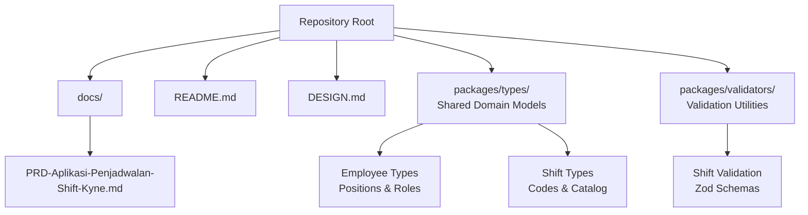
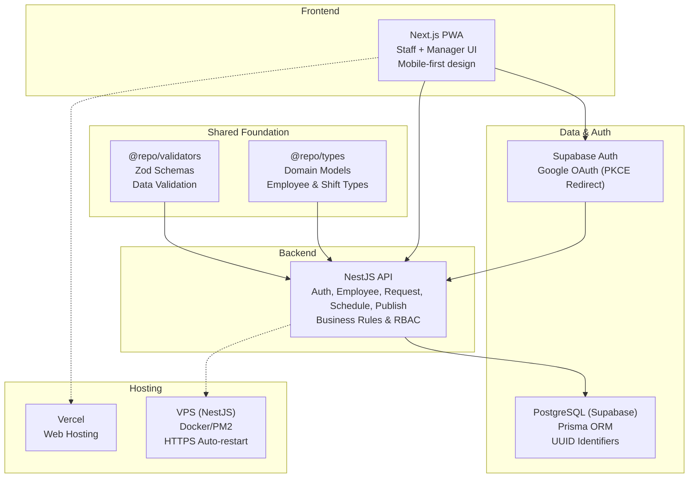
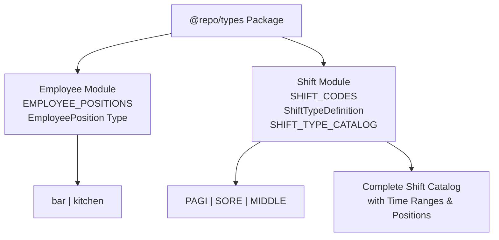
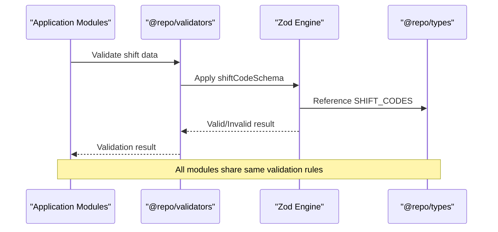
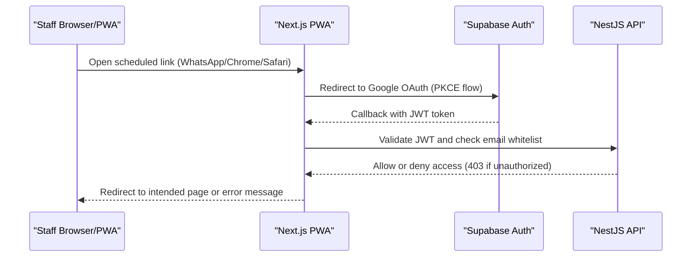
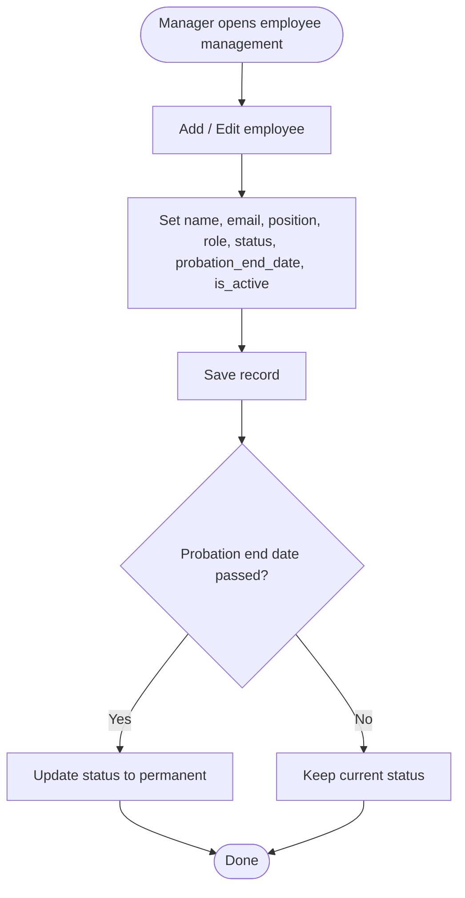
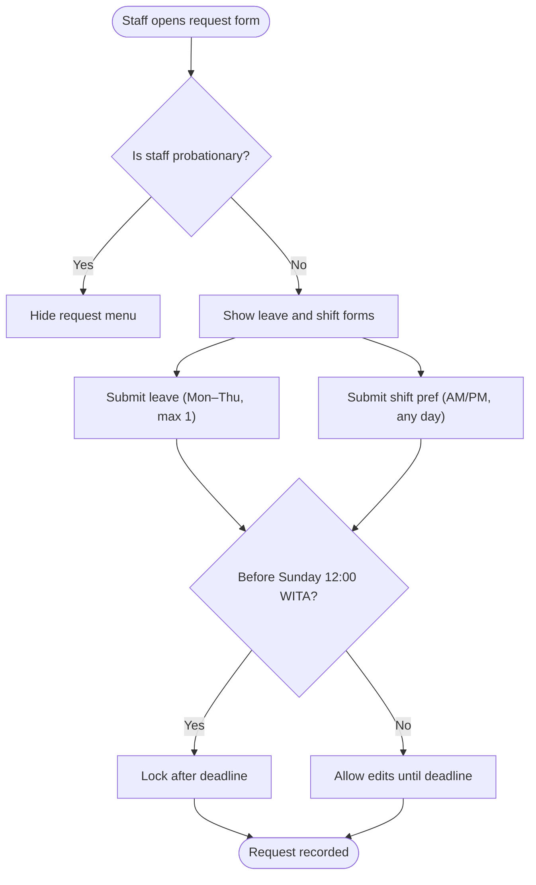
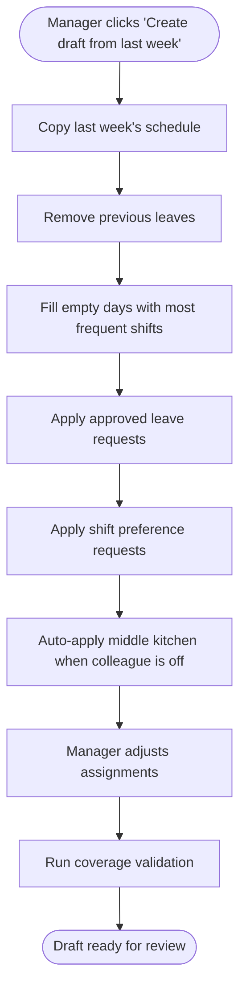
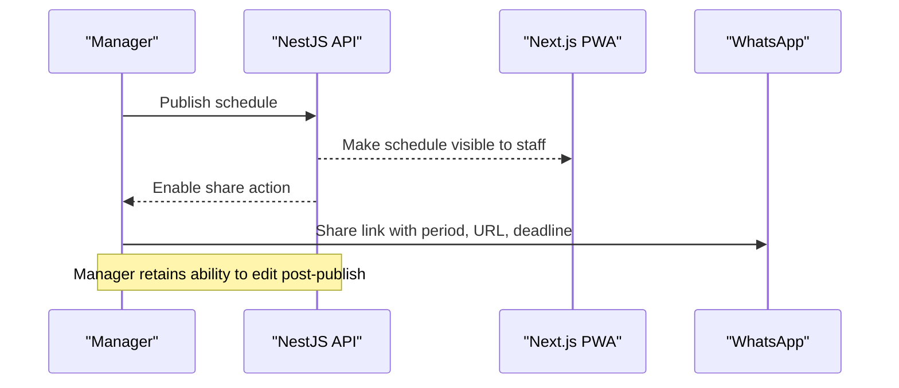
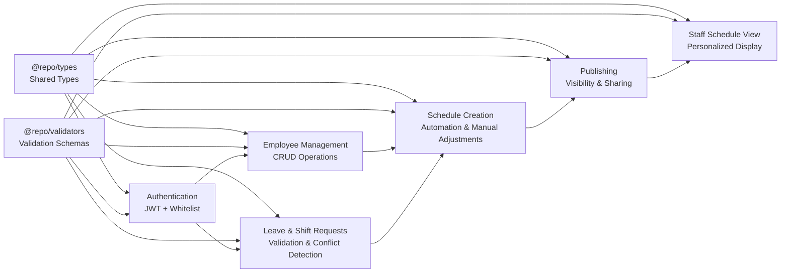

# Product Requirements Document

<cite>
**Referenced Files in This Document**
- [PRD-Aplikasi-Penjadwalan-Shift-Kyne.md](file://docs/PRD-Aplikasi-Penjadwalan-Shift-Kyne.md)
- [README.md](file://README.md)
- [DESIGN.md](file://DESIGN.md)
- [employee.ts](file://packages/types/src/employee.ts)
- [shift.ts](file://packages/types/src/shift.ts)
- [index.ts](file://packages/types/src/index.ts)
- [shift.ts](file://packages/validators/src/shift.ts)
- [index.ts](file://packages/validators/src/index.ts)
- [shift.spec.ts](file://packages/types/src/shift.spec.ts)
- [employee.prisma](file://api/prisma/schema/employee.prisma)
- [shift_type.prisma](file://api/prisma/schema/shift_type.prisma)
</cite>

## Update Summary
**Changes Made**
- Enhanced business problem statement with specific operational challenges at Kyne café
- Expanded MVP scope with detailed functional requirements for all 7 modules
- Added comprehensive user roles and permissions system with probationary staff considerations
- Detailed functional requirements breakdown including authentication, employee management, request handling, schedule generation, and publishing workflow
- Updated success metrics, timeline milestones, and acceptance criteria based on comprehensive PRD specifications
- Added technical constraints and business rules governing scheduling logic
- Enhanced architecture overview with PWA-based system specifications
- **Updated**: Added foundation documentation for shared type definitions and validation utilities that establish the core data model for all functional modules (F1-F7)

## Table of Contents
1. [Introduction](#introduction)
2. [Project Structure](#project-structure)
3. [Core Components](#core-components)
4. [Architecture Overview](#architecture-overview)
5. [Shared Type Definitions Foundation](#shared-type-definitions-foundation)
6. [Detailed Component Analysis](#detailed-component-analysis)
7. [Dependency Analysis](#dependency-analysis)
8. [Performance Considerations](#performance-considerations)
9. [Troubleshooting Guide](#troubleshooting-guide)
10. [Conclusion](#conclusion)
11. [Appendices](#appendices)

## Introduction
This document defines the product requirements for the Kyne café shift scheduling application MVP. It captures the business problem, scope, user roles, functional modules, business rules, data model, technical constraints, success metrics, timeline milestones, and acceptance criteria. The goal is to replace manual, chat-based scheduling with a structured weekly process: staff submit leave and shift preference requests; the manager builds a draft schedule from the previous week; automated middle-kitchen logic applies; coverage validation runs; and the manager publishes the schedule for staff to view on mobile devices.

The repository now contains a solid foundation with shared type definitions and validation utilities that establish the core data model for all seven functional modules (F1-F7), ensuring consistency across the entire application stack.

**Section sources**
- [README.md:1-25](file://README.md#L1-L25)
- [PRD-Aplikasi-Penjadwalan-Shift-Kyne.md:1-20](file://docs/PRD-Aplikasi-Penjadwalan-Shift-Kyne.md#L1-L20)

## Project Structure
At this stage, the repository contains:
- A documentation folder with the comprehensive Kyne shift scheduling PRD detailing PWA-based specifications.
- A root README indicating that the repository is new and scaffolding has not yet been defined.
- Design specifications for Apple-inspired UI patterns (though not directly applicable to this project).
- **New**: Shared type definitions in `packages/types` establishing core domain models for employees and shifts.
- **New**: Validation utilities in `packages/validators` providing Zod schemas for data integrity across all modules.

**Diagram sources**
- [README.md:1-25](file://README.md#L1-L25)
- [PRD-Aplikasi-Penjadwalan-Shift-Kyne.md:1-10](file://docs/PRD-Aplikasi-Penjadwalan-Shift-Kyne.md#L1-L10)
- [employee.ts:1-4](file://packages/types/src/employee.ts#L1-L4)
- [shift.ts:1-41](file://packages/types/src/shift.ts#L1-L41)
- [shift.ts:1-22](file://packages/validators/src/shift.ts#L1-L22)

**Section sources**
- [README.md:1-25](file://README.md#L1-L25)

## Core Components
The MVP centers around seven functional modules designed as a PWA for mobile-first experience:
- Authentication via Google OAuth with email whitelist enforcement and PKCE redirect flow.
- Employee management (CRUD) for manager-only operations with probation tracking.
- Leave request handling (one day per week, Monday–Thursday only).
- Shift preference requests (morning or afternoon, any day, advisory basis).
- Manager dashboard showing all requests, conflicts, and missing requests with conflict detection.
- Weekly schedule creation engine with copy-from-last-week automation, middle-kitchen logic, and manual adjustments.
- Publishing workflow with WhatsApp sharing and staff-facing schedule views with total hours calculation.

Success metrics include publishing deadlines by Sunday 18:00 WITA, weekend coverage guarantees, and adoption of the app for all non-probationary staff requests.

**Section sources**
- [PRD-Aplikasi-Penjadwalan-Shift-Kyne.md:21-25](file://docs/PRD-Aplikasi-Penjadwalan-Shift-Kyne.md#L21-L25)
- [PRD-Aplikasi-Penjadwalan-Shift-Kyne.md:102-164](file://docs/PRD-Aplikasi-Penjadwalan-Shift-Kyne.md#L102-L164)

## Architecture Overview
The system follows a monorepo structure aligned with an ERP stack, designed as a PWA for mobile-first staff experience:
- Frontend: Next.js PWA for mobile-first staff experience and manager dashboard, installable on home screen.
- Backend: NestJS API implementing business rules, RBAC, and validations with Docker/PM2 deployment.
- Database: PostgreSQL via Supabase, accessed through Prisma ORM with UUID identifiers.
- Auth: Supabase Auth with Google OAuth using PKCE redirect flow.
- Hosting: Vercel for web, Supabase for database and auth, VPS for NestJS with HTTPS and auto-restart.

**Diagram sources**
- [PRD-Aplikasi-Penjadwalan-Shift-Kyne.md:230-241](file://docs/PRD-Aplikasi-Penjadwalan-Shift-Kyne.md#L230-L241)
- [index.ts:1-3](file://packages/types/src/index.ts#L1-L3)
- [index.ts:1-2](file://packages/validators/src/index.ts#L1-L2)

**Section sources**
- [PRD-Aplikasi-Penjadwalan-Shift-Kyne.md:230-249](file://docs/PRD-Aplikasi-Penjadwalan-Shift-Kyne.md#L230-L249)

## Shared Type Definitions Foundation

**Updated** The foundation for all functional modules (F1-F7) has been established through shared type definitions and validation utilities that ensure data consistency across the entire application.

### Core Domain Models
The `@repo/types` package provides the foundational domain models that all functional modules depend on:

#### Employee Types
- **EmployeePosition**: Strictly typed positions ('bar' | 'kitchen') ensuring data consistency across all modules.
- **EMPLOYEE_POSITIONS**: Constant array defining valid positions, used throughout the application for validation and UI rendering.

#### Shift Types
- **ShiftCode**: Enumerated shift codes ('PAGI' | 'SORE' | 'MIDDLE') representing the three shift types defined in the PRD.
- **ShiftTypeDefinition**: Interface defining the complete shift type specification including code, time ranges, and applicable positions.
- **SHIFT_TYPE_CATALOG**: Centralized catalog of all shift types with their exact specifications matching PRD requirements.

**Diagram sources**
- [employee.ts:1-4](file://packages/types/src/employee.ts#L1-L4)
- [shift.ts:1-41](file://packages/types/src/shift.ts#L1-L41)

### Validation Utilities
The `@repo/validators` package provides Zod-based validation schemas that enforce data integrity across all functional modules:

#### Validation Schemas
- **shiftCodeSchema**: Validates shift codes against the enumerated values.
- **employeePositionSchema**: Validates employee positions against allowed values.
- **localTimeSchema**: Validates local WITA wall-clock time format (HH:MM).
- **shiftTypeSeedSchema**: Complete schema for validating shift type seed data.

#### Data Integrity Guarantees
- All shift codes must match the PRD-defined set exactly.
- Employee positions are strictly constrained to bar/kitchen roles.
- Time formats are validated to ensure proper WITA timezone handling.
- Seed data validation ensures database consistency with type definitions.

**Diagram sources**
- [shift.ts:1-22](file://packages/validators/src/shift.ts#L1-L22)
- [shift.ts:1-41](file://packages/types/src/shift.ts#L1-L41)

### Test Coverage
The foundation includes comprehensive test coverage ensuring type safety and validation correctness:

#### Type Definition Tests
- Verifies SHIFT_TYPE_CATALOG contains exactly three shifts matching PRD specifications.
- Validates time ranges for each shift type (PAGI: 07:30-15:30, SORE: 15:00-23:00, MIDDLE: 11:00-19:00).
- Confirms position assignments (PAGI/SORE for both bar/kitchen, MIDDLE for kitchen only).

**Section sources**
- [employee.ts:1-4](file://packages/types/src/employee.ts#L1-L4)
- [shift.ts:1-41](file://packages/types/src/shift.ts#L1-L41)
- [shift.ts:1-22](file://packages/validators/src/shift.ts#L1-L22)
- [shift.spec.ts:1-39](file://packages/types/src/shift.spec.ts#L1-L39)

## Detailed Component Analysis

### Authentication (F1)
- Google OAuth login with PKCE redirect flow (not popup) to avoid iPhone standalone mode issues.
- Email whitelist enforced at the backend; unauthorized emails receive a registration message.
- Session persistence for 30 days with proper token handling.
- Post-login redirection preserves the original link target for seamless user experience.
- In-app browser compatibility handling for WhatsApp links on Android and iPhone.

**Diagram sources**
- [PRD-Aplikasi-Penjadwalan-Shift-Kyne.md:106-112](file://docs/PRD-Aplikasi-Penjadwalan-Shift-Kyne.md#L106-L112)
- [PRD-Aplikasi-Penjadwalan-Shift-Kyne.md:237-246](file://docs/PRD-Aplikasi-Penjadwalan-Shift-Kyne.md#L237-L246)

**Section sources**
- [PRD-Aplikasi-Penjadwalan-Shift-Kyne.md:106-112](file://docs/PRD-Aplikasi-Penjadwalan-Shift-Kyne.md#L106-L112)
- [PRD-Aplikasi-Penjadwalan-Shift-Kyne.md:237-246](file://docs/PRD-Aplikasi-Penjadwalan-Shift-Kyne.md#L237-L246)

### Employee Management (F2)
- Manager-only CRUD for employees: add, deactivate, set position (bar/kitchen), set probation status and end date, toggle active/inactive.
- Inactive employees cannot log in but retain historical schedule records for audit purposes.
- Probation status automatically transitions to permanent after the end date passes.
- Employee data includes name, Google email, position, role, status, probation_end_date, and is_active flags.

**Diagram sources**
- [PRD-Aplikasi-Penjadwalan-Shift-Kyne.md:114-120](file://docs/PRD-Aplikasi-Penjadwalan-Shift-Kyne.md#L114-L120)

**Section sources**
- [PRD-Aplikasi-Penjadwalan-Shift-Kyne.md:114-120](file://docs/PRD-Aplikasi-Penjadwalan-Shift-Kyne.md#L114-L120)

### Leave and Shift Preference Requests (F3)
- Leave requests: one day per week, only Monday–Thursday, maximum one bar and one kitchen leave per day.
- Shift preference requests: morning or afternoon, any day, optional and advisory basis.
- Requests editable until the weekly deadline (Sunday 12:00 WITA), then locked automatically.
- Staff can see their own request statuses with clear indicators like "Libur: Selasa".
- Probationary staff do not see the request menu and cannot submit requests.

**Diagram sources**
- [PRD-Aplikasi-Penjadwalan-Shift-Kyne.md:122-131](file://docs/PRD-Aplikasi-Penjadwalan-Shift-Kyne.md#L122-L131)

**Section sources**
- [PRD-Aplikasi-Penjadwalan-Shift-Kyne.md:122-131](file://docs/PRD-Aplikasi-Penjadwalan-Shift-Kyne.md#L122-L131)

### Manager Dashboard (F4)
- Displays all leave and shift requests for the upcoming week in a unified interface.
- Highlights conflicts: same-position leave overlaps and shift preferences exceeding slots.
- Lists non-probationary staff who have not submitted requests for follow-up.
- Provides decision-making interface for resolving conflicts between competing requests.

**Diagram sources**
- [PRD-Aplikasi-Penjadwalan-Shift-Kyne.md:132-139](file://docs/PRD-Aplikasi-Penjadwalan-Shift-Kyne.md#L132-L139)

**Section sources**
- [PRD-Aplikasi-Penjadwalan-Shift-Kyne.md:132-139](file://docs/PRD-Aplikasi-Penjadwalan-Shift-Kyne.md#L132-L139)

### Weekly Schedule Creation Engine (F5)
- Draft generation copies last week's schedule, removes prior leaves, fills empty days with most frequent shifts, applies approved leaves, applies shift preferences, and auto-applies middle kitchen when a kitchen colleague is off.
- Manager can manually adjust each employee's daily assignment (morning, afternoon, middle, or off).
- Coverage validation runs on every change and is visible only to managers with detailed warnings.
- Drafts remain hidden from staff until published with proper visibility controls.

**Diagram sources**
- [PRD-Aplikasi-Penjadwalan-Shift-Kyne.md:140-147](file://docs/PRD-Aplikasi-Penjadwalan-Shift-Kyne.md#L140-L147)
- [PRD-Aplikasi-Penjadwalan-Shift-Kyne.md:77-90](file://docs/PRD-Aplikasi-Penjadwalan-Shift-Kyne.md#L77-L90)

**Section sources**
- [PRD-Aplikasi-Penjadwalan-Shift-Kyne.md:140-147](file://docs/PRD-Aplikasi-Penjadwalan-Shift-Kyne.md#L140-L147)
- [PRD-Aplikasi-Penjadwalan-Shift-Kyne.md:77-90](file://docs/PRD-Aplikasi-Penjadwalan-Shift-Kyne.md#L77-L90)

### Publishing Workflow (F6)
- Publishing makes the schedule visible to staff and opens the next week's request window automatically.
- Sharing generates a pre-filled WhatsApp message including the schedule period, link, and next request deadline.
- Managers may still edit schedules after publishing with proper change tracking.
- Request window timing is controlled by system deadlines rather than manual intervention.

**Diagram sources**
- [PRD-Aplikasi-Penjadwalan-Shift-Kyne.md:149-155](file://docs/PRD-Aplikasi-Penjadwalan-Shift-Kyne.md#L149-L155)

**Section sources**
- [PRD-Aplikasi-Penjadwalan-Shift-Kyne.md:149-155](file://docs/PRD-Aplikasi-Penjadwalan-Shift-Kyne.md#L149-L155)

### Staff Schedule View (F7)
- Staff see only their own schedule: day, shift, hours with proper data filtering.
- On middle-kitchen days, a notice indicates kitchen closure windows (07.30–11.00 & 19.00–23.00).
- Weekly total working hours are displayed with accurate calculations.
- Mobile-optimized interface for easy viewing on smartphones.

**Diagram sources**
- [PRD-Aplikasi-Penjadwalan-Shift-Kyne.md:157-163](file://docs/PRD-Aplikasi-Penjadwalan-Shift-Kyne.md#L157-L163)

**Section sources**
- [PRD-Aplikasi-Penjadwalan-Shift-Kyne.md:157-163](file://docs/PRD-Aplikasi-Penjadwalan-Shift-Kyne.md#L157-L163)

## Dependency Analysis
Key dependencies across components with clear separation of concerns:
- Authentication depends on Supabase Auth and backend whitelist checks with proper JWT validation.
- Employee management depends on the employee entity and role resolution from database tables.
- Request handling depends on weekly deadlines and conflict detection algorithms.
- Schedule creation depends on copying previous weeks, applying requests, and middle-kitchen automation logic.
- Publishing depends on visibility toggles and WhatsApp sharing integration.
- Staff view depends on filtering by employee identity and computing totals accurately.
- **New**: All modules depend on shared type definitions and validation utilities for data consistency.

**Diagram sources**
- [PRD-Aplikasi-Penjadwalan-Shift-Kyne.md:102-164](file://docs/PRD-Aplikasi-Penjadwalan-Shift-Kyne.md#L102-L164)
- [index.ts:1-3](file://packages/types/src/index.ts#L1-L3)
- [index.ts:1-2](file://packages/validators/src/index.ts#L1-L2)

**Section sources**
- [PRD-Aplikasi-Penjadwalan-Shift-Kyne.md:102-164](file://docs/PRD-Aplikasi-Penjadwalan-Shift-Kyne.md#L102-L164)

## Performance Considerations
- Mobile-first PWA ensures responsive performance on Android and iPhone with proper caching strategies.
- Avoid heavy client-side processing; perform validations and calculations server-side in NestJS.
- Use efficient queries for weekly schedule generation and conflict detection with proper indexing.
- Minimize network calls by batching data retrieval for dashboards and schedule views.
- Ensure timezone handling uses WITA consistently to avoid scheduling miscalculations.
- Implement proper error handling for in-app browser limitations and Google OAuth edge cases.
- **New**: Leverage shared type definitions to reduce runtime validation overhead and improve type safety across all modules.

[No sources needed since this section provides general guidance]

## Troubleshooting Guide
Common issues and mitigations with specific solutions:
- Google login blocked in in-app browsers: instruct users to open links in Chrome/Safari or use the installed PWA.
- Unauthorized access attempts: ensure NestJS enforces email whitelist and rejects unknown emails with 403 responses.
- Role confusion: always resolve roles from the employee table, not JWT metadata which can be tampered with.
- RLS misconfiguration: keep Row Level Security deny-all and route all reads/writes through NestJS.
- Deadline edge cases: enforce request lockout based on current time vs. weekly deadline in WITA timezone.
- iPhone standalone mode issues: use redirect flow instead of popup for Google OAuth authentication.
- **New**: Type definition mismatches: ensure all modules import from shared @repo/types package to maintain consistency.
- **New**: Validation failures: verify Zod schemas align with database constraints and business rules.

**Section sources**
- [PRD-Aplikasi-Penjadwalan-Shift-Kyne.md:222-228](file://docs/PRD-Aplikasi-Penjadwalan-Shift-Kyne.md#L222-L228)
- [PRD-Aplikasi-Penjadwalan-Shift-Kyne.md:243-249](file://docs/PRD-Aplikasi-Penjadwalan-Shift-Kyne.md#L243-L249)

## Conclusion
The Kyne shift scheduling MVP replaces ad-hoc scheduling with a clear weekly cycle: staff submit requests through a mobile-friendly PWA; the manager drafts and validates a schedule with automated assistance; and the published schedule is accessible to staff on mobile devices. The architecture aligns with the ERP stack to enable future migration while providing immediate value through reduced manual work and improved communication. 

**Updated** The establishment of shared type definitions and validation utilities provides a solid foundation for all seven functional modules, ensuring data consistency, type safety, and maintainability across the entire application. Success hinges on strict adherence to business rules, robust authentication and authorization, reliable coverage validation, excellent mobile user experience, and consistent use of the shared type system.

[No sources needed since this section summarizes without analyzing specific files]

## Appendices

### Business Rules and Validations Summary
Comprehensive business rules governing the scheduling system:
- Shift types: morning (07:30–15:30), afternoon (15:00–23:00), middle (11:00–19:00, kitchen only when a kitchen colleague is off).
- Morning and afternoon overlap by 30 minutes (15:00–15:30) for handover procedures.
- Leave limits: one day per week per non-probationary staff, Monday–Thursday only.
- Daily leave caps: maximum one bar and one kitchen leave per day; conflicts flagged for manager decision.
- Shift preferences: morning or afternoon, any day, advisory only (not guaranteed).
- Probationary staff: no request menu available during probation period.
- Request window: opens when the current week's schedule is published; closes Sunday 12:00 WITA.
- No request: manager assigns the day off for non-requesting staff.
- Kitchen coverage: if one kitchen staff is off, the other becomes middle; kitchen closed during specified windows (07.30–11.00 & 19.00–23.00).
- Weekend coverage: bar minimum two per shift; kitchen minimum one per shift.
- Weekday coverage: bar minimum one per shift; kitchen minimum one per shift or middle.
- Bar split rule: when only one bar staff is available, manager decides morning or afternoon.
- Coverage validation: manager-only visibility with detailed warnings and conflict resolution.

**Section sources**
- [PRD-Aplikasi-Penjadwalan-Shift-Kyne.md:165-195](file://docs/PRD-Aplikasi-Penjadwalan-Shift-Kyne.md#L165-L195)

### Data Model Overview
Seven core entities designed for ERP readiness with proper relationships:
- Employee: id, name, email, position (bar/kitchen), role (manager/staff), status (probation/permanent), probation_end_date, is_active.
- Shift type: id, code (PAGI/SORE/MIDDLE), start_time, end_time, applicable_positions.
- Schedule week: id, start_date (Monday), status (draft/published), request_deadline, published_at, published_by, copied_from_week_id.
- Shift assignment: id, week_id, employee_id, date, shift_type_id (null = off), source (copy/request/auto_middle/manual).
- Off request: id, week_id, employee_id, date, status (pending/approved/rejected), decided_by, decided_at.
- Shift request: id, week_id, employee_id, date, shift_type_id, status, decided_by, decided_at.
- Settings: key, value (e.g., probation_can_request, deadline_day, deadline_time, timezone).

Design principles for ERP readiness:
- UUID identifiers for all primary keys.
- Audit fields: created_at, updated_at, created_by on all tables.
- Soft deletes via deactivation flags rather than hard deletes.
- Calendar dates and local times stored with timezone context (WITA).

**Section sources**
- [PRD-Aplikasi-Penjadwalan-Shift-Kyne.md:197-217](file://docs/PRD-Aplikasi-Penjadwalan-Shift-Kyne.md#L197-L217)

### User Roles and Permissions
Three-tier role system with clear permission boundaries:
- Manager: manage employees, view and decide requests, build and publish schedules, view coverage validation and total hours.
- Staff: view own schedule, submit leave and shift preference requests.
- Probationary staff: view own schedule only; request menu appears automatically after probation ends.

All users must log in with a Google account whose email is registered by the manager. Each staff member holds one fixed position (bar or kitchen) with no dual positioning allowed.

**Section sources**
- [PRD-Aplikasi-Penjadwalan-Shift-Kyne.md:27-37](file://docs/PRD-Aplikasi-Penjadwalan-Shift-Kyne.md#L27-L37)

### Success Metrics
Quantifiable success criteria for MVP evaluation:
- Publish next week's schedule by Sunday 18:00 WITA every week consistently.
- No understaffed Friday–Sunday shifts at publish time with proper coverage validation.
- All non-probationary staff submit requests via the app, not via chat or verbal requests.
- Zero manual scheduling errors due to improved automation and validation.
- Improved staff satisfaction with transparent scheduling process and mobile accessibility.

**Section sources**
- [PRD-Aplikasi-Penjadwalan-Shift-Kyne.md:21-25](file://docs/PRD-Aplikasi-Penjadwalan-Shift-Kyne.md#L21-L25)

### Timeline Milestones
Structured three-week development plan with testing phase:
- Week 1: Foundation — project setup, database schema, Google login with whitelist (F1), employee management (F2), shift type data, test login from WhatsApp links on Android and iPhone.
- Week 2: Requests and scheduling — leave and shift requests (F3), manager dashboard (F4), draft from last week and coverage validation (F5).
- Week 3: Publishing and staff view — publish and WhatsApp sharing (F6), staff schedule view (F7), PWA installation, bug fixes, and mobile optimization.
- Trial cycle: One full real-data cycle with six staff; maintain manual fallback until first cycle succeeds with proper monitoring.

**Section sources**
- [PRD-Aplikasi-Penjadwalan-Shift-Kyne.md:250-257](file://docs/PRD-Aplikasi-Penjadwalan-Shift-Kyne.md#L250-L257)

### Acceptance Criteria
Comprehensive acceptance criteria for each functional module:
- Authentication: Only whitelisted emails can log in; session persists for 30 days; post-login redirects preserve target URLs; works on both Android and iPhone.
- Employee management: Manager can add, deactivate, set positions, probation status, and end dates; inactive employees cannot log in; probation transitions automatically.
- Requests: Leave limited to Monday–Thursday, one per week; shift preferences allowed any day; editable until Sunday 12:00 WITA; probationary staff cannot request.
- Dashboard: Shows all requests, flags conflicts, lists staff without requests with clear visual indicators.
- Scheduling: Draft generation automates copy-from-last-week, apply leaves, apply shift preferences, middle-kitchen logic; manager can adjust; coverage validation runs on changes; draft hidden from staff.
- Publishing: Makes schedule visible to staff; opens next request window; supports WhatsApp sharing; allows post-publish edits with change tracking.
- Staff view: Shows own schedule, middle-kitchen notices, and weekly total hours with mobile-optimized interface.

**Section sources**
- [PRD-Aplikasi-Penjadwalan-Shift-Kyne.md:102-164](file://docs/PRD-Aplikasi-Penjadwalan-Shift-Kyne.md#L102-L164)

### Shared Type System Implementation
The foundation layer provides type-safe, validated data structures used across all functional modules:

#### Type Definitions
- **EmployeePosition**: Strictly typed enum ensuring only 'bar' or 'kitchen' positions are accepted.
- **ShiftCode**: Enumerated shift types (PAGI, SORE, MIDDLE) with exact PRD compliance.
- **ShiftTypeDefinition**: Complete shift specification including time ranges and position applicability.
- **SHIFT_TYPE_CATALOG**: Centralized catalog ensuring consistency between frontend, backend, and database.

#### Validation Layer
- **Zod Schemas**: Runtime validation ensuring data integrity before database operations.
- **Local Time Validation**: WITA timezone-aware time format validation (HH:MM).
- **Position Validation**: Ensures employee positions match allowed values.
- **Shift Code Validation**: Prevents invalid shift codes from entering the system.

#### Database Integration
- **Prisma Schema Alignment**: Database enums match TypeScript type definitions exactly.
- **Seed Data Consistency**: Database seed values derived from shared type definitions.
- **Constraint Enforcement**: Database-level constraints complement application-level validation.

**Section sources**
- [employee.ts:1-4](file://packages/types/src/employee.ts#L1-L4)
- [shift.ts:1-41](file://packages/types/src/shift.ts#L1-L41)
- [shift.ts:1-22](file://packages/validators/src/shift.ts#L1-L22)
- [employee.prisma:1-37](file://api/prisma/schema/employee.prisma#L1-L37)
- [shift_type.prisma:1-28](file://api/prisma/schema/shift_type.prisma#L1-L28)