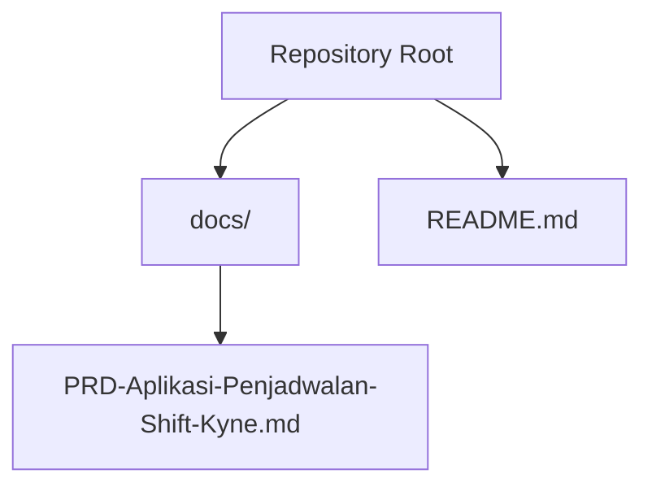
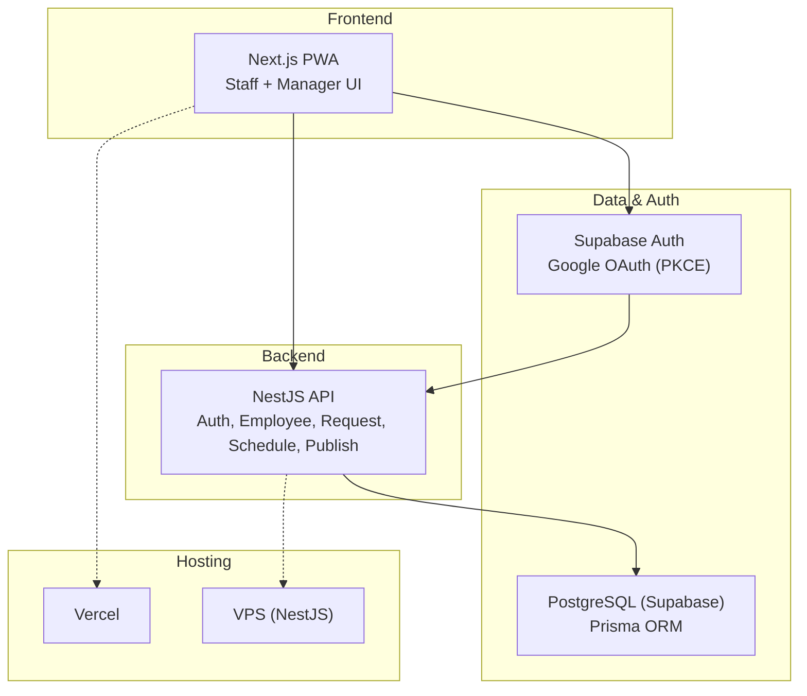
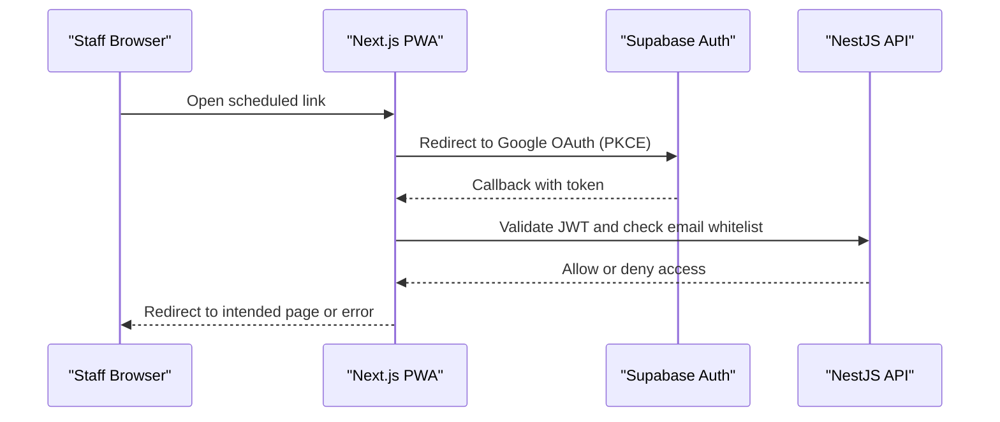
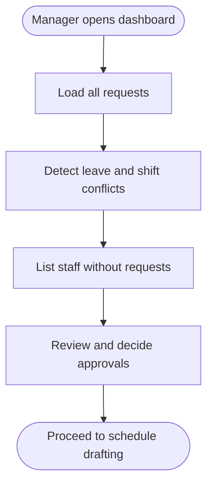
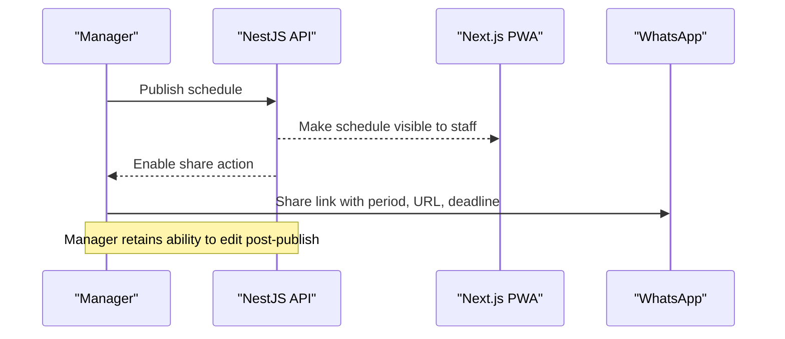
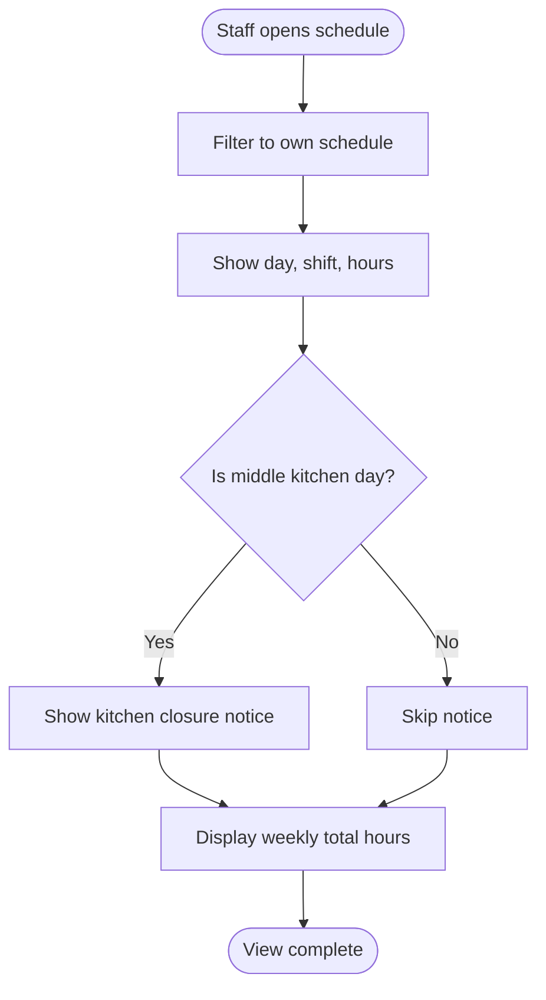
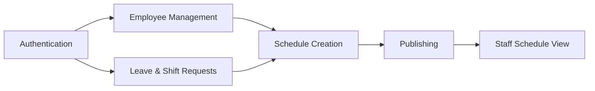

# Product Requirements Document

<cite>
**Referenced Files in This Document**
- [PRD-Aplikasi-Penjadwalan-Shift-Kyne.md](file://docs/PRD-Aplikasi-Penjadwalan-Shift-Kyne.md)
- [README.md](file://README.md)
</cite>

## Table of Contents
1. [Introduction](#introduction)
2. [Project Structure](#project-structure)
3. [Core Components](#core-components)
4. [Architecture Overview](#architecture-overview)
5. [Detailed Component Analysis](#detailed-component-analysis)
6. [Dependency Analysis](#dependency-analysis)
7. [Performance Considerations](#performance-considerations)
8. [Troubleshooting Guide](#troubleshooting-guide)
9. [Conclusion](#conclusion)
10. [Appendices](#appendices)

## Introduction
This document defines the product requirements for the Kyne café shift scheduling application MVP. It captures the business problem, scope, user roles, functional modules, business rules, data model, technical constraints, success metrics, timeline milestones, and acceptance criteria. The goal is to replace manual, chat-based scheduling with a structured weekly process: staff submit leave and shift preference requests; the manager builds a draft schedule from the previous week; automated middle-kitchen logic applies; coverage validation runs; and the manager publishes the schedule for staff to view on mobile devices.

The repository is currently a scaffold without implementation code. All specifications below are derived from the project’s PRD and initial README.

**Section sources**
- [README.md:1-25](file://README.md#L1-L25)
- [PRD-Aplikasi-Penjadwalan-Shift-Kyne.md:1-20](file://docs/PRD-Aplikasi-Penjadwalan-Shift-Kyne.md#L1-L20)

## Project Structure
At this stage, the repository contains:
- A documentation folder with the Kyne shift scheduling PRD.
- A root README indicating that the repository is new and scaffolding has not yet been defined.

**Diagram sources**
- [README.md:1-25](file://README.md#L1-L25)
- [PRD-Aplikasi-Penjadwalan-Shift-Kyne.md:1-10](file://docs/PRD-Aplikasi-Penjadwalan-Shift-Kyne.md#L1-L10)

**Section sources**
- [README.md:1-25](file://README.md#L1-L25)

## Core Components
The MVP centers around seven functional modules:
- Authentication via Google OAuth with email whitelist enforcement.
- Employee management (CRUD) for manager-only operations.
- Leave request handling (one day per week, Monday–Thursday).
- Shift preference requests (morning or afternoon, any day).
- Manager dashboard showing all requests, conflicts, and missing requests.
- Weekly schedule creation engine with copy-from-last-week automation, middle-kitchen logic, and manual adjustments.
- Publishing workflow with WhatsApp sharing and staff-facing schedule views.

Success metrics include publishing deadlines, weekend coverage guarantees, and adoption of the app for requests.

**Section sources**
- [PRD-Aplikasi-Penjadwalan-Shift-Kyne.md:21-25](file://docs/PRD-Aplikasi-Penjadwalan-Shift-Kyne.md#L21-L25)
- [PRD-Aplikasi-Penjadwalan-Shift-Kyne.md:102-164](file://docs/PRD-Aplikasi-Penjadwalan-Shift-Kyne.md#L102-L164)

## Architecture Overview
The system follows a monorepo structure aligned with an ERP stack:
- Frontend: Next.js PWA for mobile-first staff experience and manager dashboard.
- Backend: NestJS API implementing business rules, RBAC, and validations.
- Database: PostgreSQL via Supabase, accessed through Prisma.
- Auth: Supabase Auth with Google OAuth using PKCE redirect.
- Hosting: Vercel for web, Supabase for database and auth, VPS for NestJS with HTTPS and auto-restart.

**Diagram sources**
- [PRD-Aplikasi-Penjadwalan-Shift-Kyne.md:230-241](file://docs/PRD-Aplikasi-Penjadwalan-Shift-Kyne.md#L230-L241)

**Section sources**
- [PRD-Aplikasi-Penjadwalan-Shift-Kyne.md:230-249](file://docs/PRD-Aplikasi-Penjadwalan-Shift-Kyne.md#L230-L249)

## Detailed Component Analysis

### Authentication (F1)
- Google OAuth login with PKCE redirect.
- Email whitelist enforced at the backend; unauthorized emails receive a registration message.
- Session persistence for 30 days.
- Post-login redirection preserves the original link target.

**Diagram sources**
- [PRD-Aplikasi-Penjadwalan-Shift-Kyne.md:106-112](file://docs/PRD-Aplikasi-Penjadwalan-Shift-Kyne.md#L106-L112)
- [PRD-Aplikasi-Penjadwalan-Shift-Kyne.md:237-246](file://docs/PRD-Aplikasi-Penjadwalan-Shift-Kyne.md#L237-L246)

**Section sources**
- [PRD-Aplikasi-Penjadwalan-Shift-Kyne.md:106-112](file://docs/PRD-Aplikasi-Penjadwalan-Shift-Kyne.md#L106-L112)
- [PRD-Aplikasi-Penjadwalan-Shift-Kyne.md:237-246](file://docs/PRD-Aplikasi-Penjadwalan-Shift-Kyne.md#L237-L246)

### Employee Management (F2)
- Manager-only CRUD for employees: add, deactivate, set position (bar/kitchen), set probation status and end date, toggle active/inactive.
- Inactive employees cannot log in but retain historical schedule records.
- Probation status automatically transitions to permanent after the end date passes.

**Diagram sources**
- [PRD-Aplikasi-Penjadwalan-Shift-Kyne.md:114-120](file://docs/PRD-Aplikasi-Penjadwalan-Shift-Kyne.md#L114-L120)

**Section sources**
- [PRD-Aplikasi-Penjadwalan-Shift-Kyne.md:114-120](file://docs/PRD-Aplikasi-Penjadwalan-Shift-Kyne.md#L114-L120)

### Leave and Shift Preference Requests (F3)
- Leave requests: one day per week, only Monday–Thursday.
- Shift preference requests: morning or afternoon, any day, optional.
- Requests editable until the weekly deadline (Sunday 12:00 WITA), then locked.
- Staff can see their own request statuses.
- Probationary staff do not see the request menu.

**Diagram sources**
- [PRD-Aplikasi-Penjadwalan-Shift-Kyne.md:122-131](file://docs/PRD-Aplikasi-Penjadwalan-Shift-Kyne.md#L122-L131)

**Section sources**
- [PRD-Aplikasi-Penjadwalan-Shift-Kyne.md:122-131](file://docs/PRD-Aplikasi-Penjadwalan-Shift-Kyne.md#L122-L131)

### Manager Dashboard (F4)
- Displays all leave and shift requests for the upcoming week.
- Highlights conflicts: same-position leave overlaps and shift preferences exceeding slots.
- Lists non-probationary staff who have not submitted requests.

**Diagram sources**
- [PRD-Aplikasi-Penjadwalan-Shift-Kyne.md:132-139](file://docs/PRD-Aplikasi-Penjadwalan-Shift-Kyne.md#L132-L139)

**Section sources**
- [PRD-Aplikasi-Penjadwalan-Shift-Kyne.md:132-139](file://docs/PRD-Aplikasi-Penjadwalan-Shift-Kyne.md#L132-L139)

### Weekly Schedule Creation Engine (F5)
- Draft generation copies last week’s schedule, removes prior leaves, fills empty days with most frequent shifts, applies approved leaves, applies shift preferences, and auto-applies middle kitchen when a kitchen colleague is off.
- Manager can manually adjust each employee’s daily assignment (morning, afternoon, middle, or off).
- Coverage validation runs on every change and is visible only to managers.
- Drafts remain hidden from staff until published.

**Diagram sources**
- [PRD-Aplikasi-Penjadwalan-Shift-Kyne.md:140-147](file://docs/PRD-Aplikasi-Penjadwalan-Shift-Kyne.md#L140-L147)
- [PRD-Aplikasi-Penjadwalan-Shift-Kyne.md:77-90](file://docs/PRD-Aplikasi-Penjadwalan-Shift-Kyne.md#L77-L90)

**Section sources**
- [PRD-Aplikasi-Penjadwalan-Shift-Kyne.md:140-147](file://docs/PRD-Aplikasi-Penjadwalan-Shift-Kyne.md#L140-L147)
- [PRD-Aplikasi-Penjadwalan-Shift-Kyne.md:77-90](file://docs/PRD-Aplikasi-Penjadwalan-Shift-Kyne.md#L77-L90)

### Publishing Workflow (F6)
- Publishing makes the schedule visible to staff and opens the next week’s request window.
- Sharing generates a pre-filled WhatsApp message including the schedule period, link, and next request deadline.
- Managers may still edit schedules after publishing.

**Diagram sources**
- [PRD-Aplikasi-Penjadwalan-Shift-Kyne.md:149-155](file://docs/PRD-Aplikasi-Penjadwalan-Shift-Kyne.md#L149-L155)

**Section sources**
- [PRD-Aplikasi-Penjadwalan-Shift-Kyne.md:149-155](file://docs/PRD-Aplikasi-Penjadwalan-Shift-Kyne.md#L149-L155)

### Staff Schedule View (F7)
- Staff see only their own schedule: day, shift, hours.
- On middle-kitchen days, a notice indicates kitchen closure windows.
- Weekly total working hours are displayed.

**Diagram sources**
- [PRD-Aplikasi-Penjadwalan-Shift-Kyne.md:157-163](file://docs/PRD-Aplikasi-Penjadwalan-Shift-Kyne.md#L157-L163)

**Section sources**
- [PRD-Aplikasi-Penjadwalan-Shift-Kyne.md:157-163](file://docs/PRD-Aplikasi-Penjadwalan-Shift-Kyne.md#L157-L163)

## Dependency Analysis
Key dependencies across components:
- Authentication depends on Supabase Auth and backend whitelist checks.
- Employee management depends on the employee entity and role resolution.
- Request handling depends on weekly deadlines and conflict detection.
- Schedule creation depends on copying previous weeks, applying requests, and middle-kitchen automation.
- Publishing depends on visibility toggles and WhatsApp sharing.
- Staff view depends on filtering by employee identity and computing totals.

**Diagram sources**
- [PRD-Aplikasi-Penjadwalan-Shift-Kyne.md:102-164](file://docs/PRD-Aplikasi-Penjadwalan-Shift-Kyne.md#L102-L164)

**Section sources**
- [PRD-Aplikasi-Penjadwalan-Shift-Kyne.md:102-164](file://docs/PRD-Aplikasi-Penjadwalan-Shift-Kyne.md#L102-L164)

## Performance Considerations
- Mobile-first PWA ensures responsive performance on Android and iPhone.
- Avoid heavy client-side processing; perform validations and calculations server-side in NestJS.
- Use efficient queries for weekly schedule generation and conflict detection.
- Minimize network calls by batching data retrieval for dashboards and schedule views.
- Ensure timezone handling uses WITA consistently to avoid scheduling miscalculations.

[No sources needed since this section provides general guidance]

## Troubleshooting Guide
Common issues and mitigations:
- Google login blocked in in-app browsers: instruct users to open links in Chrome/Safari or use the installed PWA.
- Unauthorized access attempts: ensure NestJS enforces email whitelist and rejects unknown emails.
- Role confusion: always resolve roles from the employee table, not JWT metadata.
- RLS misconfiguration: keep Row Level Security deny-all and route all reads/writes through NestJS.
- Deadline edge cases: enforce request lockout based on current time vs. weekly deadline in WITA.

**Section sources**
- [PRD-Aplikasi-Penjadwalan-Shift-Kyne.md:222-228](file://docs/PRD-Aplikasi-Penjadwalan-Shift-Kyne.md#L222-L228)
- [PRD-Aplikasi-Penjadwalan-Shift-Kyne.md:243-249](file://docs/PRD-Aplikasi-Penjadwalan-Shift-Kyne.md#L243-L249)

## Conclusion
The Kyne shift scheduling MVP replaces ad-hoc scheduling with a clear weekly cycle: staff submit requests; the manager drafts and validates a schedule; and the published schedule is accessible to staff on mobile devices. The architecture aligns with the ERP stack to enable future migration. Success hinges on strict adherence to business rules, robust authentication and authorization, and reliable coverage validation.

[No sources needed since this section summarizes without analyzing specific files]

## Appendices

### Business Rules and Validations Summary
- Shift types: morning (07:30–15:30), afternoon (15:00–23:00), middle (11:00–19:00, kitchen only when a kitchen colleague is off).
- Morning and afternoon overlap by 30 minutes for handover.
- Leave limits: one day per week per non-probationary staff, Monday–Thursday only.
- Daily leave caps: maximum one bar and one kitchen leave per day; conflicts flagged for manager decision.
- Shift preferences: morning or afternoon, any day, advisory only.
- Probationary staff: no request menu.
- Request window: opens when the current week’s schedule is published; closes Sunday 12:00 WITA.
- No request: manager assigns the day off.
- Kitchen coverage: if one kitchen staff is off, the other becomes middle; kitchen closed during specified windows.
- Weekend coverage: bar minimum two per shift; kitchen minimum one per shift.
- Weekday coverage: bar minimum one per shift; kitchen minimum one per shift or middle.
- Bar split rule: when only one bar staff is available, manager decides morning or afternoon.
- Coverage validation: manager-only visibility.

**Section sources**
- [PRD-Aplikasi-Penjadwalan-Shift-Kyne.md:165-195](file://docs/PRD-Aplikasi-Penjadwalan-Shift-Kyne.md#L165-L195)

### Data Model Overview
Entities:
- Employee: id, name, email, position (bar/kitchen), role (manager/staff), status (probation/permanent), probation_end_date, is_active.
- Shift type: id, code (PAGI/SORE/MIDDLE), start_time, end_time, applicable_positions.
- Schedule week: id, start_date (Monday), status (draft/published), request_deadline, published_at, published_by, copied_from_week_id.
- Shift assignment: id, week_id, employee_id, date, shift_type_id (null = off), source (copy/request/auto_middle/manual).
- Off request: id, week_id, employee_id, date, status (pending/approved/rejected), decided_by, decided_at.
- Shift request: id, week_id, employee_id, date, shift_type_id, status, decided_by, decided_at.
- Settings: key, value (e.g., probation_can_request, deadline_day, deadline_time, timezone).

Design principles for ERP readiness:
- UUID identifiers.
- Audit fields: created_at, updated_at, created_by.
- Soft deletes via deactivation.
- Calendar dates and local times stored with timezone context.

**Section sources**
- [PRD-Aplikasi-Penjadwalan-Shift-Kyne.md:197-217](file://docs/PRD-Aplikasi-Penjadwalan-Shift-Kyne.md#L197-L217)

### User Roles and Permissions
- Manager: manage employees, view and decide requests, build and publish schedules, view coverage validation and total hours.
- Staff: view own schedule, submit leave and shift preference requests.
- Probationary staff: view own schedule only; request menu appears after probation ends.

All users must log in with a Google account whose email is registered by the manager. Each staff member holds one fixed position (bar or kitchen).

**Section sources**
- [PRD-Aplikasi-Penjadwalan-Shift-Kyne.md:27-37](file://docs/PRD-Aplikasi-Penjadwalan-Shift-Kyne.md#L27-L37)

### Success Metrics
- Publish next week’s schedule by Sunday 18:00 WITA every week.
- No understaffed Friday–Sunday shifts at publish time.
- All non-probationary staff submit requests via the app, not via chat.

**Section sources**
- [PRD-Aplikasi-Penjadwalan-Shift-Kyne.md:21-25](file://docs/PRD-Aplikasi-Penjadwalan-Shift-Kyne.md#L21-L25)

### Timeline Milestones
- Week 1: Foundation — project setup, database schema, Google login with whitelist (F1), employee management (F2), shift type data, test login from WhatsApp links on Android and iPhone.
- Week 2: Requests and scheduling — leave and shift requests (F3), manager dashboard (F4), draft from last week and coverage validation (F5).
- Week 3: Publishing and staff view — publish and WhatsApp sharing (F6), staff schedule view (F7), PWA installation, bug fixes.
- Trial cycle: One full real-data cycle with six staff; maintain manual fallback until first cycle succeeds.

**Section sources**
- [PRD-Aplikasi-Penjadwalan-Shift-Kyne.md:250-257](file://docs/PRD-Aplikasi-Penjadwalan-Shift-Kyne.md#L250-L257)

### Acceptance Criteria
- Authentication: Only whitelisted emails can log in; session persists for 30 days; post-login redirects preserve target URLs.
- Employee management: Manager can add, deactivate, set positions, probation status, and end dates; inactive employees cannot log in; probation transitions automatically.
- Requests: Leave limited to Monday–Thursday, one per week; shift preferences allowed any day; editable until Sunday 12:00 WITA; probationary staff cannot request.
- Dashboard: Shows all requests, flags conflicts, lists staff without requests.
- Scheduling: Draft generation automates copy-from-last-week, apply leaves, apply shift preferences, middle-kitchen logic; manager can adjust; coverage validation runs on changes; draft hidden from staff.
- Publishing: Makes schedule visible to staff; opens next request window; supports WhatsApp sharing; allows post-publish edits.
- Staff view: Shows own schedule, middle-kitchen notices, and weekly total hours.

**Section sources**
- [PRD-Aplikasi-Penjadwalan-Shift-Kyne.md:102-164](file://docs/PRD-Aplikasi-Penjadwalan-Shift-Kyne.md#L102-L164)