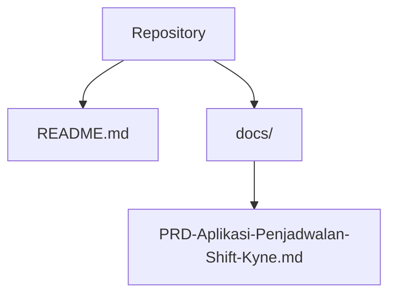
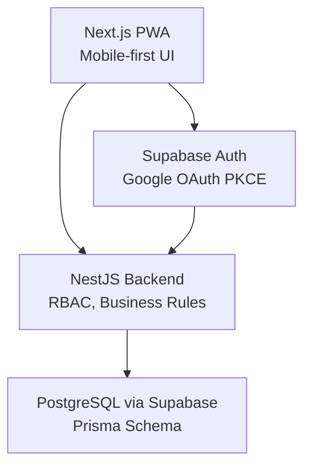
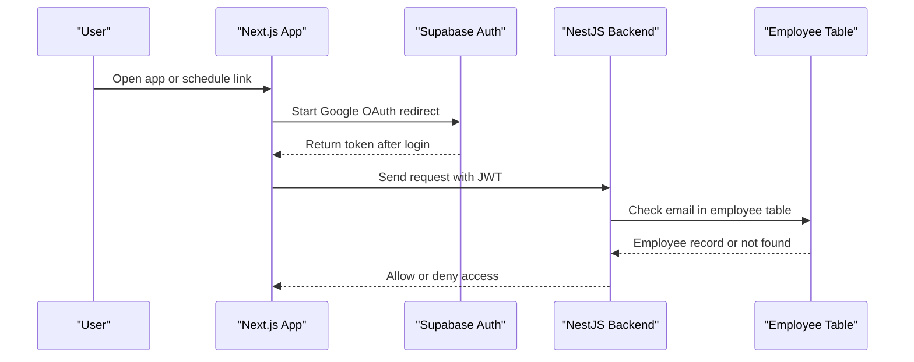
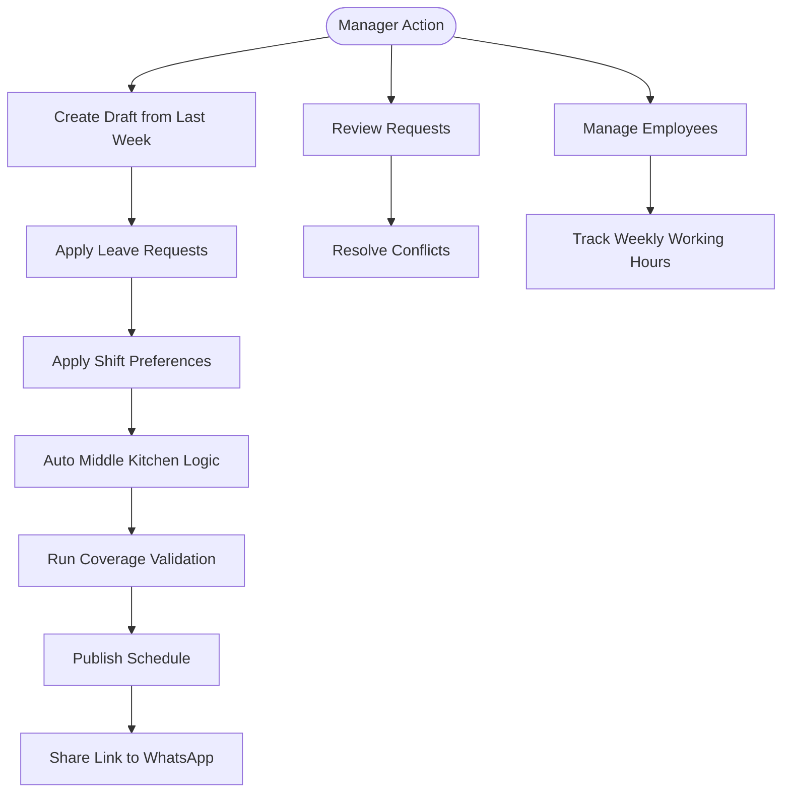
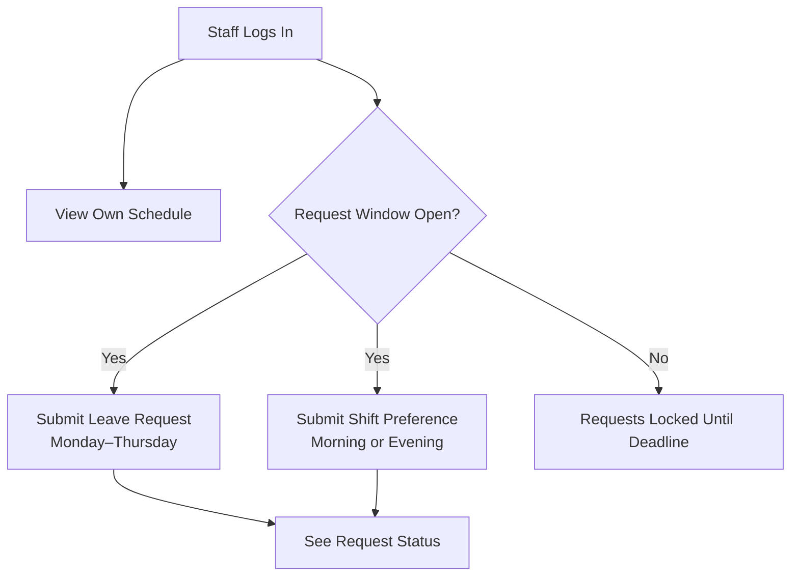
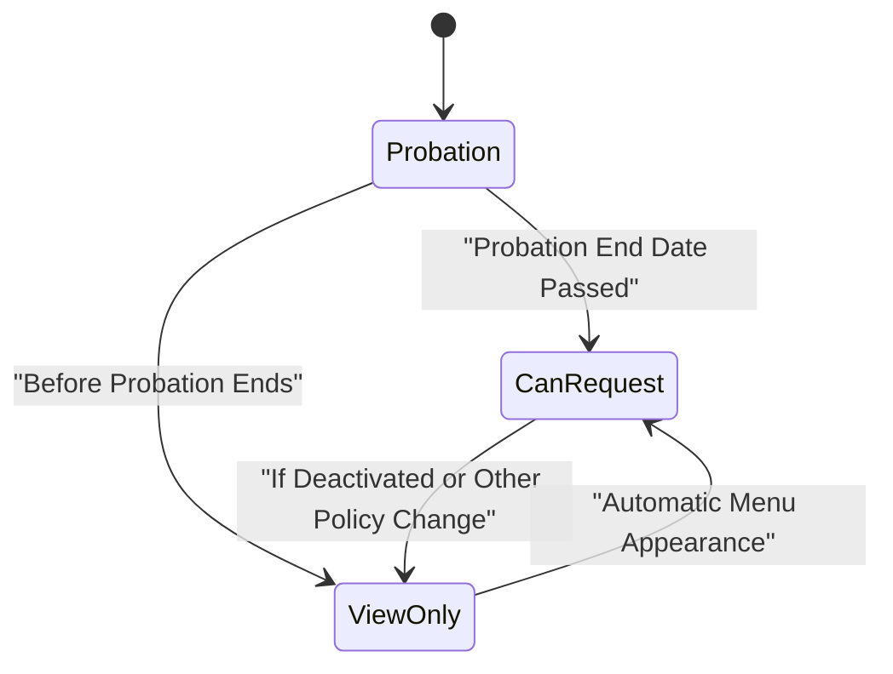
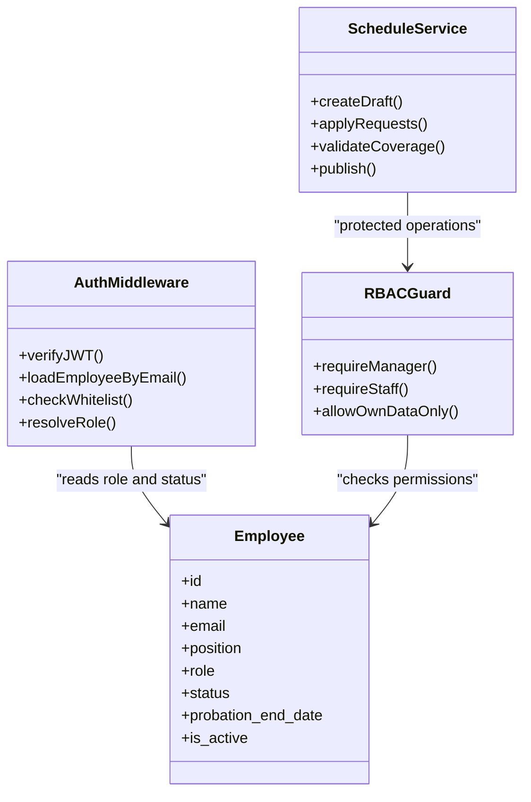
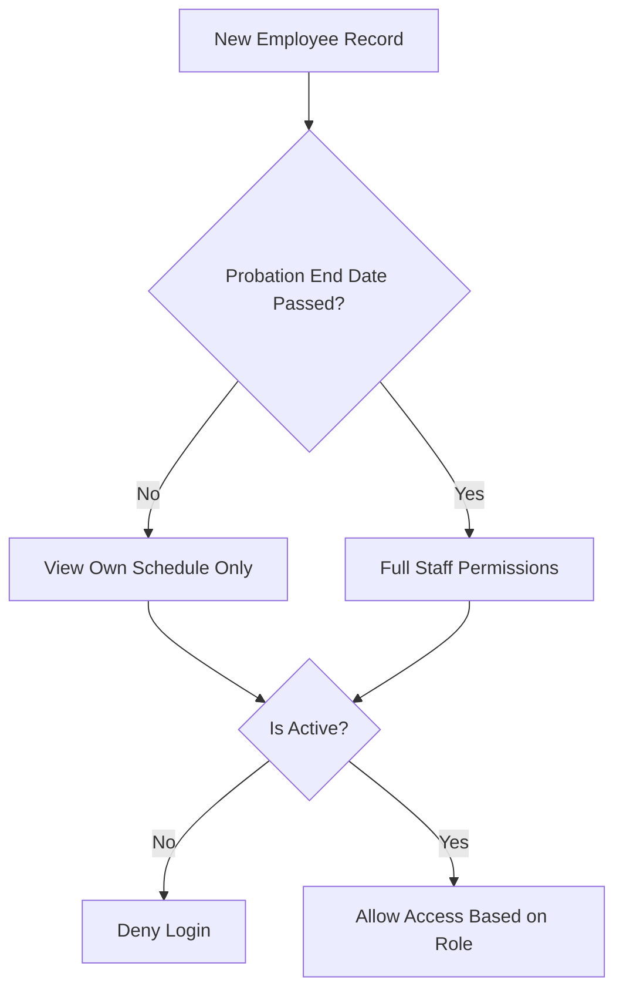
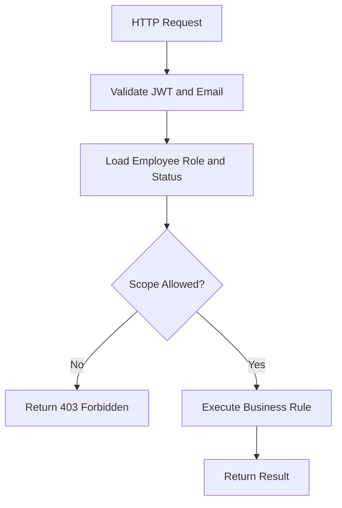
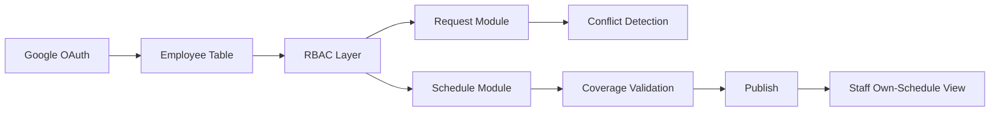

# User Roles & Permissions

<cite>
**Referenced Files in This Document**
- [README.md](file://README.md)
- [PRD-Aplikasi-Penjadwalan-Shift-Kyne.md](file://docs/PRD-Aplikasi-Penjadwalan-Shift-Kyne.md)
</cite>

## Table of Contents
1. [Introduction](#introduction)
2. [Project Structure](#project-structure)
3. [Core Components](#core-components)
4. [Architecture Overview](#architecture-overview)
5. [Detailed Component Analysis](#detailed-component-analysis)
6. [Dependency Analysis](#dependency-analysis)
7. [Performance Considerations](#performance-considerations)
8. [Troubleshooting Guide](#troubleshooting-guide)
9. [Conclusion](#conclusion)

## Introduction
This document explains the user roles and permissions for the Kyne shift scheduling application. It covers three user types: Manager, Staff, and Probationary Staff. It also documents Google OAuth authentication with email whitelist validation, role-based access control, permission inheritance patterns, and security considerations for data isolation between users.

The system is a standalone scheduling MVP intended to be mobile-first and later integrated into an ERP. The current repository is an early scaffold, so this documentation focuses on the product requirements and planned architecture rather than existing implementation code.

**Section sources**
- [README.md:1-25](file://README.md#L1-L25)
- [PRD-Aplikasi-Penjadwalan-Shift-Kyne.md:1-10](file://docs/PRD-Aplikasi-Penjadwalan-Shift-Kyne.md#L1-L10)

## Project Structure
At this stage, the repository contains only documentation and a minimal README. There is no backend or frontend source code yet. The PRD defines the intended modules, including authentication, employee management, requests, schedule drafting, coverage validation, publishing, and staff views.

**Diagram sources**
- [README.md:1-25](file://README.md#L1-L25)
- [PRD-Aplikasi-Penjadwalan-Shift-Kyne.md:1-10](file://docs/PRD-Aplikasi-Penjadwalan-Shift-Kyne.md#L1-L10)

**Section sources**
- [README.md:1-25](file://README.md#L1-L25)
- [PRD-Aplikasi-Penjadwalan-Shift-Kyne.md:1-10](file://docs/PRD-Aplikasi-Penjadwalan-Shift-Kyne.md#L1-L10)

## Core Components
The core components relevant to roles and permissions are:

- Authentication with Google OAuth and email whitelist validation
- Employee records with role, position, probation status, and active/inactive state
- Request handling for leave and shift preferences
- Schedule drafting, coverage validation, and publishing
- Role-based UI and API access control

These components are defined in the PRD as functional requirements and non-functional security rules.

**Section sources**
- [PRD-Aplikasi-Penjadwalan-Shift-Kyne.md:102-164](file://docs/PRD-Aplikasi-Penjadwalan-Shift-Kyne.md#L102-L164)
- [PRD-Aplikasi-Penjadwalan-Shift-Kyne.md:218-249](file://docs/PRD-Aplikasi-Penjadwalan-Shift-Kyne.md#L218-L249)

## Architecture Overview
The planned architecture uses Next.js for the web frontend, NestJS for the backend API, Supabase for PostgreSQL and Google OAuth, and Prisma for database access. RBAC is enforced in the backend, not only in the frontend.

**Diagram sources**
- [PRD-Aplikasi-Penjadwalan-Shift-Kyne.md:230-241](file://docs/PRD-Aplikasi-Penjadwalan-Shift-Kyne.md#L230-L241)

## Detailed Component Analysis

### User Types and Permission Summary
There are three user types:

| User Type | Login Requirement | Main Permissions | Limitations |
|---|---|---|---|
| Manager | Google account with whitelisted email | Manage employees, review and decide requests, create and publish schedules, view coverage validation, track total working hours | None beyond operational scope |
| Staff | Google account with whitelisted email | View own schedule, submit leave requests (Monday–Thursday), submit shift preference requests (morning/evening) | Cannot manage employees or publish schedules |
| Probationary Staff | Google account with whitelisted email | View own schedule only | No request menu until probation end date passes |

**Section sources**
- [PRD-Aplikasi-Penjadwalan-Shift-Kyne.md:27-37](file://docs/PRD-Aplikasi-Penjadwalan-Shift-Kyne.md#L27-L37)
- [PRD-Aplikasi-Penjadwalan-Shift-Kyne.md:114-131](file://docs/PRD-Aplikasi-Penjadwalan-Shift-Kyne.md#L114-L131)
- [PRD-Aplikasi-Penjadwalan-Shift-Kyne.md:157-164](file://docs/PRD-Aplikasi-Penjadwalan-Shift-Kyne.md#L157-L164)

### Google OAuth and Email Whitelist Validation
All users must log in through Google OAuth. Access is restricted by checking the authenticated email against the employee table. If the email is not registered, login is denied.

Key behaviors:
- Only whitelisted emails can enter the system.
- Sessions are stored for 30 days.
- Redirects preserve the original destination after login.
- The backend validates the JWT and checks the employee record for role and status.

**Diagram sources**
- [PRD-Aplikasi-Penjadwalan-Shift-Kyne.md:106-113](file://docs/PRD-Aplikasi-Penjadwalan-Shift-Kyne.md#L106-L113)
- [PRD-Aplikasi-Penjadwalan-Shift-Kyne.md:243-247](file://docs/PRD-Aplikasi-Penjadwalan-Shift-Kyne.md#L243-L247)

**Section sources**
- [PRD-Aplikasi-Penjadwalan-Shift-Kyne.md:106-113](file://docs/PRD-Aplikasi-Penjadwalan-Shift-Kyne.md#L106-L113)
- [PRD-Aplikasi-Penjadwalan-Shift-Kyne.md:243-247](file://docs/PRD-Aplikasi-Penjadwalan-Shift-Kyne.md#L243-L247)

### Manager Permissions
Manager responsibilities include:

- Employee management: add employees, set bar/kitchen position, set probation status and end date, activate/deactivate employees.
- Request review and approval: see all requests, detect conflicts, approve or reject.
- Schedule creation and publishing: copy last week’s schedule, apply leave and shift requests, handle middle kitchen logic, validate coverage, publish, and share via WhatsApp.
- Coverage validation access: view warnings for insufficient coverage before publishing.
- Total working hours tracking: view weekly total working hours per employee.

**Diagram sources**
- [PRD-Aplikasi-Penjadwalan-Shift-Kyne.md:43-54](file://docs/PRD-Aplikasi-Penjadwalan-Shift-Kyne.md#L43-L54)
- [PRD-Aplikasi-Penjadwalan-Shift-Kyne.md:132-155](file://docs/PRD-Aplikasi-Penjadwalan-Shift-Kyne.md#L132-L155)
- [PRD-Aplikasi-Penjadwalan-Shift-Kyne.md:165-195](file://docs/PRD-Aplikasi-Penjadwalan-Shift-Kyne.md#L165-L195)

**Section sources**
- [PRD-Aplikasi-Penjadwalan-Shift-Kyne.md:43-54](file://docs/PRD-Aplikasi-Penjadwalan-Shift-Kyne.md#L43-L54)
- [PRD-Aplikasi-Penjadwalan-Shift-Kyne.md:114-155](file://docs/PRD-Aplikasi-Penjadwalan-Shift-Kyne.md#L114-L155)
- [PRD-Aplikasi-Penjadwalan-Shift-Kyne.md:165-195](file://docs/PRD-Aplikasi-Penjadwalan-Shift-Kyne.md#L165-L195)

### Staff Permissions
Staff members who have completed probation can:

- View their own schedule, including day, shift, hours, and kitchen closure notices when applicable.
- Submit leave requests for Monday through Thursday, maximum one day per week.
- Submit shift preference requests for morning or evening shifts on any day.

**Diagram sources**
- [PRD-Aplikasi-Penjadwalan-Shift-Kyne.md:122-131](file://docs/PRD-Aplikasi-Penjadwalan-Shift-Kyne.md#L122-L131)
- [PRD-Aplikasi-Penjadwalan-Shift-Kyne.md:157-164](file://docs/PRD-Aplikasi-Penjadwalan-Shift-Kyne.md#L157-L164)

**Section sources**
- [PRD-Aplikasi-Penjadwalan-Shift-Kyne.md:122-131](file://docs/PRD-Aplikasi-Penjadwalan-Shift-Kyne.md#L122-L131)
- [PRD-Aplikasi-Penjadwalan-Shift-Kyne.md:157-164](file://docs/PRD-Aplikasi-Penjadwalan-Shift-Kyne.md#L157-L164)

### Probationary Staff Limitations
Probationary staff can only view their own schedule. The request menu does not appear during probation. After the probation end date passes, the system treats them as regular staff and automatically shows the request menu.

**Diagram sources**
- [PRD-Aplikasi-Penjadwalan-Shift-Kyne.md:31-37](file://docs/PRD-Aplikasi-Penjadwalan-Shift-Kyne.md#L31-L37)
- [PRD-Aplikasi-Penjadwalan-Shift-Kyne.md:114-131](file://docs/PRD-Aplikasi-Penjadwalan-Shift-Kyne.md#L114-L131)

**Section sources**
- [PRD-Aplikasi-Penjadwalan-Shift-Kyne.md:31-37](file://docs/PRD-Aplikasi-Penjadwalan-Shift-Kyne.md#L31-L37)
- [PRD-Aplikasi-Penjadwalan-Shift-Kyne.md:114-131](file://docs/PRD-Aplikasi-Penjadwalan-Shift-Kyne.md#L114-L131)

### Role-Based Access Control Implementation Details
Role-based access control is implemented primarily in the backend:

- The role is read from the employee table, not from client-side metadata.
- The backend rejects unregistered emails with a 403 response.
- Row-level security denies direct frontend access to tables; all data goes through the NestJS API.
- The frontend may hide buttons, but the server enforces permissions regardless of UI state.

**Diagram sources**
- [PRD-Aplikasi-Penjadwalan-Shift-Kyne.md:197-217](file://docs/PRD-Aplikasi-Penjadwalan-Shift-Kyne.md#L197-L217)
- [PRD-Aplikasi-Penjadwalan-Shift-Kyne.md:243-247](file://docs/PRD-Aplikasi-Penjadwalan-Shift-Kyne.md#L243-L247)

**Section sources**
- [PRD-Aplikasi-Penjadwalan-Shift-Kyne.md:197-217](file://docs/PRD-Aplikasi-Penjadwalan-Shift-Kyne.md#L197-L217)
- [PRD-Aplikasi-Penjadwalan-Shift-Kyne.md:243-247](file://docs/PRD-Aplikasi-Penjadwalan-Shift-Kyne.md#L243-L247)

### Permission Inheritance Patterns
Permission inheritance is based on probation status and employee activation:

- Probationary staff start with view-only access.
- Once the probation end date passes, they inherit full staff permissions, including request submission.
- Deactivated employees cannot log in, even if their probation has ended.
- Managers retain administrative permissions regardless of probation status.

**Diagram sources**
- [PRD-Aplikasi-Penjadwalan-Shift-Kyne.md:114-131](file://docs/PRD-Aplikasi-Penjadwalan-Shift-Kyne.md#L114-L131)
- [PRD-Aplikasi-Penjadwalan-Shift-Kyne.md:187-189](file://docs/PRD-Aplikasi-Penjadwalan-Shift-Kyne.md#L187-L189)

**Section sources**
- [PRD-Aplikasi-Penjadwalan-Shift-Kyne.md:114-131](file://docs/PRD-Aplikasi-Penjadwalan-Shift-Kyne.md#L114-L131)
- [PRD-Aplikasi-Penjadwalan-Shift-Kyne.md:187-189](file://docs/PRD-Aplikasi-Penjadwalan-Shift-Kyne.md#L187-L189)

### Security Considerations for Data Isolation
Security rules ensure that users only access their own data and that managers can perform administrative tasks safely:

- All pages require login, including shared schedule links.
- Staff can only see their own schedule.
- Server-side enforcement prevents bypassing frontend restrictions.
- Direct database access from the frontend is blocked by row-level security policies.
- Timezone and deadline logic are handled server-side to avoid client manipulation.

**Diagram sources**
- [PRD-Aplikasi-Penjadwalan-Shift-Kyne.md:225-226](file://docs/PRD-Aplikasi-Penjadwalan-Shift-Kyne.md#L225-L226)
- [PRD-Aplikasi-Penjadwalan-Shift-Kyne.md:243-249](file://docs/PRD-Aplikasi-Penjadwalan-Shift-Kyne.md#L243-L249)

**Section sources**
- [PRD-Aplikasi-Penjadwalan-Shift-Kyne.md:225-226](file://docs/PRD-Aplikasi-Penjadwalan-Shift-Kyne.md#L225-L226)
- [PRD-Aplikasi-Penjadwalan-Shift-Kyne.md:243-249](file://docs/PRD-Aplikasi-Penjadwalan-Shift-Kyne.md#L243-L249)

## Dependency Analysis
The roles and permissions depend on several interconnected parts:

- Authentication depends on Google OAuth and email whitelist validation.
- Employee records determine role, position, probation status, and activation.
- Request windows depend on schedule publication and weekly deadlines.
- Manager actions depend on conflict detection and coverage validation.
- Staff visibility depends on schedule publication and data isolation rules.

**Diagram sources**
- [PRD-Aplikasi-Penjadwalan-Shift-Kyne.md:102-164](file://docs/PRD-Aplikasi-Penjadwalan-Shift-Kyne.md#L102-L164)
- [PRD-Aplikasi-Penjadwalan-Shift-Kyne.md:197-217](file://docs/PRD-Aplikasi-Penjadwalan-Shift-Kyne.md#L197-L217)
- [PRD-Aplikasi-Penjadwalan-Shift-Kyne.md:243-249](file://docs/PRD-Aplikasi-Penjadwalan-Shift-Kyne.md#L243-L249)

**Section sources**
- [PRD-Aplikasi-Penjadwalan-Shift-Kyne.md:102-164](file://docs/PRD-Aplikasi-Penjadwalan-Shift-Kyne.md#L102-L164)
- [PRD-Aplikasi-Penjadwalan-Shift-Kyne.md:197-217](file://docs/PRD-Aplikasi-Penjadwalan-Shift-Kyne.md#L197-L217)
- [PRD-Aplikasi-Penjadwalan-Shift-Kyne.md:243-249](file://docs/PRD-Aplikasi-Penjadwalan-Shift-Kyne.md#L243-L249)

## Performance Considerations
While there is no implementation code yet, the design suggests performance-relevant points:

- Keep RBAC checks lightweight by caching employee role and status where safe.
- Avoid scanning all employees for every request; filter by employee ID and week context.
- Run coverage validation incrementally when changes occur, not only at publish time.
- Use timezone-aware queries to avoid repeated conversions on each request.
- Design the staff schedule view to return only the current and next week for the logged-in employee.

[No sources needed since this section provides general guidance]

## Troubleshooting Guide
Common issues related to roles and permissions include:

- Unregistered Google email: the backend should return a clear denial because the email is not in the employee table.
- Probation menu missing: verify the probation end date and whether it has passed.
- Staff seeing other staff data: check server-side authorization and row-level security rules.
- Request window not opening or closing: verify schedule publication timestamp and weekly deadline logic.
- Manager unable to publish due to coverage warnings: resolve insufficient coverage for Friday–Sunday and weekday minimums.

**Section sources**
- [PRD-Aplikasi-Penjadwalan-Shift-Kyne.md:106-113](file://docs/PRD-Aplikasi-Penjadwalan-Shift-Kyne.md#L106-L113)
- [PRD-Aplikasi-Penjadwalan-Shift-Kyne.md:122-131](file://docs/PRD-Aplikasi-Penjadwalan-Shift-Kyne.md#L122-L131)
- [PRD-Aplikasi-Penjadwalan-Shift-Kyne.md:181-195](file://docs/PRD-Aplikasi-Penjadwalan-Shift-Kyne.md#L181-L195)
- [PRD-Aplikasi-Penjadwalan-Shift-Kyne.md:243-249](file://docs/PRD-Aplikasi-Penjadwalan-Shift-Kyne.md#L243-L249)

## Conclusion
The Kyne shift scheduling application defines three clear user roles with distinct permissions. Managers have full administrative and scheduling authority. Staff can manage their own requests and view their schedule. Probationary staff have limited access until their probation ends, after which they inherit staff permissions. Security relies on Google OAuth, email whitelist validation, server-side RBAC, and strict data isolation. When implementation begins, these requirements should guide the backend guards, frontend visibility rules, and database constraints.

[No sources needed since this section summarizes without analyzing specific files]