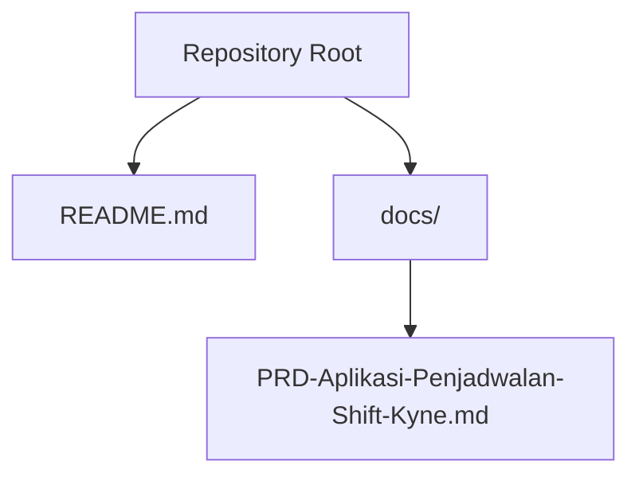
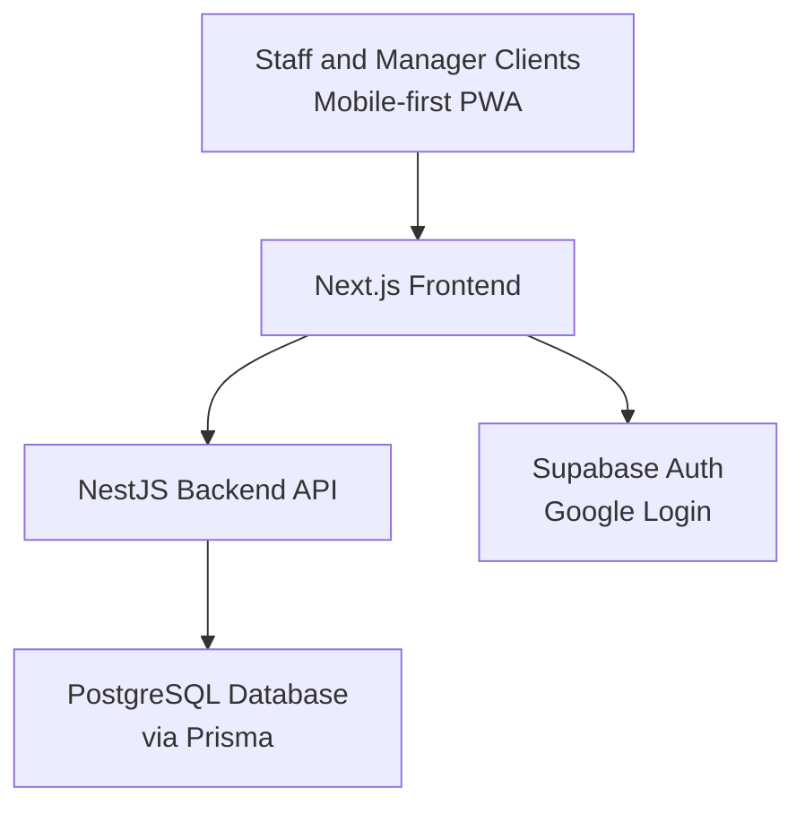
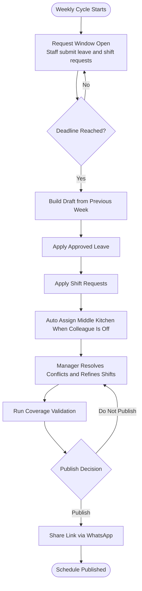
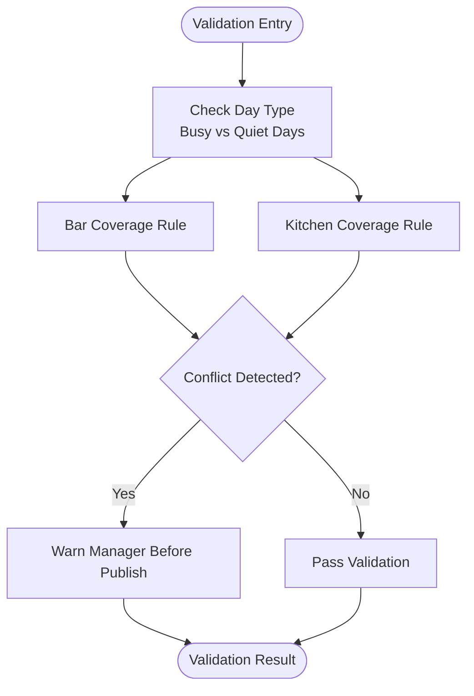
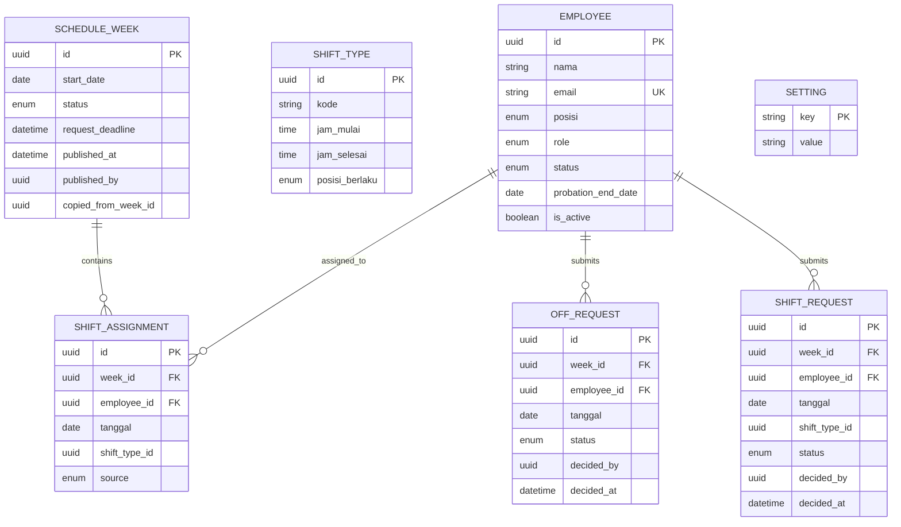
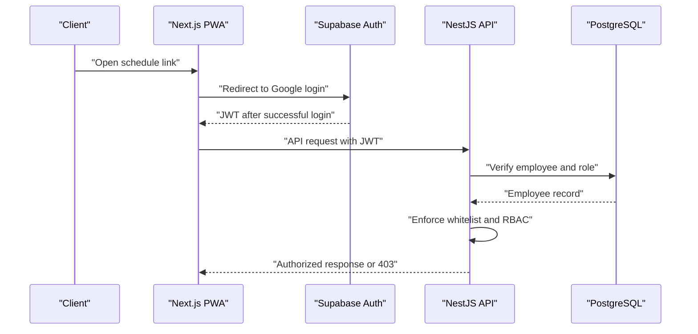
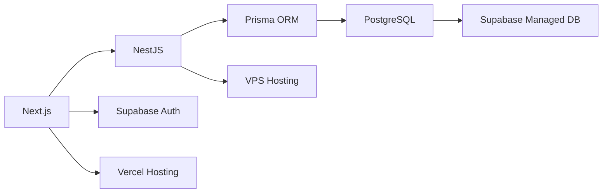

# Project Overview

<cite>
**Referenced Files in This Document**
- [README.md](file://README.md)
- [PRD-Aplikasi-Penjadwalan-Shift-Kyne.md](file://docs/PRD-Aplikasi-Penjadwalan-Shift-Kyne.md)
</cite>

## Table of Contents
1. [Introduction](#introduction)
2. [Project Structure](#project-structure)
3. [Core Components](#core-components)
4. [Architecture Overview](#architecture-overview)
5. [Detailed Component Analysis](#detailed-component-analysis)
6. [Dependency Analysis](#dependency-analysis)
7. [Performance Considerations](#performance-considerations)
8. [Troubleshooting Guide](#troubleshooting-guide)
9. [Conclusion](#conclusion)

## Introduction
This project is a standalone scheduling Progressive Web App (PWA) designed to automate weekly shift management for Kyne café operations. The application targets the current pain points of manual, chat-based coordination and helps ensure consistent coverage across bar and kitchen roles during busy days while respecting staff leave preferences.

At this stage, the repository is an initial scaffold with no implementation code yet. It contains only documentation and a README that explicitly states the project is newly created and awaiting stack and tooling decisions.

The strategic importance of this project lies in reducing manual coordination effort, preventing coverage gaps on weekends, and centralizing leave and shift requests into one system. For Indonesian business context, the product aligns with local operational practices such as WITA time zone handling and WhatsApp-based communication for sharing schedules.

Target audience:
- Café managers who create, validate, publish, and share weekly schedules.
- Bar and kitchen staff who submit leave and shift requests and view their personal schedules.
- Probationary staff who can view schedules but cannot request leave or shifts until probation ends.

Planned technology stack:
- Frontend: Next.js as a mobile-first PWA.
- Backend: NestJS API hosting on a VPS.
- Database: PostgreSQL via Supabase, accessed through Prisma.
- Authentication: Supabase Auth with Google login using PKCE redirect.
- Deployment: Vercel for the web frontend, Supabase for database and auth, and a VPS for the NestJS backend with HTTPS via a reverse proxy.

**Section sources**
- [README.md:1-25](file://README.md#L1-L25)
- [PRD-Aplikasi-Penjadwalan-Shift-Kyne.md:5-26](file://docs/PRD-Aplikasi-Penjadwalan-Shift-Kyne.md#L5-L26)
- [PRD-Aplikasi-Penjadwalan-Shift-Kyne.md:27-37](file://docs/PRD-Aplikasi-Penjadwalan-Shift-Kyne.md#L27-L37)
- [PRD-Aplikasi-Penjadwalan-Shift-Kyne.md:230-241](file://docs/PRD-Aplikasi-Penjadwalan-Shift-Kyne.md#L230-L241)

## Project Structure
The repository currently contains:
- A top-level README describing the project as a standalone scheduling application and noting that it is a new scaffold without implementation code.
- A Product Requirements Document under docs that defines scope, users, workflows, business rules, data model draft, non-functional requirements, architecture, timeline, and open questions.

**Diagram sources**
- [README.md:1-25](file://README.md#L1-L25)
- [PRD-Aplikasi-Penjadwalan-Shift-Kyne.md:1-267](file://docs/PRD-Aplikasi-Penjadwalan-Shift-Kyne.md#L1-L267)

**Section sources**
- [README.md:1-25](file://README.md#L1-L25)
- [PRD-Aplikasi-Penjadwalan-Shift-Kyne.md:1-267](file://docs/PRD-Aplikasi-Penjadwalan-Shift-Kyne.md#L1-L267)

## Core Components
The MVP focuses on seven functional modules:
- Authentication with Google login and email whitelist.
- Employee management for adding, deactivating, and assigning positions and probation status.
- Leave requests and shift requests within a weekly window.
- Manager dashboard showing all requests, conflicts, and missing requests.
- Schedule construction starting from the previous week with automated leave and middle-kitchen logic.
- Publishing and sharing schedules via WhatsApp link.
- Staff schedule view showing personal shifts, middle-kitchen closures, and weekly total hours.

These components are planned to be implemented behind a NestJS API, with a Next.js PWA frontend and PostgreSQL-backed data storage.

**Section sources**
- [PRD-Aplikasi-Penjadwalan-Shift-Kyne.md:102-164](file://docs/PRD-Aplikasi-Penjadwalan-Shift-Kyne.md#L102-L164)
- [PRD-Aplikasi-Penjadwalan-Shift-Kyne.md:230-241](file://docs/PRD-Aplikasi-Penjadwalan-Shift-Kyne.md#L230-L241)

## Architecture Overview
The planned architecture separates concerns between frontend, backend, authentication, and database layers. The frontend is a mobile-first PWA built with Next.js. The backend is a NestJS service that enforces business rules, role-based access control, and validation. Authentication uses Supabase Auth with Google login, and the database is PostgreSQL managed by Supabase.

**Diagram sources**
- [PRD-Aplikasi-Penjadwalan-Shift-Kyne.md:230-241](file://docs/PRD-Aplikasi-Penjadwalan-Shift-Kyne.md#L230-L241)

## Detailed Component Analysis

### Weekly Scheduling Workflow
The scheduling process follows a weekly cycle aligned with Monday–Sunday operations. During the week, staff submit leave and shift requests. At a defined deadline, the request window closes, and the manager constructs the schedule using automation helpers, then validates coverage before publishing.

**Diagram sources**
- [PRD-Aplikasi-Penjadwalan-Shift-Kyne.md:73-90](file://docs/PRD-Aplikasi-Penjadwalan-Shift-Kyne.md#L73-L90)
- [PRD-Aplikasi-Penjadwalan-Shift-Kyne.md:140-155](file://docs/PRD-Aplikasi-Penjadwalan-Shift-Kyne.md#L140-L155)

**Section sources**
- [PRD-Aplikasi-Penjadwalan-Shift-Kyne.md:73-90](file://docs/PRD-Aplikasi-Penjadwalan-Shift-Kyne.md#L73-L90)
- [PRD-Aplikasi-Penjadwalan-Shift-Kyne.md:140-155](file://docs/PRD-Aplikasi-Penjadwalan-Shift-Kyne.md#L140-L155)

### Business Rules and Coverage Validation
Business rules define shift types, leave limits, request windows, probation behavior, and coverage requirements. Coverage validation ensures sufficient staffing on busy days and warns the manager before publishing if rules are violated.

**Diagram sources**
- [PRD-Aplikasi-Penjadwalan-Shift-Kyne.md:165-195](file://docs/PRD-Aplikasi-Penjadwalan-Shift-Kyne.md#L165-L195)

**Section sources**
- [PRD-Aplikasi-Penjadwalan-Shift-Kyne.md:165-195](file://docs/PRD-Aplikasi-Penjadwalan-Shift-Kyne.md#L165-L195)

### Data Model Draft
The MVP data model includes entities for employees, shift types, weekly schedules, shift assignments, leave requests, shift requests, and settings. The design emphasizes UUIDs, audit fields, soft deletion, and timezone-aware date handling to prepare for future integration with an ERP system.

**Diagram sources**
- [PRD-Aplikasi-Penjadwalan-Shift-Kyne.md:197-217](file://docs/PRD-Aplikasi-Penjadwalan-Shift-Kyne.md#L197-L217)

**Section sources**
- [PRD-Aplikasi-Penjadwalan-Shift-Kyne.md:197-217](file://docs/PRD-Aplikasi-Penjadwalan-Shift-Kyne.md#L197-L217)

### Security and Access Control
Security relies on a NestJS-enforced email whitelist, role checks from the employee table rather than client-side metadata, and strict database policies. All pages require login, and staff can only see their own schedule data. Timezone handling uses WITA, and backup is planned daily.

**Diagram sources**
- [PRD-Aplikasi-Penjadwalan-Shift-Kyne.md:220-248](file://docs/PRD-Aplikasi-Penjadwalan-Shift-Kyne.md#L220-L248)

**Section sources**
- [PRD-Aplikasi-Penjadwalan-Shift-Kyne.md:220-248](file://docs/PRD-Aplikasi-Penjadwalan-Shift-Kyne.md#L220-L248)

## Dependency Analysis
At this point, there is no implementation code, so runtime dependencies are not present. The planned dependencies include:
- Next.js for the frontend PWA.
- NestJS for the backend API.
- Supabase Auth for Google authentication.
- PostgreSQL via Prisma for data persistence.
- Hosting services: Vercel for frontend, Supabase for database and auth, and a VPS for NestJS.

**Diagram sources**
- [PRD-Aplikasi-Penjadwalan-Shift-Kyne.md:230-241](file://docs/PRD-Aplikasi-Penjadwalan-Shift-Kyne.md#L230-L241)

**Section sources**
- [PRD-Aplikasi-Penjadwalan-Shift-Kyne.md:230-241](file://docs/PRD-Aplikasi-Penjadwalan-Shift-Kyne.md#L230-L241)

## Performance Considerations
As this is a scaffold-only repository, performance characteristics are not yet measurable. Planned considerations include:
- Mobile-first PWA design optimized for Android and iPhone.
- Efficient server-side validation and authorization to minimize unnecessary data exposure.
- Daily backups for data safety.
- Avoiding cron jobs for deadlines by enforcing cutoff times at request submission.

[No sources needed since this section provides general guidance]

## Troubleshooting Guide
Potential issues highlighted in the requirements include:
- Google login blocked in in-app browsers; users may need to open links in Chrome or Safari or use the installed PWA.
- iPhone standalone mode requiring redirect-based login instead of popups.
- Ensuring all staff have Google accounts and that the email whitelist is correctly configured.
- Managing unexpected schedule changes after publication through direct manager edits and WhatsApp communication.

**Section sources**
- [PRD-Aplikasi-Penjadwalan-Shift-Kyne.md:220-228](file://docs/PRD-Aplikasi-Penjadwalan-Shift-Kyne.md#L220-L228)
- [PRD-Aplikasi-Penjadwalan-Shift-Kyne.md:98-100](file://docs/PRD-Aplikasi-Penjadwalan-Shift-Kyne.md#L98-L100)

## Conclusion
Kyne café’s shift scheduling application is positioned to replace manual, chat-driven coordination with a structured, automated weekly workflow. While the repository is currently a scaffold without implementation code, the Product Requirements Document clearly outlines user roles, functional modules, business rules, data model, security posture, and deployment strategy. Once development begins, the planned stack—Next.js, NestJS, PostgreSQL, Supabase Auth, and Vercel/VPS hosting—will support a reliable, mobile-friendly scheduling experience tailored to Indonesian café operations.

[No sources needed since this section summarizes without analyzing specific files]