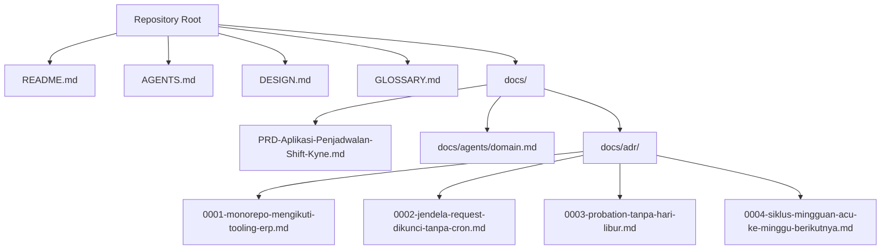
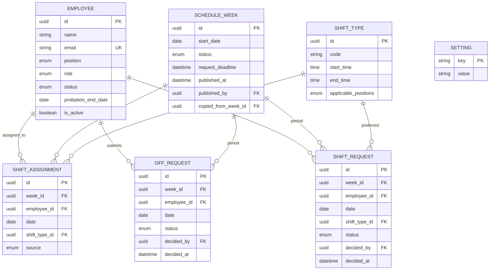
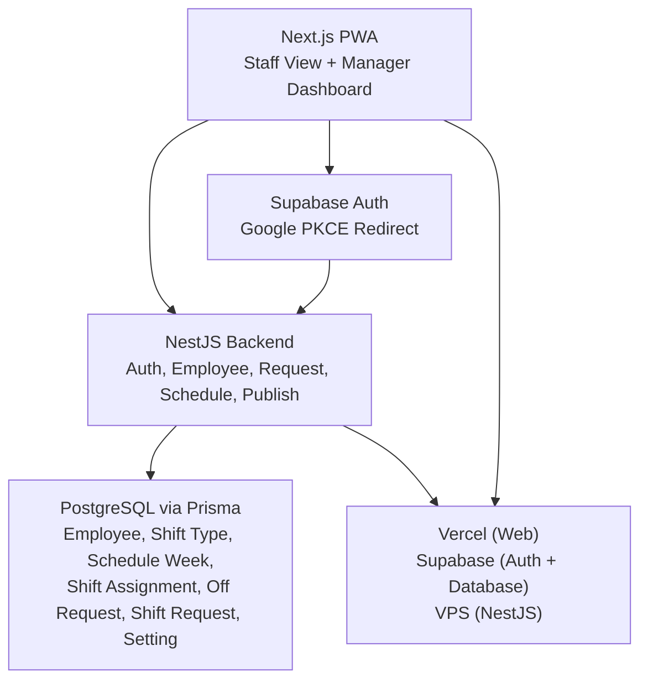
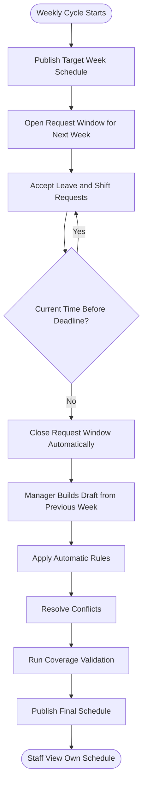
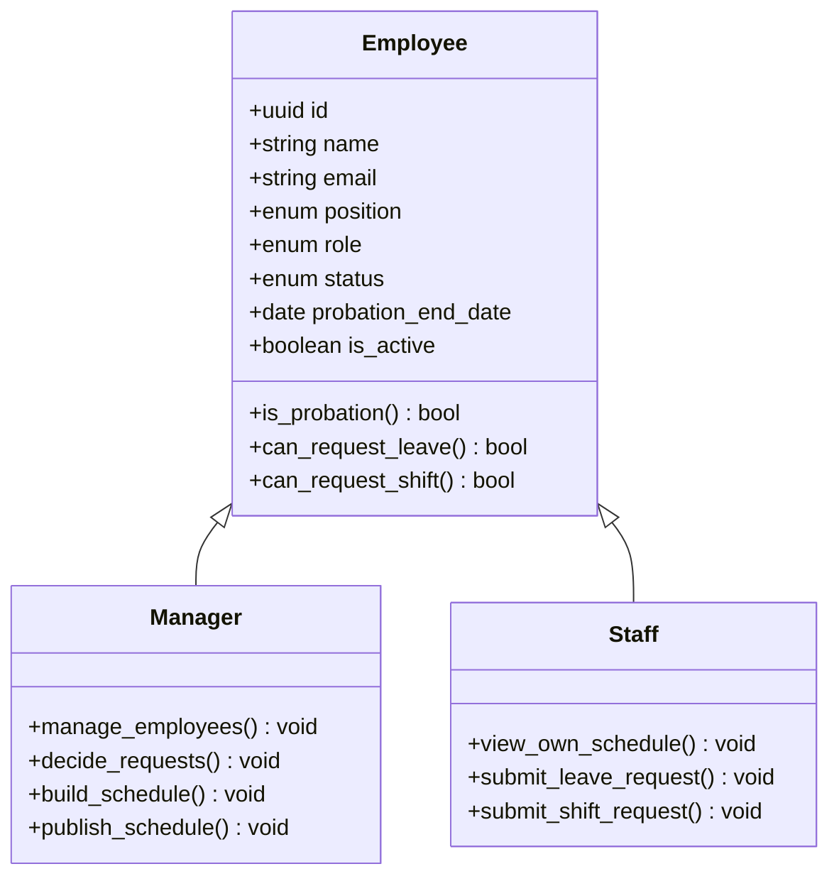
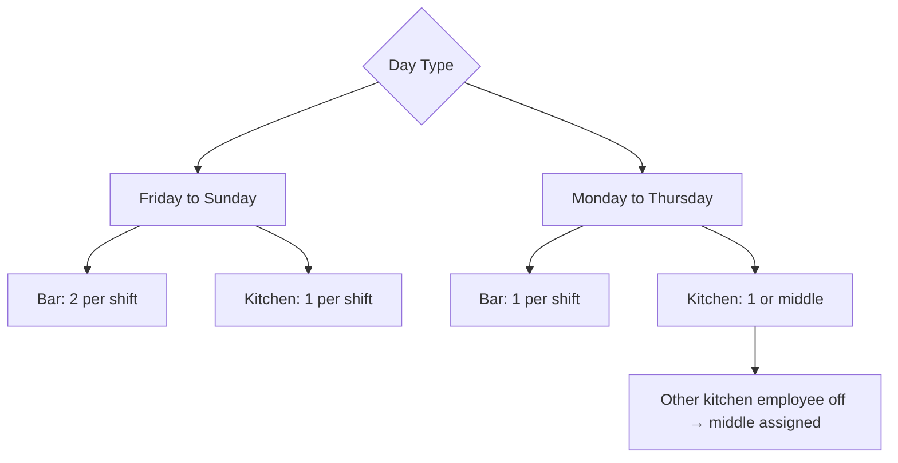
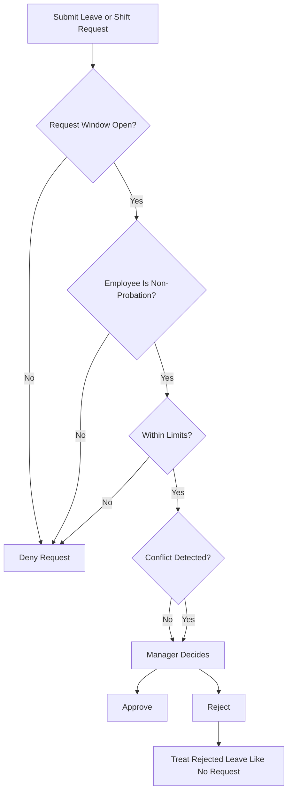
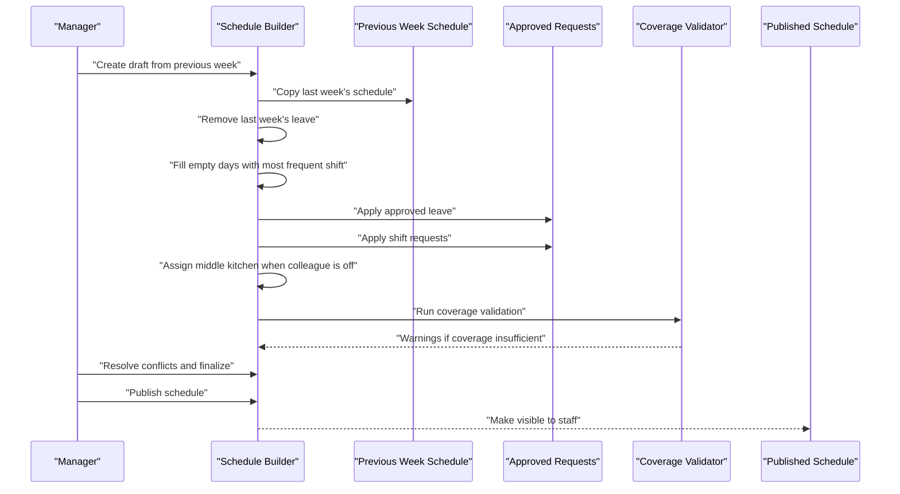
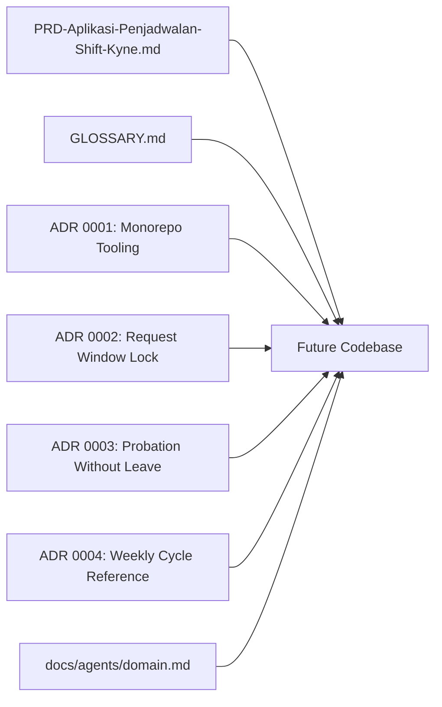

# Domain Model & Glossary

<cite>
**Referenced Files in This Document**
- [README.md](file://README.md)
- [AGENTS.md](file://AGENTS.md)
- [DESIGN.md](file://DESIGN.md)
- [GLOSSARY.md](file://GLOSSARY.md)
- [PRD-Aplikasi-Penjadwalan-Shift-Kyne.md](file://docs/PRD-Aplikasi-Penjadwalan-Shift-Kyne.md)
- [domain.md](file://docs/agents/domain.md)
- [0001-monorepo-mengikuti-tooling-erp.md](file://docs/adr/0001-monorepo-mengikuti-tooling-erp.md)
- [0002-jendela-request-dikunci-tanpa-cron.md](file://docs/adr/0002-jendela-request-dikunci-tanpa-cron.md)
- [0003-probation-tanpa-hari-libur.md](file://docs/adr/0003-probation-tanpa-hari-libur.md)
- [0004-siklus-mingguan-acu-ke-minggu-berikutnya.md](file://docs/adr/0004-siklus-mingguan-acu-ke-minggu-berikutnya.md)
</cite>

## Table of Contents
1. [Introduction](#introduction)
2. [Project Structure](#project-structure)
3. [Core Components](#core-components)
4. [Architecture Overview](#architecture-overview)
5. [Detailed Component Analysis](#detailed-component-analysis)
6. [Dependency Analysis](#dependency-analysis)
7. [Performance Considerations](#performance-considerations)
8. [Troubleshooting Guide](#troubleshooting-guide)
9. [Conclusion](#conclusion)

## Introduction
This document defines the domain model and glossary for the Kyne shift scheduling application. The project is currently a scaffold: there is no runtime code yet, but the repository already contains a product requirements document, a canonical glossary, design rules, and architectural decision records that together form the authoritative domain contract.

The MVP targets weekly shift scheduling for six Kyne staff members across bar and kitchen roles, with one manager. Staff submit leave requests and shift preferences during a weekly request window; the manager builds a draft from the previous week, applies automatic rules, resolves conflicts, validates coverage, and publishes the schedule. After publication, staff can view their own schedule on mobile devices.

The repository explicitly states that it is a new repository without code or features, so this document focuses on the conceptual domain model, vocabulary, and business rules rather than implementation details.

**Section sources**
- [README.md:1-25](file://README.md#L1-L25)
- [PRD-Aplikasi-Penjadwalan-Shift-Kyne.md:5-25](file://docs/PRD-Aplikasi-Penjadwalan-Shift-Kyne.md#L5-L25)

## Project Structure
At this stage, the repository is documentation-first. The relevant files for domain modeling are:

- Root-level documentation: `README.md`, `AGENTS.md`, `DESIGN.md`, `GLOSSARY.md`.
- Product and domain context: `docs/PRD-Aplikasi-Penjadwalan-Shift-Kyne.md` and `docs/agents/domain.md`.
- Architectural decisions: `docs/adr/0001-*`, `docs/adr/0002-*`, `docs/adr/0003-*`, `docs/adr/0004-*`.

**Diagram sources**
- [README.md:1-25](file://README.md#L1-L25)
- [AGENTS.md:1-45](file://AGENTS.md#L1-L45)
- [DESIGN.md:1-563](file://DESIGN.md#L1-L563)
- [GLOSSARY.md:1-70](file://GLOSSARY.md#L1-L70)
- [PRD-Aplikasi-Penjadwalan-Shift-Kyne.md:1-267](file://docs/PRD-Aplikasi-Penjadwalan-Shift-Kyne.md#L1-L267)
- [domain.md:1-52](file://docs/agents/domain.md#L1-L52)
- [0001-monorepo-mengikuti-tooling-erp.md:1-4](file://docs/adr/0001-monorepo-mengikuti-tooling-erp.md#L1-L4)
- [0002-jendela-request-dikunci-tanpa-cron.md:1-4](file://docs/adr/0002-jendela-request-dikunci-tanpa-cron.md#L1-L4)
- [0003-probation-tanpa-hari-libur.md:1-4](file://docs/adr/0003-probation-tanpa-hari-libur.md#L1-L4)
- [0004-siklus-mingguan-acu-ke-minggu-berikutnya.md:1-10](file://docs/adr/0004-siklus-mingguan-acu-ke-minggu-berikutnya.md#L1-L10)

**Section sources**
- [README.md:1-25](file://README.md#L1-L25)
- [AGENTS.md:13-15](file://AGENTS.md#L13-L15)
- [domain.md:1-52](file://docs/agents/domain.md#L1-L52)

## Core Components
The domain model centers on seven entities defined in the product requirements document. These entities represent the minimum data needed to support the MVP workflow: employees, shift types, weekly schedules, shift assignments, leave requests, shift requests, and settings.

| Entity | Purpose | Key Attributes | Business Meaning |
|---|---|---|---|
| Employee | Represents a person who may be a manager, bar staff, or kitchen staff | id, name, email, position, role, status, probation end date, active flag | Login whitelist, role-based access, probation behavior, and availability scope |
| Shift Type | Defines standard shifts | id, code, start time, end time, applicable positions | PAGI, SORE, MIDDLE; times are not duplicated per assignment |
| Schedule Week | Represents one weekly planning cycle | id, start date, status, request deadline, published timestamp, publisher, copied-from week id | One row per week; status is draft or published |
| Shift Assignment | Records who works which day and shift | id, week id, employee id, date, shift type id, source | Core schedule; empty shift type means off day |
| Off Request | Captures leave requests | id, week id, employee id, date, status, decided by, decided at | Maximum one per non-probation employee per week |
| Shift Request | Captures preferred morning or afternoon shifts | id, week id, employee id, date, shift type id, status, decided by, decided at | Preferred, not guaranteed |
| Setting | Stores system configuration | key, value | Probation policy, deadline day/time, timezone, feature flags |

The model is intentionally generic so it can later map into an ERP’s HR module. It uses UUIDs, audit fields, soft deletion semantics, calendar dates, local WITA times, and a timezone setting.

**Diagram sources**
- [PRD-Aplikasi-Penjadwalan-Shift-Kyne.md:197-217](file://docs/PRD-Aplikasi-Penjadwalan-Shift-Kyne.md#L197-L217)

**Section sources**
- [PRD-Aplikasi-Penjadwalan-Shift-Kyne.md:197-217](file://docs/PRD-Aplikasi-Penjadwalan-Shift-Kyne.md#L197-L217)

## Architecture Overview
Although no runtime code exists yet, the repository documents a clear separation between frontend, backend, authentication, database, and hosting. The domain model lives primarily in the backend and database layers, while the frontend surfaces employee views, manager dashboards, request forms, and schedule publishing flows.

**Diagram sources**
- [PRD-Aplikasi-Penjadwalan-Shift-Kyne.md:230-249](file://docs/PRD-Aplikasi-Penjadwalan-Shift-Kyne.md#L230-L249)

The monorepo structure follows the ERP tooling stack, with directories named after the PRD table stack: `web`, `api`, plus shared packages for types and validators. This keeps the NestJS module portable to the ERP repository.

**Section sources**
- [PRD-Aplikasi-Penjadwalan-Shift-Kyne.md:230-249](file://docs/PRD-Aplikasi-Penjadwalan-Shift-Kyne.md#L230-L249)
- [0001-monorepo-mengikuti-tooling-erp.md:1-4](file://docs/adr/0001-monorepo-mengikuti-tooling-erp.md#L1-L4)

## Detailed Component Analysis

### Weekly Cycle and Request Window
The weekly cycle is the central rhythm of the domain. A “weekly cycle” is a Monday-to-Sunday period used as the planning unit. The “target week” is the week being planned through requests and drafts. The “request window” opens when the target week’s schedule is created or published and closes automatically at Sunday 12:00 WITA of the previous week.

**Diagram sources**
- [PRD-Aplikasi-Penjadwalan-Shift-Kyne.md:73-90](file://docs/PRD-Aplikasi-Penjadwalan-Shift-Kyne.md#L73-L90)
- [0004-siklus-mingguan-acu-ke-minggu-berikutnya.md:1-10](file://docs/adr/0004-siklus-mingguan-acu-ke-minggu-berikutnya.md#L1-L10)
- [0002-jendela-request-dikunci-tanpa-cron.md:1-4](file://docs/adr/0002-jendela-request-dikunci-tanpa-cron.md#L1-L4)

Key rules:
- The canonical reference point is the next week, not the current week.
- The request window is derived from the target week’s deadline, not stored as a separate window status.
- Only the schedule week status `draft` or `published` is explicit.

**Section sources**
- [GLOSSARY.md:7-19](file://GLOSSARY.md#L7-L19)
- [PRD-Aplikasi-Penjadwalan-Shift-Kyne.md:73-90](file://docs/PRD-Aplikasi-Penjadwalan-Shift-Kyne.md#L73-L90)
- [0002-jendela-request-dikunci-tanpa-cron.md:1-4](file://docs/adr/0002-jendela-request-dikunci-tanpa-cron.md#L1-L4)
- [0004-siklus-mingguan-acu-ke-minggu-berikutnya.md:1-10](file://docs/adr/0004-siklus-mingguan-acu-ke-minggu-berikutnya.md#L1-L10)

### Employees and Roles
Employees have a fixed position: bar or kitchen. They also have a role: manager or staff. Their status is either probation or permanent. Probation ends on a specific date, after which the employee becomes permanent automatically.

| Attribute | Allowed Values | Behavior |
|---|---|---|
| Position | Bar, Kitchen | Fixed per employee; no employee holds two positions |
| Role | Manager, Staff | Determines dashboard and decision rights |
| Status | Probation, Permanent | Probation hides leave and shift menus; becomes permanent after `probation_end_date` |
| Active | True, False | Inactive employees cannot log in, but historical schedule data remains |

Probation has a legal risk noted in the product requirements: labor law requires at least one rest day per week for six working days, and no explicit exception was found for probation. The owner’s policy is accepted consciously and should not be changed in code without approval.

**Diagram sources**
- [PRD-Aplikasi-Penjadwalan-Shift-Kyne.md:27-38](file://docs/PRD-Aplikasi-Penjadwalan-Shift-Kyne.md#L27-L38)
- [PRD-Aplikasi-Penjadwalan-Shift-Kyne.md:114-121](file://docs/PRD-Aplikasi-Penjadwalan-Shift-Kyne.md#L114-L121)
- [0003-probation-tanpa-hari-libur.md:1-4](file://docs/adr/0003-probation-tanpa-hari-libur.md#L1-L4)

**Section sources**
- [PRD-Aplikasi-Penjadwalan-Shift-Kyne.md:27-38](file://docs/PRD-Aplikasi-Penjadwalan-Shift-Kyne.md#L27-L38)
- [PRD-Aplikasi-Penjadwalan-Shift-Kyne.md:114-121](file://docs/PRD-Aplikasi-Penjadwalan-Shift-Kyne.md#L114-L121)
- [0003-probation-tanpa-hari-libur.md:1-4](file://docs/adr/0003-probation-tanpa-hari-libur.md#L1-L4)

### Shift Types and Coverage
There are three shift types:

| Shift | Hours | Applicable To | Notes |
|---|---|---|---|
| Morning | 07:30–15:30 | Bar, Kitchen | Standard opening shift |
| Afternoon | 15:00–23:00 | Bar, Kitchen | Overlaps morning by 30 minutes for handover |
| Middle | 11:00–19:00 | Kitchen only | Appears only when the other kitchen employee is off; kitchen closes 07:30–11:00 and 19:00–23:00 on that day |

Coverage rules differ by weekday:
- Friday to Sunday are busy: bar needs two people per shift, kitchen needs one person per shift.
- Monday to Thursday are quieter: bar needs at least one person per shift, kitchen needs at least one person or middle.

**Diagram sources**
- [PRD-Aplikasi-Penjadwalan-Shift-Kyne.md:165-195](file://docs/PRD-Aplikasi-Penjadwalan-Shift-Kyne.md#L165-L195)
- [GLOSSARY.md:39-55](file://GLOSSARY.md#L39-L55)

**Section sources**
- [PRD-Aplikasi-Penjadwalan-Shift-Kyne.md:165-195](file://docs/PRD-Aplikasi-Penjadwalan-Shift-Kyne.md#L165-L195)
- [GLOSSARY.md:39-55](file://GLOSSARY.md#L39-L55)

### Leave Requests and Shift Requests
Leave requests and shift requests are distinct concepts:

| Concept | Rules | Decision Authority |
|---|---|---|
| Leave request | One day per week, Monday–Thursday, maximum one per non-probation employee | Manager decides; rejected requests are treated like no request |
| Shift request | Morning or afternoon, any day, preferred but not guaranteed | Manager decides; conflicts are flagged |
| Conflict | Two same-position employees requesting leave on the same day, or shift requests exceeding available slots | System flags; manager resolves |

**Diagram sources**
- [PRD-Aplikasi-Penjadwalan-Shift-Kyne.md:92-97](file://docs/PRD-Aplikasi-Penjadwalan-Shift-Kyne.md#L92-L97)
- [PRD-Aplikasi-Penjadwalan-Shift-Kyne.md:122-131](file://docs/PRD-Aplikasi-Penjadwalan-Shift-Kyne.md#L122-L131)
- [PRD-Aplikasi-Penjadwalan-Shift-Kyne.md:181-194](file://docs/PRD-Aplikasi-Penjadwalan-Shift-Kyne.md#L181-L194)
- [GLOSSARY.md:21-37](file://GLOSSARY.md#L21-L37)

**Section sources**
- [PRD-Aplikasi-Penjadwalan-Shift-Kyne.md:92-97](file://docs/PRD-Aplikasi-Penjadwalan-Shift-Kyne.md#L92-L97)
- [PRD-Aplikasi-Penjadwalan-Shift-Kyne.md:122-131](file://docs/PRD-Aplikasi-Penjadwalan-Shift-Kyne.md#L122-L131)
- [PRD-Aplikasi-Penjadwalan-Shift-Kyne.md:181-194](file://docs/PRD-Aplikasi-Penjadwalan-Shift-Kyne.md#L181-L194)
- [GLOSSARY.md:21-37](file://GLOSSARY.md#L21-L37)

### Schedule Drafting and Publishing
The manager builds a schedule draft from the previous week. The automatic steps include copying last week’s schedule, removing last week’s leave, filling empty days with the employee’s most frequent shift, applying approved leave, applying shift requests, converting kitchen employees to middle when their colleague is off, and running coverage validation.

**Diagram sources**
- [PRD-Aplikasi-Penjadwalan-Shift-Kyne.md:77-90](file://docs/PRD-Aplikasi-Penjadwalan-Shift-Kyne.md#L77-L90)
- [PRD-Aplikasi-Penjadwalan-Shift-Kyne.md:140-155](file://docs/PRD-Aplikasi-Penjadwalan-Shift-Kyne.md#L140-L155)
- [PRD-Aplikasi-Penjadwalan-Shift-Kyne.md:189-195](file://docs/PRD-Aplikasi-Penjadwalan-Shift-Kyne.md#L189-L195)

**Section sources**
- [PRD-Aplikasi-Penjadwalan-Shift-Kyne.md:77-90](file://docs/PRD-Aplikasi-Penjadwalan-Shift-Kyne.md#L77-L90)
- [PRD-Aplikasi-Penjadwalan-Shift-Kyne.md:140-155](file://docs/PRD-Aplikasi-Penjadwalan-Shift-Kyne.md#L140-L155)

### Glossary Terms
The glossary establishes the canonical vocabulary for the domain. It avoids ambiguous synonyms and prescribes exact terms for cycles, windows, requests, shifts, drafts, publishing, and employee status.

| Term | Definition Summary | Avoid |
|---|---|---|
| Weekly cycle | Monday-to-Sunday planning period | Calendar week, period |
| Request window | Time staff can request leave or shifts for the target week | Request period, request phase |
| Target week | Week being planned through requests and drafts | Next week, following week |
| Leave request | One-day leave request, Monday–Thursday, max one per week for non-probation staff | Permission, vacation, off request |
| Shift request | Preferred morning or afternoon shift per day | Shift preference, hour request |
| Conflict | Incompatible requests that cannot both be approved | Conflict, duplication |
| Off day | Workday without a shift assignment for a week; only for non-probation staff | Off, vacation, long holiday |
| Morning / Afternoon | Standard bar and kitchen shifts with 30-minute overlap | Shift 1, shift 2 |
| Middle | Kitchen-only midday shift when the other kitchen employee is off | Midday shift, half-day |
| Draft | Manager-visible version of the target week’s schedule | Preview, draf |
| Publish | Moment draft becomes visible to staff and opens next week’s request window | Release, submit |
| Probation | Employee whose probation end date has not passed | Trial, training |
| Permanent | Employee past probation; eligible for leave and shift requests | Active, senior |
| Non-probation staff | Operational term for permanent staff in request and validation flows | Senior staff, full staff |

**Section sources**
- [GLOSSARY.md:1-70](file://GLOSSARY.md#L1-L70)

## Dependency Analysis
The domain documentation depends on a small set of authoritative sources. The product requirements document defines the MVP scope, user roles, workflows, business rules, data model, and architecture. The glossary defines vocabulary. The architectural decision records constrain how certain domain behaviors must be implemented. The agents guide explains how engineering skills should consume domain documentation.

**Diagram sources**
- [PRD-Aplikasi-Penjadwalan-Shift-Kyne.md:1-267](file://docs/PRD-Aplikasi-Penjadwalan-Shift-Kyne.md#L1-L267)
- [GLOSSARY.md:1-70](file://GLOSSARY.md#L1-L70)
- [0001-monorepo-mengikuti-tooling-erp.md:1-4](file://docs/adr/0001-monorepo-mengikuti-tooling-erp.md#L1-L4)
- [0002-jendela-request-dikunci-tanpa-cron.md:1-4](file://docs/adr/0002-jendela-request-dikunci-tanpa-cron.md#L1-L4)
- [0003-probation-tanpa-hari-libur.md:1-4](file://docs/adr/0003-probation-tanpa-hari-libur.md#L1-L4)
- [0004-siklus-mingguan-acu-ke-minggu-berikutnya.md:1-10](file://docs/adr/0004-siklus-mingguan-acu-ke-minggu-berikutnya.md#L1-L10)
- [domain.md:1-52](file://docs/agents/domain.md#L1-L52)

**Section sources**
- [domain.md:1-52](file://docs/agents/domain.md#L1-L52)
- [PRD-Aplikasi-Penjadwalan-Shift-Kyne.md:1-267](file://docs/PRD-Aplikasi-Penjadwalan-Shift-Kyne.md#L1-L267)
- [GLOSSARY.md:1-70](file://GLOSSARY.md#L1-L70)
- [0001-monorepo-mengikuti-tooling-erp.md:1-4](file://docs/adr/0001-monorepo-mengikuti-tooling-erp.md#L1-L4)
- [0002-jendela-request-dikunci-tanpa-cron.md:1-4](file://docs/adr/0002-jendela-request-dikunci-tanpa-cron.md#L1-L4)
- [0003-probation-tanpa-hari-libur.md:1-4](file://docs/adr/0003-probation-tanpa-hari-libur.md#L1-L4)
- [0004-siklus-mingguan-acu-ke-minggu-berikutnya.md:1-10](file://docs/adr/0004-siklus-mingguan-acu-ke-minggu-berikutnya.md#L1-L10)

## Performance Considerations
Because this repository currently contains no runtime code, performance considerations apply conceptually to the future implementation:

- Weekly scheduling is a batch-oriented process driven by publish events and manual manager actions, not continuous high-frequency transactions.
- Coverage validation runs when the manager modifies the draft; it should be efficient enough to recompute quickly but does not need real-time microsecond latency.
- Request submission is low-volume and should prioritize correctness over throughput.
- Mobile-first PWA usage suggests optimizing initial load and offline-friendly navigation, even though offline scheduling is not part of the MVP.
- Database queries should favor indexed lookups by week, employee, date, and status, since the main operations are per-week and per-employee.

[No sources needed since this section provides general guidance]

## Troubleshooting Guide
When implementing the domain model, common issues will likely center around time zones, deadlines, probation behavior, and conflict resolution.

| Area | Symptom | Likely Cause | Resolution |
|---|---|---|---|
| Request window | Requests accepted after intended deadline | Using cron instead of deadline check | Enforce deadline comparison against `request_deadline` in WITA |
| Weekly cycle | Request window opens for the wrong week | Treating current week as target | Follow ADR 0004: target week is the next week |
| Probation | Probation employee sees leave menu | UI or permission logic not checking status | Hide leave and shift menus until probation ends |
| Coverage warning | Published schedule fails coverage rule | Middle kitchen not applied or weekend staffing ignored | Apply middle rule and validate Friday–Sunday coverage |
| Conflict handling | Two same-position leave requests both approved | Missing conflict detection | Detect and flag conflicts; require manager decision |
| Time display | Shift hours or deadlines appear wrong | Mixing local time and WITA | Store times as local WITA and record timezone in settings |

**Section sources**
- [PRD-Aplikasi-Penjadwalan-Shift-Kyne.md:165-195](file://docs/PRD-Aplikasi-Penjadwalan-Shift-Kyne.md#L165-L195)
- [0002-jendela-request-dikunci-tanpa-cron.md:1-4](file://docs/adr/0002-jendela-request-dikunci-tanpa-cron.md#L1-L4)
- [0003-probation-tanpa-hari-libur.md:1-4](file://docs/adr/0003-probation-tanpa-hari-libur.md#L1-L4)
- [0004-siklus-mingguan-acu-ke-minggu-berikutnya.md:1-10](file://docs/adr/0004-siklus-mingguan-acu-ke-minggu-berikutnya.md#L1-L10)

## Conclusion
The Kyne shift scheduling domain is defined by a clear weekly cycle, two kinds of requests, three shift types, and a manager-driven drafting and publishing workflow. The canonical vocabulary in `GLOSSARY.md` should drive naming across issues, tests, and future code. The data model in the PRD provides the baseline schema, while the ADRs constrain important behavioral choices such as deadline enforcement, probation policy, and weekly cycle orientation.

Until code is added, this document serves as the single source of truth for domain terminology, entity relationships, and business rules. When implementation begins, every new term should be checked against the glossary, and every behavioral change should be evaluated against the PRD and existing ADRs.

[No sources needed since this section summarizes without analyzing specific files]