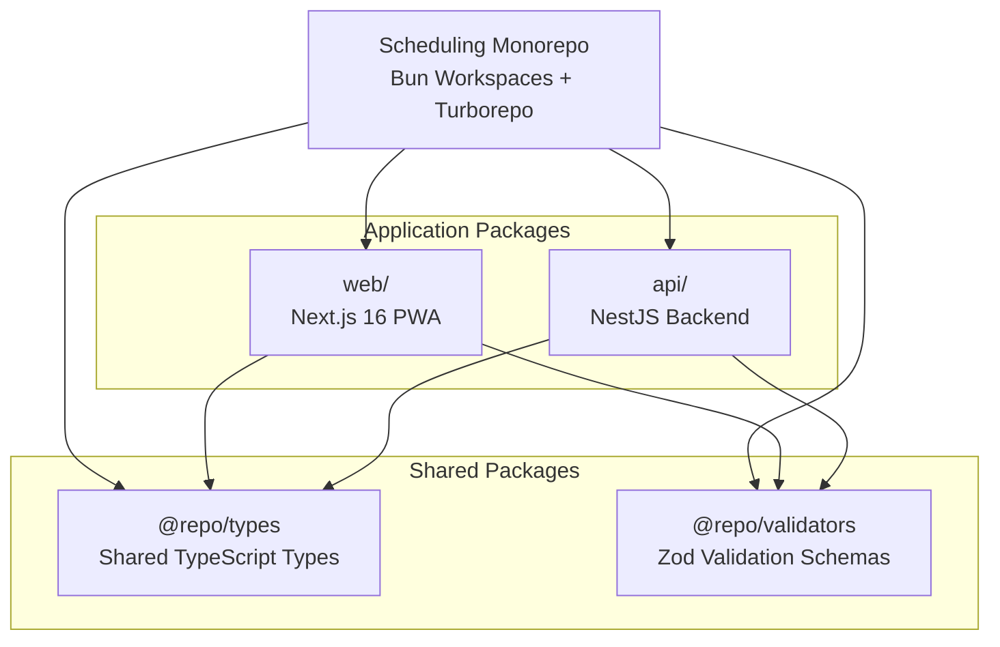
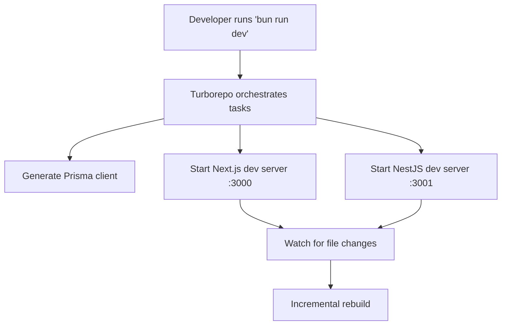
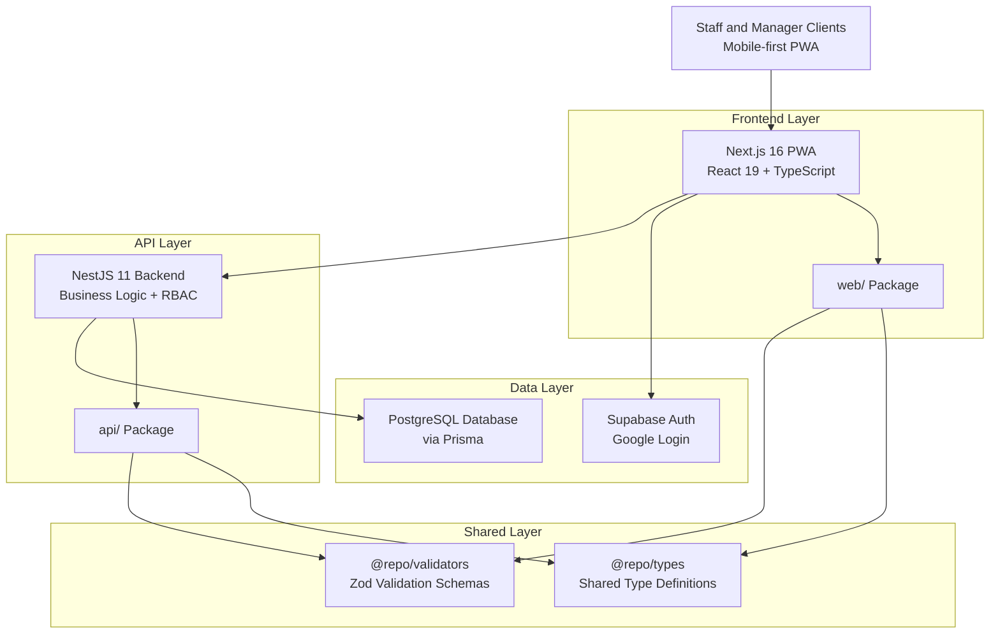
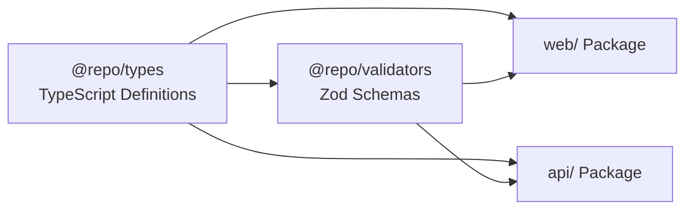
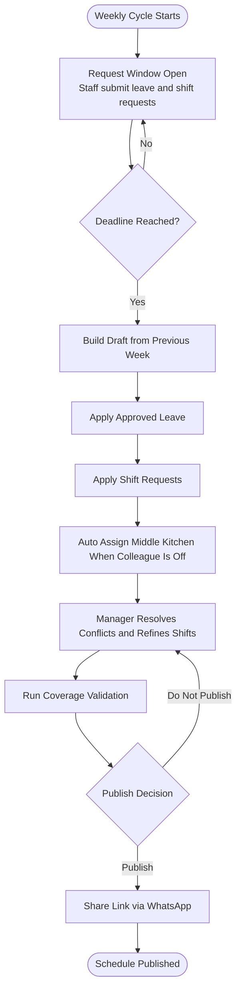
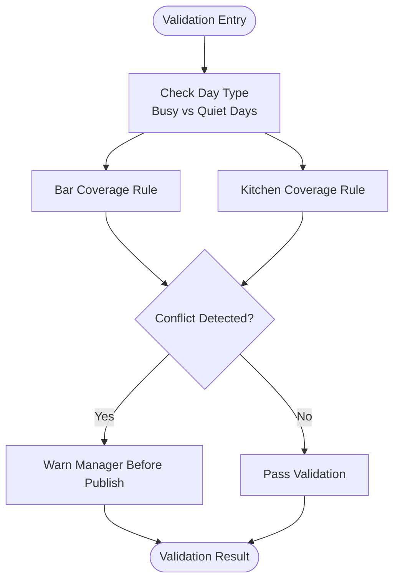
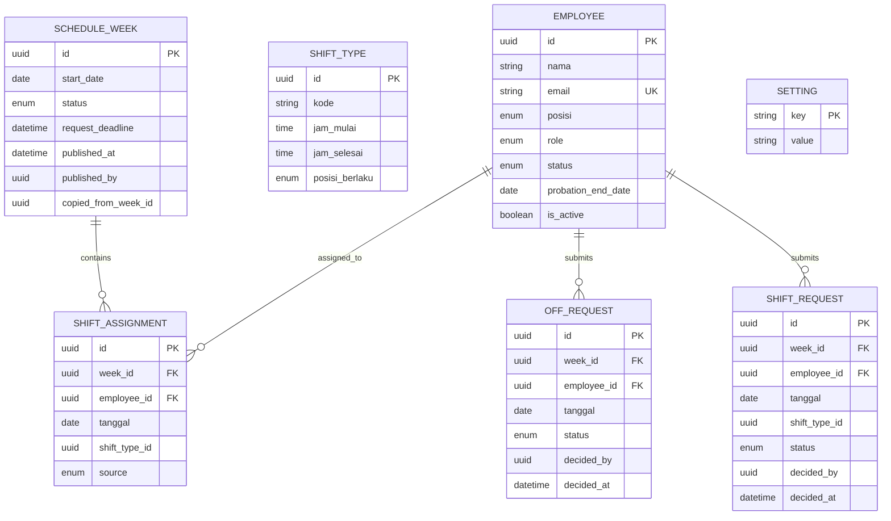
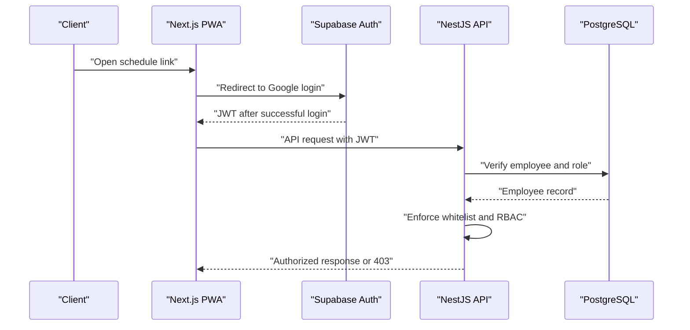
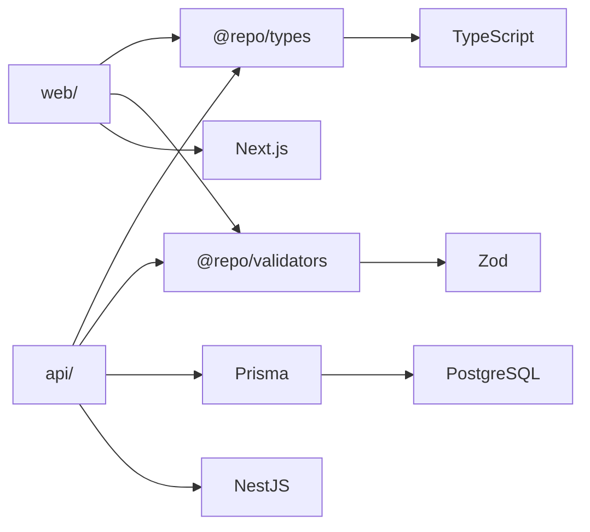

Now I have a comprehensive understanding of the monorepo architecture. Let me update the Project Overview documentation to reflect the actual implementation with Bun workspaces, Turborepo, and the complete project structure.

# Project Overview

<cite>
**Referenced Files in This Document**
- [README.md](file://README.md)
- [package.json](file://package.json)
- [turbo.json](file://turbo.json)
- [web/package.json](file://web/package.json)
- [api/package.json](file://api/package.json)
- [packages/types/package.json](file://packages/types/package.json)
- [packages/validators/package.json](file://packages/validators/package.json)
- [tsconfig.base.json](file://tsconfig.base.json)
- [PRD-Aplikasi-Penjadwalan-Shift-Kyne.md](file://docs/PRD-Aplikasi-Penjadwalan-Shift-Kyne.md)
- [0001-monorepo-mengikuti-tooling-erp.md](file://docs/adr/0001-monorepo-mengikuti-tooling-erp.md)
</cite>

## Update Summary
**Changes Made**
- Updated Project Structure section to reflect actual monorepo architecture with Bun workspaces and Turborepo
- Added comprehensive overview of the four-package structure (web, api, packages/types, packages/validators)
- Updated Architecture Overview to show real implementation details including Bun runtime and build system
- Enhanced Core Components section with actual package dependencies and shared utilities
- Added new sections for Monorepo Tooling and Build System configuration

## Table of Contents
1. [Introduction](#introduction)
2. [Monorepo Architecture](#monorepo-architecture)
3. [Project Structure](#project-structure)
4. [Core Components](#core-components)
5. [Architecture Overview](#architecture-overview)
6. [Detailed Component Analysis](#detailed-component-analysis)
7. [Dependency Analysis](#dependency-analysis)
8. [Performance Considerations](#performance-considerations)
9. [Troubleshooting Guide](#troubleshooting-guide)
10. [Conclusion](#conclusion)

## Introduction
This project is a standalone scheduling Progressive Web App (PWA) designed to automate weekly shift management for Kyne café operations. The application targets the current pain points of manual, chat-based coordination and helps ensure consistent coverage across bar and kitchen roles during busy days while respecting staff leave preferences.

The repository is now a fully scaffolded monorepo using Bun workspaces and Turborepo, containing both frontend and backend implementations along with shared packages. It includes a Next.js PWA frontend, NestJS API backend, Prisma database schema, and shared type definitions and validators.

The strategic importance of this project lies in reducing manual coordination effort, preventing coverage gaps on weekends, and centralizing leave and shift requests into one system. For Indonesian business context, the product aligns with local operational practices such as WITA time zone handling and WhatsApp-based communication for sharing schedules.

Target audience:
- Café managers who create, validate, publish, and share weekly schedules.
- Bar and kitchen staff who submit leave and shift requests and view their personal schedules.
- Probationary staff who can view schedules but cannot request leave or shifts until probation ends.

**Section sources**
- [README.md:1-20](file://README.md#L1-L20)
- [PRD-Aplikasi-Penjadwalan-Shift-Kyne.md:5-26](file://docs/PRD-Aplikasi-Penjadwalan-Shift-Kyne.md#L5-L26)

## Monorepo Architecture
The project follows a modern monorepo architecture built on Bun workspaces and Turborepo, mirroring the tooling structure of the ERP system it will eventually integrate with. This design enables seamless code sharing between components and maintains consistency with enterprise-grade development practices.

### Key Architectural Decisions
- **Bun Runtime**: Uses Bun 1.4.3 as the primary JavaScript runtime for improved performance
- **Turborepo Build System**: Provides fast, parallelized builds and task orchestration across all packages
- **Workspace Isolation**: Each package maintains its own dependencies while sharing common types and validators
- **ERP Compatibility**: Directory structure and tooling follow ERP conventions for easy migration

**Diagram sources**
- [package.json:6-10](file://package.json#L6-L10)
- [README.md:14-19](file://README.md#L14-L19)

**Section sources**
- [0001-monorepo-mengikuti-tooling-erp.md:1-4](file://docs/adr/0001-monorepo-mengikuti-tooling-erp.md#L1-L4)
- [package.json:1-32](file://package.json#L1-L32)

## Project Structure
The repository is organized as a monorepo with four main packages, each serving a specific purpose in the shift scheduling application:

### Package Overview
| Directory | Purpose | Technology Stack |
|-----------|---------|------------------|
| `web` | Frontend PWA for staff and manager interfaces | Next.js 16, React 19, TypeScript |
| `api` | Backend API with business logic and database access | NestJS 11, Prisma, PostgreSQL |
| `packages/types` | Shared TypeScript type definitions | TypeScript, Vitest |
| `packages/validators` | Zod validation schemas used across packages | Zod, TypeScript |

### Development Workflow
The monorepo supports unified development commands through Turborepo:
- `bun run dev`: Starts both web and API servers in watch mode
- `bun run build`: Builds all packages with dependency ordering
- `bun run test`: Runs tests across all packages
- `bun run db:migrate`: Applies database migrations
- `bun run db:seed`: Seeds initial data including shift types

**Diagram sources**
- [turbo.json:21-25](file://turbo.json#L21-L25)
- [README.md:25-33](file://README.md#L25-L33)

**Section sources**
- [README.md:10-20](file://README.md#L10-L20)
- [README.md:21-33](file://README.md#L21-L33)
- [package.json:11-24](file://package.json#L11-L24)

## Core Components
The MVP focuses on seven functional modules implemented across the monorepo structure:

### Application Modules
- **Authentication**: Google login with email whitelist via Supabase Auth
- **Employee Management**: Add, deactivate, assign positions and manage probation status
- **Leave & Shift Requests**: Weekly window for staff to submit leave and shift swap requests
- **Manager Dashboard**: View all requests, conflicts, and missing requests with validation
- **Schedule Construction**: Automated schedule building from previous week with business rules
- **Publish & Share**: Schedule publishing with WhatsApp link sharing
- **Staff Schedule View**: Personal shift viewing with middle-kitchen closures and hours tracking

### Shared Infrastructure
- **Type Safety**: Centralized TypeScript definitions ensuring consistency across web and API
- **Validation Layer**: Zod schemas providing runtime validation for all data inputs
- **Database Schema**: Prisma models with UUIDs, audit fields, and timezone-aware date handling
- **Testing Framework**: Vitest for unit tests and Jest for API integration tests

**Section sources**
- [PRD-Aplikasi-Penjadwalan-Shift-Kyne.md:102-164](file://docs/PRD-Aplikasi-Penjadwalan-Shift-Kyne.md#L102-L164)
- [web/package.json:12-16](file://web/package.json#L12-L16)
- [api/package.json:16-27](file://api/package.json#L16-L27)

## Architecture Overview
The architecture separates concerns between frontend, backend, authentication, and database layers with clear boundaries enforced by the monorepo structure.

### Technology Stack Implementation
- **Frontend**: Next.js 16 App Router as mobile-first PWA with React 19
- **Backend**: NestJS 11 service enforcing business rules, RBAC, and validation
- **Database**: PostgreSQL via Supabase with Prisma ORM
- **Authentication**: Supabase Auth with Google login using PKCE redirect
- **Build System**: Turborepo for parallelized builds and task orchestration
- **Runtime**: Bun 1.4.3 for improved performance across all packages

**Diagram sources**
- [web/package.json:12-16](file://web/package.json#L12-L16)
- [api/package.json:16-27](file://api/package.json#L16-L27)
- [packages/types/package.json:1-24](file://packages/types/package.json#L1-L24)
- [packages/validators/package.json:1-28](file://packages/validators/package.json#L1-L28)

## Detailed Component Analysis

### Monorepo Build System Configuration
Turborepo provides intelligent task orchestration with caching and dependency resolution:

#### Task Dependencies
- **Build Pipeline**: `^build` ensures dependencies build before dependents
- **Development Mode**: Persistent processes with hot reload for both web and API
- **Database Operations**: Prisma client generation before dependent tasks
- **Testing**: Separate test suites for unit (Vitest) and integration (Jest) testing

#### Environment Configuration
Global environment variables include database URLs for both pooled and direct connections, enabling flexible deployment across different environments.

**Section sources**
- [turbo.json:1-40](file://turbo.json#L1-L40)
- [package.json:26-30](file://package.json#L26-L30)

### Shared Package Architecture
The shared packages provide type safety and validation across the entire application:

#### @repo/types Package
- Exports centralized TypeScript definitions
- Includes SHIFT_TYPE_CATALOG from PRD specifications
- Supports both development and production builds
- Maintains type consistency between frontend and backend

#### @repo/validators Package  
- Contains Zod schemas for runtime validation
- Used by both API endpoints and seed scripts
- Provides input sanitization and business rule enforcement
- Depends on @repo/types for type definitions

**Diagram sources**
- [packages/types/package.json:1-24](file://packages/types/package.json#L1-L24)
- [packages/validators/package.json:1-28](file://packages/validators/package.json#L1-L28)

**Section sources**
- [packages/types/package.json:1-24](file://packages/types/package.json#L1-L24)
- [packages/validators/package.json:1-28](file://packages/validators/package.json#L1-L28)

### Weekly Scheduling Workflow
The scheduling process follows a weekly cycle aligned with Monday–Sunday operations. During the week, staff submit leave and shift requests. At a defined deadline, the request window closes, and the manager constructs the schedule using automation helpers, then validates coverage before publishing.

**Diagram sources**
- [PRD-Aplikasi-Penjadwalan-Shift-Kyne.md:73-90](file://docs/PRD-Aplikasi-Penjadwalan-Shift-Kyne.md#L73-L90)
- [PRD-Aplikasi-Penjadwalan-Shift-Kyne.md:140-155](file://docs/PRD-Aplikasi-Penjadwalan-Shift-Kyne.md#L140-L155)

**Section sources**
- [PRD-Aplikasi-Penjadwalan-Shift-Kyne.md:73-90](file://docs/PRD-Aplikasi-Penjadwalan-Shift-Kyne.md#L73-L90)
- [PRD-Aplikasi-Penjadwalan-Shift-Kyne.md:140-155](file://docs/PRD-Aplikasi-Penjadwalan-Shift-Kyne.md#L140-L155)

### Business Rules and Coverage Validation
Business rules define shift types, leave limits, request windows, probation behavior, and coverage requirements. Coverage validation ensures sufficient staffing on busy days and warns the manager before publishing if rules are violated.

**Diagram sources**
- [PRD-Aplikasi-Penjadwalan-Shift-Kyne.md:165-195](file://docs/PRD-Aplikasi-Penjadwalan-Shift-Kyne.md#L165-L195)

**Section sources**
- [PRD-Aplikasi-Penjadwalan-Shift-Kyne.md:165-195](file://docs/PRD-Aplikasi-Penjadwalan-Shift-Kyne.md#L165-L195)

### Data Model Draft
The MVP data model includes entities for employees, shift types, weekly schedules, shift assignments, leave requests, shift requests, and settings. The design emphasizes UUIDs, audit fields, soft deletion, and timezone-aware date handling to prepare for future integration with an ERP system.

**Diagram sources**
- [PRD-Aplikasi-Penjadwalan-Shift-Kyne.md:197-217](file://docs/PRD-Aplikasi-Penjadwalan-Shift-Kyne.md#L197-L217)

**Section sources**
- [PRD-Aplikasi-Penjadwalan-Shift-Kyne.md:197-217](file://docs/PRD-Aplikasi-Penjadwalan-Shift-Kyne.md#L197-L217)

### Security and Access Control
Security relies on a NestJS-enforced email whitelist, role checks from the employee table rather than client-side metadata, and strict database policies. All pages require login, and staff can only see their own schedule data. Timezone handling uses WITA, and backup is planned daily.

**Diagram sources**
- [PRD-Aplikasi-Penjadwalan-Shift-Kyne.md:220-248](file://docs/PRD-Aplikasi-Penjadwalan-Shift-Kyne.md#L220-L248)

**Section sources**
- [PRD-Aplikasi-Penjadwalan-Shift-Kyne.md:220-248](file://docs/PRD-Aplikasi-Penjadwalan-Shift-Kyne.md#L220-L248)

## Dependency Analysis
The monorepo structure creates clear dependency relationships between packages:

### Package Dependencies
- **web** depends on: Next.js, React, @repo/types, @repo/validators
- **api** depends on: NestJS, Prisma, @repo/types, @repo/validators, PostgreSQL
- **@repo/types**: No runtime dependencies, pure TypeScript definitions
- **@repo/validators**: Depends on @repo/types and Zod for validation

### Build and Runtime Dependencies
- **Bun 1.4.3**: Primary runtime for improved performance
- **Turborepo 2.x**: Build orchestration and caching
- **TypeScript 6.x**: Type checking across all packages
- **Prisma 7.x**: Database ORM and client generation

**Diagram sources**
- [web/package.json:12-23](file://web/package.json#L12-L23)
- [api/package.json:16-45](file://api/package.json#L16-L45)
- [packages/types/package.json:19-22](file://packages/types/package.json#L19-L22)
- [packages/validators/package.json:19-26](file://packages/validators/package.json#L19-L26)

**Section sources**
- [web/package.json:1-25](file://web/package.json#L1-L25)
- [api/package.json:1-47](file://api/package.json#L1-L47)
- [packages/types/package.json:1-24](file://packages/types/package.json#L1-L24)
- [packages/validators/package.json:1-28](file://packages/validators/package.json#L1-L28)

## Performance Considerations
The monorepo architecture provides several performance benefits:

### Build Performance
- **Parallel Execution**: Turborepo runs independent tasks concurrently
- **Caching**: Intelligent caching of build artifacts across packages
- **Incremental Builds**: Only rebuilds changed packages and their dependencies
- **Bun Runtime**: Faster startup and execution compared to Node.js

### Development Experience
- **Hot Reload**: Both web and API support development-time reloading
- **Type Checking**: Fast incremental type checking across all packages
- **Unified Commands**: Single command interface for all development tasks

### Runtime Performance
- **Mobile-First PWA**: Optimized for Android and iPhone devices
- **Efficient Validation**: Zod schemas provide fast runtime validation
- **Database Optimization**: Direct PostgreSQL connections with Prisma optimizations
- **WITA Timezone Handling**: Local timezone storage avoids conversion overhead

[No sources needed since this section provides general guidance]

## Troubleshooting Guide
Common issues and solutions for the monorepo setup:

### Development Environment Setup
- **Bun Installation**: Requires Bun 1.4.3 specifically for workspace compatibility
- **Docker Requirements**: OrbStack or Docker Desktop needed for local Supabase
- **Port Conflicts**: Local Supabase uses port 5442x to avoid conflicts with other projects

### Common Issues
- **Google Login Blocked**: In-app browsers may block Google login; users need Chrome/Safari or installed PWA
- **iPhone Standalone Mode**: Requires redirect-based login instead of popups
- **Email Whitelist**: Ensure all staff have Google accounts and proper email configuration
- **Database Connection**: Verify DATABASE_URL and DIRECT_URL for pooled vs direct connections

### Build and Deployment
- **Type Errors**: Use `bun run typecheck` to catch TypeScript errors across all packages
- **Test Failures**: Run `bun run test` for unit tests and `bun run test:api` for integration tests
- **Migration Issues**: Use `bun run db:migrate` to apply database schema changes

**Section sources**
- [README.md:21-35](file://README.md#L21-L35)
- [PRD-Aplikasi-Penjadwalan-Shift-Kyne.md:220-228](file://docs/PRD-Aplikasi-Penjadwalan-Shift-Kyne.md#L220-L228)

## Conclusion
Kyne café's shift scheduling application has evolved from a conceptual scaffold to a fully structured monorepo with modern tooling. The Bun workspaces and Turborepo architecture provide a solid foundation for scalable development, while the clear separation between web, api, and shared packages ensures maintainability and type safety.

The implementation successfully addresses the original goals of replacing manual, chat-driven coordination with a structured, automated weekly workflow. With Next.js providing a mobile-first PWA experience, NestJS handling complex business logic, and shared packages ensuring consistency, the application is well-positioned to meet the needs of Indonesian café operations.

The monorepo structure not only serves the immediate needs of the scheduling application but also establishes patterns and tooling that can be easily adapted when integrating with the larger ERP system, as specified in the architectural decision records.