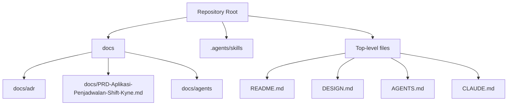
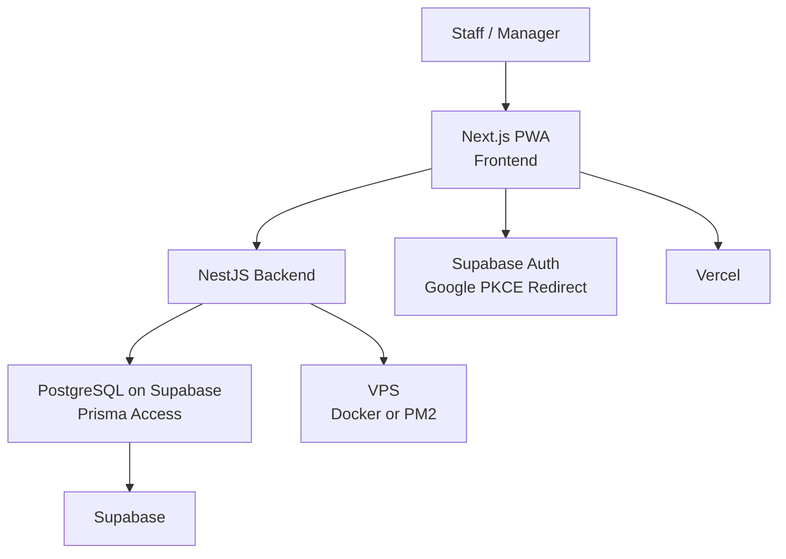
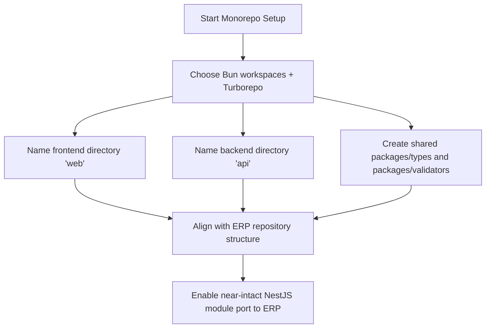
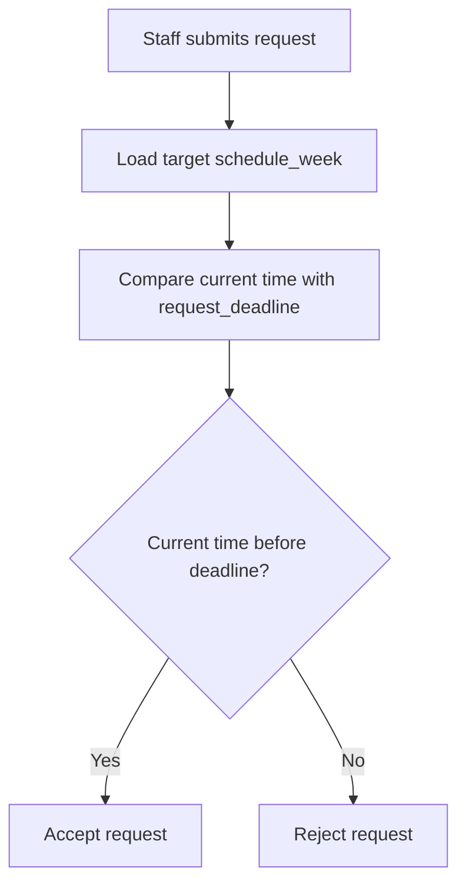
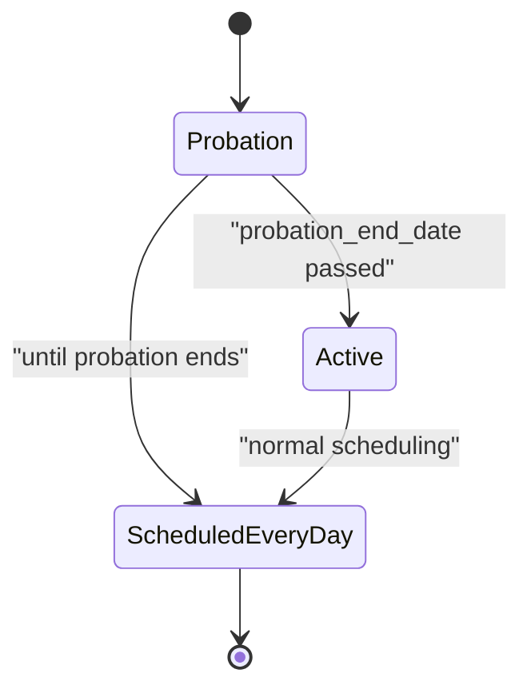
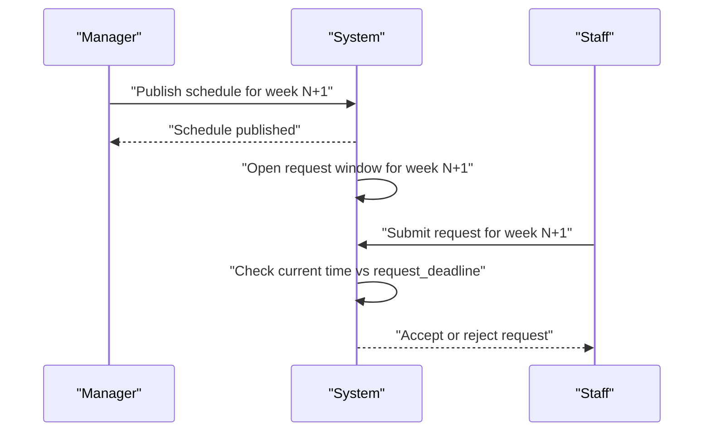
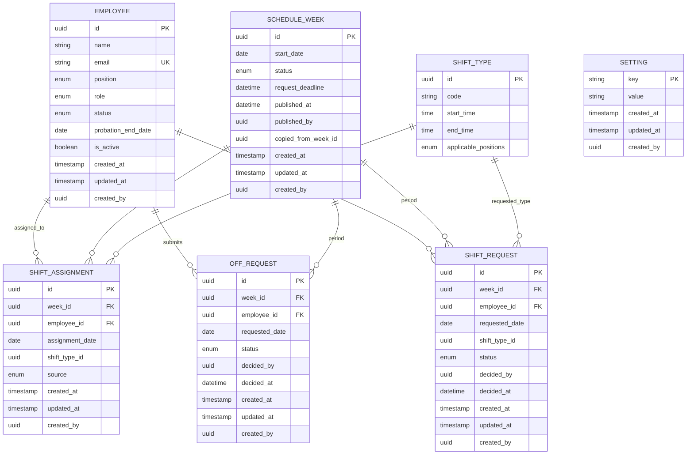
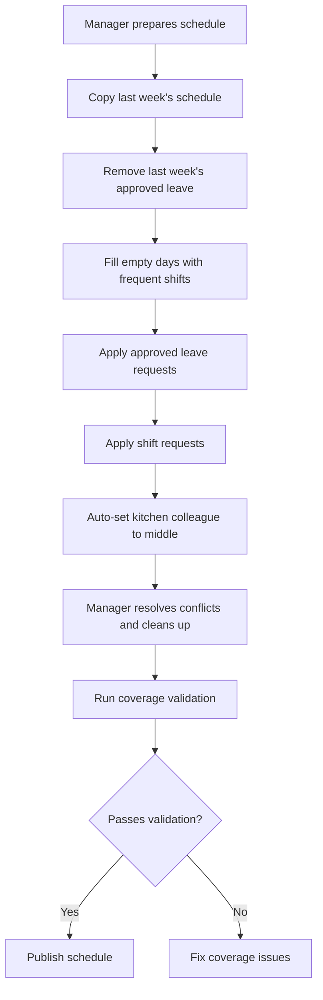
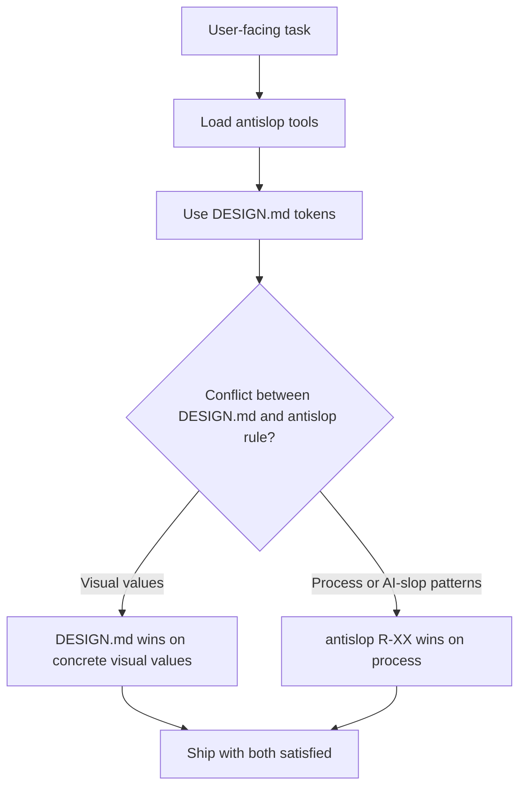
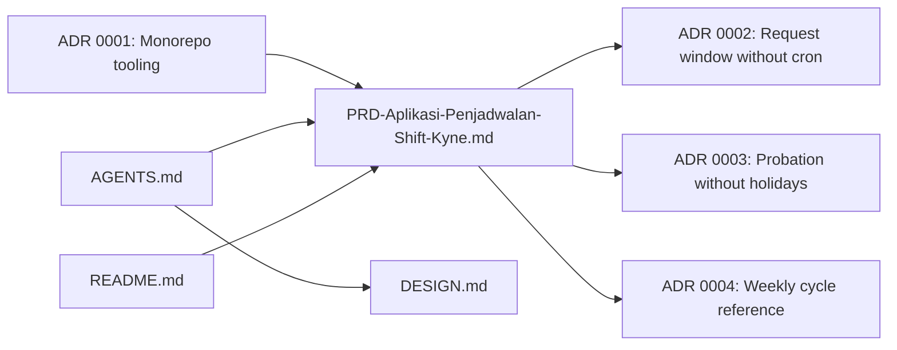

# Architecture Decision Records

<cite>
**Referenced Files in This Document**
- [README.md](file://README.md)
- [DESIGN.md](file://DESIGN.md)
- [AGENTS.md](file://AGENTS.md)
- [CLAUDE.md](file://CLAUDE.md)
- [PRD-Aplikasi-Penjadwalan-Shift-Kyne.md](file://docs/PRD-Aplikasi-Penjadwalan-Shift-Kyne.md)
- [0001-monorepo-mengikuti-tooling-erp.md](file://docs/adr/0001-monorepo-mengikuti-tooling-erp.md)
- [0002-jendela-request-dikunci-tanpa-cron.md](file://docs/adr/0002-jendela-request-dikunci-tanpa-cron.md)
- [0003-probation-tanpa-hari-libur.md](file://docs/adr/0003-probation-tanpa-hari-libur.md)
- [0004-siklus-mingguan-acu-ke-minggu-berikutnya.md](file://docs/adr/0004-siklus-mingguan-acu-ke-minggu-berikutnya.md)
</cite>

## Table of Contents
1. [Introduction](#introduction)
2. [Project Structure](#project-structure)
3. [Core Components](#core-components)
4. [Architecture Overview](#architecture-overview)
5. [Detailed Component Analysis](#detailed-component-analysis)
6. [Dependency Analysis](#dependency-analysis)
7. [Performance Considerations](#performance-considerations)
8. [Troubleshooting Guide](#troubleshooting-guide)
9. [Conclusion](#conclusion)

## Introduction
This document synthesizes the current state of the Scheduling repository and explains its architectural decisions through the lens of the Product Requirements Document, existing Architecture Decision Records, design system guidance, and agent workflow rules. The project is a standalone scheduling application for managing weekly shift schedules for six staff members across bar and kitchen roles. It is intentionally scaffolded as an early-stage monorepo whose structure and tooling are aligned with an ERP repository so that the NestJS backend module can later be moved almost intact into the ERP codebase.

At this point, the repository contains:
- A product requirements document describing MVP scope, user roles, business rules, data model draft, stack, hosting, security, timeline, and open questions.
- Four architecture decision records covering monorepo tooling, request window locking without cron, probation policy, and weekly cycle semantics.
- A design system specification used by agents to constrain visual and interaction decisions.
- Agent workflow instructions that mandate graph-based exploration, antislop quality gates, and strict adherence to the design system.

The repository currently has no executable application code; it is an initial scaffold awaiting implementation.

**Section sources**
- [README.md:1-25](file://README.md#L1-L25)
- [PRD-Aplikasi-Penjadwalan-Shift-Kyne.md:1-267](file://docs/PRD-Aplikasi-Penjadwalan-Shift-Kyne.md#L1-L267)

## Project Structure
The repository is organized around documentation, agent skills, and a small set of top-level directives rather than application source code.

**Diagram sources**
- [README.md:1-25](file://README.md#L1-L25)
- [DESIGN.md:1-563](file://DESIGN.md#L1-L563)
- [AGENTS.md:1-45](file://AGENTS.md#L1-L45)
- [CLAUDE.md:1-4](file://CLAUDE.md#L1-L4)
- [PRD-Aplikasi-Penjadwalan-Shift-Kyne.md:1-267](file://docs/PRD-Aplikasi-Penjadwalan-Shift-Kyne.md#L1-L267)

Key observations:
- The `docs/adr` directory holds the canonical architectural decisions.
- The `docs/PRD-Aplikasi-Penjadwalan-Shift-Kyne.md` file is the primary product and system specification.
- The `.agents/skills` directory contains reusable agent skill definitions, including domain modeling, code review, TDD, triage, and other process-oriented capabilities.
- Top-level files define project status, design constraints, agent behavior, and editor integration hints.

**Section sources**
- [README.md:1-25](file://README.md#L1-L25)
- [AGENTS.md:1-45](file://AGENTS.md#L1-L45)
- [CLAUDE.md:1-4](file://CLAUDE.md#L1-L4)

## Core Components
The core components at this stage are conceptual and documented rather than implemented:

| Component | Purpose | Current State |
|---|---|---|
| Product Requirements Document | Defines MVP scope, roles, workflows, business rules, data model draft, stack, hosting, security, timeline, and open questions | Complete but not yet implemented |
| Architecture Decision Records | Captures deliberate choices about monorepo layout, request window locking, probation policy, and weekly cycle semantics | Four decisions recorded |
| Design System Specification | Provides tokens, components, spacing, typography, colors, responsive behavior, and do/don’t rules for UI work | Used as the only design system for agents |
| Agent Workflow Rules | Enforces graph-first exploration, antislop quality gates, and mandatory use of the design system | Active for all agent work |
| Repository Scaffold | Initial commit with README, design system, agent rules, and ADRs | No application code yet |

**Section sources**
- [PRD-Aplikasi-Penjadwalan-Shift-Kyne.md:1-267](file://docs/PRD-Aplikasi-Penjadwalan-Shift-Kyne.md#L1-L267)
- [0001-monorepo-mengikuti-tooling-erp.md:1-4](file://docs/adr/0001-monorepo-mengikuti-tooling-erp.md#L1-L4)
- [0002-jendela-request-dikunci-tanpa-cron.md:1-4](file://docs/adr/0002-jendela-request-dikunci-tanpa-cron.md#L1-L4)
- [0003-probation-tanpa-hari-libur.md:1-4](file://docs/adr/0003-probation-tanpa-hari-libur.md#L1-L4)
- [0004-siklus-mingguan-acu-ke-minggu-berikutnya.md:1-10](file://docs/adr/0004-siklus-mingguan-acu-ke-minggu-berikutnya.md#L1-L10)
- [DESIGN.md:1-563](file://DESIGN.md#L1-L563)
- [AGENTS.md:1-45](file://AGENTS.md#L1-L45)

## Architecture Overview
The intended architecture is a monorepo containing a Next.js PWA frontend, a NestJS backend, shared type and validation packages, PostgreSQL via Supabase, and Supabase Auth. Hosting is split between Vercel for the web frontend, Supabase for database and authentication, and a VPS for the NestJS backend.

**Diagram sources**
- [PRD-Aplikasi-Penjadwalan-Shift-Kyne.md:230-249](file://docs/PRD-Aplikasi-Penjadwalan-Shift-Kyne.md#L230-L249)

Important architectural constraints:
- The monorepo follows the ERP repository’s structure and tooling so the NestJS module can be ported with minimal changes.
- Frontend uses Next.js as a PWA; backend uses NestJS with modules for authentication, employee management, requests, scheduling, and publishing.
- Database schema is drafted around seven entities: employee, shift_type, schedule_week, shift_assignment, off_request, shift_request, and setting.
- Security requires email whitelist enforcement in NestJS, role resolution from the employee table, and deny-all Row Level Security policies because the frontend never reads tables directly.
- Request deadlines are enforced by comparing current time with the week’s deadline rather than using a cron job.

**Section sources**
- [PRD-Aplikasi-Penjadwalan-Shift-Kyne.md:230-249](file://docs/PRD-Aplikasi-Penjadwalan-Shift-Kyne.md#L230-L249)
- [PRD-Aplikasi-Penjadwalan-Shift-Kyne.md:197-217](file://docs/PRD-Aplikasi-Penjadwalan-Shift-Kyne.md#L197-L217)

## Detailed Component Analysis

### Monorepo Tooling and Directory Naming
The first ADR decides that the repository should follow the ERP monorepo’s tooling and directory naming conventions. The chosen tooling includes Bun workspaces and Turborepo. The frontend directory is named `web`, the backend directory is named `api`, and shared packages live under `packages/types` and `packages/validators`. This naming resolves ambiguity between client/server versus web/api terminology and supports moving the NestJS module into the ERP repository.

**Diagram sources**
- [0001-monorepo-mengikuti-tooling-erp.md:1-4](file://docs/adr/0001-monorepo-mengikuti-tooling-erp.md#L1-L4)

**Section sources**
- [0001-monorepo-mengikuti-tooling-erp.md:1-4](file://docs/adr/0001-monorepo-mengikuti-tooling-erp.md#L1-L4)

### Request Window Locking Without Cron
The second ADR chooses to lock the request window by checking the current time against the target week’s `request_deadline` when a request arrives, instead of using a cron job to toggle a window status. This means:
- There is no scheduler job on the VPS.
- The openness of the request window is derived from `request_deadline`.
- The only explicit week status is draft or published.

**Diagram sources**
- [0002-jendela-request-dikunci-tanpa-cron.md:1-4](file://docs/adr/0002-jendela-request-dikunci-tanpa-cron.md#L1-L4)
- [PRD-Aplikasi-Penjadwalan-Shift-Kyne.md:197-217](file://docs/PRD-Aplikasi-Penjadwalan-Shift-Kyne.md#L197-L217)

**Section sources**
- [0002-jendela-request-dikunci-tanpa-cron.md:1-4](file://docs/adr/0002-jendela-request-dikunci-tanpa-cron.md#L1-L4)

### Probation Policy Without Holidays
The third ADR records the owner’s policy that probationary staff do not receive holidays. They are scheduled every day until their probation end date passes, and they do not see request menus for leave or shift swaps. An alternative where managers still assign holiday days was rejected because the owner’s policy is explicit. The ADR also notes a legal risk: labor law appears to require at least one rest day per week for six working days, with no clear probation exception. This risk is accepted consciously and must not be silently “fixed” in code without owner approval.

**Diagram sources**
- [0003-probation-tanpa-hari-libur.md:1-4](file://docs/adr/0003-probation-tanpa-hari-libur.md#L1-L4)
- [PRD-Aplikasi-Penjadwalan-Shift-Kyne.md:27-37](file://docs/PRD-Aplikasi-Penjadwalan-Shift-Kyne.md#L27-L37)
- [PRD-Aplikasi-Penjadwalan-Shift-Kyne.md:122-130](file://docs/PRD-Aplikasi-Penjadwalan-Shift-Kyne.md#L122-L130)

**Section sources**
- [0003-probation-tanpa-hari-libur.md:1-4](file://docs/adr/0003-probation-tanpa-hari-libur.md#L1-L4)

### Weekly Cycle Reference Point
The fourth ADR clarifies that both the request window and publish actions refer to the next week, not the current week. Although the PRD wording could be read literally as publishing the current week’s schedule on Sunday afternoon, the success metric anchors the rule: the schedule for the next week must be published by Sunday 18:00 WITA. Therefore:
- The schedule for week N+1 is prepared and published on Sunday of week N, no later than 18:00 WITA.
- The request window for N+1 opens when the schedule for N+1 is created or published.
- The request window closes at Sunday 12:00 WITA of week N.
- Staff submit requests for a week that has not yet started.

**Diagram sources**
- [0004-siklus-mingguan-acu-ke-minggu-berikutnya.md:1-10](file://docs/adr/0004-siklus-mingguan-acu-ke-minggu-berikutnya.md#L1-L10)
- [PRD-Aplikasi-Penjadwalan-Shift-Kyne.md:73-90](file://docs/PRD-Aplikasi-Penjadwalan-Shift-Kyne.md#L73-L90)

**Section sources**
- [0004-siklus-mingguan-acu-ke-minggu-berikutnya.md:1-10](file://docs/adr/0004-siklus-mingguan-acu-ke-minggu-berikutnya.md#L1-L10)

### Data Model Draft
The PRD defines seven core entities for the MVP. These entities form the backbone of the scheduling domain and will guide database schema design once implementation begins.

**Diagram sources**
- [PRD-Aplikasi-Penjadwalan-Shift-Kyne.md:197-217](file://docs/PRD-Aplikasi-Penjadwalan-Shift-Kyne.md#L197-L217)

**Section sources**
- [PRD-Aplikasi-Penjadwalan-Shift-Kyne.md:197-217](file://docs/PRD-Aplikasi-Penjadwalan-Shift-Kyne.md#L197-L217)

### Business Rules and Validation Flow
The business rules define shift types, coverage expectations, conflict handling, and how the system enforces constraints. The most important flows involve request locking, middle kitchen logic, and coverage validation before publishing.

**Diagram sources**
- [PRD-Aplikasi-Penjadwalan-Shift-Kyne.md:73-90](file://docs/PRD-Aplikasi-Penjadwalan-Shift-Kyne.md#L73-L90)
- [PRD-Aplikasi-Penjadwalan-Shift-Kyne.md:165-195](file://docs/PRD-Aplikasi-Penjadwalan-Shift-Kyne.md#L165-L195)

**Section sources**
- [PRD-Aplikasi-Penjadwalan-Shift-Kyne.md:73-90](file://docs/PRD-Aplikasi-Penjadwalan-Shift-Kyne.md#L73-L90)
- [PRD-Aplikasi-Penjadwalan-Shift-Kyne.md:165-195](file://docs/PRD-Aplikasi-Penjadwalan-Shift-Kyne.md#L165-L195)

### Design System Constraints
The design system is not merely aesthetic; it is a hard constraint for any user-facing work. It specifies a single interactive accent color, SF Pro typography, zero decorative gradients, one product drop shadow, alternating light and dark tile rhythm, and detailed component specifications. Agents must load antislop tools before shipping user-facing work and must treat DESIGN.md as the only design system.

**Diagram sources**
- [AGENTS.md:28-36](file://AGENTS.md#L28-L36)
- [DESIGN.md:1-563](file://DESIGN.md#L1-L563)

**Section sources**
- [AGENTS.md:28-36](file://AGENTS.md#L28-L36)
- [DESIGN.md:1-563](file://DESIGN.md#L1-L563)

## Dependency Analysis
At this stage, dependencies are primarily documentary and procedural rather than code-level.

**Diagram sources**
- [PRD-Aplikasi-Penjadwalan-Shift-Kyne.md:1-267](file://docs/PRD-Aplikasi-Penjadwalan-Shift-Kyne.md#L1-L267)
- [0001-monorepo-mengikuti-tooling-erp.md:1-4](file://docs/adr/0001-monorepo-mengikuti-tooling-erp.md#L1-L4)
- [0002-jendela-request-dikunci-tanpa-cron.md:1-4](file://docs/adr/0002-jendela-request-dikunci-tanpa-cron.md#L1-L4)
- [0003-probation-tanpa-hari-libur.md:1-4](file://docs/adr/0003-probation-tanpa-hari-libur.md#L1-L4)
- [0004-siklus-mingguan-acu-ke-minggu-berikutnya.md:1-10](file://docs/adr/0004-siklus-mingguan-acu-ke-minggu-berikutnya.md#L1-L10)
- [DESIGN.md:1-563](file://DESIGN.md#L1-L563)
- [AGENTS.md:1-45](file://AGENTS.md#L1-L45)
- [README.md:1-25](file://README.md#L1-L25)

Key dependency relationships:
- The PRD is the primary source of truth for scope, roles, workflows, data model, stack, hosting, and security.
- ADRs refine or disambiguate PRD statements, especially around monorepo structure, request window mechanics, probation policy, and weekly cycle semantics.
- AGENTS.md constrains how agents explore and implement changes, requiring graph-first analysis, antislop quality checks, and strict use of DESIGN.md.
- DESIGN.md governs all visual and interaction decisions for user-facing work.
- README.md documents repository status and indicates that setup instructions will be added after the stack and tooling are finalized.

**Section sources**
- [PRD-Aplikasi-Penjadwalan-Shift-Kyne.md:1-267](file://docs/PRD-Aplikasi-Penjadwalan-Shift-Kyne.md#L1-L267)
- [AGENTS.md:1-45](file://AGENTS.md#L1-L45)
- [DESIGN.md:1-563](file://DESIGN.md#L1-L563)
- [README.md:1-25](file://README.md#L1-L25)

## Performance Considerations
Because there is no application code yet, performance considerations are architectural and operational rather than algorithmic:

- **Request deadline checks:** Checking the current time against `request_deadline` avoids background jobs but adds a small per-request comparison. This is acceptable for an MVP serving six staff members.
- **Database access:** The frontend does not read tables directly; all data goes through NestJS. This centralizes authorization and validation but introduces a single backend dependency.
- **Hosting separation:** Frontend on Vercel, database and auth on Supabase, backend on a VPS. This separates concerns but increases deployment complexity.
- **Mobile-first PWA:** The frontend targets Android and iPhone users, which means network latency, offline installability, and in-app browser login behavior are important runtime concerns.
- **Backup strategy:** Daily automatic backups are required by the non-functional requirements.

[No sources needed since this section provides general guidance]

## Troubleshooting Guide
Operational troubleshooting should focus on areas explicitly called out in the PRD and ADRs:

| Area | Symptom | Likely Cause | Recommended Action |
|---|---|---|---|
| Google login from WhatsApp link | Login blocked or fails inside in-app browser | In-app browser restrictions or WebView user-agent blocking | Test on Android and iPhone; direct users to Chrome/Safari or installed PWA if needed |
| Request submission rejected | Request denied even though manager expects it open | Current time past `request_deadline` | Verify timezone (WITA), deadline value, and that the correct week is referenced |
| Probation staff sees request menu | Menu visible despite probation policy | UI or permission logic not enforcing probation rules | Confirm probation status and hide request menus until probation end date passes |
| Schedule conflict unresolved | Coverage warnings remain before publish | Kitchen middle logic or manual cleanup incomplete | Review auto-middle logic and let manager resolve remaining conflicts |
| Role mismatch | JWT metadata says one role but access differs | Role taken from JWT metadata instead of employee table | Ensure roles come from the employee table, not `user_metadata` |
| Unauthorized direct database access | Unexpected data exposure | RLS not deny-all or frontend bypassing backend | Enforce deny-all RLS and ensure frontend only talks to NestJS |

**Section sources**
- [PRD-Aplikasi-Penjadwalan-Shift-Kyne.md:220-249](file://docs/PRD-Aplikasi-Penjadwalan-Shift-Kyne.md#L220-L249)
- [0002-jendela-request-dikunci-tanpa-cron.md:1-4](file://docs/adr/0002-jendela-request-dikunci-tanpa-cron.md#L1-L4)
- [0003-probation-tanpa-hari-libur.md:1-4](file://docs/adr/0003-probation-tanpa-hari-libur.md#L1-L4)

## Conclusion
The Scheduling repository is currently a well-scoped scaffold backed by a clear PRD, four focused architecture decision records, a strict design system, and agent workflow rules. The most important architectural decisions are:
- Use an ERP-aligned monorepo structure with `web`, `api`, and shared packages.
- Lock request windows by deadline check rather than cron.
- Honor the owner’s probation policy without holidays, while documenting the associated legal risk.
- Treat the weekly cycle as referring to the next week, anchored by the success metric.
- Centralize business logic, RBAC, and validation in NestJS behind a mobile-first PWA.
- Enforce security through NestJS whitelist checks, employee-table roles, and deny-all RLS.

Once implementation begins, these documents should remain the authoritative references for new architectural decisions, code structure, and user-facing behavior.

[No sources needed since this section summarizes without analyzing specific files]