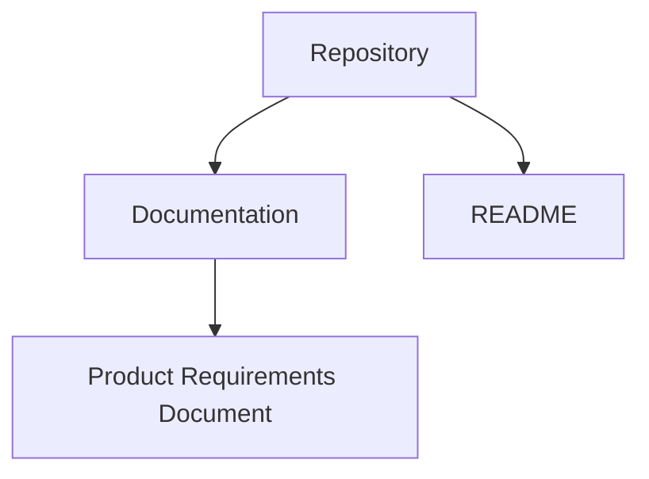
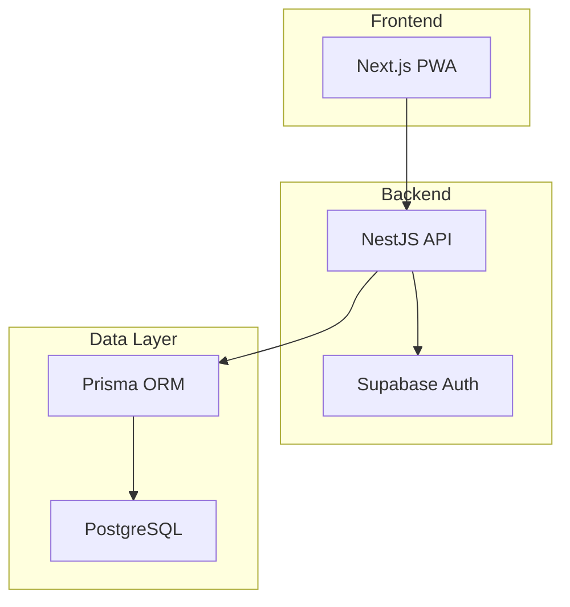
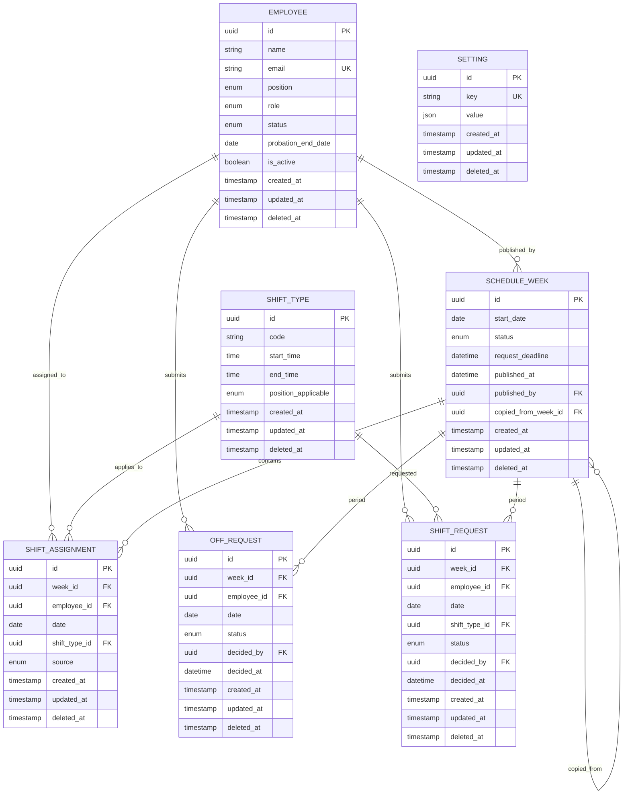
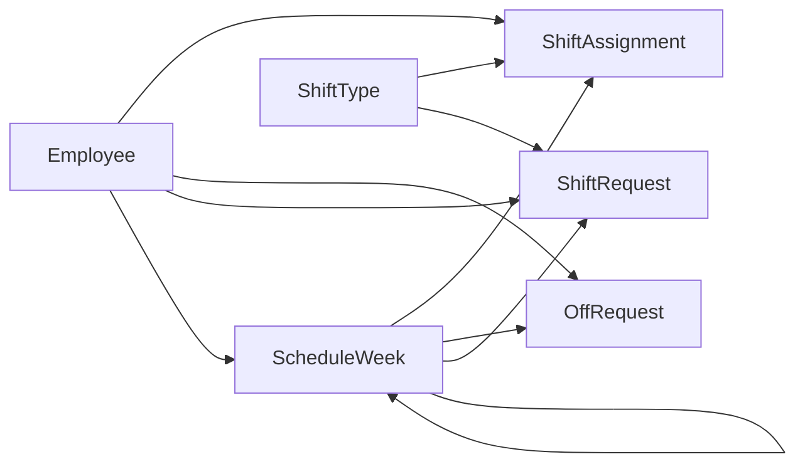

# Data Model Architecture

<cite>
**Referenced Files in This Document**
- [README.md](file://README.md)
- [PRD-Aplikasi-Penjadwalan-Shift-Kyne.md](file://docs/PRD-Aplikasi-Penjadwalan-Shift-Kyne.md)
</cite>

## Table of Contents
1. [Introduction](#introduction)
2. [Project Structure](#project-structure)
3. [Core Components](#core-components)
4. [Architecture Overview](#architecture-overview)
5. [Detailed Component Analysis](#detailed-component-analysis)
6. [Dependency Analysis](#dependency-analysis)
7. [Performance Considerations](#performance-considerations)
8. [Troubleshooting Guide](#troubleshooting-guide)
9. [Conclusion](#conclusion)
10. [Appendices](#appendices)

## Introduction
This document defines the data model architecture for the Kyne shift scheduling application. It consolidates the Product Requirements Document’s draft entity model into a complete, implementation-ready specification. The scope covers:

- Entity relationships among Employee, ShiftType, ScheduleWeek, ShiftAssignment, OffRequest, ShiftRequest, and Setting
- Primary keys, foreign keys, constraints, and indexing strategy
- Prisma ORM schema design guidance and migration approach
- Data validation rules, business constraints, and referential integrity
- Audit trail fields (created_at, updated_at, deleted_at)
- Normalization principles, performance considerations for large datasets, and query optimization strategies
- Role-based access permissions for manager, staff, and probationary staff
- Sample data structures and common query patterns for schedule generation and reporting

The repository is currently an early scaffold without code; this document derives its requirements from the PRD and provides actionable database design recommendations aligned with PostgreSQL and Prisma.

**Section sources**
- [README.md:1-25](file://README.md#L1-L25)
- [PRD-Aplikasi-Penjadwalan-Shift-Kyne.md:197-217](file://docs/PRD-Aplikasi-Penjadwalan-Shift-Kyne.md#L197-L217)

## Project Structure
At this stage, the project contains only documentation and a README. The actual application code, including Prisma schema and migrations, will be introduced later as part of the NestJS backend and Next.js frontend within a monorepo structure. For now, the data model is defined conceptually based on the PRD.

**Diagram sources**
- [README.md:1-25](file://README.md#L1-L25)
- [PRD-Aplikasi-Penjadwalan-Shift-Kyne.md:1-10](file://docs/PRD-Aplikasi-Penjadwalan-Shift-Kyne.md#L1-L10)

**Section sources**
- [README.md:1-25](file://README.md#L1-L25)

## Core Components
The MVP requires seven core entities to support weekly shift scheduling, request handling, and configuration management. These entities are designed to be ERP-ready by using UUIDs, audit fields, and normalized relations.

- Employee: Represents staff members with role, position, probation status, and active flag. Email serves as the login whitelist key.
- ShiftType: Defines shift codes (PAGI/SORE/MIDDLE), start/end times, and applicable positions.
- ScheduleWeek: Represents one weekly cycle (Monday–Sunday) with status, deadlines, publication metadata, and copy lineage.
- ShiftAssignment: The core schedule record linking employee, week, date, shift type, and source of assignment.
- OffRequest: Weekly off-day requests per employee with approval workflow.
- ShiftRequest: Preferred shift requests per day per employee with approval workflow.
- Setting: Key-value configuration for system behavior such as timezone and deadline settings.

Key design principles:
- Use UUIDs for all primary keys.
- Include created_at, updated_at, and deleted_at for auditing and soft deletes.
- Maintain referential integrity via foreign keys.
- Normalize repeated attributes (e.g., shift time definitions) into ShiftType.
- Track provenance of assignments through source fields.

**Section sources**
- [PRD-Aplikasi-Penjadwalan-Shift-Kyne.md:197-217](file://docs/PRD-Aplikasi-Penjadwalan-Shift-Kyne.md#L197-L217)

## Architecture Overview
The data layer uses PostgreSQL accessed via Prisma ORM. The application stack includes Next.js frontend, NestJS backend, Supabase Auth, and Vercel hosting. The data model supports RBAC enforced at the server level and RLS deny-all at the database level.

**Diagram sources**
- [PRD-Aplikasi-Penjadwalan-Shift-Kyne.md:230-249](file://docs/PRD-Aplikasi-Penjadwalan-Shift-Kyne.md#L230-L249)

**Section sources**
- [PRD-Aplikasi-Penjadwalan-Shift-Kyne.md:230-249](file://docs/PRD-Aplikasi-Penjadwalan-Shift-Kyne.md#L230-L249)

## Detailed Component Analysis

### Entity Relationships and Schema Design
The following diagram maps the seven entities and their relationships. Foreign keys enforce referential integrity between employees, weeks, shifts, and requests.

**Diagram sources**
- [PRD-Aplikasi-Penjadwalan-Shift-Kyne.md:197-217](file://docs/PRD-Aplikasi-Penjadwalan-Shift-Kyne.md#L197-L217)

#### Employee
- Purpose: Stores staff identity, role, position, probation status, and active flag.
- Primary Key: id (UUID).
- Unique Constraints: email (whitelist for login).
- Business Rules:
  - Roles: manager, staff, probationary.
  - Positions: bar, kitchen.
  - Status: probation, tetap (permanent).
  - Probation transitions automatically after probation_end_date.
  - Inactive employees cannot log in but retain historical records.
- Indexing:
  - Unique index on email.
  - Index on position and role for dashboard queries.
  - Index on is_active for filtering active staff.

#### ShiftType
- Purpose: Canonical definition of shift types and their time windows.
- Primary Key: id (UUID).
- Unique Constraints: code (PAGI, SORE, MIDDLE).
- Business Rules:
  - PAGI: 07:30–15:30 for bar and kitchen.
  - SORE: 15:00–23:00 for bar and kitchen.
  - MIDDLE: 11:00–19:00 for kitchen only, applied when a kitchen colleague is off.
- Indexing:
  - Unique index on code.
  - Index on position_applicable for quick lookup by role.

#### ScheduleWeek
- Purpose: Represents a weekly cycle with status, deadlines, and publication metadata.
- Primary Key: id (UUID).
- Unique Constraints: start_date (one row per Monday).
- Business Rules:
  - Status: draft, published.
  - Request window opens when previous week is published; closes Sunday 12:00 WITA.
  - copied_from_week_id references prior week for draft generation.
- Indexing:
  - Unique index on start_date.
  - Index on status for filtering drafts vs published.
  - Index on request_deadline for deadline enforcement.

#### ShiftAssignment
- Purpose: Core schedule entries mapping employees to shifts per day within a week.
- Primary Key: id (UUID).
- Foreign Keys:
  - week_id → ScheduleWeek.id
  - employee_id → Employee.id
  - shift_type_id → ShiftType.id
- Business Rules:
  - Null shift_type_id indicates off day.
  - Source values: copy, request, auto_middle, manual.
  - Coverage validation applies per day and position.
- Indexing:
  - Composite index on (week_id, employee_id, date) for schedule retrieval.
  - Index on shift_type_id for coverage checks.
  - Index on source for provenance analysis.

#### OffRequest
- Purpose: Weekly off-day requests per employee.
- Primary Key: id (UUID).
- Foreign Keys:
  - week_id → ScheduleWeek.id
  - employee_id → Employee.id
  - decided_by → Employee.id (manager decision)
- Business Rules:
  - Only Monday–Thursday allowed.
  - Maximum one off request per employee per week.
  - Status: pending, approved, rejected.
- Indexing:
  - Unique constraint on (week_id, employee_id) to enforce max one off per week.
  - Index on status for dashboard views.

#### ShiftRequest
- Purpose: Preferred shift requests per day per employee.
- Primary Key: id (UUID).
- Foreign Keys:
  - week_id → ScheduleWeek.id
  - employee_id → Employee.id
  - shift_type_id → ShiftType.id
  - decided_by → Employee.id (manager decision)
- Business Rules:
  - Allowed for any day; preferred morning or evening.
  - Multiple requests per week allowed; one per day.
  - Status: pending, approved, rejected.
- Indexing:
  - Index on (week_id, employee_id, date) for per-week per-staff requests.
  - Index on shift_type_id for slot conflict detection.

#### Setting
- Purpose: System configuration stored as key-value pairs.
- Primary Key: id (UUID).
- Unique Constraints: key.
- Business Rules:
  - Examples: probation_can_request=false, deadline_day=Sunday, deadline_time=12:00, timezone=Asia/Makassar.
- Indexing:
  - Unique index on key.

**Section sources**
- [PRD-Aplikasi-Penjadwalan-Shift-Kyne.md:197-217](file://docs/PRD-Aplikasi-Penjadwalan-Shift-Kyne.md#L197-L217)

### Data Validation Rules and Business Constraints
- OffRequest:
  - Day must be Monday–Thursday.
  - One off request per employee per week.
  - Conflict detection if two employees in the same position request off on the same day.
- ShiftRequest:
  - Any day allowed; one request per day per employee.
  - Slot limits: maximum number of PAGI/SORE per position per day.
  - Kitchen middle rule: if a kitchen colleague is off, the other kitchen employee becomes middle; conflicting shift requests on that day are invalidated.
- Coverage:
  - Friday–Sunday: bar needs 2 per shift; kitchen needs 1 per shift.
  - Monday–Thursday: bar needs at least 1 per shift; kitchen needs at least 1 or middle.
- Probation:
  - Probationary staff cannot submit requests; menu hidden until probation ends.
- Request Window:
  - Opens when previous week is published; closes Sunday 12:00 WITA.
- Soft Deletes:
  - No permanent deletion; use deleted_at for archival.

These rules are enforced at the application layer (NestJS) and validated via database constraints where appropriate.

**Section sources**
- [PRD-Aplikasi-Penjadwalan-Shift-Kyne.md:165-195](file://docs/PRD-Aplikasi-Penjadwalan-Shift-Kyne.md#L165-L195)

### Referential Integrity and Constraints
- All foreign keys reference valid parent records.
- Unique constraints prevent duplicate off requests per week and duplicate shift codes.
- Cascade behaviors:
  - Deleting a ScheduleWeek should cascade to dependent ShiftAssignment, OffRequest, and ShiftRequest rows.
  - Deleting an Employee should not delete historical assignments; instead, mark as inactive and preserve records.
- Check constraints:
  - OffRequest.date must fall within the week’s range.
  - ShiftRequest.shift_type_id must match position applicability.

**Section sources**
- [PRD-Aplikasi-Penjadwalan-Shift-Kyne.md:197-217](file://docs/PRD-Aplikasi-Penjadwalan-Shift-Kyne.md#L197-L217)

### Audit Trail Implementation
- Fields:
  - created_at: Timestamp when record is created.
  - updated_at: Timestamp when record is last modified.
  - deleted_at: Timestamp for soft delete.
- Strategy:
  - Middleware or hooks set created_at and updated_at automatically.
  - Soft deletes update deleted_at rather than removing rows.
  - created_by can be added to track who created records (optional extension).

**Section sources**
- [PRD-Aplikasi-Penjadwalan-Shift-Kyne.md:211-217](file://docs/PRD-Aplikasi-Penjadwalan-Shift-Kyne.md#L211-L217)

### Prisma ORM Schema Design and Migration Strategy
- Schema Design:
  - Define models for each entity with UUID primary keys.
  - Use enums for fixed sets (role, position, status, code, source).
  - Establish relations with @relation annotations.
  - Add indexes explicitly for performance-critical queries.
- Migration Strategy:
  - Use Prisma migrations to evolve schema incrementally.
  - Backfill default ShiftType records during initial migration.
  - Apply unique constraints and indexes in separate migration steps to minimize downtime.
  - Version control migrations alongside application code.

[No sources needed since this section provides general guidance]

### Data Normalization Principles
- First Normal Form:
  - Atomic values in columns; no repeating groups.
- Second Normal Form:
  - Remove partial dependencies; e.g., shift time details moved to ShiftType.
- Third Normal Form:
  - Eliminate transitive dependencies; e.g., avoid storing shift times in ShiftAssignment.
- Benefits:
  - Reduced redundancy.
  - Consistent shift definitions.
  - Easier maintenance and updates.

**Section sources**
- [PRD-Aplikasi-Penjadwalan-Shift-Kyne.md:197-217](file://docs/PRD-Aplikasi-Penjadwalan-Shift-Kyne.md#L197-L217)

### Performance Considerations for Large Datasets
- Indexing:
  - Composite indexes on (week_id, employee_id, date) for schedule queries.
  - Indexes on status fields for dashboard filtering.
  - Indexes on foreign keys for join performance.
- Partitioning:
  - Consider partitioning ShiftAssignment by week_id or date ranges for very large datasets.
- Query Optimization:
  - Use selective projections to reduce payload size.
  - Avoid N+1 queries by batching reads.
  - Cache frequent read-only data (e.g., ShiftType) in application memory.

[No sources needed since this section provides general guidance]

### Query Optimization Strategies
- Precompute coverage metrics for weekly reports.
- Materialized views for aggregated statistics (e.g., total hours per employee per week).
- Use transactional boundaries for batch operations like copying schedules.
- Leverage database-level constraints to prevent invalid states.

[No sources needed since this section provides general guidance]

### Role-Based Access Permissions
- Manager:
  - Manage employees, view and decide requests, create/publish schedules, view coverage validation.
- Staff:
  - View own schedule, submit off and shift requests.
- Probationary Staff:
  - View own schedule only; request menu hidden until probation ends.
- Enforcement:
  - Server-side RBAC in NestJS.
  - Database RLS deny-all; frontend never accesses tables directly.

**Section sources**
- [PRD-Aplikasi-Penjadwalan-Shift-Kyne.md:27-38](file://docs/PRD-Aplikasi-Penjadwalan-Shift-Kyne.md#L27-L38)
- [PRD-Aplikasi-Penjadwalan-Shift-Kyne.md:243-249](file://docs/PRD-Aplikasi-Penjadwalan-Shift-Kyne.md#L243-L249)

### Sample Data Structures
Below are conceptual examples of how data would look in practice. Replace placeholders with actual UUIDs and timestamps.

- Employee:
  - id: UUID
  - name: "Staff Name"
  - email: "staff@example.com"
  - position: "bar"
  - role: "staff"
  - status: "probation"
  - probation_end_date: "2026-12-31"
  - is_active: true
  - created_at: "2026-11-07T00:00:00Z"
  - updated_at: "2026-11-07T00:00:00Z"
  - deleted_at: null

- ShiftType:
  - id: UUID
  - code: "PAGI"
  - start_time: "07:30:00"
  - end_time: "15:30:00"
  - position_applicable: ["bar", "kitchen"]

- ScheduleWeek:
  - id: UUID
  - start_date: "2026-11-09"
  - status: "draft"
  - request_deadline: "2026-11-15T12:00:00+08:00"
  - published_at: null
  - published_by: UUID
  - copied_from_week_id: UUID

- ShiftAssignment:
  - id: UUID
  - week_id: UUID
  - employee_id: UUID
  - date: "2026-11-09"
  - shift_type_id: UUID
  - source: "copy"

- OffRequest:
  - id: UUID
  - week_id: UUID
  - employee_id: UUID
  - date: "2026-11-10"
  - status: "pending"
  - decided_by: UUID
  - decided_at: null

- ShiftRequest:
  - id: UUID
  - week_id: UUID
  - employee_id: UUID
  - date: "2026-11-11"
  - shift_type_id: UUID
  - status: "pending"
  - decided_by: UUID
  - decided_at: null

- Setting:
  - id: UUID
  - key: "timezone"
  - value: {"timezone": "Asia/Makassar"}

[No sources needed since this section provides general guidance]

### Common Query Patterns
- Generate Draft Schedule from Previous Week:
  - Copy ShiftAssignment rows from previous week.
  - Clear off days and replace with most frequent shifts per employee.
  - Apply approved OffRequests.
  - Apply approved ShiftRequests.
  - Auto-set kitchen middle when a kitchen colleague is off.
- Coverage Validation:
  - Count assigned staff per position per shift per day.
  - Enforce minimum staffing rules per weekday category.
- Reporting:
  - Total hours per employee per week by summing ShiftType durations.
  - Request status dashboards filtered by week and role.

**Section sources**
- [PRD-Aplikasi-Penjadwalan-Shift-Kyne.md:73-90](file://docs/PRD-Aplikasi-Penjadwalan-Shift-Kyne.md#L73-L90)
- [PRD-Aplikasi-Penjadwalan-Shift-Kyne.md:140-155](file://docs/PRD-Aplikasi-Penjadwalan-Shift-Kyne.md#L140-L155)

## Dependency Analysis
The data model exhibits clear dependency chains:

- ScheduleWeek depends on Employee (published_by) and may reference another ScheduleWeek (copied_from_week_id).
- ShiftAssignment depends on ScheduleWeek, Employee, and ShiftType.
- OffRequest and ShiftRequest depend on ScheduleWeek, Employee, and optionally ShiftType.
- Setting is independent.

**Diagram sources**
- [PRD-Aplikasi-Penjadwalan-Shift-Kyne.md:197-217](file://docs/PRD-Aplikasi-Penjadwalan-Shift-Kyne.md#L197-L217)

**Section sources**
- [PRD-Aplikasi-Penjadwalan-Shift-Kyne.md:197-217](file://docs/PRD-Aplikasi-Penjadwalan-Shift-Kyne.md#L197-L217)

## Performance Considerations
- Use efficient indexes on frequently queried columns.
- Avoid full table scans by leveraging composite indexes.
- Batch operations for schedule generation to reduce transaction overhead.
- Monitor query performance and adjust indexes as dataset grows.

[No sources needed since this section provides general guidance]

## Troubleshooting Guide
Common issues and resolutions:

- Duplicate OffRequest per week:
  - Ensure unique constraint on (week_id, employee_id) is enforced.
- Invalid OffRequest day:
  - Validate day is Monday–Thursday before insertion.
- Coverage violations:
  - Run validation logic before publishing; warn manager if rules are breached.
- Probation restrictions:
  - Hide request menus for probationary staff; enforce server-side checks.
- Timezone mismatches:
  - Store dates and times consistently in WITA; use setting.timezone for conversions.

**Section sources**
- [PRD-Aplikasi-Penjadwalan-Shift-Kyne.md:165-195](file://docs/PRD-Aplikasi-Penjadwalan-Shift-Kyne.md#L165-L195)

## Conclusion
The Kyne shift scheduling data model is designed to support MVP requirements while remaining ERP-ready. It emphasizes normalization, referential integrity, audit trails, and performance-oriented indexing. Role-based access controls ensure secure data access, and the Prisma ORM facilitates maintainable schema evolution. As the application scales, additional optimizations such as partitioning and materialized views can be introduced to handle larger datasets efficiently.

[No sources needed since this section summarizes without analyzing specific files]

## Appendices

### Appendix A: Indexing Summary
- Employee:
  - Unique index on email.
  - Index on position, role, is_active.
- ShiftType:
  - Unique index on code.
  - Index on position_applicable.
- ScheduleWeek:
  - Unique index on start_date.
  - Index on status, request_deadline.
- ShiftAssignment:
  - Composite index on (week_id, employee_id, date).
  - Index on shift_type_id, source.
- OffRequest:
  - Unique constraint on (week_id, employee_id).
  - Index on status.
- ShiftRequest:
  - Index on (week_id, employee_id, date).
  - Index on shift_type_id.
- Setting:
  - Unique index on key.

[No sources needed since this section provides general guidance]

### Appendix B: Migration Checklist
- Create initial schema with all entities and constraints.
- Seed default ShiftType records.
- Apply indexes and unique constraints.
- Enable soft deletes across tables.
- Test rollback procedures for each migration step.

[No sources needed since this section provides general guidance]