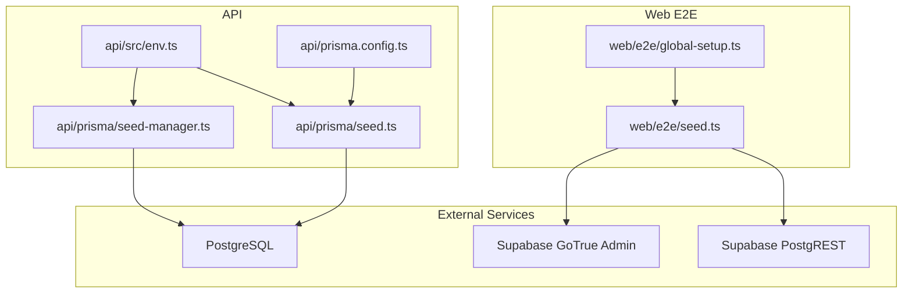
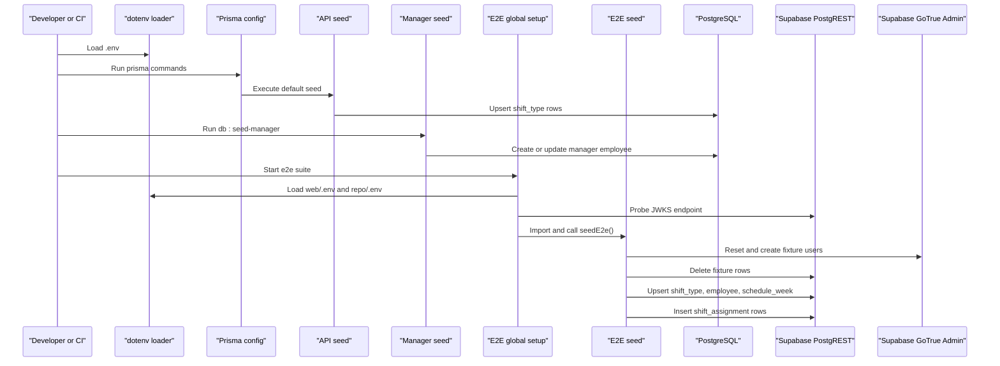
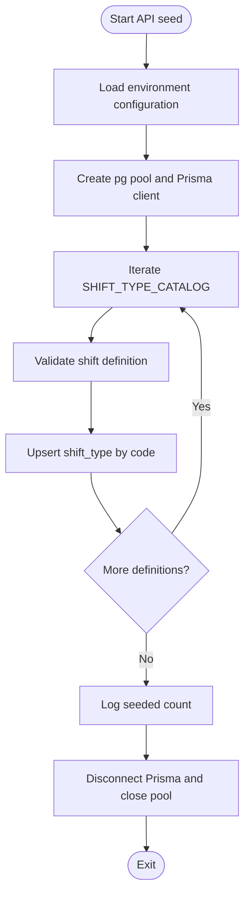
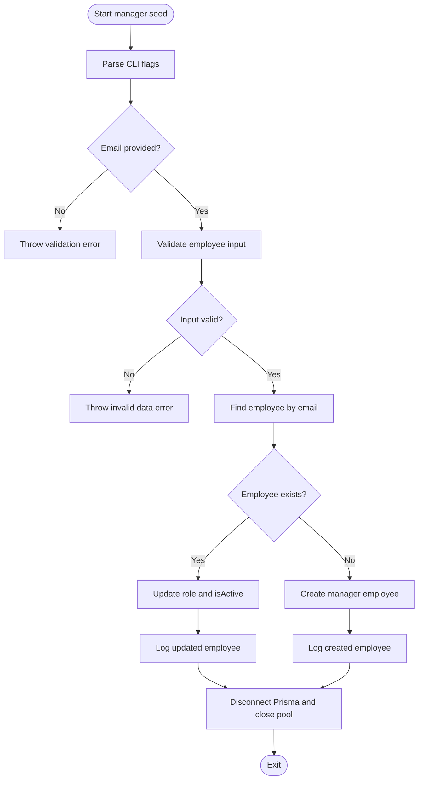
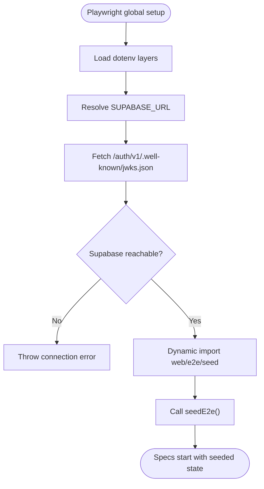
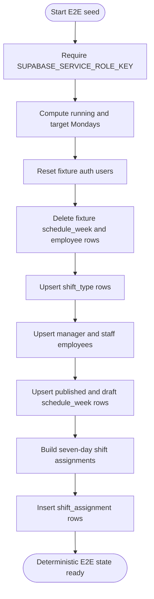
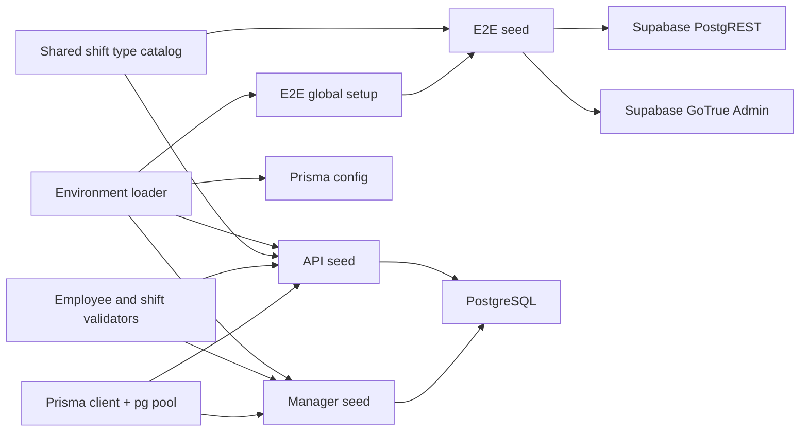

# Database Seeding Infrastructure

<cite>
**Referenced Files in This Document**
- [seed.ts](file://api/prisma/seed.ts)
- [seed-manager.ts](file://api/prisma/seed-manager.ts)
- [prisma.config.ts](file://api/prisma.config.ts)
- [env.ts](file://api/src/env.ts)
- [seed.ts](file://web/e2e/seed.ts)
- [global-setup.ts](file://web/e2e/global-setup.ts)
</cite>

## Table of Contents
1. [Introduction](#introduction)
2. [Project Structure](#project-structure)
3. [Core Components](#core-components)
4. [Architecture Overview](#architecture-overview)
5. [Detailed Component Analysis](#detailed-component-analysis)
6. [Dependency Analysis](#dependency-analysis)
7. [Performance Considerations](#performance-considerations)
8. [Troubleshooting Guide](#troubleshooting-guide)
9. [Conclusion](#conclusion)

## Introduction
This document explains the database seeding infrastructure for the scheduling application. The system provides three complementary seeding paths:

- **API Prisma seed**: populates reference data such as shift types directly against the PostgreSQL database using Prisma and a pooled connection.
- **Manager bootstrap seed**: creates or refreshes a manager account so authentication can work on a fresh database, bypassing the normal API gate that requires an employee record.
- **E2E web seed**: prepares deterministic test fixtures through Supabase’s hosted REST and auth admin APIs, including users, employees, weeks, and shift assignments.

The design separates concerns by environment and access model: direct database writes for development and CI, and service-role HTTP calls for end-to-end tests that must exercise real RLS behavior.

## Project Structure
The seeding logic lives in two packages:

| Area | Purpose | Key Files |
|---|---|---|
| API Prisma seeds | Reference data and manager bootstrap via Prisma | `api/prisma/seed.ts`, `api/prisma/seed-manager.ts` |
| E2E web seed | Deterministic fixture setup through Supabase REST and GoTrue admin APIs | `web/e2e/seed.ts`, `web/e2e/global-setup.ts` |
| Configuration | Environment loading and Prisma seed command wiring | `api/src/env.ts`, `api/prisma.config.ts` |

**Diagram sources**
- [env.ts:1-6](file://api/src/env.ts#L1-L6)
- [prisma.config.ts:1-26](file://api/prisma.config.ts#L1-L26)
- [seed.ts:1-43](file://api/prisma/seed.ts#L1-L43)
- [seed-manager.ts:1-119](file://api/prisma/seed-manager.ts#L1-L119)
- [global-setup.ts:1-39](file://web/e2e/global-setup.ts#L1-L39)
- [seed.ts:1-242](file://web/e2e/seed.ts#L1-L242)

**Section sources**
- [env.ts:1-6](file://api/src/env.ts#L1-L6)
- [prisma.config.ts:1-26](file://api/prisma.config.ts#L1-L26)
- [seed.ts:1-43](file://api/prisma/seed.ts#L1-L43)
- [seed-manager.ts:1-119](file://api/prisma/seed-manager.ts#L1-L119)
- [global-setup.ts:1-39](file://web/e2e/global-setup.ts#L1-L39)
- [seed.ts:1-242](file://web/e2e/seed.ts#L1-L242)

## Core Components
The seeding infrastructure is composed of four main components:

| Component | Responsibility | Data Target | Idempotency |
|---|---|---|---|
| API Prisma seed | Seeds shift type catalog into `shift_type` | PostgreSQL via Prisma | Upserts by code |
| Manager bootstrap seed | Creates or refreshes a manager employee row | PostgreSQL via Prisma | Updates existing email |
| E2E global setup | Loads environment, probes Supabase, then runs E2E seed | Supabase services | Deletes and recreates fixture rows |
| E2E seed | Builds deterministic users, employees, weeks, and assignments | Supabase PostgREST and GoTrue admin APIs | Full reset per run |

**Section sources**
- [seed.ts:8-31](file://api/prisma/seed.ts#L8-L31)
- [seed-manager.ts:7-23](file://api/prisma/seed-manager.ts#L7-L23)
- [global-setup.ts:4-37](file://web/e2e/global-setup.ts#L4-L37)
- [seed.ts:5-10](file://web/e2e/seed.ts#L5-L10)

## Architecture Overview
The seeding architecture follows a layered approach:

1. **Environment layer**: `.env` files are loaded consistently across API runtime, Prisma configuration, and test setup.
2. **Direct database layer**: API seeds connect to PostgreSQL using a `pg` pool and Prisma’s PostgreSQL adapter.
3. **Service-role HTTP layer**: E2E seed uses Supabase’s service role key to write through PostgREST and GoTrue admin endpoints, mirroring how the API reads under RLS.
4. **Test orchestration layer**: Playwright’s global setup loads environment variables before importing the E2E seed, ensuring deterministic state before any spec runs.

**Diagram sources**
- [env.ts:1-6](file://api/src/env.ts#L1-L6)
- [prisma.config.ts:1-26](file://api/prisma.config.ts#L1-L26)
- [seed.ts:1-43](file://api/prisma/seed.ts#L1-L43)
- [seed-manager.ts:1-119](file://api/prisma/seed-manager.ts#L1-L119)
- [global-setup.ts:1-39](file://web/e2e/global-setup.ts#L1-L39)
- [seed.ts:1-242](file://web/e2e/seed.ts#L1-L242)

## Detailed Component Analysis

### API Prisma Seed
The API seed initializes shift type reference data from a shared catalog. It validates each definition through a schema, then upserts rows by unique code. This makes repeated runs safe: existing rows are updated rather than duplicated.

Key behaviors:
- Loads environment configuration before connecting to the database.
- Uses a dedicated `pg` pool with Prisma’s PostgreSQL adapter.
- Iterates over the shift type catalog and performs idempotent upserts.
- Disconnects Prisma and closes the pool in cleanup.

**Diagram sources**
- [seed.ts:1-43](file://api/prisma/seed.ts#L1-L43)

**Section sources**
- [seed.ts:1-43](file://api/prisma/seed.ts#L1-L43)

### Manager Bootstrap Seed
The manager seed solves a bootstrap problem: authentication rejects users without an employee row, but the only UI that creates employees is behind authentication. This script writes directly to the database as the database owner, bypassing RLS and JWT flows.

Key behaviors:
- Parses CLI flags such as `--email`, `--name`, `--position`, `--role`, `--status`, and `--probation`.
- Validates input through the employee creation validator.
- Finds an existing employee by email; if present, refreshes role and active status.
- If absent, creates a new manager employee and logs success.
- Ensures Prisma and pool cleanup even on errors.

**Diagram sources**
- [seed-manager.ts:29-118](file://api/prisma/seed-manager.ts#L29-L118)

**Section sources**
- [seed-manager.ts:7-23](file://api/prisma/seed-manager.ts#L7-L23)
- [seed-manager.ts:29-118](file://api/prisma/seed-manager.ts#L29-L118)

### E2E Global Setup
The E2E global setup is the entry point for end-to-end tests. It loads environment variables from multiple locations, verifies that the hosted Supabase instance is reachable, and then imports and executes the E2E seed.

Key behaviors:
- Loads `.env.local`, web `.env`, and repository `.env` in priority order.
- Probes the public JWKS endpoint to validate Supabase connectivity.
- Throws early if Supabase is unreachable, avoiding long test timeouts.
- Dynamically imports the E2E seed after environment loading so module-level secrets are available.

**Diagram sources**
- [global-setup.ts:1-39](file://web/e2e/global-setup.ts#L1-L39)

**Section sources**
- [global-setup.ts:1-39](file://web/e2e/global-setup.ts#L1-L39)

### E2E Seed
The E2E seed builds a fully deterministic fixture set through Supabase’s hosted APIs. It does not use Prisma because the web package has no Prisma client, and it needs to exercise the same RLS boundaries that the API uses.

Key responsibilities:
- Requires `SUPABASE_SERVICE_ROLE_KEY` and optionally `SUPABASE_URL`.
- Provides helper functions for PostgREST queries and GoTrue admin operations.
- Resets fixture auth users by deleting and recreating known emails.
- Deletes previous fixture rows for employees, schedule weeks, and related data.
- Upserts shift types, employees, schedule weeks, and shift assignments with fixed IDs.

**Diagram sources**
- [seed.ts:5-242](file://web/e2e/seed.ts#L5-L242)

**Section sources**
- [seed.ts:5-10](file://web/e2e/seed.ts#L5-L10)
- [seed.ts:12-31](file://web/e2e/seed.ts#L12-L31)
- [seed.ts:45-104](file://web/e2e/seed.ts#L45-L104)
- [seed.ts:106-128](file://web/e2e/seed.ts#L106-L128)
- [seed.ts:130-242](file://web/e2e/seed.ts#L130-L242)

## Dependency Analysis
The seeding components have clear dependency boundaries:

| Component | Direct Dependencies | External Integration |
|---|---|---|
| API Prisma seed | Environment loader, shared shift type catalog, validators, Prisma client, pg pool | PostgreSQL |
| Manager bootstrap seed | Environment loader, employee validator, Prisma client, pg pool | PostgreSQL |
| E2E global setup | Node path, dotenv | Supabase JWKS endpoint |
| E2E seed | Shared shift type catalog, E2E fixtures, week utilities, Supabase REST and GoTrue admin APIs | Supabase hosted services |

**Diagram sources**
- [env.ts:1-6](file://api/src/env.ts#L1-L6)
- [prisma.config.ts:1-26](file://api/prisma.config.ts#L1-L26)
- [seed.ts:1-43](file://api/prisma/seed.ts#L1-L43)
- [seed-manager.ts:1-119](file://api/prisma/seed-manager.ts#L1-L119)
- [global-setup.ts:1-39](file://web/e2e/global-setup.ts#L1-L39)
- [seed.ts:1-242](file://web/e2e/seed.ts#L1-L242)

**Section sources**
- [env.ts:1-6](file://api/src/env.ts#L1-L6)
- [prisma.config.ts:1-26](file://api/prisma.config.ts#L1-L26)
- [seed.ts:1-43](file://api/prisma/seed.ts#L1-L43)
- [seed-manager.ts:1-119](file://api/prisma/seed-manager.ts#L1-L119)
- [global-setup.ts:1-39](file://web/e2e/global-setup.ts#L1-L39)
- [seed.ts:1-242](file://web/e2e/seed.ts#L1-L242)

## Performance Considerations
- **Connection pooling**: Both API seeds create a `pg` pool and explicitly disconnect it, which avoids leaking connections during short-lived scripts.
- **Idempotent writes**: The API seed uses upserts keyed by code, and the manager seed updates existing records instead of duplicating them. This reduces unnecessary database churn on repeated runs.
- **Deterministic E2E resets**: The E2E seed deletes and recreates fixture rows, making test runs predictable at the cost of full teardown and rebuild.
- **Early failure in E2E setup**: Probing the Supabase JWKS endpoint before seeding prevents long-running specs from masking missing environment configuration.

[No sources needed since this section provides general guidance]

## Troubleshooting Guide

### Missing Environment Variables
- **Symptom**: Seeds fail when reading `DATABASE_URL`, `SUPABASE_URL`, or `SUPABASE_SERVICE_ROLE_KEY`.
- **Cause**: `.env` files are not loaded or do not contain required keys.
- **Resolution**:
  - Ensure the repository root `.env` contains `DATABASE_URL` for API seeds.
  - Ensure `SUPABASE_URL` and `SUPABASE_SERVICE_ROLE_KEY` are present for E2E tests.
  - Verify that `api/src/env.ts` and `web/e2e/global-setup.ts` load the intended `.env` paths.

**Section sources**
- [env.ts:1-6](file://api/src/env.ts#L1-L6)
- [seed.ts:12-13](file://api/prisma/seed.ts#L12-L13)
- [seed-manager.ts:46-47](file://api/prisma/seed-manager.ts#L46-L47)
- [seed.ts:12-26](file://web/e2e/seed.ts#L12-L26)
- [global-setup.ts:8-15](file://web/e2e/global-setup.ts#L8-L15)

### Manager Cannot Log In After Fresh Database
- **Symptom**: Authentication rejects all users because no employee row exists.
- **Cause**: Google sign-in does not automatically provision a manager, and the staff management screen is gated by authentication.
- **Resolution**: Run the manager bootstrap seed with a valid email flag. Re-running refreshes role and active status instead of creating duplicates.

**Section sources**
- [seed-manager.ts:7-23](file://api/prisma/seed-manager.ts#L7-L23)
- [seed-manager.ts:49-88](file://api/prisma/seed-manager.ts#L49-L88)

### E2E Tests Fail Before First Spec
- **Symptom**: Global setup throws about Supabase being unreachable.
- **Cause**: `SUPABASE_URL` points to an inaccessible project, network issues, or incorrect credentials.
- **Resolution**:
  - Confirm `SUPABASE_URL` matches the hosted project.
  - Confirm the JWKS endpoint responds.
  - Ensure `SUPABASE_SERVICE_ROLE_KEY` is set for the seed to write through RLS.

**Section sources**
- [global-setup.ts:17-31](file://web/e2e/global-setup.ts#L17-L31)
- [seed.ts:15-26](file://web/e2e/seed.ts#L15-L26)

### Seed Runs But No Rows Appear
- **Symptom**: Seed completes without errors, but expected rows are missing.
- **Cause**:
  - For API seeds, check whether the correct database URL is used.
  - For E2E seed, confirm that the service role key has permission to write through PostgREST and GoTrue admin APIs.
- **Resolution**:
  - Verify `DATABASE_URL` for API seeds.
  - Verify `SUPABASE_SERVICE_ROLE_KEY` for E2E seed.
  - Inspect console output for logged counts or messages.

**Section sources**
- [seed.ts:31-42](file://api/prisma/seed.ts#L31-L42)
- [seed-manager.ts:105-107](file://api/prisma/seed-manager.ts#L105-L107)
- [seed.ts:65-73](file://web/e2e/seed.ts#L65-L73)

## Conclusion
The database seeding infrastructure separates development, bootstrap, and testing concerns while keeping each path idempotent and environment-aware. API seeds operate directly against PostgreSQL for fast, reliable reference data setup. The manager bootstrap seed resolves the initial authentication chicken-and-egg problem. The E2E seed exercises the real Supabase surface, producing deterministic fixtures that mirror production RLS behavior. Together, these components provide a clear, maintainable foundation for initializing and resetting the scheduling application’s data state.

[No sources needed since this section summarizes without analyzing specific files]