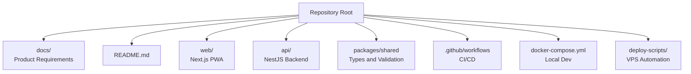
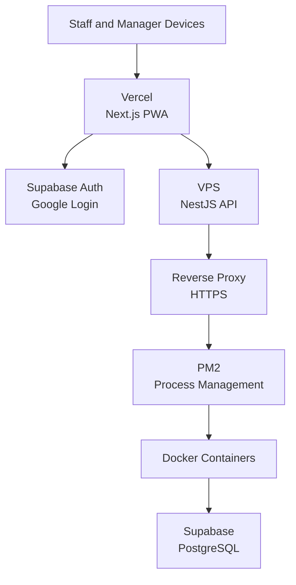
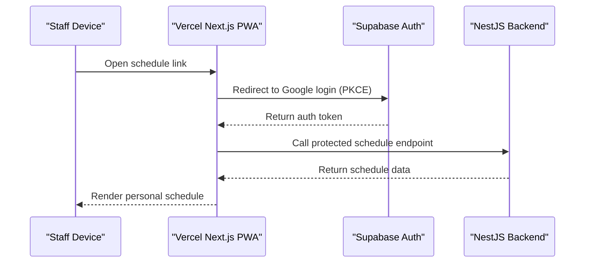
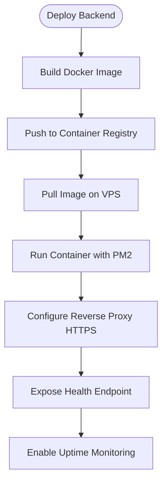
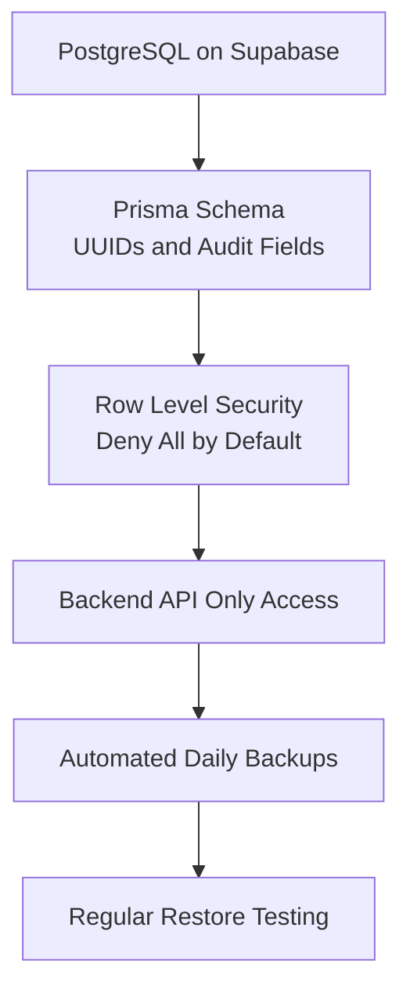
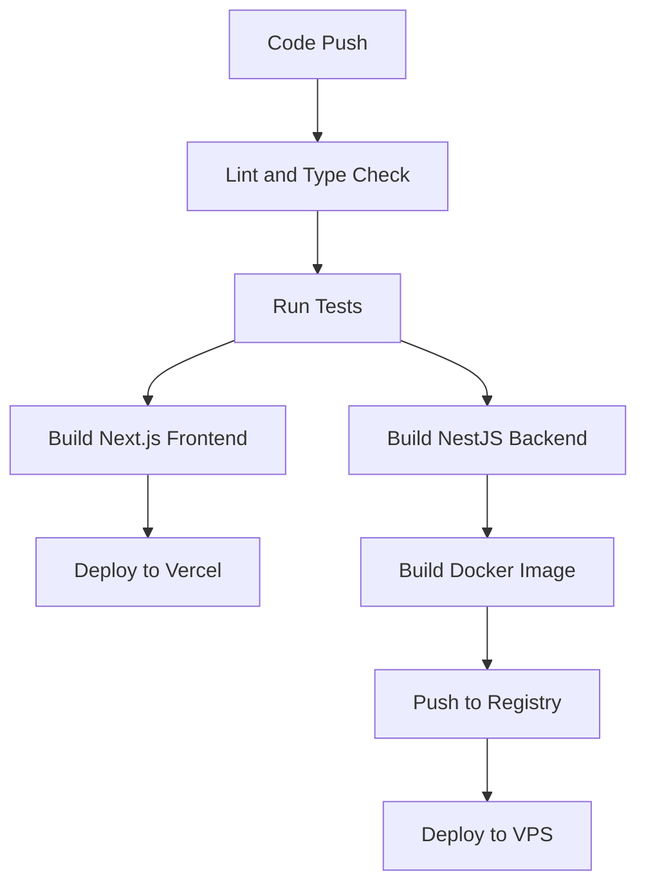
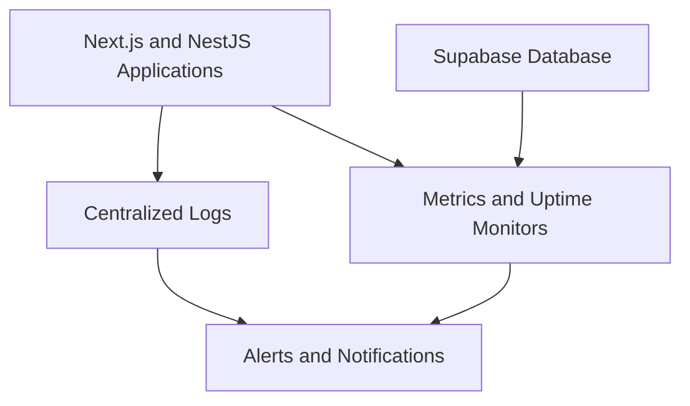
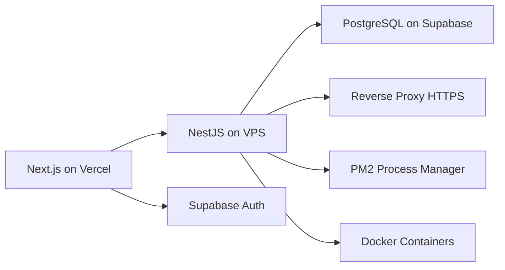

# Deployment Strategy

<cite>
**Referenced Files in This Document**
- [README.md](file://README.md)
- [PRD-Aplikasi-Penjadwalan-Shift-Kyne.md](file://docs/PRD-Aplikasi-Penjadwalan-Shift-Kyne.md)
</cite>

## Table of Contents
1. [Introduction](#introduction)
2. [Project Structure](#project-structure)
3. [Core Components](#core-components)
4. [Architecture Overview](#architecture-overview)
5. [Detailed Component Analysis](#detailed-component-analysis)
6. [Dependency Analysis](#dependency-analysis)
7. [Performance Considerations](#performance-considerations)
8. [Troubleshooting Guide](#troubleshooting-guide)
9. [Conclusion](#conclusion)
10. [Appendices](#appendices)

## Introduction
This document defines the deployment strategy for the Kyne shift scheduling application across Vercel and a self-managed VPS. The MVP is a mobile-first PWA where staff submit leave and shift requests, managers draft weekly schedules with automated rules, validate coverage, publish schedules, and share them via WhatsApp. Authentication uses Google accounts with an email whitelist enforced by the backend. The planned stack includes Next.js for the frontend, NestJS for the backend API, PostgreSQL on Supabase, and hosting split between Vercel (frontend), Supabase (database and authentication), and a VPS (backend).

The repository is currently an early scaffold without code or features yet, so this deployment strategy is forward-looking and aligned with the product requirements and architecture notes.

**Section sources**
- [README.md:1-25](file://README.md#L1-L25)
- [PRD-Aplikasi-Penjadwalan-Shift-Kyne.md:5-20](file://docs/PRD-Aplikasi-Penjadwalan-Shift-Kyne.md#L5-L20)

## Project Structure
At this stage, the project contains only documentation and a minimal README. The intended structure will follow a monorepo layout with separate `web` (Next.js) and `api` (NestJS) packages, plus shared types and validation utilities. Until implementation begins, deployment configuration should be prepared as code so that it can be committed alongside the future source code.

**Diagram sources**
- [README.md:22-25](file://README.md#L22-L25)
- [PRD-Aplikasi-Penjadwalan-Shift-Kyne.md:230-241](file://docs/PRD-Aplikasi-Penjadwalan-Shift-Kyne.md#L230-L241)

**Section sources**
- [README.md:22-25](file://README.md#L22-L25)
- [PRD-Aplikasi-Penjadwalan-Shift-Kyne.md:230-241](file://docs/PRD-Aplikasi-Penjadwalan-Shift-Kyne.md#L230-L241)

## Core Components
The deployment strategy centers on five core components:

- Frontend: Next.js PWA hosted on Vercel.
- Backend: NestJS API hosted on a VPS using Docker and PM2.
- Database: PostgreSQL on Supabase accessed through Prisma.
- Authentication: Google login with PKCE redirect and email whitelist enforcement in the backend.
- Operations: CI/CD, environment management, secrets handling, monitoring, backups, rollback, and disaster recovery.

These components are derived from the PRD’s architecture section and non-functional requirements.

**Section sources**
- [PRD-Aplikasi-Penjadwalan-Shift-Kyne.md:218-248](file://docs/PRD-Aplikasi-Penjadwalan-Shift-Kyne.md#L218-L248)
- [PRD-Aplikasi-Penjadwalan-Shift-Kyne.md:230-241](file://docs/PRD-Aplikasi-Penjadwalan-Shift-Kyne.md#L230-L241)

## Architecture Overview
The system separates static and dynamic concerns:

- Vercel serves the Next.js PWA, including optimized builds, caching, and edge-friendly delivery.
- Supabase provides PostgreSQL and Google-based authentication.
- A VPS runs the NestJS backend inside Docker containers, managed by PM2, behind a reverse proxy with HTTPS.
- The frontend communicates with the backend API; authentication tokens are validated server-side.

**Diagram sources**
- [PRD-Aplikasi-Penjadwalan-Shift-Kyne.md:230-241](file://docs/PRD-Aplikasi-Penjadwalan-Shift-Kyne.md#L230-L241)
- [PRD-Aplikasi-Penjadwalan-Shift-Kyne.md:243-248](file://docs/PRD-Aplikasi-Penjadwalan-Shift-Kyne.md#L243-L248)

## Detailed Component Analysis

### Frontend Deployment on Vercel with Next.js PWA Optimization
The frontend is a Next.js PWA designed for mobile devices, with manager dashboards also supported on laptops. Vercel is the recommended host for the web layer.

Key deployment considerations:

- Build process
  - Use Next.js production build.
  - Enable PWA-related optimizations such as offline support, installability hints, and asset optimization.
  - Keep bundle size small for mobile networks.
- Environment variables
  - Store Vercel environment variables in the Vercel project settings.
  - Include variables for the backend API base URL, timezone, and any feature flags needed at build or runtime.
  - Avoid embedding secrets directly in the frontend; use server-side verification for sensitive operations.
- Authentication flow
  - Use Google login with PKCE redirect rather than popups to avoid issues in standalone PWA mode on iOS.
  - Ensure links opened from WhatsApp work reliably on Android and iPhone.
- Security boundaries
  - Enforce login before accessing schedule data.
  - Do not rely solely on client-side restrictions; all authorization must be enforced by the backend.

**Diagram sources**
- [PRD-Aplikasi-Penjadwalan-Shift-Kyne.md:220-227](file://docs/PRD-Aplikasi-Penjadwalan-Shift-Kyne.md#L220-L227)
- [PRD-Aplikasi-Penjadwalan-Shift-Kyne.md:243-248](file://docs/PRD-Aplikasi-Penjadwalan-Shift-Kyne.md#L243-L248)

**Section sources**
- [PRD-Aplikasi-Penjadwalan-Shift-Kyne.md:220-227](file://docs/PRD-Aplikasi-Penjadwalan-Shift-Kyne.md#L220-L227)
- [PRD-Aplikasi-Penjadwalan-Shift-Kyne.md:230-241](file://docs/PRD-Aplikasi-Penjadwalan-Shift-Kyne.md#L230-L241)
- [PRD-Aplikasi-Penjadwalan-Shift-Kyne.md:243-248](file://docs/PRD-Aplikasi-Penjadwalan-Shift-Kyne.md#L243-L248)

### Backend Deployment on VPS Using Docker and PM2
The backend is a NestJS API deployed on a VPS. It should run inside Docker containers and be managed by PM2 for automatic restarts and process supervision. A reverse proxy handles HTTPS termination.

Deployment checklist:

- Containerization
  - Create a production-oriented Dockerfile for the NestJS API.
  - Separate development and production dependencies.
  - Use multi-stage builds if applicable to reduce image size.
- Process management
  - Use PM2 to manage the Node.js process inside the container or on the host.
  - Configure auto-restart on failure and memory limits.
- Reverse proxy
  - Use Caddy or Nginx to terminate TLS and forward traffic to the backend.
  - Harden headers and enable HTTP/2 where supported.
- Health checks
  - Expose a health endpoint for uptime monitors and load balancers.
  - Integrate with systemd or container orchestration for liveness and readiness probes.

**Diagram sources**
- [PRD-Aplikasi-Penjadwalan-Shift-Kyne.md:241-248](file://docs/PRD-Aplikasi-Penjadwalan-Shift-Kyne.md#L241-L248)

**Section sources**
- [PRD-Aplikasi-Penjadwalan-Shift-Kyne.md:241-248](file://docs/PRD-Aplikasi-Penjadwalan-Shift-Kyne.md#L241-L248)

### PostgreSQL Database Setup, Backups, and Maintenance
The database is PostgreSQL on Supabase, accessed through Prisma. The PRD requires daily automatic backups and careful data modeling for future ERP migration.

Database responsibilities:

- Schema design
  - Use UUIDs for primary keys.
  - Include audit fields such as created_at, updated_at, and created_by.
  - Avoid hard deletes; prefer soft deletion via active/inactive status.
- Access control
  - Enforce deny-all Row Level Security policies.
  - Ensure the frontend never reads tables directly; all access goes through the NestJS API.
- Backup strategy
  - Schedule daily automated backups.
  - Retain multiple backup generations for recovery.
  - Test restore procedures regularly.
- Maintenance
  - Monitor query performance and index usage.
  - Plan migrations carefully, especially around schedule publishing deadlines.

**Diagram sources**
- [PRD-Aplikasi-Penjadwalan-Shift-Kyne.md:211-217](file://docs/PRD-Aplikasi-Penjadwalan-Shift-Kyne.md#L211-L217)
- [PRD-Aplikasi-Penjadwalan-Shift-Kyne.md:228-229](file://docs/PRD-Aplikasi-Penjadwalan-Shift-Kyne.md#L228-L229)
- [PRD-Aplikasi-Penjadwalan-Shift-Kyne.md:247-248](file://docs/PRD-Aplikasi-Penjadwalan-Shift-Kyne.md#L247-L248)

**Section sources**
- [PRD-Aplikasi-Penjadwalan-Shift-Kyne.md:211-217](file://docs/PRD-Aplikasi-Penjadwalan-Shift-Kyne.md#L211-L217)
- [PRD-Aplikasi-Penjadwalan-Shift-Kyne.md:228-229](file://docs/PRD-Aplikasi-Penjadwalan-Shift-Kyne.md#L228-L229)
- [PRD-Aplikasi-Penjadwalan-Shift-Kyne.md:247-248](file://docs/PRD-Aplikasi-Penjadwalan-Shift-Kyne.md#L247-L248)

### CI/CD Pipeline Configuration, Automated Testing, and Deployment Automation
Although no CI/CD files exist yet, the pipeline should automate testing, building, and deploying both frontend and backend.

Recommended pipeline stages:

- Lint and type check
- Unit tests
- Integration tests against a test database
- Frontend build for Vercel
- Backend Docker image build and push
- Deployments gated by branch and environment

[No sources needed since this diagram shows conceptual workflow, not actual code structure]

### Environment Configuration Management and Secrets Handling
Environment configuration should be separated per environment and kept out of version control.

Guidelines:

- Frontend
  - Use Vercel environment variables for public-facing values such as API base URLs.
  - Avoid storing secrets in the frontend.
- Backend
  - Store database credentials, JWT verification keys, and other secrets in VPS environment files or a secrets manager.
  - Load configuration at startup and validate required variables.
- Timezone and business rules
  - Store timezone as Asia/Makassar (WITA) in configuration or settings.
  - Enforce request deadlines based on WITA without relying on cron jobs.

**Section sources**
- [PRD-Aplikasi-Penjadwalan-Shift-Kyne.md:226-227](file://docs/PRD-Aplikasi-Penjadwalan-Shift-Kyne.md#L226-L227)
- [PRD-Aplikasi-Penjadwalan-Shift-Kyne.md:248-249](file://docs/PRD-Aplikasi-Penjadwalan-Shift-Kyne.md#L248-L249)

### Production Monitoring Setup
Production monitoring should cover availability, error rates, response times, and database health.

Monitoring targets:

- Uptime monitoring for frontend and backend endpoints.
- Application logs centralized and searchable.
- Error tracking for unhandled exceptions.
- Database connection pool metrics and slow queries.
- Alerting for critical failures and backup failures.

[No sources needed since this diagram shows conceptual workflow, not actual code structure]

## Dependency Analysis
The deployment depends on external services and infrastructure choices defined in the PRD:

- Vercel for frontend hosting.
- Supabase for PostgreSQL and authentication.
- A VPS for the NestJS backend.
- Docker and PM2 for backend process management.
- A reverse proxy for HTTPS.

**Diagram sources**
- [PRD-Aplikasi-Penjadwalan-Shift-Kyne.md:230-241](file://docs/PRD-Aplikasi-Penjadwalan-Shift-Kyne.md#L230-L241)

**Section sources**
- [PRD-Aplikasi-Penjadwalan-Shift-Kyne.md:230-241](file://docs/PRD-Aplikasi-Penjadwalan-Shift-Kyne.md#L230-L241)

## Performance Considerations
Performance guidance focuses on mobile users, schedule publishing deadlines, and reliable access from WhatsApp links.

Recommendations:

- Frontend
  - Optimize images, fonts, and JavaScript bundles.
  - Use caching strategies appropriate for PWA behavior.
  - Minimize reflows and heavy computations on low-end phones.
- Backend
  - Cache read-heavy schedule data where safe.
  - Validate and reject requests after the weekly deadline.
  - Index database columns used for employee, week, and shift lookups.
- Database
  - Monitor long-running queries during schedule drafting and publishing.
  - Keep schema changes backward-compatible until migration is fully tested.

**Section sources**
- [PRD-Aplikasi-Penjadwalan-Shift-Kyne.md:218-227](file://docs/PRD-Aplikasi-Penjadwalan-Shift-Kyne.md#L218-L227)
- [PRD-Aplikasi-Penjadwalan-Shift-Kyne.md:248-249](file://docs/PRD-Aplikasi-Penjadwalan-Shift-Kyne.md#L248-L249)

## Troubleshooting Guide
Common operational issues and their likely causes:

- Google login fails from WhatsApp links
  - Cause: In-app browser restrictions or popup blocking.
  - Action: Use PKCE redirect flow; instruct users to open links in Chrome or Safari if needed.
- Unauthorized access attempts
  - Cause: Client-side bypass attempts.
  - Action: Verify email whitelist and role resolution in the backend; ensure RLS deny-all remains enabled.
- Request submission after deadline
  - Cause: Timezone mismatch or missing deadline logic.
  - Action: Enforce WITA-based deadline checks server-side.
- Backend crashes or hangs
  - Cause: Unhandled errors or resource exhaustion.
  - Action: Use PM2 auto-restart, monitor memory, and review logs.
- Database connectivity issues
  - Cause: Connection pool exhaustion or network problems.
  - Action: Check Supabase status, connection limits, and backend retry logic.

**Section sources**
- [PRD-Aplikasi-Penjadwalan-Shift-Kyne.md:223-227](file://docs/PRD-Aplikasi-Penjadwalan-Shift-Kyne.md#L223-L227)
- [PRD-Aplikasi-Penjadwalan-Shift-Kyne.md:243-249](file://docs/PRD-Aplikasi-Penjadwalan-Shift-Kyne.md#L243-L249)

## Conclusion
The Kyne shift scheduling application should deploy its frontend to Vercel as a Next.js PWA, its backend to a VPS using Docker and PM2, and its database to Supabase PostgreSQL. Authentication uses Google accounts with backend-enforced email whitelisting. Operational reliability depends on clear environment configuration, secrets management, automated backups, monitoring, and well-defined rollback and disaster recovery procedures. As the repository moves beyond its current scaffold, these deployment practices should be codified in CI/CD pipelines and infrastructure-as-code artifacts.

[No sources needed since this section summarizes without analyzing specific files]

## Appendices

### Rollback Procedures
- Frontend rollback
  - Revert to the previous Vercel deployment using the platform’s rollback or redeploy a known-good commit.
- Backend rollback
  - Stop the new container, start the previous Docker image, and verify health endpoints.
- Database rollback
  - Prefer schema migrations that are reversible.
  - If necessary, restore from the latest verified backup and validate data integrity.

### Disaster Recovery Plan
- Identify critical assets: schedule data, employee records, authentication state, and configuration.
- Maintain daily backups with retention policies.
- Document restore steps and test them regularly.
- Define recovery time objectives aligned with the weekly schedule publishing cycle.

### Scaling and Load Balancing Considerations
- Horizontal scaling
  - Scale backend instances behind a load balancer when request volume increases.
  - Use stateless API design and external session or token verification.
- Database scaling
  - Monitor Supabase capacity and consider read replicas if needed.
- Frontend scaling
  - Leverage Vercel’s edge network and caching to handle traffic spikes.

[No sources needed since this section provides general guidance]