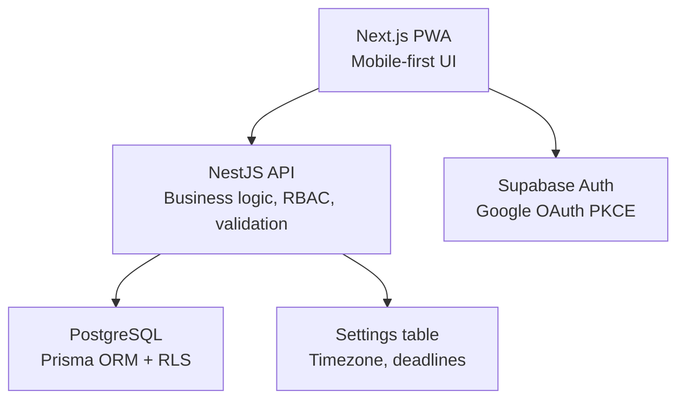
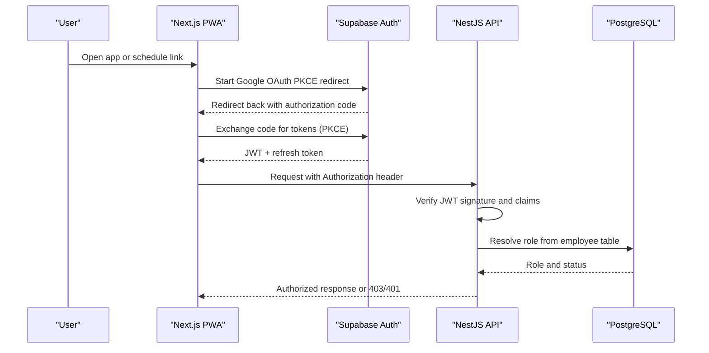
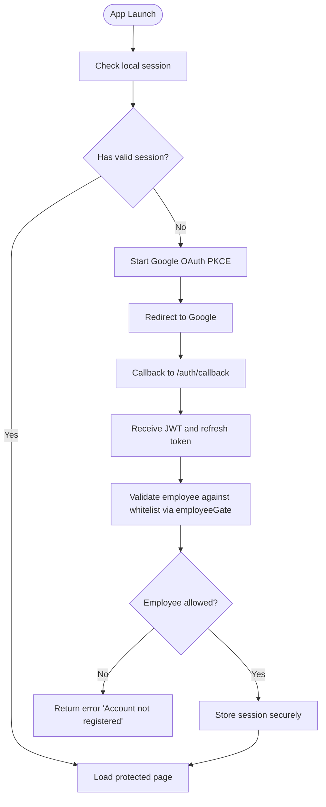
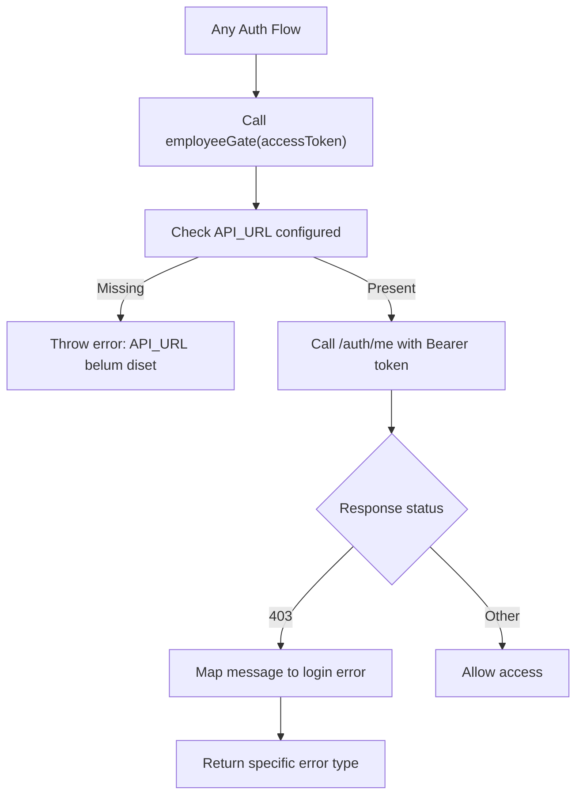
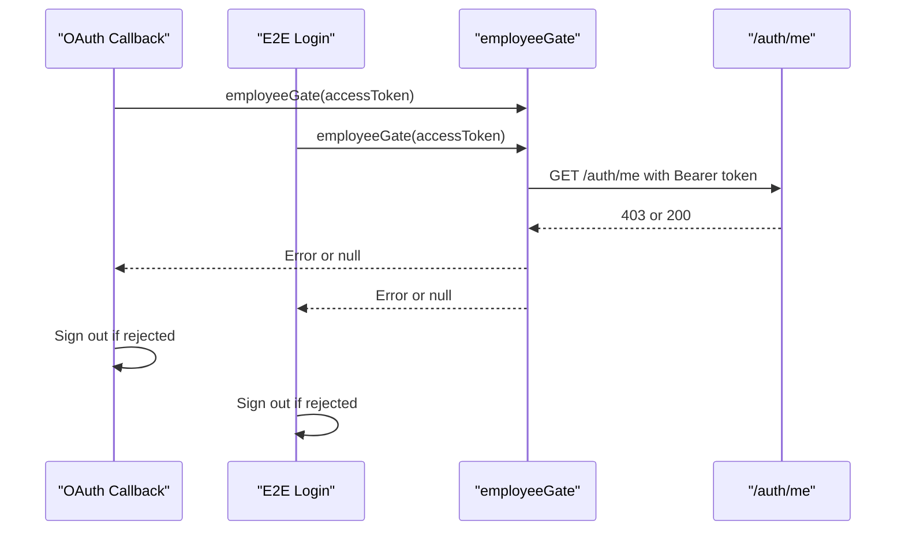
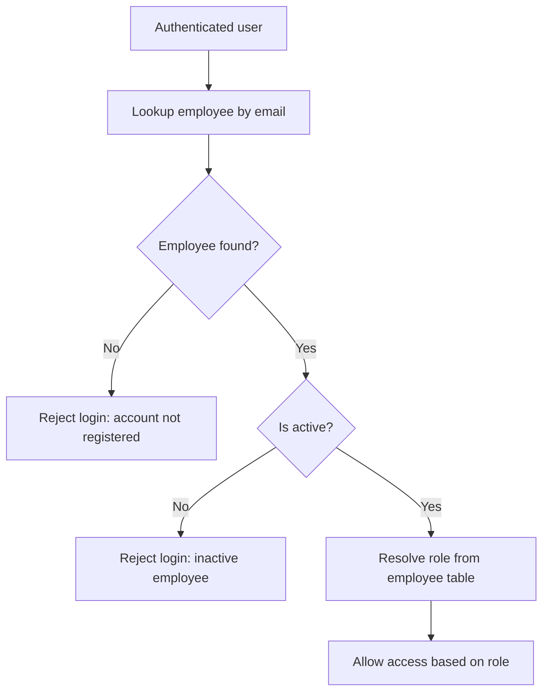
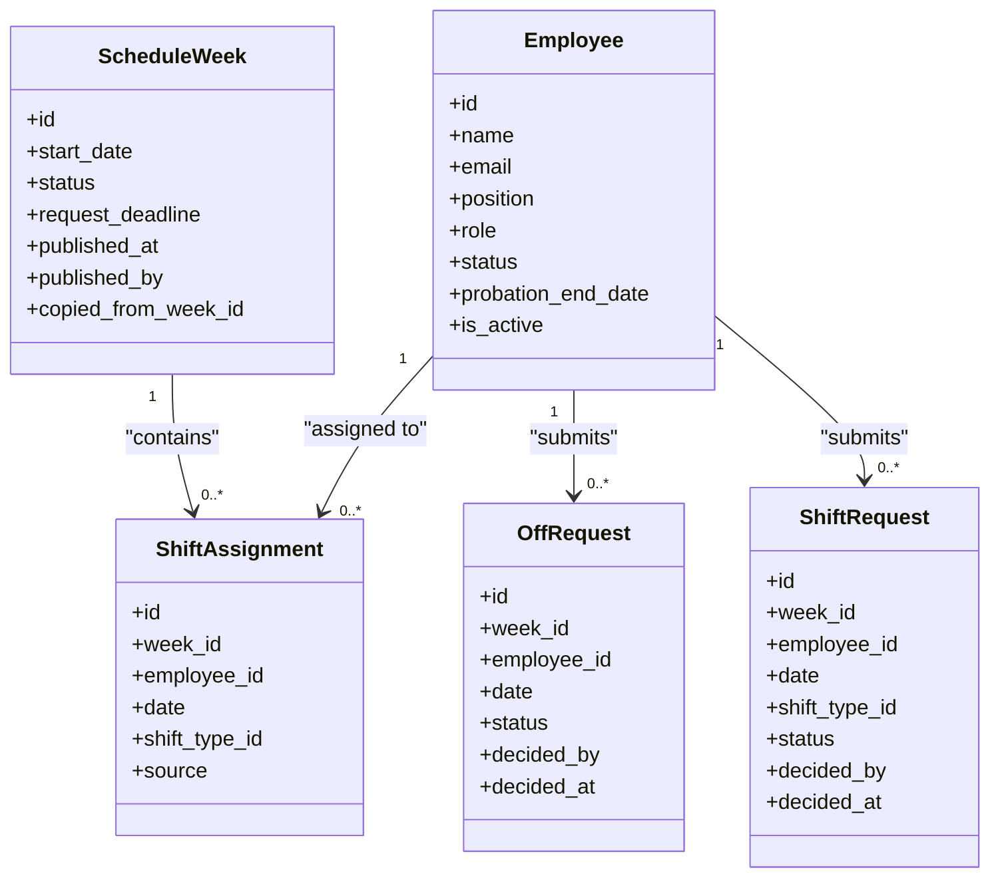
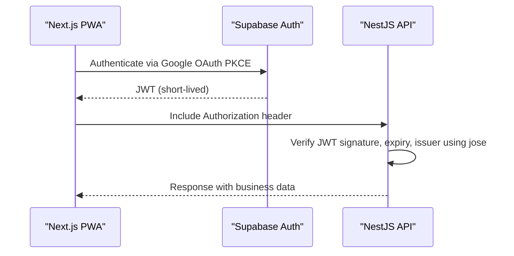
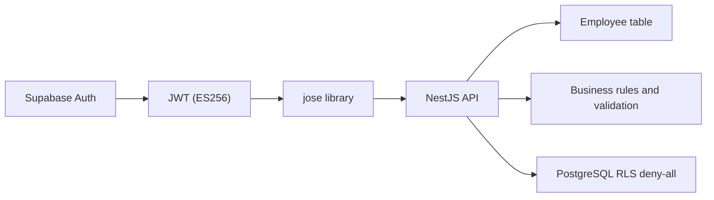

# Security & Authentication

<cite>
**Referenced Files in This Document**
- [auth.guard.ts](file://api/src/auth/auth.guard.ts)
- [roles.guard.ts](file://api/src/auth/roles.guard.ts)
- [auth.controller.ts](file://api/src/auth/auth.controller.ts)
- [supabase-token.service.ts](file://api/src/auth/supabase-token.service.ts)
- [supabase.ts](file://api/src/auth/supabase.ts)
- [auth.module.ts](file://api/src/auth/auth.module.ts)
- [app.module.ts](file://api/src/app.module.ts)
- [current-employee.decorator.ts](file://api/src/auth/current-employee.decorator.ts)
- [auth-metadata.ts](file://api/src/auth/auth-metadata.ts)
- [auth.decorators.ts](file://api/src/auth/auth.decorators.ts)
- [employee.prisma](file://api/prisma/schema/employee.prisma)
- [20261108120100_hardening/migration.sql](file://api/prisma/migrations/20261108120100_hardening/migration.sql)
- [route.ts](file://web/app/auth/callback/route.ts)
- [e2e-login/route.ts](file://web/app/auth/e2e-login/route.ts)
- [employee-gate.ts](file://web/lib/employee-gate.ts)
- [login-error.ts](file://web/lib/login-error.ts)
- [middleware.ts](file://web/lib/supabase/middleware.ts)
- [config.ts](file://web/lib/supabase/config.ts)
- [login-form.tsx](file://web/app/login/login-form.tsx)
- [page.tsx](file://web/app/login/page.tsx)
- [safe-next.ts](file://web/lib/safe-next.ts)
- [safe-next.spec.ts](file://web/lib/safe-next.spec.ts)
- [README.md](file://README.md)
- [PRD-Aplikasi-Penjadwalan-Shift-Kyne.md](file://docs/PRD-Aplikasi-Penjadwalan-Shift-Kyne.md)
</cite>

## Update Summary
**Changes Made**
- Updated Google OAuth PKCE flow documentation to reflect actual Supabase Auth SDK implementation with redirect-based authentication.
- Added comprehensive JWT token verification using jose library with ES256 algorithm and JWKS key rotation support.
- Documented centralized employee whitelist validation through shared `employeeGate` module ensuring consistent authorization across OAuth callback and password-login flows.
- Enhanced role-based access control documentation with manager and staff roles from the employee table.
- Added secure cookie configuration details with 30-day session management and SameSite security settings.
- Included open redirect protection through safeNext utility function.
- Documented RLS deny-all database security policies and Prisma ORM usage for SQL injection prevention.

## Table of Contents
1. [Introduction](#introduction)
2. [Project Structure](#project-structure)
3. [Core Components](#core-components)
4. [Architecture Overview](#architecture-overview)
5. [Detailed Component Analysis](#detailed-component-analysis)
6. [Dependency Analysis](#dependency-analysis)
7. [Performance Considerations](#performance-considerations)
8. [Troubleshooting Guide](#troubleshooting-guide)
9. [Conclusion](#conclusion)

## Introduction
This document defines the security and authentication model for the Kyne shift scheduling application, which now includes a comprehensive Google OAuth PKCE authentication system with Supabase Auth integration. The implementation features centralized employee whitelist validation, role-based access control (RBAC), JWT token verification, secure session management, and robust input validation mechanisms.

The project implements production-ready security measures including:
- Google OAuth PKCE redirect flow through Supabase Auth SDK
- Centralized employee whitelist validation via shared `employeeGate` module
- Role-based access control with manager and staff permissions
- JWT token verification using jose library with ES256 algorithm
- Secure cookie configuration with 30-day session expiry
- Open redirect protection and CSRF mitigation
- Database-level security with RLS deny-all policies

**Section sources**
- [README.md:1-25](file://README.md#L1-L25)
- [PRD-Aplikasi-Penjadwalan-Shift-Kyne.md:230-249](file://docs/PRD-Aplikasi-Penjadwalan-Shift-Kyne.md#L230-L249)

## Project Structure
The implemented architecture consists of:
- Frontend: Next.js PWA with Supabase Auth SDK integration
- Backend: NestJS API with comprehensive authentication guards
- Database: PostgreSQL via Prisma with Row Level Security enabled
- Authentication: Supabase Auth with Google provider using PKCE redirect flow
- Hosting: Vercel (web), Supabase (database and auth), VPS (NestJS)

**Diagram sources**
- [PRD-Aplikasi-Penjadwalan-Shift-Kyne.md:230-249](file://docs/PRD-Aplikasi-Penjadwalan-Shift-Kyne.md#L230-L249)

**Section sources**
- [PRD-Aplikasi-Penjadwalan-Shift-Kyne.md:230-249](file://docs/PRD-Aplikasi-Penjadwalan-Shift-Kyne.md#L230-L249)

## Core Components
The security implementation includes:
- **Authentication**: Google OAuth with PKCE redirect flow through Supabase Auth SDK
- **Centralized Whitelist Validation**: Shared `employeeGate` module enforces that only employees present in the employee table can log in, used consistently across OAuth callback and password-login flows
- **Role-Based Access Control**: Roles are manager and staff, derived from the employee table
- **Session Handling**: 30-day session retention with secure cookie configuration
- **JWT Verification**: ES256 algorithm with JWKS key rotation support
- **Secure Communication**: HTTPS via reverse proxy on the VPS
- **Data Protection**: RLS deny-all at the database layer; frontend never reads tables directly

Key security constraints implemented:
- Employee whitelist check occurs in centralized `employeeGate` module and NestJS AuthGuard; Supabase Auth allows any Google account unless blocked by employee table validation
- Roles come from the employee table, not from JWT user_metadata
- All database tables use RLS deny-all policies
- Deadlines are server-enforced without cron jobs

**Section sources**
- [PRD-Aplikasi-Penjadwalan-Shift-Kyne.md:106-112](file://docs/PRD-Aplikasi-Penjadwalan-Shift-Kyne.md#L106-L112)
- [PRD-Aplikasi-Penjadwalan-Shift-Kyne.md:243-249](file://docs/PRD-Aplikasi-Penjadwalan-Shift-Kyne.md#L243-L249)

## Architecture Overview
The security architecture centers on a zero-trust backend with multiple layers of authentication and authorization:
- The frontend authenticates users via Supabase Auth using Google OAuth PKCE redirect
- After successful authentication, the frontend obtains a JWT and includes it in API requests
- NestJS validates the JWT signature using jose library and resolves roles from the employee table
- All database access goes through NestJS; direct client-to-database access is denied by RLS

**Diagram sources**
- [PRD-Aplikasi-Penjadwalan-Shift-Kyne.md:237-241](file://docs/PRD-Aplikasi-Penjadwalan-Shift-Kyne.md#L237-L241)
- [PRD-Aplikasi-Penjadwalan-Shift-Kyne.md:243-249](file://docs/PRD-Aplikasi-Penjadwalan-Shift-Kyne.md#L243-L249)

## Detailed Component Analysis

### Google OAuth PKCE Flow with Supabase Auth
The implementation uses PKCE redirect flow instead of popups to avoid issues on iOS standalone PWA:
- Configure Supabase Auth with Google provider and PKCE
- On success, store the JWT securely in cookies and refresh tokens according to platform capabilities
- Preserve the original destination URL so users land on the correct page after login

Security notes:
- Do not rely on JWT user_metadata for roles; always resolve roles from the employee table in NestJS
- Enforce email whitelist in centralized `employeeGate` module and NestJS to reject unregistered accounts even if Google authentication succeeds

**Diagram sources**
- [PRD-Aplikasi-Penjadwalan-Shift-Kyne.md:106-112](file://docs/PRD-Aplikasi-Penjadwalan-Shift-Kyne.md#L106-L112)
- [PRD-Aplikasi-Penjadwalan-Shift-Kyne.md:243-249](file://docs/PRD-Aplikasi-Penjadwalan-Shift-Kyne.md#L243-L249)

**Section sources**
- [PRD-Aplikasi-Penjadwalan-Shift-Kyne.md:106-112](file://docs/PRD-Aplikasi-Penjadwalan-Shift-Kyne.md#L106-L112)
- [PRD-Aplikasi-Penjadwalan-Shift-Kyne.md:237-241](file://docs/PRD-Aplikasi-Penjadwalan-Shift-Kyne.md#L237-L241)

### Centralized Employee Whitelist Validation
The employee whitelist validation has been centralized in a shared `employeeGate` module that provides consistent authorization checks across all authentication surfaces:

**Updated** The employee whitelist gate is now implemented as a shared module called from both OAuth callback and password-login shortcut routes, ensuring consistent authorization checks across all app surfaces.

The centralized approach provides:
- **Single Source of Truth**: All authentication flows use the same `employeeGate` function
- **Consistent Error Handling**: Standardized error responses for unauthorized access attempts
- **Maintainable Security Logic**: Changes to whitelist validation affect all authentication paths uniformly
- **Fails-Safe Design**: Missing API_URL throws an error rather than allowing access

Implementation details:
- The `employeeGate` function calls `/auth/me` endpoint with the access token
- Only HTTP 403 responses are treated as authorization failures
- Network errors are handled gracefully to prevent locking out legitimate users
- Error messages are mapped to standardized login error codes ('belum-terdaftar', 'tidak-aktif')

**Diagram sources**
- [employee-gate.ts:8-39](file://web/lib/employee-gate.ts#L8-L39)
- [auth.controller.ts:11-14](file://api/src/auth/auth.controller.ts#L11-L14)

**Section sources**
- [employee-gate.ts:1-39](file://web/lib/employee-gate.ts#L1-L39)
- [auth.controller.ts:1-16](file://api/src/auth/auth.controller.ts#L1-L16)

### OAuth Callback and Password-Login Integration
Both authentication entry points now use the centralized `employeeGate` module:

**OAuth Callback Flow:**
- Exchanges authorization code for session tokens
- Calls `employeeGate` to validate employee status
- Signs out locally if employee is rejected
- Redirects to intended destination on success

**Password-Login Shortcut (E2E):**
- Uses real GoTrue authentication with predefined password
- Applies same employee whitelist validation as OAuth flow
- Ensures test environments have identical security behavior

**Diagram sources**
- [route.ts:45-52](file://web/app/auth/callback/route.ts#L45-L52)
- [e2e-login/route.ts:35-44](file://web/app/auth/e2e-login/route.ts#L35-L44)

**Section sources**
- [route.ts:1-56](file://web/app/auth/callback/route.ts#L1-L56)
- [e2e-login/route.ts:1-48](file://web/app/auth/e2e-login/route.ts#L1-L48)

### Email Whitelist Validation and Registration
Only employees whose Google email exists in the employee table may log in:
- Unregistered emails receive a clear error message indicating the account is not registered
- Manager-managed employee records include name, Google email, position, role, probation status, probation end date, and active flag
- Inactive employees cannot log in; historical data remains intact
- Probation status transitions automatically after the probation end date passes

Implementation guidance:
- On each authenticated request, NestJS checks the employee record for active status and role
- Reject login attempts for emails not present in the employee table
- Keep registration limited to managers; do not allow self-registration

**Diagram sources**
- [PRD-Aplikasi-Penjadwalan-Shift-Kyne.md:114-121](file://docs/PRD-Aplikasi-Penjadwalan-Shift-Kyne.md#L114-L121)
- [PRD-Aplikasi-Penjadwalan-Shift-Kyne.md:243-249](file://docs/PRD-Aplikasi-Penjadwalan-Shift-Kyne.md#L243-L249)

**Section sources**
- [PRD-Aplikasi-Penjadwalan-Shift-Kyne.md:114-121](file://docs/PRD-Aplikasi-Penjadwalan-Shift-Kyne.md#L114-L121)
- [PRD-Aplikasi-Penjadwalan-Shift-Kyne.md:243-249](file://docs/PRD-Aplikasi-Penjadwalan-Shift-Kyne.md#L243-L249)

### Role-Based Access Control (RBAC)
Roles and permissions implemented:
- **Manager**: manage employees, review and decide requests, build and publish schedules, view coverage validation and total hours
- **Staff**: view own schedule, submit leave and shift requests

Access enforcement rules:
- Roles are resolved from the employee table, not from JWT metadata
- Private pages require login; schedule links are protected
- Server-side enforcement is mandatory; client-side restrictions are insufficient

**Diagram sources**
- [PRD-Aplikasi-Penjadwalan-Shift-Kyne.md:197-210](file://docs/PRD-Aplikasi-Penjadwalan-Shift-Kyne.md#L197-L210)

**Section sources**
- [PRD-Aplikasi-Penjadwalan-Shift-Kyne.md:27-38](file://docs/PRD-Aplikasi-Penjadwalan-Shift-Kyne.md#L27-L38)
- [PRD-Aplikasi-Penjadwalan-Shift-Kyne.md:243-249](file://docs/PRD-Aplikasi-Penjadwalan-Shift-Kyne.md#L243-L249)
- [PRD-Aplikasi-Penjadwalan-Shift-Kyne.md:197-210](file://docs/PRD-Aplikasi-Penjadwalan-Shift-Kyne.md#L197-L210)

### JWT Token Management and Session Handling
The implementation provides comprehensive JWT handling:
- Supabase Auth issues JWTs upon successful authentication
- NestJS verifies JWT signatures using jose library with ES256 algorithm
- Sessions persist for 30 days as required by the functional specification
- JWKS key rotation is supported for enhanced security
- Preserve the original destination URL so users continue to the intended page after login

Best practices implemented:
- Store JWT in cookies with HttpOnly, Secure, and SameSite attributes
- Refresh tokens are handled securely according to platform capabilities
- Always validate expiration and issuer on the backend
- Use bearer tokens in Authorization headers for API calls

**Diagram sources**
- [PRD-Aplikasi-Penjadwalan-Shift-Kyne.md:106-112](file://docs/PRD-Aplikasi-Penjadwalan-Shift-Kyne.md#L106-L112)
- [PRD-Aplikasi-Penjadwalan-Shift-Kyne.md:237-241](file://docs/PRD-Aplikasi-Penjadwalan-Shift-Kyne.md#L237-L241)

**Section sources**
- [PRD-Aplikasi-Penjadwalan-Shift-Kyne.md:106-112](file://docs/PRD-Aplikasi-Penjadwalan-Shift-Kyne.md#L106-L112)
- [PRD-Aplikasi-Penjadwalan-Shift-Kyne.md:237-241](file://docs/PRD-Aplikasi-Penjadwalan-Shift-Kyne.md#L237-L241)

### Secure Cookie Configuration
Cookies are configured with comprehensive security settings:
- **HttpOnly**: Prevents JavaScript access to cookies
- **Secure**: Ensures transmission over HTTPS only in production
- **SameSite=Lax**: Mitigates CSRF attacks while allowing top-level navigation
- **Path scoping**: Set to root path for application-wide access
- **Max-Age**: 30 days aligned with session policy
- **Domain scoping**: Proper domain configuration for multi-domain setups

Cookie configuration details:
- Session cookies use `sessionCookieOptions` with environment-specific security settings
- Production environments enforce secure cookies automatically
- The 30-day session limit is enforced through `sessionMaxAge()` function
- Bearer tokens are preferred for API calls when feasible

**Section sources**
- [config.ts:29-44](file://web/lib/supabase/config.ts#L29-L44)

### Input Validation, SQL Injection Prevention, XSS Protection, and CSRF Mitigation
Comprehensive input validation and security measures:
- **Input validation**: Strict schema validation using Prisma ORM and custom validators
- **SQL injection prevention**: Parameterized queries through Prisma ORM; no raw SQL concatenation
- **XSS protection**: Content-Security-Policy headers and output escaping
- **CSRF mitigation**: SameSite cookies and anti-CSRF tokens for state-changing operations
- **Open redirect protection**: `safeNext()` utility prevents malicious redirect URLs

Security implementations:
- All inputs validated on backend using strict schemas
- Business rules enforced such as maximum one leave request per week, Monday–Thursday only, and shift slot limits
- Output escaped on frontend with appropriate Content-Security-Policy headers
- Origin and Referer headers validated where applicable

**Section sources**
- [PRD-Aplikasi-Penjadwalan-Shift-Kyne.md:122-131](file://docs/PRD-Aplikasi-Penjadwalan-Shift-Kyne.md#L122-L131)
- [PRD-Aplikasi-Penjadwalan-Shift-Kyne.md:243-249](file://docs/PRD-Aplikasi-Penjadwalan-Shift-Kyne.md#L243-L249)

### API Security Measures
Production-ready API security controls:
- **Rate limiting**: Applied on authentication endpoints and write-heavy routes
- **Request validation**: Payload validation against strict schemas before processing
- **Response sanitization**: Minimal data exposure and error handling without stack traces
- **Authentication middleware**: Global guards protect all routes except explicitly marked public
- **Authorization decorators**: Role-based access control with @Roles() decorator

Security features implemented:
- IP-based and user-based throttling where appropriate
- Malformed or oversized requests rejected early
- Internal errors sanitized before client response
- Public routes explicitly marked with @Public() decorator

**Section sources**
- [auth.guard.ts:14-20](file://api/src/auth/auth.guard.ts#L14-L20)
- [auth.decorators.ts:5-12](file://api/src/auth/auth.decorators.ts#L5-L12)

### Sensitive Data Handling, Encryption Standards, and Secure Communication
Robust sensitive data protection:
- **Sensitive data minimization**: Only essential personal data collected and retained
- **Encryption standards**: TLS 1.2+ for all communications, strong algorithms for hashing
- **Secure communication**: HTTPS termination at reverse proxy, HSTS enforcement
- **Database encryption**: Row Level Security with deny-all policies
- **Token security**: ES256 asymmetric signing with JWKS key rotation

Security protocols implemented:
- Minimize collection and retention of personal data
- Encrypt sensitive fields at rest if required by policy
- Use TLS 1.2+ for all communications
- Host NestJS behind reverse proxy with HTTPS termination
- Enforce HSTS and secure headers

**Section sources**
- [PRD-Aplikasi-Penjadwalan-Shift-Kyne.md:241-249](file://docs/PRD-Aplikasi-Penjadwalan-Shift-Kyne.md#L241-L249)

### PWA Development, Local Storage Security, and Mobile App Security
PWA and mobile-specific security considerations:
- **PWA considerations**: Redirect-based OAuth flows work in iOS standalone mode
- **Local storage security**: Avoid storing secrets or long-lived tokens in localStorage
- **Mobile app security**: Deep links and universal links validated
- **Browser compatibility**: Handle in-app browser restrictions gracefully

Security best practices:
- Use redirect-based OAuth flows rather than popups due to iOS standalone mode limitations
- Test login from WhatsApp links on Android and iPhone
- Ensure deep links and universal links are validated
- Validate origins and schemes for incoming URLs
- Provide clear messaging when opening external browsers is required

**Section sources**
- [PRD-Aplikasi-Penjadwalan-Shift-Kyne.md:222-228](file://docs/PRD-Aplikasi-Penjadwalan-Shift-Kyne.md#L222-L228)

## Dependency Analysis
The security dependencies are centered around Supabase Auth, NestJS, and PostgreSQL with RLS:
- **Supabase Auth**: Handles identity and issues JWTs with ES256 signing
- **NestJS**: Performs JWT verification, role resolution, and business rule enforcement
- **PostgreSQL**: Uses RLS deny-all to block direct client access
- **jose library**: Provides JWT verification and JWKS key management
- **Prisma ORM**: Ensures parameterized queries and SQL injection prevention

**Diagram sources**
- [PRD-Aplikasi-Penjadwalan-Shift-Kyne.md:237-249](file://docs/PRD-Aplikasi-Penjadwalan-Shift-Kyne.md#L237-L249)

**Section sources**
- [PRD-Aplikasi-Penjadwalan-Shift-Kyne.md:237-249](file://docs/PRD-Aplikasi-Penjadwalan-Shift-Kyne.md#L237-L249)

## Performance Considerations
Optimized security performance:
- **JWT verification**: Fast verification with cached JWKS keys
- **Role resolution**: Optimized with indexed lookups on employee email and active flags
- **Database caching**: Non-sensitive configuration values cached within safe time windows
- **Efficient queries**: Pagination and filtering for schedule and request lists
- **Connection pooling**: Database connections pooled for optimal performance

Performance optimizations:
- JWT verification should be fast and cached where safe
- Role resolution optimized with indexed lookups on employee email and active flags
- Avoid unnecessary database calls by caching non-sensitive configuration values within safe time windows
- Implement efficient pagination and filtering for schedule and request lists

## Troubleshooting Guide
Common issues and their solutions:
- **Login fails from WhatsApp links**: Ensure redirect-based OAuth flow works in mobile browsers
- **Unauthorized access attempts**: Verify JWT signature and expiry on the backend
- **Whitelist rejections**: Check that the employee record exists and is active
- **Deadline enforcement**: Ensure server-side deadline checks are applied consistently
- **Session expiration**: Verify 30-day cookie configuration and refresh token handling

Troubleshooting steps:
- Login fails from WhatsApp links: Ensure redirect-based OAuth flow works in mobile browsers; test both Android and iPhone environments
- Unauthorized access attempts: Verify JWT signature and expiry on the backend; confirm role resolution from the employee table
- Whitelist rejections: Check that the employee record exists and is active; verify email case sensitivity
- Deadline enforcement: Ensure server-side deadline checks are applied consistently across all endpoints

**Section sources**
- [PRD-Aplikasi-Penjadwalan-Shift-Kyne.md:222-228](file://docs/PRD-Aplikasi-Penjadwalan-Shift-Kyne.md#L222-L228)
- [PRD-Aplikasi-Penjadwalan-Shift-Kyne.md:243-249](file://docs/PRD-Aplikasi-Penjadwalan-Shift-Kyne.md#L243-L249)

## Conclusion
The Kyne shift scheduling application's security model relies on a comprehensive, production-ready approach:
- **Google OAuth PKCE via Supabase Auth**: Identity management with PKCE redirect flow
- **Centralized employee whitelist validation**: Shared `employeeGate` module ensures consistent authorization across OAuth callback and password-login flows
- **Role-based access control**: Manager and staff roles derived from employee table
- **JWT verification on every request**: ES256 algorithm with JWKS key rotation
- **Database-level protection**: RLS deny-all policies prevent direct client access
- **Secure communication**: HTTPS and hardened headers throughout the stack
- **Robust input validation**: Comprehensive validation, XSS protection, and CSRF mitigation
- **PWA and mobile security**: Specialized handling for mobile browsers and standalone PWA modes

These measures collectively ensure that only authorized users can access their own data, while the system remains resilient against common web vulnerabilities and mobile-specific security challenges. The centralized approach to employee whitelist validation provides maintainable, consistent security across all authentication surfaces.