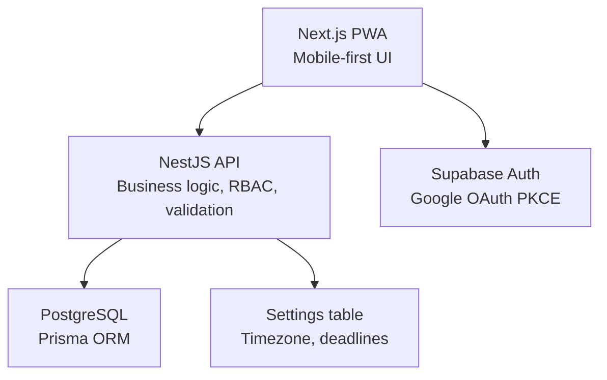
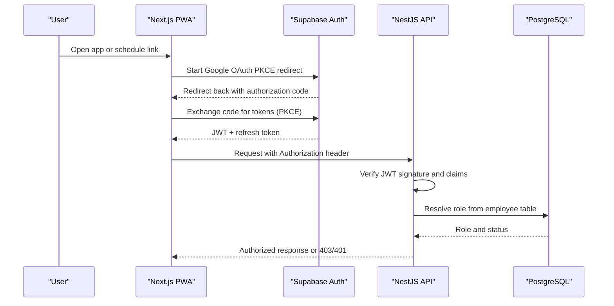
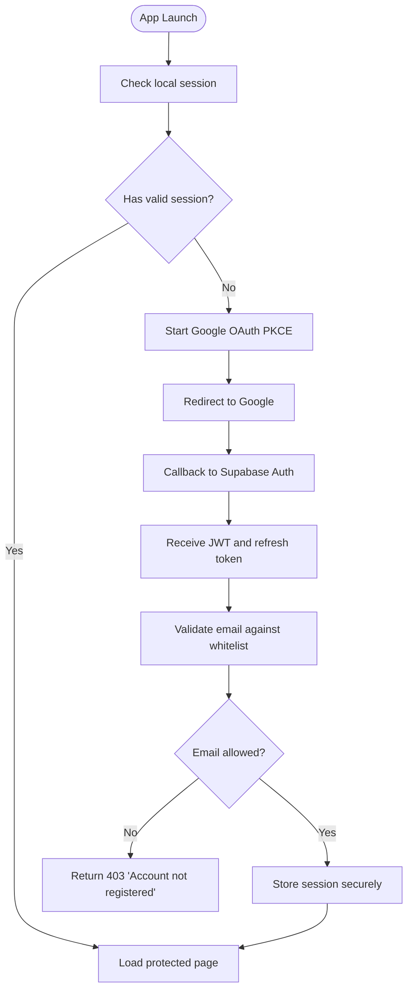
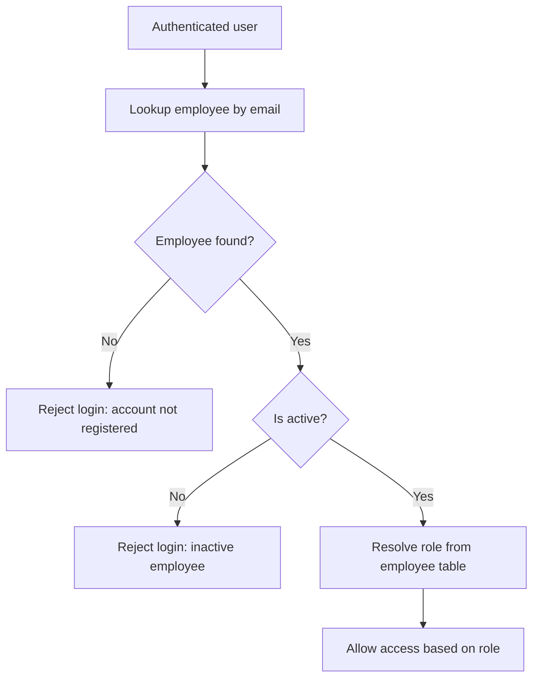
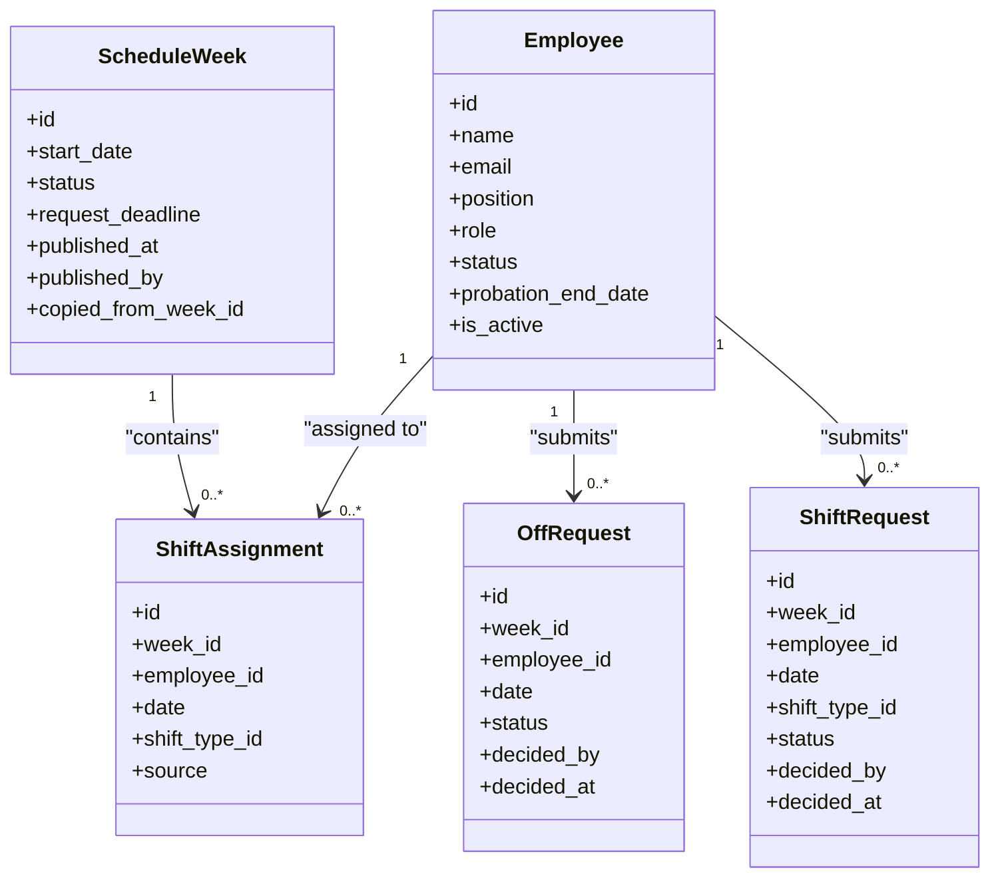
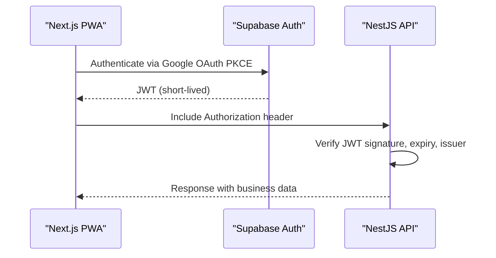
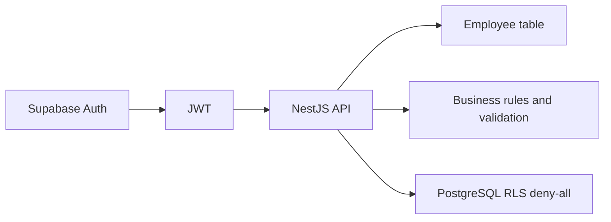

# Security & Authentication

<cite>
**Referenced Files in This Document**   
- [README.md](file://README.md)
- [PRD-Aplikasi-Penjadwalan-Shift-Kyne.md](file://docs/PRD-Aplikasi-Penjadwalan-Shift-Kyne.md)
</cite>

## Table of Contents
1. [Introduction](#introduction)
2. [Project Structure](#project-structure)
3. [Core Components](#core-components)
4. [Architecture Overview](#architecture-overview)
5. [Detailed Component Analysis](#detailed-component-analysis)
6. [Dependency Analysis](#dependency-analysis)
7. [Performance Considerations](#performance-considerations)
8. [Troubleshooting Guide](#troubleshooting-guide)
9. [Conclusion](#conclusion)

## Introduction
This document defines the security and authentication model for the Kyne shift scheduling application as specified in the product requirements. It focuses on Google OAuth PKCE login with Supabase Auth, email whitelist validation, role-based access control (RBAC), JWT handling, session behavior, secure cookie configuration, input validation, SQL injection prevention, XSS protection, CSRF mitigation, API security controls, sensitive data handling, encryption standards, secure communication protocols, and PWA/mobile security best practices.

The project is currently a scaffold without implementation code; therefore, this document specifies the required security design and constraints that must be enforced during development.

**Section sources**
- [README.md:1-25](file://README.md#L1-L25)
- [PRD-Aplikasi-Penjadwalan-Shift-Kyne.md:230-249](file://docs/PRD-Aplikasi-Penjadwalan-Shift-Kyne.md#L230-L249)

## Project Structure
At this stage, the repository contains only documentation and a README. The intended architecture is described in the PRD:
- Frontend: Next.js PWA
- Backend: NestJS API
- Database: PostgreSQL via Prisma on Supabase
- Authentication: Supabase Auth with Google provider using PKCE redirect flow
- Hosting: Vercel (web), Supabase (database and auth), VPS (NestJS)

**Diagram sources**
- [PRD-Aplikasi-Penjadwalan-Shift-Kyne.md:230-249](file://docs/PRD-Aplikasi-Penjadwalan-Shift-Kyne.md#L230-L249)

**Section sources**
- [PRD-Aplikasi-Penjadwalan-Shift-Kyne.md:230-249](file://docs/PRD-Aplikasi-Penjadwalan-Shift-Kyne.md#L230-L249)

## Core Components
- Authentication: Google OAuth with PKCE redirect flow through Supabase Auth SDK.
- Email Whitelist Validation: NestJS enforces that only emails present in the employee table can log in.
- Role-Based Access Control: Roles are manager, staff, and probationary staff, derived from the employee table.
- Session Handling: 30-day session retention as per functional requirement.
- Secure Communication: HTTPS via reverse proxy on the VPS.
- Data Protection: RLS deny-all at the database layer; frontend never reads tables directly.

Key security constraints from the PRD:
- Whitelist check occurs in NestJS; Supabase Auth allows any Google account unless blocked by an optional Auth Hook.
- Roles come from the employee table, not from JWT user_metadata.
- All database tables use RLS deny-all.
- Deadlines are server-enforced without cron jobs.

**Section sources**
- [PRD-Aplikasi-Penjadwalan-Shift-Kyne.md:106-112](file://docs/PRD-Aplikasi-Penjadwalan-Shift-Kyne.md#L106-L112)
- [PRD-Aplikasi-Penjadwalan-Shift-Kyne.md:243-249](file://docs/PRD-Aplikasi-Penjadwalan-Shift-Kyne.md#L243-L249)

## Architecture Overview
The security architecture centers on a zero-trust backend:
- The frontend authenticates users via Supabase Auth using Google OAuth PKCE redirect.
- After successful authentication, the frontend obtains a JWT and includes it in API requests.
- NestJS validates the JWT on every request and resolves roles from the employee table.
- All database access goes through NestJS; direct client-to-database access is denied by RLS.

**Diagram sources**
- [PRD-Aplikasi-Penjadwalan-Shift-Kyne.md:237-241](file://docs/PRD-Aplikasi-Penjadwalan-Shift-Kyne.md#L237-L241)
- [PRD-Aplikasi-Penjadwalan-Shift-Kyne.md:243-249](file://docs/PRD-Aplikasi-Penjadwalan-Shift-Kyne.md#L243-L249)

## Detailed Component Analysis

### Google OAuth PKCE Flow with Supabase Auth
- Use PKCE redirect flow instead of popups to avoid issues on iOS standalone PWA.
- Configure Supabase Auth with Google provider and PKCE.
- On success, store the JWT securely in memory and refresh tokens according to platform capabilities.
- Preserve the original destination URL so users land on the correct page after login.

Security notes:
- Do not rely on JWT user_metadata for roles; always resolve roles from the employee table in NestJS.
- Enforce email whitelist in NestJS to reject unregistered accounts even if Google authentication succeeds.

**Diagram sources**
- [PRD-Aplikasi-Penjadwalan-Shift-Kyne.md:106-112](file://docs/PRD-Aplikasi-Penjadwalan-Shift-Kyne.md#L106-L112)
- [PRD-Aplikasi-Penjadwalan-Shift-Kyne.md:243-249](file://docs/PRD-Aplikasi-Penjadwalan-Shift-Kyne.md#L243-L249)

**Section sources**
- [PRD-Aplikasi-Penjadwalan-Shift-Kyne.md:106-112](file://docs/PRD-Aplikasi-Penjadwalan-Shift-Kyne.md#L106-L112)
- [PRD-Aplikasi-Penjadwalan-Shift-Kyne.md:237-241](file://docs/PRD-Aplikasi-Penjadwalan-Shift-Kyne.md#L237-L241)

### Email Whitelist Validation and Registration
- Only employees whose Google email exists in the employee table may log in.
- Unregistered emails receive a clear error message indicating the account is not registered.
- Manager-managed employee records include name, Google email, position, role, probation status, probation end date, and active flag.
- Inactive employees cannot log in; historical data remains intact.
- Probation status transitions automatically after the probation end date passes.

Implementation guidance:
- On each authenticated request, NestJS checks the employee record for active status and role.
- Reject login attempts for emails not present in the employee table.
- Keep registration limited to managers; do not allow self-registration.

**Diagram sources**
- [PRD-Aplikasi-Penjadwalan-Shift-Kyne.md:114-121](file://docs/PRD-Aplikasi-Penjadwalan-Shift-Kyne.md#L114-L121)
- [PRD-Aplikasi-Penjadwalan-Shift-Kyne.md:243-249](file://docs/PRD-Aplikasi-Penjadwalan-Shift-Kyne.md#L243-L249)

**Section sources**
- [PRD-Aplikasi-Penjadwalan-Shift-Kyne.md:114-121](file://docs/PRD-Aplikasi-Penjadwalan-Shift-Kyne.md#L114-L121)
- [PRD-Aplikasi-Penjadwalan-Shift-Kyne.md:243-249](file://docs/PRD-Aplikasi-Penjadwalan-Shift-Kyne.md#L243-L249)

### Role-Based Access Control (RBAC)
Roles and permissions:
- Manager: manage employees, review and decide requests, build and publish schedules, view coverage validation and total hours.
- Staff: view own schedule, submit leave and shift requests.
- Probationary staff: view own schedule only; request menu appears automatically after probation ends.

Access enforcement rules:
- Roles are resolved from the employee table, not from JWT metadata.
- Private pages require login; schedule links are protected.
- Server-side enforcement is mandatory; client-side restrictions are insufficient.

**Diagram sources**
- [PRD-Aplikasi-Penjadwalan-Shift-Kyne.md:197-210](file://docs/PRD-Aplikasi-Penjadwalan-Shift-Kyne.md#L197-L210)

**Section sources**
- [PRD-Aplikasi-Penjadwalan-Shift-Kyne.md:27-38](file://docs/PRD-Aplikasi-Penjadwalan-Shift-Kyne.md#L27-L38)
- [PRD-Aplikasi-Penjadwalan-Shift-Kyne.md:243-249](file://docs/PRD-Aplikasi-Penjadwalan-Shift-Kyne.md#L243-L249)
- [PRD-Aplikasi-Penjadwalan-Shift-Kyne.md:197-210](file://docs/PRD-Aplikasi-Penjadwalan-Shift-Kyne.md#L197-L210)

### JWT Token Management and Session Handling
- Supabase Auth issues JWTs upon successful authentication.
- NestJS verifies JWT signatures and claims on every API request.
- Sessions persist for 30 days as required by the functional specification.
- Preserve the original destination URL so users continue to the intended page after login.

Best practices:
- Store JWT in memory where possible; avoid long-lived storage unless necessary.
- Refresh tokens should be handled securely according to platform capabilities.
- Always validate expiration and issuer on the backend.

**Diagram sources**
- [PRD-Aplikasi-Penjadwalan-Shift-Kyne.md:106-112](file://docs/PRD-Aplikasi-Penjadwalan-Shift-Kyne.md#L106-L112)
- [PRD-Aplikasi-Penjadwalan-Shift-Kyne.md:237-241](file://docs/PRD-Aplikasi-Penjadwalan-Shift-Kyne.md#L237-L241)

**Section sources**
- [PRD-Aplikasi-Penjadwalan-Shift-Kyne.md:106-112](file://docs/PRD-Aplikasi-Penjadwalan-Shift-Kyne.md#L106-L112)
- [PRD-Aplikasi-Penjadwalan-Shift-Kyne.md:237-241](file://docs/PRD-Aplikasi-Penjadwalan-Shift-Kyne.md#L237-L241)

### Secure Cookie Configuration
- If cookies are used for sessions or tokens, configure them with:
  - HttpOnly to prevent JavaScript access.
  - Secure to ensure transmission over HTTPS only.
  - SameSite=Strict or Lax to mitigate CSRF.
  - Appropriate Domain and Path scoping.
  - Reasonable Max-Age aligned with the 30-day session policy.
- Prefer bearer tokens in Authorization headers for API calls when feasible.

[No sources needed since this section provides general guidance]

### Input Validation, SQL Injection Prevention, XSS Protection, and CSRF Mitigation
- Input validation:
  - Validate all inputs on the backend using strict schemas.
  - Enforce business rules such as maximum one leave request per week, Monday–Thursday only, and shift slot limits.
- SQL injection prevention:
  - Use parameterized queries or an ORM like Prisma.
  - Never concatenate user input into SQL strings.
- XSS protection:
  - Escape output on the frontend.
  - Set appropriate Content-Security-Policy headers.
  - Avoid rendering untrusted HTML.
- CSRF mitigation:
  - Use SameSite cookies and anti-CSRF tokens for state-changing operations.
  - Validate Origin and Referer headers where applicable.

**Section sources**
- [PRD-Aplikasi-Penjadwalan-Shift-Kyne.md:122-131](file://docs/PRD-Aplikasi-Penjadwalan-Shift-Kyne.md#L122-L131)
- [PRD-Aplikasi-Penjadwalan-Shift-Kyne.md:243-249](file://docs/PRD-Aplikasi-Penjadwalan-Shift-Kyne.md#L243-L249)

### API Security Measures
- Rate limiting:
  - Apply rate limits on authentication endpoints and write-heavy routes.
  - Use IP-based and user-based throttling where appropriate.
- Request validation:
  - Validate payloads against strict schemas before processing.
  - Reject malformed or oversized requests early.
- Response sanitization:
  - Return minimal data necessary.
  - Avoid leaking stack traces or internal errors to clients.

[No sources needed since this section provides general guidance]

### Sensitive Data Handling, Encryption Standards, and Secure Communication
- Sensitive data:
  - Minimize collection and retention of personal data.
  - Encrypt sensitive fields at rest if required by policy.
- Encryption standards:
  - Use TLS 1.2+ for all communications.
  - Use strong algorithms for hashing and encryption as per current standards.
- Secure communication:
  - Host NestJS behind a reverse proxy with HTTPS termination.
  - Enforce HSTS and secure headers.

**Section sources**
- [PRD-Aplikasi-Penjadwalan-Shift-Kyne.md:241-249](file://docs/PRD-Aplikasi-Penjadwalan-Shift-Kyne.md#L241-L249)

### PWA Development, Local Storage Security, and Mobile App Security
- PWA considerations:
  - Use redirect-based OAuth flows rather than popups due to iOS standalone mode limitations.
  - Test login from WhatsApp links on Android and iPhone.
  - Handle in-app browser restrictions gracefully.
- Local storage security:
  - Avoid storing secrets or long-lived tokens in localStorage.
  - Prefer memory storage for short-lived tokens.
- Mobile app security:
  - Ensure deep links and universal links are validated.
  - Validate origins and schemes for incoming URLs.
  - Provide clear messaging when opening external browsers is required.

**Section sources**
- [PRD-Aplikasi-Penjadwalan-Shift-Kyne.md:222-228](file://docs/PRD-Aplikasi-Penjadwalan-Shift-Kyne.md#L222-L228)

## Dependency Analysis
The security dependencies are centered around Supabase Auth, NestJS, and PostgreSQL with RLS:
- Supabase Auth handles identity and issues JWTs.
- NestJS performs JWT verification, role resolution, and business rule enforcement.
- PostgreSQL uses RLS deny-all to block direct client access.

**Diagram sources**
- [PRD-Aplikasi-Penjadwalan-Shift-Kyne.md:237-249](file://docs/PRD-Aplikasi-Penjadwalan-Shift-Kyne.md#L237-L249)

**Section sources**
- [PRD-Aplikasi-Penjadwalan-Shift-Kyne.md:237-249](file://docs/PRD-Aplikasi-Penjadwalan-Shift-Kyne.md#L237-L249)

## Performance Considerations
- JWT verification should be fast and cached where safe.
- Role resolution should be optimized with indexed lookups on employee email and active flags.
- Avoid unnecessary database calls by caching non-sensitive configuration values within safe time windows.
- Implement efficient pagination and filtering for schedule and request lists.

[No sources needed since this section provides general guidance]

## Troubleshooting Guide
Common issues and mitigations:
- Login fails from WhatsApp links:
  - Ensure redirect-based OAuth flow works in mobile browsers.
  - Test both Android and iPhone environments.
- Unauthorized access attempts:
  - Verify JWT signature and expiry on the backend.
  - Confirm role resolution from the employee table.
- Whitelist rejections:
  - Check that the employee record exists and is active.
- Deadline enforcement:
  - Ensure server-side deadline checks are applied consistently.

**Section sources**
- [PRD-Aplikasi-Penjadwalan-Shift-Kyne.md:222-228](file://docs/PRD-Aplikasi-Penjadwalan-Shift-Kyne.md#L222-L228)
- [PRD-Aplikasi-Penjadwalan-Shift-Kyne.md:243-249](file://docs/PRD-Aplikasi-Penjadwalan-Shift-Kyne.md#L243-L249)

## Conclusion
The Kyne shift scheduling application’s security model relies on a strict backend-centric approach:
- Google OAuth PKCE via Supabase Auth for identity.
- Email whitelist enforcement in NestJS.
- Role-based access control derived from the employee table.
- JWT verification on every request.
- Database-level protection with RLS deny-all.
- Secure communication via HTTPS and hardened headers.
- Robust input validation, XSS protection, and CSRF mitigation.
- Careful handling of PWA and mobile-specific authentication flows.

These measures collectively ensure that only authorized users can access their own data, while the system remains resilient against common web vulnerabilities.