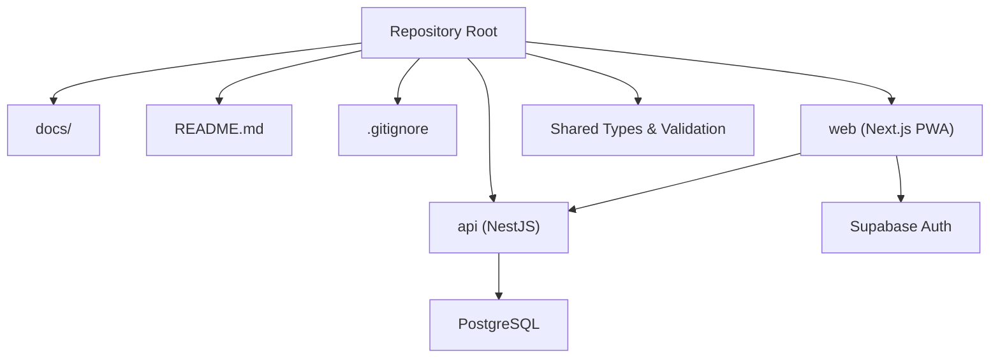
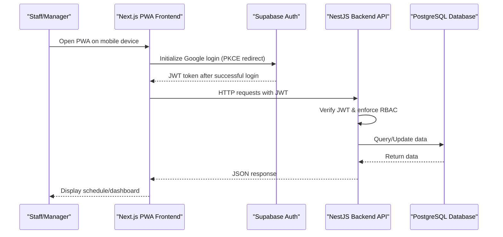
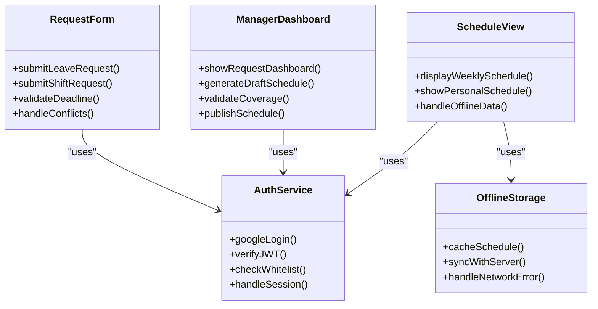
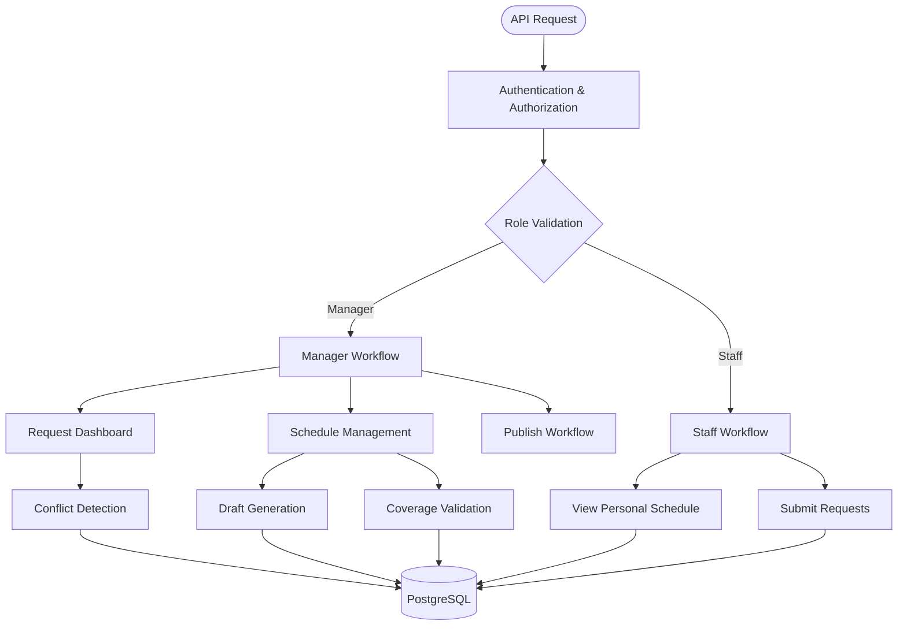
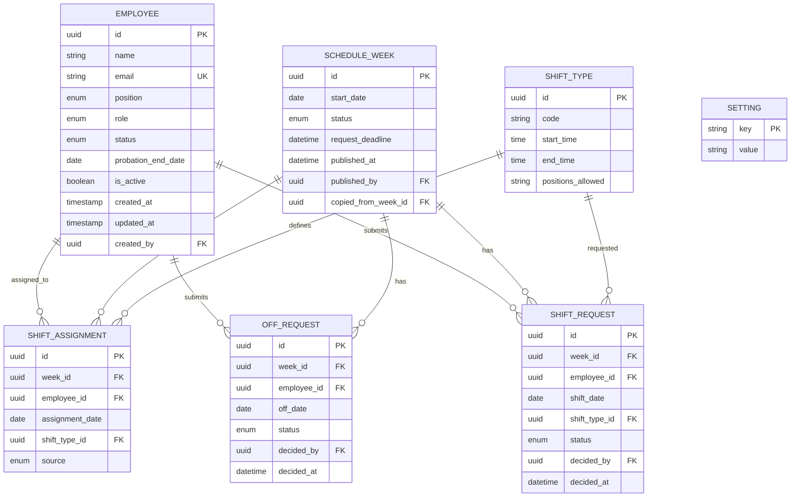
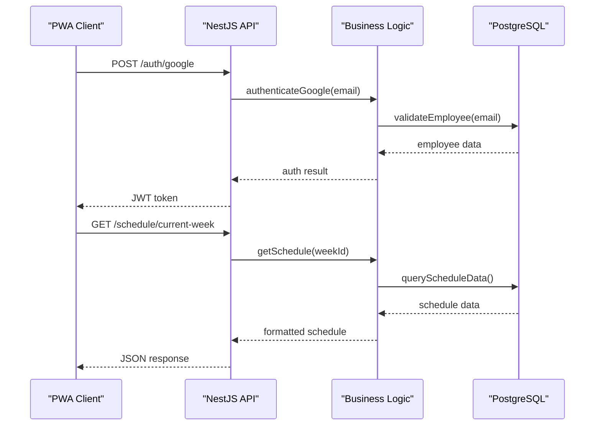
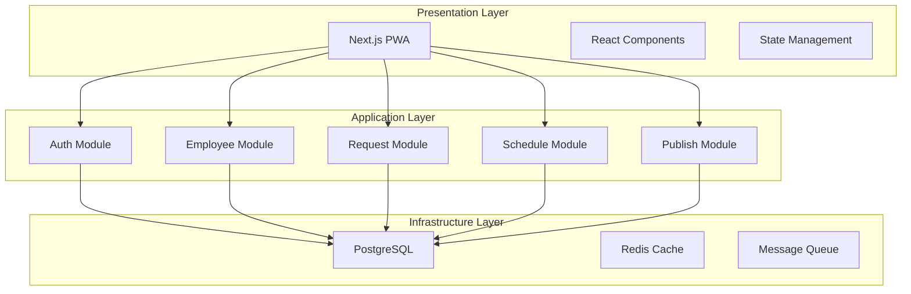

# System Design Overview

<cite>
**Referenced Files in This Document**
- [README.md](file://README.md)
- [PRD-Aplikasi-Penjadwalan-Shift-Kyne.md](file://docs/PRD-Aplikasi-Penjadwalan-Shift-Kyne.md)
- [.gitignore](file://.gitignore)
</cite>

## Table of Contents
1. [Introduction](#introduction)
2. [Project Structure](#project-structure)
3. [Core Components](#core-components)
4. [Architecture Overview](#architecture-overview)
5. [Detailed Component Analysis](#detailed-component-analysis)
6. [Dependency Analysis](#dependency-analysis)
7. [Performance Considerations](#performance-considerations)
8. [Troubleshooting Guide](#troubleshooting-guide)
9. [Conclusion](#conclusion)

## Introduction
This document describes the system design overview for the Kyne shift scheduling application. The project is currently an early scaffold with no implementation code yet, but the product requirements define a clear architecture: a Next.js PWA frontend, a NestJS backend API, and PostgreSQL as the relational database. The repository follows a monorepo layout where the frontend (`web`) and backend (`api`) are separate modules, with shared types and validation packages intended to support future integration into an ERP system.

The MVP focuses on weekly shift scheduling for six staff members across bar and kitchen roles, including Google-based authentication, employee management, leave and shift requests, manager scheduling workflows, coverage validation, publishing, and staff schedule viewing.

**Section sources**
- [README.md:1-25](file://README.md#L1-L25)
- [PRD-Aplikasi-Penjadwalan-Shift-Kyne.md:5-20](file://docs/PRD-Aplikasi-Penjadwalan-Shift-Kyne.md#L5-L20)

## Project Structure
At this stage, the repository contains only documentation and scaffolding files. The intended structure is a monorepo with:
- `web`: Next.js PWA frontend for mobile-first staff views and manager dashboard
- `api`: NestJS backend API implementing business logic, authorization, and data access
- Shared packages for TypeScript types and validation rules
- Documentation under `docs`

**Diagram sources**
- [PRD-Aplikasi-Penjadwalan-Shift-Kyne.md:230-242](file://docs/PRD-Aplikasi-Penjadwalan-Shift-Kyne.md#L230-L242)

**Section sources**
- [README.md:1-25](file://README.md#L1-L25)
- [PRD-Aplikasi-Penjadwalan-Shift-Kyne.md:230-242](file://docs/PRD-Aplikasi-Penjadwalan-Shift-Kyne.md#L230-L242)

## Core Components
The system is composed of three primary layers:
- Presentation Layer (Frontend): Next.js PWA providing mobile-first UI for staff and manager dashboards
- Business Logic Layer (Backend): NestJS services handling authentication, employee management, request processing, scheduling, and publishing
- Data Access Layer (Database): PostgreSQL storing employees, shift types, schedules, requests, and settings

Key functional modules include:
- Authentication via Supabase Auth with Google login and whitelist enforcement
- Employee Management for adding, deactivating, and role assignment
- Leave and Shift Requests with conflict detection and deadline enforcement
- Manager Scheduling Dashboard with draft generation from previous weeks
- Coverage Validation ensuring minimum staffing levels
- Publishing and Sharing workflow with WhatsApp link sharing

**Section sources**
- [PRD-Aplikasi-Penjadwalan-Shift-Kyne.md:102-164](file://docs/PRD-Aplikasi-Penjadwalan-Shift-Kyne.md#L102-L164)
- [PRD-Aplikasi-Penjadwalan-Shift-Kyne.md:230-242](file://docs/PRD-Aplikasi-Penjadwalan-Shift-Kyne.md#L230-L242)

## Architecture Overview
The high-level architecture follows a client-server pattern with clear separation of concerns:

**Diagram sources**
- [PRD-Aplikasi-Penjadwalan-Shift-Kyne.md:230-248](file://docs/PRD-Aplikasi-Penjadwalan-Shift-Kyne.md#L230-L248)

### Technology Stack Decisions
- **Next.js for PWA Development**: Provides server-side rendering capabilities, static site generation, and PWA features for offline support and app-like experience
- **NestJS for Modular Backend Architecture**: Offers structured module organization, dependency injection, and built-in support for REST APIs
- **PostgreSQL for Relational Data Storage**: Ensures data integrity, complex queries, and ACID compliance for scheduling operations
- **Supabase Auth**: Handles Google authentication with PKCE flow and JWT token management
- **Prisma ORM**: Provides type-safe database access and schema management

**Section sources**
- [PRD-Aplikasi-Penjadwalan-Shift-Kyne.md:230-242](file://docs/PRD-Aplikasi-Penjadwalan-Shift-Kyne.md#L230-L242)

## Detailed Component Analysis

### Frontend Architecture (Next.js PWA)
The frontend implements a progressive web application with mobile-first design principles:

**Diagram sources**
- [PRD-Aplikasi-Penjadwalan-Shift-Kyne.md:220-228](file://docs/PRD-Aplikasi-Penjadwalan-Shift-Kyne.md#L220-L228)

### Backend Services (NestJS)
The backend implements modular services with clear separation of concerns:

**Diagram sources**
- [PRD-Aplikasi-Penjadwalan-Shift-Kyne.md:102-164](file://docs/PRD-Aplikasi-Penjadwalan-Shift-Kyne.md#L102-L164)

### Data Model Architecture
The database schema supports the core business entities:

**Diagram sources**
- [PRD-Aplikasi-Penjadwalan-Shift-Kyne.md:197-217](file://docs/PRD-Aplikasi-Penjadwalan-Shift-Kyne.md#L197-L217)

### Client-Server Communication Patterns
The application uses RESTful API patterns with JWT-based authentication:

**Diagram sources**
- [PRD-Aplikasi-Penjadwalan-Shift-Kyne.md:230-248](file://docs/PRD-Aplikasi-Penjadwalan-Shift-Kyne.md#L230-L248)

## Dependency Analysis
The system exhibits clear dependency relationships between components:

**Diagram sources**
- [PRD-Aplikasi-Penjadwalan-Shift-Kyne.md:230-242](file://docs/PRD-Aplikasi-Penjadwalan-Shift-Kyne.md#L230-L242)

**Section sources**
- [PRD-Aplikasi-Penjadwalan-Shift-Kyne.md:230-242](file://docs/PRD-Aplikasi-Penjadwalan-Shift-Kyne.md#L230-L242)

## Performance Considerations
Several performance optimizations are planned for the system:

- **Caching Strategy**: Implement Redis caching for frequently accessed schedule data and employee information
- **Database Optimization**: Use proper indexing on foreign keys and frequently queried columns
- **PWA Caching**: Leverage service workers for offline data caching and background synchronization
- **API Response Optimization**: Implement pagination for large datasets and field selection for reduced payload sizes
- **Connection Pooling**: Configure optimal database connection pooling for concurrent request handling

[No sources needed since this section provides general guidance]

## Troubleshooting Guide
Common issues and their resolution strategies:

### Authentication Issues
- **Google Login Failures**: Verify PKCE flow configuration and ensure proper redirect URI setup
- **JWT Validation Errors**: Check token expiration and verify signature validation
- **Whitelist Rejections**: Ensure employee records exist in the database before allowing login

### Scheduling Conflicts
- **Coverage Violations**: Implement real-time validation during schedule editing
- **Request Deadlines**: Enforce timezone-aware deadline checking (WITA timezone)
- **Middle Kitchen Logic**: Validate automatic middle shift assignment when kitchen colleagues are on leave

### PWA-Specific Issues
- **Offline Mode**: Test service worker caching strategies and background sync functionality
- **Mobile Browser Compatibility**: Verify behavior across different iOS and Android browsers
- **Installation Issues**: Provide clear instructions for PWA installation on different platforms

**Section sources**
- [PRD-Aplikasi-Penjadwalan-Shift-Kyne.md:220-228](file://docs/PRD-Aplikasi-Penjadwalan-Shift-Kyne.md#L220-L228)

## Conclusion
The Kyne shift scheduling application is designed with a modern, scalable architecture that separates concerns between presentation, business logic, and data layers. The use of Next.js for PWA development ensures excellent mobile user experience, while NestJS provides a robust foundation for business logic implementation. PostgreSQL offers reliable relational data storage suitable for complex scheduling operations.

The monorepo structure facilitates code sharing and maintains consistency with the broader ERP system architecture. Security measures including JWT authentication, role-based access control, and database row-level security ensure data protection and privacy compliance.

As the project progresses from scaffold to full implementation, these architectural principles will guide development decisions and ensure maintainability, scalability, and performance optimization opportunities.

[No sources needed since this section summarizes without analyzing specific files]