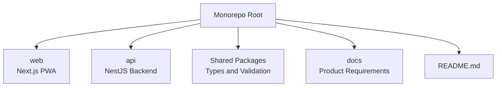
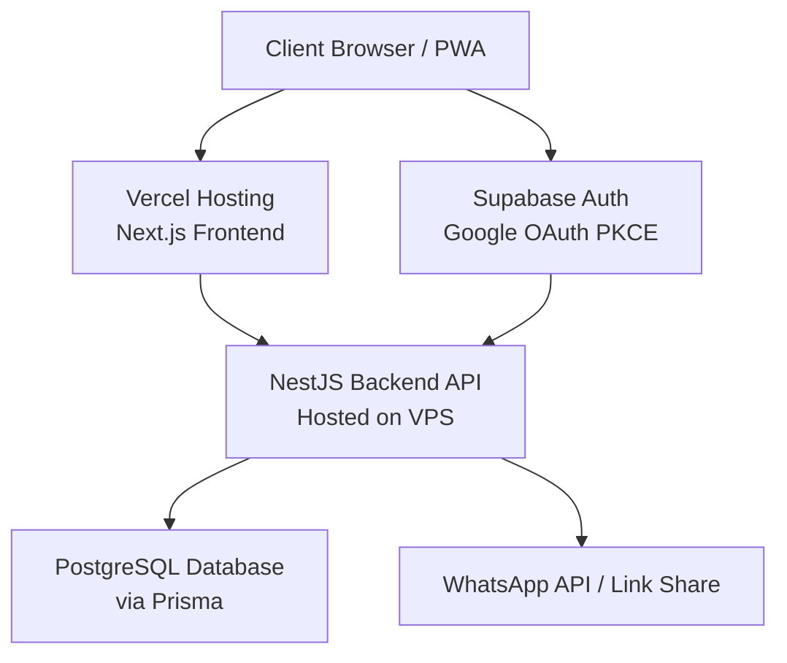
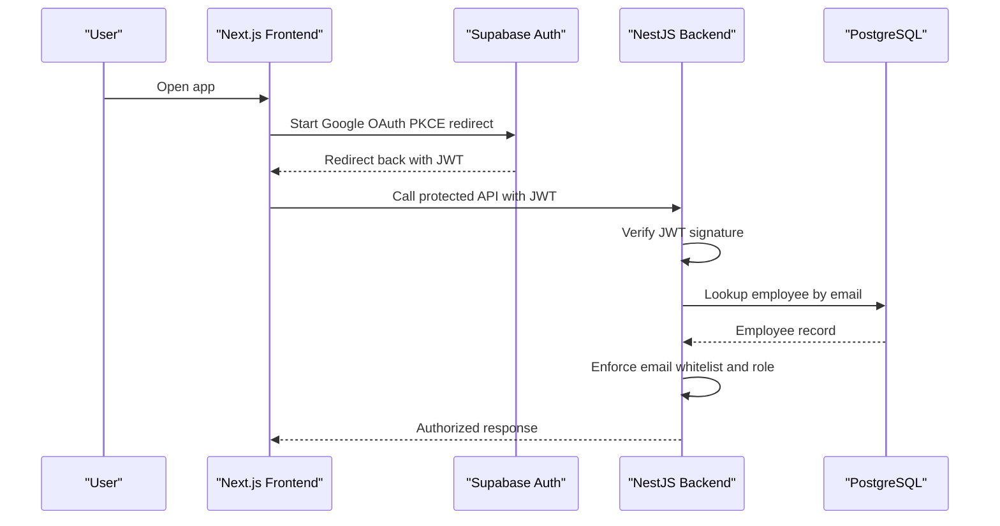
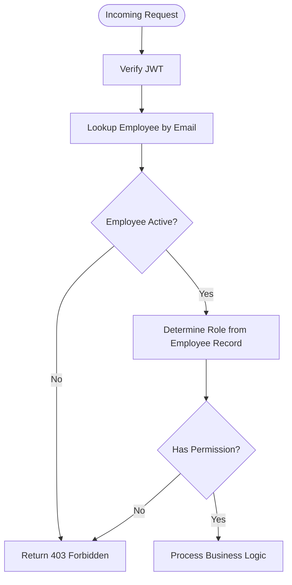
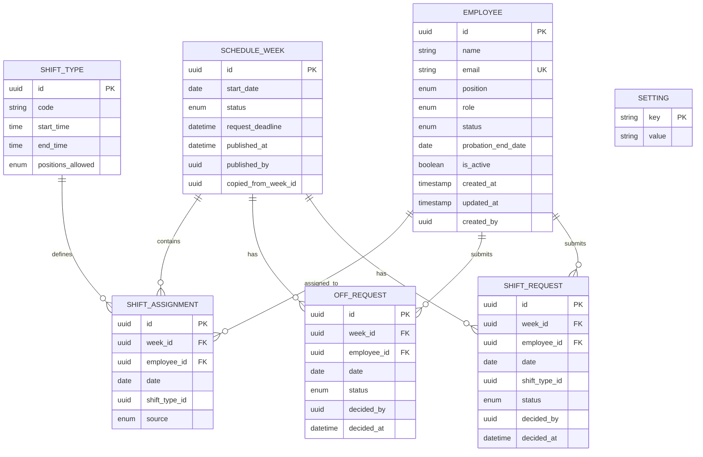
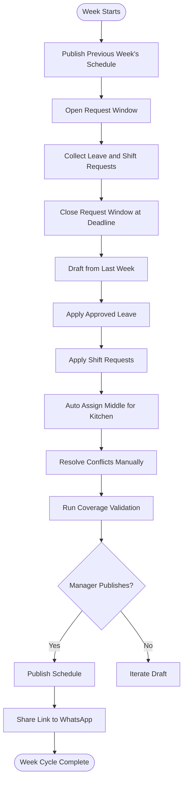
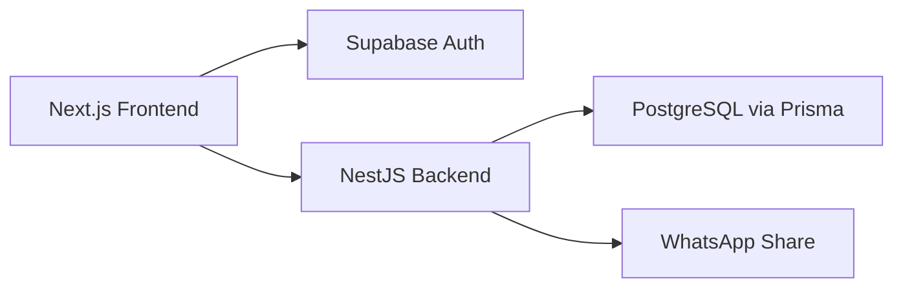

# Technical Architecture

<cite>
**Referenced Files in This Document**
- [README.md](file://README.md)
- [PRD-Aplikasi-Penjadwalan-Shift-Kyne.md](file://docs/PRD-Aplikasi-Penjadwalan-Shift-Kyne.md)
</cite>

## Table of Contents
1. [Introduction](#introduction)
2. [Project Structure](#project-structure)
3. [Core Components](#core-components)
4. [Architecture Overview](#architecture-overview)
5. [Detailed Component Analysis](#detailed-component-analysis)
6. [Dependency Analysis](#dependency-analysis)
7. [Performance Considerations](#performance-considerations)
8. [Troubleshooting Guide](#troubleshooting-guide)
9. [Conclusion](#conclusion)
10. [Appendices](#appendices)

## Introduction
This document describes the planned technical architecture for the Kyne shift scheduling application. The system is a standalone, mobile-first Progressive Web Application (PWA) that helps managers create weekly shift schedules for six staff members across bar and kitchen roles. It uses Next.js for the frontend, NestJS for the backend API, and PostgreSQL via Supabase for data storage. Authentication is handled through Google OAuth with Supabase Auth, and role-based access control is enforced on the backend. The monorepo structure separates frontend and backend modules so that the NestJS module can later be moved into an ERP repository with minimal changes.

The MVP scope includes:
- Google login with email whitelist
- Employee management
- Leave and shift requests
- Manager dashboard and schedule drafting
- Coverage validation
- Schedule publishing and WhatsApp sharing
- Staff schedule view with total hours per week

**Section sources**
- [README.md:1-25](file://README.md#L1-L25)
- [PRD-Aplikasi-Penjadwalan-Shift-Kyne.md:5-26](file://docs/PRD-Aplikasi-Penjadwalan-Shift-Kyne.md#L5-L26)

## Project Structure
At this stage, the repository is a new scaffold without source code. The intended structure follows a monorepo pattern aligned with the ERP project:
- `web`: Next.js PWA frontend
- `api`: NestJS backend API
- Shared packages for types and validation used by both frontend and backend

**Diagram sources**
- [PRD-Aplikasi-Penjadwalan-Shift-Kyne.md:230-242](file://docs/PRD-Aplikasi-Penjadwalan-Shift-Kyne.md#L230-L242)

**Section sources**
- [README.md:1-25](file://README.md#L1-L25)
- [PRD-Aplikasi-Penjadwalan-Shift-Kyne.md:230-242](file://docs/PRD-Aplikasi-Penjadwalan-Shift-Kyne.md#L230-L242)

## Core Components
The core components are organized around authentication, employee management, request handling, schedule creation, coverage validation, publishing, and staff viewing.

- **Authentication**: Google OAuth via Supabase Auth using PKCE redirect. JWTs are issued by Supabase and verified by NestJS. Email whitelist enforcement happens in NestJS.
- **Employee Management**: CRUD for employees with fields such as name, Google email, position (bar/kitchen), role (manager/staff), probation status, probation end date, and active flag.
- **Request Handling**: Leave requests limited to Monday–Thursday, one per week; shift requests for morning or afternoon shifts per day. Requests can be edited until the weekly deadline.
- **Schedule Creation**: Managers draft from last week’s schedule, apply leave and shift requests, auto-assign middle shifts for kitchen when a colleague is off, and manually resolve conflicts.
- **Coverage Validation**: Rules enforce minimum staffing levels for busy days (Friday–Sunday) and quiet days (Monday–Thursday). Warnings appear before publish.
- **Publishing and Sharing**: Publishing makes the schedule visible to staff and opens the next week’s request window. A share button prepares a WhatsApp message with schedule link and deadline.
- **Staff View**: Each staff member sees only their own schedule, including middle kitchen indicators and total weekly hours.

**Section sources**
- [PRD-Aplikasi-Penjadwalan-Shift-Kyne.md:102-164](file://docs/PRD-Aplikasi-Penjadwalan-Shift-Kyne.md#L102-L164)

## Architecture Overview
The system boundary includes the Next.js frontend, NestJS backend, Supabase Auth, PostgreSQL database, and external WhatsApp integration.

**Diagram sources**
- [PRD-Aplikasi-Penjadwalan-Shift-Kyne.md:230-242](file://docs/PRD-Aplikasi-Penjadwalan-Shift-Kyne.md#L230-L242)

### System Boundaries
- **Frontend Boundary**: Next.js PWA handles user interfaces for staff and manager dashboards. It delegates authentication to Supabase Auth and calls NestJS APIs for business logic.
- **Backend Boundary**: NestJS enforces RBAC, validates requests, manages schedule state, and applies business rules. It communicates with PostgreSQL via Prisma.
- **External Services**:
  - **Supabase Auth**: Issues JWTs after Google OAuth.
  - **WhatsApp**: Used for sharing schedule links and deadlines.

**Section sources**
- [PRD-Aplikasi-Penjadwalan-Shift-Kyne.md:230-242](file://docs/PRD-Aplikasi-Penjadwalan-Shift-Kyne.md#L230-L242)

## Detailed Component Analysis

### Authentication Flow with Google OAuth and Supabase
The authentication flow uses PKCE redirect to avoid popup issues on iOS standalone mode. After successful Google login, Supabase returns a JWT. NestJS verifies the token and checks the email against the employee whitelist. Roles are read from the employee table, not from JWT metadata.

**Diagram sources**
- [PRD-Aplikasi-Penjadwalan-Shift-Kyne.md:106-113](file://docs/PRD-Aplikasi-Penjadwalan-Shift-Kyne.md#L106-L113)
- [PRD-Aplikasi-Penjadwalan-Shift-Kyne.md:243-248](file://docs/PRD-Aplikasi-Penjadwalan-Shift-Kyne.md#L243-L248)

**Section sources**
- [PRD-Aplikasi-Penjadwalan-Shift-Kyne.md:106-113](file://docs/PRD-Aplikasi-Penjadwalan-Shift-Kyne.md#L106-L113)
- [PRD-Aplikasi-Penjadwalan-Shift-Kyne.md:243-248](file://docs/PRD-Aplikasi-Penjadwalan-Shift-Kyne.md#L243-L248)

### Role-Based Access Control Implementation
Roles are determined from the employee table:
- Manager: full access to manage employees, review requests, create and publish schedules, and see coverage validation.
- Staff: view own schedule and submit requests.
- Probationary staff: view own schedule only; request menu appears after probation ends.

Access control is enforced at the backend layer. Frontend UI may hide features based on role, but server-side authorization remains authoritative.

**Diagram sources**
- [PRD-Aplikasi-Penjadwalan-Shift-Kyne.md:27-38](file://docs/PRD-Aplikasi-Penjadwalan-Shift-Kyne.md#L27-L38)
- [PRD-Aplikasi-Penjadwalan-Shift-Kyne.md:243-248](file://docs/PRD-Aplikasi-Penjadwalan-Shift-Kyne.md#L243-L248)

**Section sources**
- [PRD-Aplikasi-Penjadwalan-Shift-Kyne.md:27-38](file://docs/PRD-Aplikasi-Penjadwalan-Shift-Kyne.md#L27-L38)
- [PRD-Aplikasi-Penjadwalan-Shift-Kyne.md:243-248](file://docs/PRD-Aplikasi-Penjadwalan-Shift-Kyne.md#L243-L248)

### Data Model Relationships
The MVP data model includes seven entities designed for future ERP migration. Key relationships:
- One schedule week contains many shift assignments.
- Each shift assignment belongs to one employee and references a shift type.
- Leave and shift requests belong to a week and an employee.
- Settings store configuration keys and values.

**Diagram sources**
- [PRD-Aplikasi-Penjadwalan-Shift-Kyne.md:197-217](file://docs/PRD-Aplikasi-Penjadwalan-Shift-Kyne.md#L197-L217)

**Section sources**
- [PRD-Aplikasi-Penjadwalan-Shift-Kyne.md:197-217](file://docs/PRD-Aplikasi-Penjadwalan-Shift-Kyne.md#L197-L217)

### Weekly Schedule Workflow
The weekly workflow governs request windows, drafting, validation, and publishing.

**Diagram sources**
- [PRD-Aplikasi-Penjadwalan-Shift-Kyne.md:73-90](file://docs/PRD-Aplikasi-Penjadwalan-Shift-Kyne.md#L73-L90)
- [PRD-Aplikasi-Penjadwalan-Shift-Kyne.md:140-156](file://docs/PRD-Aplikasi-Penjadwalan-Shift-Kyne.md#L140-L156)

**Section sources**
- [PRD-Aplikasi-Penjadwalan-Shift-Kyne.md:73-90](file://docs/PRD-Aplikasi-Penjadwalan-Shift-Kyne.md#L73-L90)
- [PRD-Aplikasi-Penjadwalan-Shift-Kyne.md:140-156](file://docs/PRD-Aplikasi-Penjadwalan-Shift-Kyne.md#L140-L156)

### Integration Patterns with External Services
- **Supabase Auth**: Handles Google OAuth PKCE redirect and JWT issuance. NestJS verifies tokens and enforces whitelist and role policies.
- **WhatsApp**: The publish flow provides a share button that prepopulates a message containing the schedule period, link, and next request deadline. No direct API call is required unless automated messaging is added later.

**Section sources**
- [PRD-Aplikasi-Penjadwalan-Shift-Kyne.md:230-242](file://docs/PRD-Aplikasi-Penjadwalan-Shift-Kyne.md#L230-L242)
- [PRD-Aplikasi-Penjadwalan-Shift-Kyne.md:149-156](file://docs/PRD-Aplikasi-Penjadwalan-Shift-Kyne.md#L149-L156)

## Dependency Analysis
High-level dependencies:
- Frontend depends on Supabase Auth client and NestJS REST endpoints.
- Backend depends on PostgreSQL via Prisma and validates incoming JWTs.
- Deployment topology splits hosting responsibilities between Vercel (frontend) and VPS (backend).

**Diagram sources**
- [PRD-Aplikasi-Penjadwalan-Shift-Kyne.md:230-242](file://docs/PRD-Aplikasi-Penjadwalan-Shift-Kyne.md#L230-L242)

**Section sources**
- [PRD-Aplikasi-Penjadwalan-Shift-Kyne.md:230-242](file://docs/PRD-Aplikasi-Penjadwalan-Shift-Kyne.md#L230-L242)

## Performance Considerations
- **Frontend**: Use Next.js static generation where possible and client-side hydration for interactive pages. Cache schedule data efficiently and minimize re-renders on mobile devices.
- **Backend**: Keep NestJS endpoints focused and validate inputs early. Use database indexes on frequently queried fields such as employee email, week start date, and employee-week combinations.
- **Database**: Avoid heavy computations in queries; implement coverage validation in application logic with clear constraints. Use transactions for schedule drafting operations to maintain consistency.
- **Timezone Handling**: Store dates and times consistently in WITA (Asia/Makassar) and convert only at presentation boundaries.
- **Scalability**: NestJS on VPS can scale horizontally behind a reverse proxy. Consider connection pooling for PostgreSQL and caching for read-heavy endpoints like staff schedule views.

[No sources needed since this section provides general guidance]

## Troubleshooting Guide
Common operational issues and mitigations:
- **Login from WhatsApp Links**: Opening the app from WhatsApp may trigger browser restrictions. Ensure users open the link in Chrome/Safari or use the installed PWA. Test both Android and iPhone environments.
- **Whitelist Rejections**: If NestJS rejects a valid Google account, verify the employee record exists and is active. Check timezone settings affecting deadline evaluation.
- **Coverage Warnings Before Publish**: Investigate insufficient staffing on busy days or missing middle kitchen coverage. Adjust draft assignments and re-run validation.
- **Request Window Lockout**: Confirm the current time relative to the weekly deadline in WITA. Requests submitted after closure should be rejected.

**Section sources**
- [PRD-Aplikasi-Penjadwalan-Shift-Kyne.md:220-228](file://docs/PRD-Aplikasi-Penjadwalan-Shift-Kyne.md#L220-L228)
- [PRD-Aplikasi-Penjadwalan-Shift-Kyne.md:188-195](file://docs/PRD-Aplikasi-Penjadwalan-Shift-Kyne.md#L188-L195)

## Conclusion
The Kyne shift scheduling application is designed as a secure, mobile-first PWA backed by a NestJS API and PostgreSQL database. Authentication relies on Google OAuth via Supabase, with strict email whitelisting and role-based access control enforced on the backend. The monorepo structure separates frontend and backend modules, enabling future migration of the NestJS module into an ERP repository. Security practices include deny-all Row Level Security, server-side authorization, and timezone-aware deadline handling. Deployment spans Vercel for the frontend and a VPS for the backend, with WhatsApp used for sharing schedule links. The MVP focuses on essential scheduling workflows while laying groundwork for scalability and ERP integration.

[No sources needed since this section summarizes without analyzing specific files]

## Appendices

### Technology Stack Decisions
- **Frontend**: Next.js PWA, mobile-first design, Supabase Auth for login.
- **Backend**: NestJS with modular services for Auth, Employee, Request, Schedule, and Publish.
- **Database**: PostgreSQL via Supabase, accessed through Prisma.
- **Hosting**: Vercel for web, Supabase for database and auth, VPS for NestJS with Docker or PM2, reverse proxy with HTTPS, and uptime monitoring.

**Section sources**
- [PRD-Aplikasi-Penjadwalan-Shift-Kyne.md:230-242](file://docs/PRD-Aplikasi-Penjadwalan-Shift-Kyne.md#L230-L242)

### Version Compatibility and Third-Party Dependencies
- **Supabase Auth**: Google OAuth with PKCE redirect.
- **Prisma**: ORM for PostgreSQL schema management.
- **WhatsApp**: Used for manual sharing of schedule links and deadlines.
- **Timezone**: Asia/Makassar (WITA) for all deadline and shift calculations.

**Section sources**
- [PRD-Aplikasi-Penjadwalan-Shift-Kyne.md:220-242](file://docs/PRD-Aplikasi-Penjadwalan-Shift-Kyne.md#L220-L242)