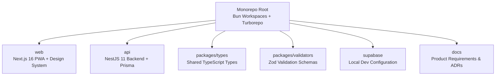
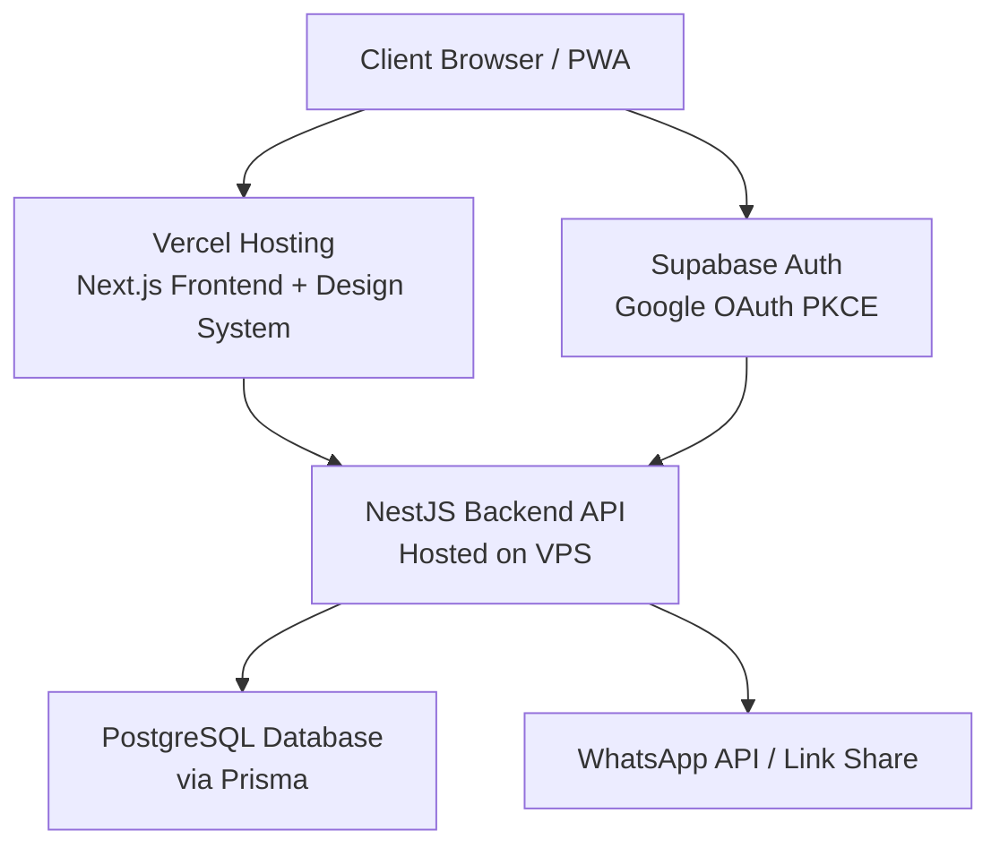
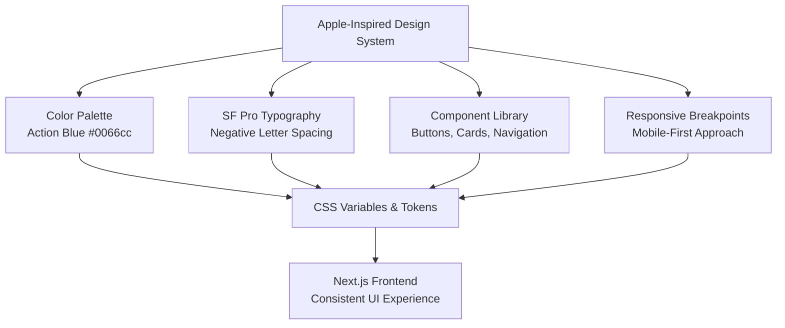
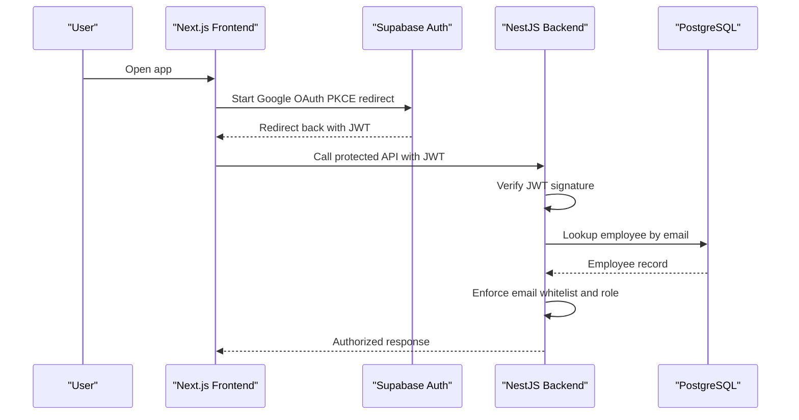
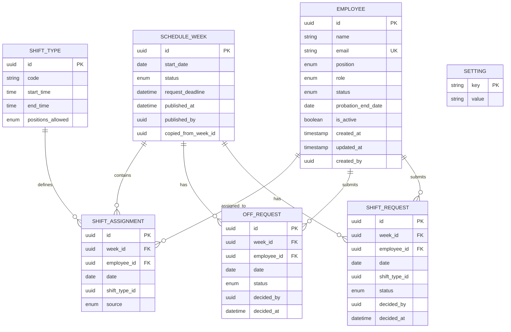
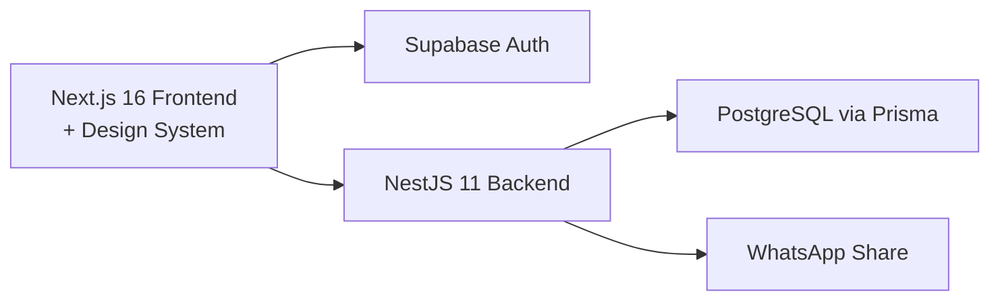

# Technical Architecture

<cite>
**Referenced Files in This Document**
- [README.md](file://README.md)
- [DESIGN.md](file://DESIGN.md)
- [package.json](file://package.json)
- [api/package.json](file://api/package.json)
- [web/package.json](file://web/package.json)
- [api/src/app.module.ts](file://api/src/app.module.ts)
- [api/src/main.ts](file://api/src/main.ts)
- [api/src/env.ts](file://api/src/env.ts)
- [api/prisma/schema/schema.prisma](file://api/prisma/schema/schema.prisma)
- [api/prisma/schema/employee.prisma](file://api/prisma/schema/employee.prisma)
- [api/prisma/schema/shift_type.prisma](file://api/prisma/schema/shift_type.prisma)
- [supabase/config.toml](file://supabase/config.toml)
- [web/app/layout.tsx](file://web/app/layout.tsx)
</cite>

## Update Summary
**Changes Made**
- Updated architecture overview to reflect the established NestJS backend, Next.js frontend, Prisma database layer, and Supabase integration
- Revised project structure documentation based on actual monorepo layout with Bun workspaces and Turborepo
- Added detailed technical specifications for NestJS modules, Prisma schema design, and Supabase configuration
- Updated technology stack decisions with specific version information from package manifests
- Enhanced system boundaries to include actual deployment ports and local development setup
- Added comprehensive data model documentation based on Prisma schema definitions

## Table of Contents
1. [Introduction](#introduction)
2. [Project Structure](#project-structure)
3. [Core Components](#core-components)
4. [Architecture Overview](#architecture-overview)
5. [Design System Architecture](#design-system-architecture)
6. [Detailed Component Analysis](#detailed-component-analysis)
7. [Dependency Analysis](#dependency-analysis)
8. [Performance Considerations](#performance-considerations)
9. [Troubleshooting Guide](#troubleshooting-guide)
10. [Conclusion](#conclusion)
11. [Appendices](#appendices)

## Introduction
This document describes the planned technical architecture for the Kyne shift scheduling application. The system is a standalone, mobile-first Progressive Web Application (PWA) that helps managers create weekly shift schedules for six staff members across bar and kitchen roles. It uses Next.js 16 for the frontend with an Apple-inspired design system, NestJS 11 for the backend API, and PostgreSQL via Supabase for data storage. Authentication is handled through Google OAuth with Supabase Auth, and role-based access control is enforced on the backend. The monorepo structure separates frontend and backend modules using Bun workspaces and Turborepo, enabling future migration of the NestJS module into an ERP repository with minimal changes.

The MVP scope includes:
- Google login with email whitelist
- Employee management
- Leave and shift requests
- Manager dashboard and schedule drafting
- Coverage validation
- Schedule publishing and WhatsApp sharing
- Staff schedule view with total hours per week

**Section sources**
- [README.md:1-25](file://README.md#L1-L25)

## Project Structure
At this stage, the repository follows a well-established monorepo pattern aligned with the ERP project using Bun workspaces and Turborepo:
- `web`: Next.js 16 PWA frontend with Apple-inspired design system
- `api`: NestJS 11 backend API with Prisma database layer
- `packages/types`: Shared TypeScript types including SHIFT_TYPE_CATALOG
- `packages/validators`: Zod validation schemas used by both frontend and backend
- `supabase`: Local Supabase configuration for development environment

**Diagram sources**
- [package.json:6-10](file://package.json#L6-L10)
- [README.md:14-19](file://README.md#L14-L19)

**Section sources**
- [README.md:10-19](file://README.md#L10-L19)
- [package.json:6-10](file://package.json#L6-L10)

## Core Components
The core components are organized around authentication, employee management, request handling, schedule creation, coverage validation, publishing, and staff viewing.

- **Authentication**: Google OAuth via Supabase Auth using PKCE redirect. JWTs are issued by Supabase and verified by NestJS. Email whitelist enforcement happens in NestJS.
- **Employee Management**: CRUD for employees with fields such as name, Google email, position (bar/kitchen), role (manager/staff), probation status, probation end date, and active flag.
- **Request Handling**: Leave requests limited to Monday–Thursday, one per week; shift requests for morning or afternoon shifts per day. Requests can be edited until the weekly deadline.
- **Schedule Creation**: Managers draft from last week's schedule, apply leave and shift requests, auto-assign middle shifts for kitchen when a colleague is off, and manually resolve conflicts.
- **Coverage Validation**: Rules enforce minimum staffing levels for busy days (Friday–Sunday) and quiet days (Monday–Thursday). Warnings appear before publish.
- **Publishing and Sharing**: Publishing makes the schedule visible to staff and opens the next week's request window. A share button prepares a WhatsApp message with schedule link and deadline.
- **Staff View**: Each staff member sees only their own schedule, including middle kitchen indicators and total weekly hours.

**Section sources**
- [README.md:1-25](file://README.md#L1-L25)

## Architecture Overview
The system boundary includes the Next.js frontend with Apple-inspired design system, NestJS backend, Supabase Auth, PostgreSQL database, and external WhatsApp integration.

### System Boundaries
- **Frontend Boundary**: Next.js 16 PWA handles user interfaces for staff and manager dashboards with Apple-inspired design system. It delegates authentication to Supabase Auth and calls NestJS APIs for business logic.
- **Backend Boundary**: NestJS 11 enforces RBAC, validates requests, manages schedule state, and applies business rules. It communicates with PostgreSQL via Prisma adapter.
- **External Services**:
  - **Supabase Auth**: Issues JWTs after Google OAuth.
  - **WhatsApp**: Used for sharing schedule links and deadlines.

**Section sources**
- [README.md:10-19](file://README.md#L10-L19)

## Design System Architecture
The frontend implements an Apple-inspired design system that provides consistent visual language across the shift scheduling interface. This design system establishes the foundation for all user-facing components and ensures a cohesive, professional appearance.

### Color Palette
The design system centers around a single brand color, Action Blue (#0066cc), which serves as the primary interactive element throughout the application. The color system includes:

- **Primary Colors**: Action Blue (#0066cc) for interactive elements, Focus Blue (#0071e3) for focus states, Sky Link Blue (#2997ff) for dark surfaces
- **Surface Colors**: Pure White (#ffffff), Parchment (#f5f5f7), Pearl (#fafafc), and near-black tiles for alternating sections
- **Text Colors**: Near-Black Ink (#1d1d1f) for light surfaces, Body On Dark (#ffffff) for dark surfaces
- **Utility Colors**: Divider Soft (#f0f0f0) and Hairline (#e0e0e0) for subtle borders and separators

### Typography System
The typography system uses SF Pro fonts with careful attention to letter-spacing and line-height:

- **Display Fonts**: SF Pro Display for headlines ≥19px with negative letter-spacing (-0.28 to -0.374px)
- **Body Fonts**: SF Pro Text for body copy at 17px (not the conventional 16px)
- **Hierarchy**: Hero display (56px), display-lg (40px), display-md (34px), lead (28px), tagline (21px), body (17px), caption (14px), fine-print (12px)

### Component Library
The design system defines reusable components including:

- **Buttons**: Primary pill buttons, secondary ghost buttons, utility buttons, and icon buttons
- **Navigation**: Global navigation bar and sub-navigation with frosted glass effect
- **Cards**: Product tiles (light/dark variants), utility cards, and configurator chips
- **Inputs**: Search inputs and form controls with consistent styling

### Responsive Breakpoints
The design system includes comprehensive responsive behavior:

| Breakpoint | Width | Key Changes |
|---|---|---|
| Small phone | ≤ 419px | Single-column layout, reduced typography |
| Phone | 420–640px | Single-column stack, scaled product renders |
| Tablet portrait | 736–833px | Collapsed navigation, simplified layouts |
| Desktop | 1069–1440px | Full layout with multi-column grids |
| Wide desktop | ≥ 1441px | Content locked at 1440px width |

**Diagram sources**
- [DESIGN.md:6-126](file://DESIGN.md#L6-L126)
- [DESIGN.md:294-372](file://DESIGN.md#L294-L372)
- [DESIGN.md:428-487](file://DESIGN.md#L428-L487)
- [DESIGN.md:510-543](file://DESIGN.md#L510-L543)

**Section sources**
- [DESIGN.md:6-126](file://DESIGN.md#L6-L126)
- [DESIGN.md:294-372](file://DESIGN.md#L294-L372)
- [DESIGN.md:428-487](file://DESIGN.md#L428-L487)
- [DESIGN.md:510-543](file://DESIGN.md#L510-L543)

## Detailed Component Analysis

### Authentication Flow with Google OAuth and Supabase
The authentication flow uses PKCE redirect to avoid popup issues on iOS standalone mode. After successful Google login, Supabase returns a JWT. NestJS verifies the token and checks the email against the employee whitelist. Roles are read from the employee table, not from JWT metadata.

**Section sources**
- [README.md:10-19](file://README.md#L10-L19)

### Role-Based Access Control Implementation
Roles are determined from the employee table:
- Manager: full access to manage employees, review requests, create and publish schedules, and see coverage validation.
- Staff: view own schedule and submit requests.
- Probationary staff: view own schedule only; request menu appears after probation ends.

Access control is enforced at the backend layer. Frontend UI may hide features based on role, but server-side authorization remains authoritative.

**Section sources**
- [api/prisma/schema/employee.prisma:21-36](file://api/prisma/schema/employee.prisma#L21-L36)

### Data Model Relationships
The MVP data model includes seven entities designed for future ERP migration. Key relationships:
- One schedule week contains many shift assignments.
- Each shift assignment belongs to one employee and references a shift type.
- Leave and shift requests belong to a week and an employee.
- Settings store configuration keys and values.

**Diagram sources**
- [api/prisma/schema/employee.prisma:21-36](file://api/prisma/schema/employee.prisma#L21-L36)
- [api/prisma/schema/shift_type.prisma:16-27](file://api/prisma/schema/shift_type.prisma#L16-L27)

### Weekly Schedule Workflow
The weekly workflow governs request windows, drafting, validation, and publishing.

**Section sources**
- [README.md:1-25](file://README.md#L1-L25)

### Integration Patterns with External Services
- **Supabase Auth**: Handles Google OAuth PKCE redirect and JWT issuance. NestJS verifies tokens and enforces whitelist and role policies.
- **WhatsApp**: The publish flow provides a share button that prepopulates a message containing the schedule period, link, and next request deadline. No direct API call is required unless automated messaging is added later.

**Section sources**
- [README.md:10-19](file://README.md#L10-L19)

## Dependency Analysis
High-level dependencies:
- Frontend depends on Supabase Auth client, NestJS REST endpoints, and the Apple-inspired design system.
- Backend depends on PostgreSQL via Prisma and validates incoming JWTs.
- Deployment topology splits hosting responsibilities between Vercel (frontend) and VPS (backend).

**Diagram sources**
- [api/package.json:16-27](file://api/package.json#L16-L27)
- [web/package.json:12-16](file://web/package.json#L12-L16)

**Section sources**
- [api/package.json:16-27](file://api/package.json#L16-L27)
- [web/package.json:12-16](file://web/package.json#L12-L16)

## Performance Considerations
- **Frontend**: Use Next.js static generation where possible and client-side hydration for interactive pages. Cache schedule data efficiently and minimize re-renders on mobile devices. Implement the design system with CSS variables for optimal performance.
- **Backend**: Keep NestJS endpoints focused and validate inputs early. Use database indexes on frequently queried fields such as employee email, week start date, and employee-week combinations.
- **Database**: Avoid heavy computations in queries; implement coverage validation in application logic with clear constraints. Use transactions for schedule drafting operations to maintain consistency.
- **Timezone Handling**: Store dates and times consistently in WITA (Asia/Makassar) and convert only at presentation boundaries.
- **Scalability**: NestJS on VPS can scale horizontally behind a reverse proxy. Consider connection pooling for PostgreSQL and caching for read-heavy endpoints like staff schedule views.
- **Design System Performance**: Leverage CSS custom properties for design tokens, minimize JavaScript bundle size by using static design assets, and optimize images with responsive srcset patterns.

## Troubleshooting Guide
Common operational issues and mitigations:
- **Login from WhatsApp Links**: Opening the app from WhatsApp may trigger browser restrictions. Ensure users open the link in Chrome/Safari or use the installed PWA. Test both Android and iPhone environments.
- **Whitelist Rejections**: If NestJS rejects a valid Google account, verify the employee record exists and is active. Check timezone settings affecting deadline evaluation.
- **Coverage Warnings Before Publish**: Investigate insufficient staffing on busy days or missing middle kitchen coverage. Adjust draft assignments and re-run validation.
- **Request Window Lockout**: Confirm the current time relative to the weekly deadline in WITA. Requests submitted after closure should be rejected.
- **Design System Issues**: Verify CSS custom properties are properly loaded, check font loading for SF Pro alternatives, and ensure responsive breakpoints are working correctly across devices.

**Section sources**
- [README.md:21-35](file://README.md#L21-L35)

## Conclusion
The Kyne shift scheduling application is designed as a secure, mobile-first PWA backed by a NestJS API and PostgreSQL database. The frontend implements an Apple-inspired design system that provides consistent visual language with Action Blue (#0066cc) as the primary interactive color, SF Pro typography, and comprehensive responsive breakpoints. Authentication relies on Google OAuth via Supabase, with strict email whitelisting and role-based access control enforced on the backend. The monorepo structure separates frontend and backend modules using Bun workspaces and Turborepo, enabling future migration of the NestJS module into an ERP repository. Security practices include deny-all Row Level Security, server-side authorization, and timezone-aware deadline handling. Deployment spans Vercel for the frontend and a VPS for the backend, with WhatsApp used for sharing schedule links. The MVP focuses on essential scheduling workflows while laying groundwork for scalability and ERP integration.

## Appendices

### Technology Stack Decisions
- **Frontend**: Next.js 16 PWA with Apple-inspired design system, mobile-first design, Supabase Auth for login.
- **Design System**: Comprehensive design tokens including color palette centered around Action Blue (#0066cc), SF Pro typography, responsive breakpoints, and component library.
- **Backend**: NestJS 11 with modular services for Auth, Employee, Request, Schedule, and Publish.
- **Database**: PostgreSQL via Supabase, accessed through Prisma 7 with pg adapter.
- **Hosting**: Vercel for web, Supabase for database and auth, VPS for NestJS with Docker or PM2, reverse proxy with HTTPS, and uptime monitoring.

**Section sources**
- [README.md:10-19](file://README.md#L10-L19)
- [api/package.json:16-27](file://api/package.json#L16-L27)
- [web/package.json:12-16](file://web/package.json#L12-L16)

### Version Compatibility and Third-Party Dependencies
- **Supabase Auth**: Google OAuth with PKCE redirect.
- **Prisma**: ORM for PostgreSQL schema management with pg adapter.
- **WhatsApp**: Used for manual sharing of schedule links and deadlines.
- **Timezone**: Asia/Makassar (WITA) for all deadline and shift calculations.
- **Design System**: SF Pro fonts with system-ui fallbacks, CSS custom properties for design tokens, and responsive design patterns.

**Section sources**
- [README.md:21-35](file://README.md#L21-L35)
- [DESIGN.md:365-372](file://DESIGN.md#L365-L372)

### Design System Implementation Details
The Apple-inspired design system provides a solid foundation for the shift scheduling application interface:

- **Color System**: Single accent color (Action Blue #0066cc) with complementary surface colors for light and dark modes
- **Typography**: SF Pro Display and Text fonts with careful attention to letter-spacing and line-height
- **Components**: Reusable UI components including buttons, navigation, cards, and form controls
- **Responsive Design**: Comprehensive breakpoint system ensuring optimal experience across all device sizes
- **Accessibility**: WCAG-compliant color contrasts and semantic HTML structure

**Section sources**
- [DESIGN.md:294-372](file://DESIGN.md#L294-L372)
- [DESIGN.md:428-487](file://DESIGN.md#L428-L487)
- [DESIGN.md:510-543](file://DESIGN.md#L510-L543)

### Development Environment Setup
The development environment uses Supabase CLI for local database management with shifted ports to avoid conflicts:

- **Supabase Local**: Postgres on port 54422, API on port 54421, Studio on port 54423
- **Application Ports**: Next.js frontend on port 3000, NestJS backend on port 3001
- **Database Migration**: Prisma migrations with RLS deny-all policy for security
- **Environment Configuration**: Shared .env file with Supabase connection strings

**Section sources**
- [README.md:21-35](file://README.md#L21-L35)
- [supabase/config.toml:7-44](file://supabase/config.toml#L7-L44)
- [api/src/main.ts:6-9](file://api/src/main.ts#L6-L9)
- [api/src/env.ts:1-6](file://api/src/env.ts#L1-L6)

### Database Schema Architecture
The database schema follows ERP-ready principles with UUID primary keys, audit timestamps, and soft deletes:

- **Employee Model**: Tracks staff information with position, role, probation status, and active flags
- **Shift Type Model**: Defines shift codes (PAGI, SORE, MIDDLE) with time ranges and position compatibility
- **Timezone Handling**: Shift times stored as HH:MM strings to avoid timezone conversion issues
- **Security**: Row Level Security (RLS) deny-all policy prevents direct database access from browsers

**Section sources**
- [api/prisma/schema/employee.prisma:1-37](file://api/prisma/schema/employee.prisma#L1-L37)
- [api/prisma/schema/shift_type.prisma:1-28](file://api/prisma/schema/shift_type.prisma#L1-L28)
- [api/prisma/schema/schema.prisma:1-13](file://api/prisma/schema/schema.prisma#L1-L13)
- [README.md:53-58](file://README.md#L53-L58)